<h1 align="left">Day 01 – DevOps, Cloud & Lab Setup</h1>

<p>


</p>

<p><b>Notes</b> · <a href="Day01_Commands_and_Setup.md">Commands & Setup</a> · <a href="Day01_Questions_and_Answers.md">Questions & Answers</a> · <a href="../README.md">Week overview</a> · <a href="../../README.md">Course index</a><br><sub><b>Deliverable:</b> Tool-install checklist + screenshot of budget alerts</sub></p>


<h2>Learning Objectives</h2>

By the end of today you can:
- Explain what DevOps is (culture, CALMS, practices) in a two-minute "elevator pitch", the way US clients ask for it in interviews.
- Describe how DevOps changes the SDLC, and explain the difference between Continuous Integration, Continuous Delivery and Continuous Deployment.
- Explain Infrastructure as Code, GitOps, and how SRE, DevOps and Platform Engineering differ.
- Calculate the four DORA metrics from a simple deployment log, step by step.
- Explain cloud basics: IaaS/PaaS/SaaS, regions and Availability Zones, the shared responsibility model and pay-as-you-go pricing. Then compare AWS and Azure side by side.
- Name the main US role families and describe a typical day of a DevOps Engineer.
- Install and verify the course toolchain (VS Code, Git, Docker Desktop, Python 3.12, kubectl, Terraform, AWS CLI v2, Azure CLI), create AWS and Azure accounts protected with MFA, and set budget alerts at $10 and $25 on both clouds.


<h2>Prerequisites</h2>

- A laptop with admin rights, at least 16 GB RAM (8 GB works, but Docker and Kubernetes will be slow) and 30 GB free disk.
- Windows users: Windows 10 22H2+ or Windows 11, with virtualization enabled in the BIOS (needed for WSL2 and Docker Desktop).
- A personal email address you control. Never use a client or employer email for your training cloud accounts.
- A credit or debit card for cloud sign-up verification (free offers still ask for one).
- A smartphone with an authenticator app (Microsoft Authenticator, Google Authenticator or Authy).
- A free GitHub account.
- This is Day 1, so there is no previous day file to read.


<h2>Batch Roster – CLOUD Nov-10 Batch</h2>


Use <b>your own row</b> everywhere the notes say `<your-name>` (cloud resource names, tags, Git repo, branch owner). Resource names are lowercase with hyphens and no accents, because AWS and Azure reject special characters such as `ó`.

| Trainee | Linux username | Resource name (`<your-name>`) | Training repo |
|---|---|---|---|
| Haiman Sher | `haiman` | `haiman-sher` | `devops-8wk-haiman-sher` |
| Cindia Josephine Fouda | `cindia` | `cindia-fouda` | `devops-8wk-cindia-fouda` |
| Jobanjit Singh | `jobanjit` | `jobanjit-singh` | `devops-8wk-jobanjit-singh` |
| Carla Rivera | `carla` | `carla-rivera` | `devops-8wk-carla-rivera` |
| Raymundo Trancoso López | `raymundo` | `raymundo-trancoso` | `devops-8wk-raymundo-trancoso` |

> [!TIP]
> <b>Pro tip:</b> Example: Carla tags her Azure VM `owner=carla-rivera` and names her AWS key pair `day02-carla-rivera`. The trainer can then see at a glance whose resource is still running at the 4:00 PM review.


<h2>Today's Schedule (EST)</h2>

| Time (EST) | Block | Type | What we do today |
|---|---|---|---|
| 8:00 – 8:15 AM | Stand-up & recap | Class | Icebreaker, program overview, how the 8 weeks work |
| 8:15 – 9:45 AM | Concept session 1 | Class | DevOps and CALMS, SDLC, CI/CD, IaC, GitOps, SRE vs DevOps vs Platform Engineering, DORA metrics |
| 9:45 – 10:00 AM | Break | Break | — |
| 10:00 – 11:15 AM | Concept session 2 + live demo | Class | Cloud basics, AWS vs Azure, US role families, day in the life; demo: verify toolchain + AWS budget from the CLI |
| 11:15 AM – 12:15 PM | Q&A, quiz & lab briefing | Class | Interview Q&A, 10-question quiz, lab briefing |
| 12:15 – 1:15 PM | Lunch | Break | — |
| 1:15 – 2:45 PM | Lab part 1 – task assignment & guided build | Lab | Install all tools, create AWS and Azure accounts with MFA, set budget alerts |
| 2:45 – 4:00 PM | Lab part 2 – independent challenge | Lab | Toolchain check script, DORA calculation, least-privilege user, break/fix PATH issue |
| 4:00 – 4:45 PM | Lab review with trainer & teardown | Lab | Mentor checks, delete test user, cost check |
| 4:45 – 5:00 PM | Commit & daily report | Lab | Create your training repo and push the checklist |

> [!IMPORTANT]
> <b>How the day runs:</b> the class from <b>8:00 AM to 12:15 PM EST</b> is recorded every day (4 hours of teaching; recording pauses during the 9:45 break). After lunch, <b>1:15 – 5:00 PM EST</b> is 3 hours 45 minutes of hands-on lab: at 1:15 PM the trainer posts the day's lab tasks, you work through them (take short breaks at your own pace), and you report your results to the trainer at the 4:00 PM review.


---


<h2>8:00 – 8:15 AM · Stand-up & Recap</h2>


| Minutes | Activity | Method |
|---|---|---|
| 8:00 – 8:03 | Welcome, trainer and mentor introductions, house rules (cameras, questions, breaks) | Lecture |
| 8:03 – 8:10 | Icebreaker: Haiman, Cindia, Jobanjit, Carla and Raymundo each answer three questions (about 1 minute each) | Discussion |
| 8:10 – 8:14 | Program overview: 8 weeks, daily rhythm, the PeoplePulse app | Lecture |
| 8:14 – 8:15 | Today's goal | Lecture |

Day 1 has no previous day to recap, so we use this slot to get to know each other and the program.

<b>Icebreaker questions:</b>
- Your name, where you are based, and your background (developer, sysadmin, support, QA, tester, fresh graduate…).
- One tool you have already used (Linux, Git, Jenkins, AWS, anything is fine).
- The role you are aiming for: DevOps, Cloud, Platform, SRE or AI Infra. "Not sure yet" is a fine answer; today should help you decide.

<b>Program overview – 8 weeks, 40 days:</b>

| Week | Theme | What you leave with |
|---|---|---|
| 1 | Linux, networking, Git, Python | PeoplePulse CSV Records API with tests |
| 2 | Docker + CI (Jenkins, GitHub Actions) | Mini Project 1: local CI/CD pipeline |
| 3 | Kubernetes, Helm, Argo CD | Mini Project 2: app on Kubernetes via GitOps |
| 4–5 | AWS + Terraform | Mini Project 3: EKS, RDS, API Gateway, observability |
| 6 | Azure | Mini Project 4: AKS + Azure DevOps |
| 7 | DevSecOps, SRE, Ansible, FinOps, Backup/DR | Security and reliability toolkit |
| 8 | AI for DevOps, Platform Engineering, Capstone | Capstone demo + final assessment |

<b>How every day works:</b> 4 hours of recorded class in the morning (8:00 AM – 12:15 PM EST), then 3 hours 45 minutes of hands-on lab after lunch (1:15 – 5:00 PM EST). At the end of the day you commit your work to GitHub and send a short daily report. Every Friday is an assessment or a mini-project demo.

<b>The running app – PeoplePulse:</b> a small Python FastAPI service that reads `data/employees.csv` and serves three endpoints: `/health`, `/records` and `/records/{id}`. You build it on Day 5. Then you put it in a container, build a CI/CD pipeline for it, deploy it to Kubernetes, AWS and Azure, and monitor it. One app on many platforms is exactly what real client work looks like.

<b>Today's goal:</b> understand what DevOps is and why US clients hire for it, and leave with a working laptop toolchain plus AWS and Azure accounts that cannot surprise you with a bill.

---


<h2>8:15 – 9:45 AM · Concept Session 1</h2>


| Minutes | Activity | Method |
|---|---|---|
| 8:15 – 8:28 | What DevOps is: culture, the "wall of confusion", CALMS | Lecture / Whiteboard |
| 8:28 – 8:38 | SDLC and how DevOps changes it (batch size, the infinity loop) | Whiteboard |
| 8:38 – 8:52 | CI vs Continuous Delivery vs Continuous Deployment; walk through a CI YAML file | Whiteboard / Live demo |
| 8:52 – 9:04 | Infrastructure as Code: declarative vs imperative, drift, `terraform plan` output | Lecture / Live demo |
| 9:04 – 9:14 | GitOps: push vs pull deployments, Argo CD | Whiteboard |
| 9:14 – 9:26 | SRE vs DevOps vs Platform Engineering; error budget maths | Lecture / Discussion |
| 9:26 – 9:42 | DORA metrics with a worked calculation (trainees calculate along) | Hands-on |
| 9:42 – 9:45 | Three quick check questions before the break | Quiz |

<h3>The Big Picture</h3>

Before we look at each concept, here is how all of today's topics connect. Keep this picture in mind: each day of the course fills in one part of it.

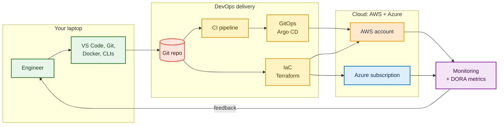
<p align="center"><sub><i>Figure: Big picture – how today's topics fit together</i></sub></p>


<b>Reading the diagram:</b> the engineer works on a laptop with today's tools and pushes changes to a Git repository. From Git, a CI pipeline tests and builds the app, IaC (Terraform) creates cloud infrastructure, and GitOps (Argo CD) deploys the app into AWS or Azure. Monitoring and DORA metrics measure the result and feed back to the engineer, so the loop starts again.

<h3>1. What DevOps Is – Culture and CALMS</h3>

<b>In simple words:</b> DevOps is a way of working where the people who build software (Developers) and the people who run it (Operations) share the same goal, the same tools and the same responsibility. It is a culture, plus a set of practices, plus automation. It is not one tool and not one job title.

> [!NOTE]
> <b>Simple analogy:</b> Think of a restaurant. In a bad restaurant the chefs cook and "throw the plate over the wall" to the waiters, and nobody owns the customer's experience. In a good restaurant, chefs and waiters work as one team, talk all the time and fix problems together. DevOps is the good restaurant.


<b>Why a DevOps Engineer cares:</b>
- US clients hire DevOps consultants because releases are slow, risky or manual. Your job is to make delivery <b>fast and safe at the same time</b>.
- If you only make it fast, production breaks. If you only make it safe, the business waits weeks for features.
- "What is DevOps?" is the first question in almost every interview. A tool list is a weak answer; goal plus culture plus practices is a strong one.

<b>How it works:</b> before DevOps, Dev and Ops had different goals. Dev was measured on new features (change). Ops was measured on stability (no change). This conflict is called the <b>wall of confusion</b>.

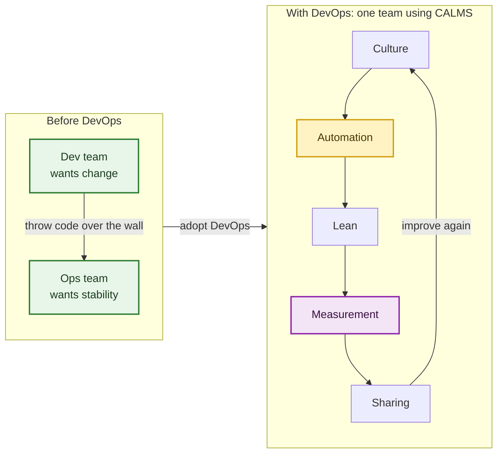
<p align="center"><sub><i>Figure: From the wall of confusion to one DevOps team</i></sub></p>


<b>Reading the diagram:</b> on the left, Dev and Ops are separate teams with opposite goals, and code is "thrown over the wall" with no shared ownership. On the right, one team works through the five CALMS ideas in a cycle: a healthy culture makes automation possible, automation enables small lean batches, measurement shows what works, and sharing spreads it across the team. Then the cycle starts again.

DevOps teams use the <b>CALMS</b> model to check if they are really "doing DevOps":

| Letter | Meaning | What it looks like on a real project |
|---|---|---|
| C | Culture | Blameless post-mortems (find the cause, not the person), shared on-call, "you build it, you run it" |
| A | Automation | Pipelines, Infrastructure as Code, automated tests, no manual server changes |
| L | Lean | Small batches, short-lived branches, remove waiting time and hand-offs |
| M | Measurement | DORA metrics, SLOs, dashboards – decide with data, not opinions |
| S | Sharing | Docs, runbooks, internal demos, reusable modules and templates |

<b>Example:</b> here is automation at its smallest. A manual "check the app is up" step becomes a script that anyone (or any pipeline) can run.

```bash
#!/usr/bin/env bash
# health-check.sh – a manual step turned into automation (the "A" in CALMS)
URL="${1:-https://example.com}"                  # URL to check, default example.com
CODE=$(curl -s -o /dev/null -w "%{http_code}" "$URL")   # get only the HTTP status code
if [ "$CODE" = "200" ]; then
  echo "OK   $URL returned $CODE"
else
  echo "FAIL $URL returned $CODE"
  exit 1                                          # non-zero exit fails a pipeline step
fi
```

<b>Command breakdown:</b>

| Part | What it means |
|---|---|
| `curl` | a tool that sends web (HTTP) requests from the terminal |
| `-s` | silent – hide the progress bar |
| `-o /dev/null` | throw the page body away; we only need the status code |
| `-w "%{http_code}"` | write out only the HTTP status code (200 OK, 404 not found, 500 server error) |
| `CODE=$(...)` | run the command inside `$( )` and save its output in the variable `CODE` |
| `${1:-https://example.com}` | use the first argument; if none is given, use the default URL |
| `exit 1` | end with a failure code; a pipeline step that exits non-zero turns red |

Run it with `bash health-check.sh https://example.com`. Expected output:
```text
OK   https://example.com returned 200
```

> [!IMPORTANT]
> <b>Key point:</b> Interview answer pattern: start with the <b>goal</b> (fast, safe, repeatable delivery), then <b>culture</b> (shared ownership), then <b>practices</b> (CI/CD, IaC, monitoring), and only then the <b>tools</b> you used.


> [!WARNING]
> <b>Common mistake:</b> Common mistake: "DevOps = Jenkins + Docker + Kubernetes." Tools without culture give you an expensive, automated mess. A client with great tools but blame-driven post-mortems is still not doing DevOps.


<h3>2. The SDLC and How DevOps Changes It</h3>

<b>In simple words:</b> the <b>SDLC (Software Development Life Cycle)</b> is the list of stages every change goes through: plan, code, build, test, release, deploy, operate, monitor. DevOps keeps the same stages but runs them in <b>small, fast, automated loops</b> instead of one big slow pass.

> [!NOTE]
> <b>Simple analogy:</b> Waterfall is like sending one huge container ship every three months. If one box is wrong, the whole ship waits. DevOps is like a delivery van that leaves every hour with a few boxes, so a wrong box is found and fixed the same day.


<b>Why a DevOps Engineer cares:</b>
- You build and own the pipeline that moves code through these stages.
- Each stage has tools you will learn in this course (see the table below).
- When something breaks, knowing which stage failed tells you where to look first.

<b>How it works:</b> DevOps draws the SDLC as an infinity loop. It never ends because what you learn from monitoring feeds the next plan.

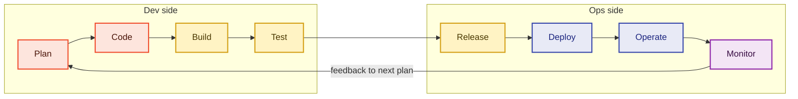
<p align="center"><sub><i>Figure: The DevOps loop – SDLC stages for PeoplePulse</i></sub></p>


<b>Reading the diagram:</b> a change starts on the Dev side (plan, code, build, test) and moves to the Ops side (release, deploy, operate, monitor). The arrow from Monitor back to Plan is the key DevOps idea: what you learn in production decides what you build next. In DevOps this loop runs many times per day, once for each small change.

| Stage | Example tool in this course | PeoplePulse example |
|---|---|---|
| Plan | GitHub Issues, Jira | Ticket: "Add `/records/{id}` endpoint" |
| Code | VS Code, Git | `app/main.py` |
| Build | Docker, Jenkins, GitHub Actions | `docker build -t peoplepulse:0.1.0 .` |
| Test | pytest, ruff, Trivy | Test coverage must be at least 80% |
| Release | Git tags, semantic versions, ECR/ACR | Tag `v0.1.0`, push the image |
| Deploy | Helm, Argo CD, Terraform | `helm upgrade --install peoplepulse` |
| Operate | Kubernetes, AWS, Azure | EKS or AKS cluster |
| Monitor | Prometheus, Grafana, CloudWatch, Azure Monitor | Alert when `/health` fails |

| | Waterfall SDLC | DevOps SDLC |
|---|---|---|
| Batch size | Large: months of changes in one release | Small: one feature or fix per release |
| Release frequency | Every few months | Daily or many times per day |
| Testing | A separate phase at the end | Automated, on every commit |
| Risk per release | High – many changes at once | Low – easy to find what broke |
| Rollback | Painful, often manual | Fast, often one command |
| Feedback | Arrives months later | Arrives in minutes or hours |

<b>Example:</b> small batches are easy to read. Here are the last five commits from a typical DevOps-style week:

```bash
git log --oneline -5      # show the last 5 commits, one line each
```
Expected output (example):
```text
a1c9e3f fix: return 404 for unknown record id
7b2d410 test: add test for /records/{id}
c4e8a21 feat: add /records/{id} endpoint
19f0b7d chore: pin fastapi to 0.115.0
e02a6c3 ci: run pytest on every pull request
```

<b>Command breakdown:</b>

| Part | What it means |
|---|---|
| `git log` | show the commit history of the current branch |
| `--oneline` | one line per commit: short ID + message |
| `-5` | only the last 5 commits |

Each commit is small, has a clear message, and can be reviewed, tested and reverted on its own.

> [!WARNING]
> <b>Common mistake:</b> Common mistake: thinking "waterfall vs DevOps" is about meetings or Agile ceremonies. The real difference is <b>batch size</b> and <b>automation</b>. Many small, automatically tested changes are safer than one big change.


<h3>3. CI vs Continuous Delivery vs Continuous Deployment</h3>

<b>In simple words:</b>
- <b>Continuous Integration (CI):</b> developers merge small changes into the main branch often (at least daily). Every merge automatically builds and tests the code.
- <b>Continuous Delivery:</b> every change that passes CI is <i>ready</i> to go to production. A human clicks "approve" to release it.
- <b>Continuous Deployment:</b> every change that passes all checks goes to production <i>automatically</i>. No human click.

> [!NOTE]
> <b>Simple analogy:</b> CI is a quality check at the factory door: every part is tested as soon as it is made. Continuous Delivery puts the tested product in the shop window, and a manager decides when to sell it. Continuous Deployment sells it the moment it passes the test.


<b>Why a DevOps Engineer cares:</b>
- Building CI/CD pipelines is the most common task in DevOps job descriptions.
- When clients say "CD" they can mean either one. Asking "Delivery or Deployment?" shows you have done this before.
- Regulated US clients (banks, healthcare, insurance) usually need the manual approval step for audit (SOX, HIPAA).

<b>How it works:</b>
```mermaid
flowchart LR
  PUSH[git push] --> L
  subgraph CI["Continuous Integration"]
    L[Lint] --> UT[Unit tests] --> BI[Build image] --> SC[Security scan]
  end
  SC --> ART[("Image v1.4.2")]
  ART --> STG[Deploy to staging]
  STG --> GATE{"Release to<br/>production?"}
  GATE -->|"human approves<br/>= Continuous Delivery"| PROD[Production]
  GATE -->|"automatic<br/>= Continuous Deployment"| PROD
  class PUSH git
  class L,UT,BI,SC cicd
  class ART data
  class STG,PROD app
  class GATE user
  classDef aws fill:#FFE8CC,stroke:#FF9900,stroke-width:2px,color:#232F3E
  classDef azure fill:#DCEEFF,stroke:#0078D4,stroke-width:2px,color:#0B2A4A
  classDef k8s fill:#E3E9FB,stroke:#326CE5,stroke-width:2px,color:#13284F
  classDef git fill:#FDE5DD,stroke:#F05032,stroke-width:2px,color:#4A1408
  classDef cicd fill:#FFF3C4,stroke:#D4A017,stroke-width:2px,color:#4A3800
  classDef user fill:#E8F5E9,stroke:#2E7D32,stroke-width:2px,color:#1B3D1E
  classDef sec fill:#FDE7E7,stroke:#C62828,stroke-width:2px,color:#4A0E0E
  classDef mon fill:#F3E5F5,stroke:#8E24AA,stroke-width:2px,color:#3A0F45
  classDef data fill:#E0F2F1,stroke:#00897B,stroke-width:2px,color:#0B3B36
  classDef linux fill:#F1F1F1,stroke:#424242,stroke-width:2px,color:#212121
  classDef app fill:#E8EAF6,stroke:#3949AB,stroke-width:2px,color:#1A237E
```
<p align="center"><sub><i>Figure: CI vs Continuous Delivery vs Continuous Deployment</i></sub></p>


<b>Reading the diagram:</b> every `git push` runs the CI stages (lint, tests, build, scan) and produces one tested artifact: a container image. The image is deployed to staging automatically. The only difference between the two kinds of CD is the last diamond: with Continuous Delivery a human approves the release, with Continuous Deployment it goes to production with no click.

| | Continuous Integration | Continuous Delivery | Continuous Deployment |
|---|---|---|---|
| What is automated | Build + test on every merge | Build + test + deploy to staging | Everything up to production |
| Production release | Not covered | Manual approval | Automatic |
| Typical client | Every team | Banks, healthcare, government | SaaS start-ups, mature web teams |
| Needs | Good automated tests | CI + reliable deployments | CI + excellent tests + monitoring + fast rollback |

<b>Example:</b> a tiny GitHub Actions CI file (you write the full version on Day 9).
```yaml
# .github/workflows/ci.yml  – preview, Day 9 covers this in depth
name: ci
on: [push, pull_request]            # run on every push and every pull request
jobs:
  test:
    runs-on: ubuntu-24.04
    steps:
      - uses: actions/checkout@v4   # download the repository code
      - uses: actions/setup-python@v5
        with:
          python-version: "3.12"
      - run: pip install -r requirements.txt
      - run: pytest --cov=app --cov-fail-under=80   # quality gate: fail below 80% coverage
```

<b>Command breakdown:</b>

| Part | What it means |
|---|---|
| `pytest` | the Python test runner; finds and runs files named `test_*.py` |
| `--cov=app` | measure how much of the `app` package the tests execute (coverage) |
| `--cov-fail-under=80` | fail the step if coverage is below 80% – this is the quality gate |
| `on: [push, pull_request]` | run the workflow on every push and every pull request |
| `uses: actions/checkout@v4` | a ready-made step pinned to version 4 that downloads the repo code |

Expected output in the GitHub Actions log (last step):
```text
============================= 6 passed in 0.42s ==============================
Required test coverage of 80% reached. Total coverage: 91.30%
```

> [!TIP]
> <b>Pro tip:</b> In interviews, say: "CI is about merging and testing often. Delivery means always releasable with an approval gate. Deployment means no gate." Then ask the client which one they run today.


> [!NOTE]
> <b>Real-world scenario:</b> Real-world scenario: a US health-insurance client uses Continuous Delivery. The pipeline deploys to staging automatically, then a change manager approves the production job in Jenkins or GitHub Environments. The approval record is the audit evidence.


<h3>4. Infrastructure as Code (IaC)</h3>

<b>In simple words:</b> IaC means you describe servers, networks, databases and permissions in <b>text files</b> instead of clicking in a web console. The files live in Git, are reviewed in pull requests, and a tool (like Terraform) creates the real resources from them.

> [!NOTE]
> <b>Simple analogy:</b> Clicking in the console is like cooking from memory: the dish comes out a little different every time. IaC is a written recipe: anyone can follow it and get the same dish, and you can see exactly who changed the recipe and when.


<b>Why a DevOps Engineer cares:</b>
- You can rebuild dev, staging and prod environments in minutes, and they are identical.
- Every change is reviewed in a pull request and recorded in Git history, which is exactly what auditors ask for.
- Terraform is in almost every US Cloud/DevOps job description.
- IaC makes teardown easy, which saves cloud cost (`terraform destroy`).

<b>How it works:</b> you write the <b>desired end state</b>. The tool compares it with what really exists and makes only the needed changes.

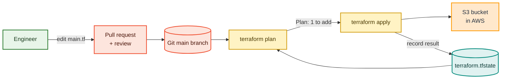
<p align="center"><sub><i>Figure: Infrastructure as Code flow with Terraform</i></sub></p>


<b>Reading the diagram:</b> the engineer changes a `.tf` file and opens a pull request so a teammate can review it. After merge, `terraform plan` compares the code with the state file (Terraform's record of what it created) and shows what will change. `terraform apply` makes the real cloud change and updates the state file, so the next plan knows what already exists.

| Approach | Tool examples | Style |
|---|---|---|
| Declarative provisioning | Terraform, OpenTofu, Bicep, CloudFormation | Describe the <i>end state</i>; the tool works out the steps |
| Configuration management | Ansible, Chef, Puppet | Configure software <i>inside</i> servers |
| Imperative scripts | Bash + AWS CLI or `az` CLI | Step-by-step commands; hard to keep in sync |

<b>Example:</b> a tagged S3 bucket in Terraform (preview of Day 18).
```hcl
# main.tf – "terraform apply" makes reality match this file
resource "aws_s3_bucket" "reports" {
  bucket = "peoplepulse-reports-<your-name>"   # bucket names are globally unique

  tags = {
    owner  = "<your-name>"
    env    = "dev"
    course = "devops-8wk"
  }
}
```

<b>Command breakdown:</b>

| Part | What it means |
|---|---|
| `terraform init` | run once first: downloads the AWS provider plugin |
| `terraform plan` | compare code with real infrastructure and show what <i>would</i> change – changes nothing |
| `+` | in the plan output means "will be created"; `~` means changed, `-` means destroyed |
| `terraform apply` | show the plan again and, after you type `yes`, make the changes |

Expected output of `terraform plan` (shortened):
```text
Terraform will perform the following actions:

  # aws_s3_bucket.reports will be created
  + resource "aws_s3_bucket" "reports" {
      + bucket = "peoplepulse-reports-<your-name>"
      + tags   = {
          + "course" = "devops-8wk"
          + "env"    = "dev"
          + "owner"  = "<your-name>"
        }
    }

Plan: 1 to add, 0 to change, 0 to destroy.
```

> [!WARNING]
> <b>Common mistake:</b> Common mistake: changing a Terraform-managed resource by hand in the console. This is called <b>drift</b>: the real resource no longer matches the code. The next `terraform apply` may undo your fix or fail. Rule on every project: if IaC created it, only IaC changes it.


> [!TIP]
> <b>Pro tip:</b> Always read the `Plan:` line before you type `yes`. "0 to add, 0 to change, 5 to destroy" on a production stack is the kind of mistake a team remembers for years.


<h3>5. GitOps</h3>

<b>In simple words:</b> GitOps uses a Git repository as the <b>single source of truth</b> for what should run in an environment. An agent inside the Kubernetes cluster (Argo CD or Flux) keeps comparing the cluster with Git and fixes any difference. You deploy by merging a pull request, not by running commands from your laptop.

> [!NOTE]
> <b>Simple analogy:</b> Think of a thermostat. You set 72°F (the desired state in Git). The thermostat keeps checking the room (the cluster). If someone opens a window and the room gets cold (drift), it turns the heating on until the room matches 72°F again.


<b>Why a DevOps Engineer cares:</b>
- Every production change is a reviewed pull request, with full history.
- Rollback is just `git revert`, which is quick to do even during an incident at 2 AM.
- The CI system no longer needs admin credentials to production clusters, which security teams like.
- Argo CD appears in many Platform and Kubernetes job descriptions (Day 14 and Day 23).

<b>How it works:</b>
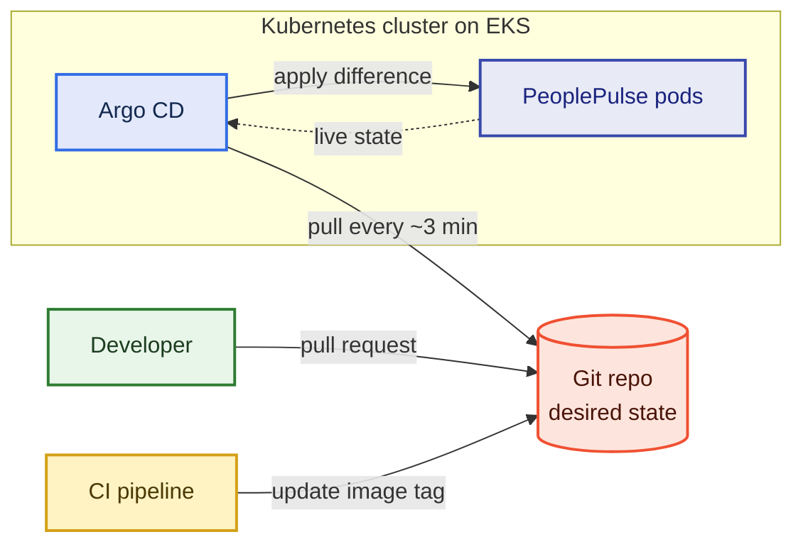
<p align="center"><sub><i>Figure: GitOps pull model with Argo CD</i></sub></p>


<b>Reading the diagram:</b> people and pipelines only ever change the Git repository; nobody pushes into the cluster directly. Argo CD runs <i>inside</i> the cluster, pulls the desired state from Git every few minutes and compares it with the live state of the pods. If they differ, Argo CD applies the difference, which also undoes manual changes (drift).

| | Push-based CD (classic pipeline) | Pull-based GitOps |
|---|---|---|
| Who changes the cluster | The pipeline, from outside | An agent inside the cluster |
| Credentials | Pipeline holds cluster admin credentials | Only the in-cluster agent has access |
| Drift (manual changes) | Stays until the next deploy | Detected and corrected automatically |
| Rollback | Re-run an old pipeline | `git revert` the commit |

<b>Example:</b> an Argo CD `Application` that tells Argo CD what to watch (preview of Day 14).
```yaml
apiVersion: argoproj.io/v1alpha1
kind: Application
metadata:
  name: peoplepulse
  namespace: argocd
spec:
  project: default
  source:
    repoURL: https://github.com/<your-github-user>/peoplepulse.git
    path: helm/peoplepulse          # Helm chart folder in Git
    targetRevision: main            # branch to follow
  destination:
    server: https://kubernetes.default.svc
    namespace: peoplepulse
  syncPolicy:
    automated:
      prune: true                   # delete resources removed from Git
      selfHeal: true                # undo manual changes (drift)
```

<b>Command breakdown:</b>

| Part | What it means |
|---|---|
| `kubectl get applications` | list Argo CD Application objects (a custom Kubernetes resource) |
| `-n argocd` | look in the `argocd` namespace, where Argo CD is installed |
| `Synced` | the cluster matches Git; `OutOfSync` means they differ |
| `Healthy` | the app's pods and services are running correctly |

Expected output of `kubectl get applications -n argocd`:
```text
NAME          SYNC STATUS   HEALTH STATUS
peoplepulse   Synced        Healthy
```

> [!TIP]
> <b>Pro tip:</b> When a client asks "Why Argo CD?", give the security answer: "Our CI no longer needs production credentials, and every change is a reviewed commit."


<h3>6. SRE vs DevOps vs Platform Engineering</h3>

<b>In simple words:</b>
- <b>DevOps</b> is the broad culture and set of practices for shipping fast and safely.
- <b>SRE (Site Reliability Engineering)</b> is Google's way of running production: treat operations as a software problem and manage reliability with numbers (SLIs, SLOs, error budgets).
- <b>Platform Engineering</b> builds an <b>Internal Developer Platform (IDP)</b> (templates, pipelines and self-service tools) so app teams can ship without being infrastructure experts.

New terms, explained:
- <b>SLI (Service Level Indicator):</b> a measurement, e.g. "% of requests that succeed".
- <b>SLO (Service Level Objective):</b> the target for that measurement, e.g. "99.9% of requests succeed over 30 days".
- <b>Error budget:</b> the amount of failure the SLO allows (100% − 99.9% = 0.1%).
- <b>Toil:</b> manual, repetitive work that a script could do.
- <b>Golden path:</b> the recommended, pre-built way to create a new service (template + pipeline + infrastructure).

> [!NOTE]
> <b>Simple analogy:</b> Think of a city. DevOps is the idea that builders and maintainers work together. SRE is the emergency and maintenance department that keeps roads safe and measures accidents. Platform Engineering builds the roads, bus lines and building permits so residents can move around without building their own roads.


<b>Why a DevOps Engineer cares:</b>
- US job titles mix these three words. Knowing the differences helps you read job descriptions and answer interview questions.
- On many projects you will do some of all three: build pipelines (DevOps), join on-call (SRE), and create reusable Terraform modules (Platform).

| | DevOps | SRE | Platform Engineering |
|---|---|---|---|
| Core idea | Culture + practices to ship fast and safe | Reliability as an engineering problem | The platform is a product |
| Main "customer" | The delivery process | End users of the service | Internal developers |
| Key outputs | Pipelines, IaC, automation | SLOs, error budgets, runbooks, post-mortems | Templates, golden paths, portal (e.g. Backstage), modules |
| Typical metrics | DORA metrics | SLO attainment, MTTR, toil % | Onboarding time, template adoption, developer satisfaction |
| Covered in this course | Weeks 1–6 | Day 33 | Day 38 |

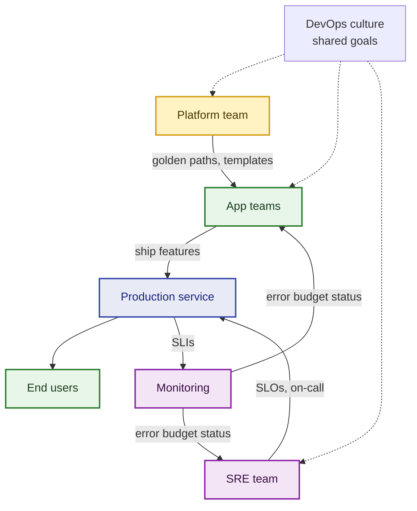
<p align="center"><sub><i>Figure: Who serves whom – DevOps, SRE and Platform Engineering</i></sub></p>


<b>Reading the diagram:</b> DevOps culture (dotted lines) sits above all three groups. The platform team serves the app teams with ready-made golden paths, and the app teams ship features to the production service. The SRE team owns reliability: monitoring turns SLIs into error-budget status, which tells both SRE and app teams whether to keep shipping or fix reliability first.

<b>How it works – the error budget:</b> an SLO of 99.9% over 30 days allows 0.1% downtime, about 43 minutes (the script below works it out). If the team uses up the budget, it pauses feature releases and works on reliability. That replaces "Dev vs Ops" arguments with a simple rule agreed in advance.

<b>Example:</b> calculate an error budget in Python.
```python
# error_budget.py – minutes of downtime allowed in 30 days
MINUTES_IN_30_DAYS = 30 * 24 * 60           # 43,200 minutes

for slo in (99.0, 99.5, 99.9, 99.99):
    budget = MINUTES_IN_30_DAYS * (1 - slo / 100)
    print(f"SLO {slo}% -> {budget:.1f} minutes of downtime allowed")
```
Expected output:
```text
SLO 99.0% -> 432.0 minutes of downtime allowed
SLO 99.5% -> 216.0 minutes of downtime allowed
SLO 99.9% -> 43.2 minutes of downtime allowed
SLO 99.99% -> 4.3 minutes of downtime allowed
```

> [!WARNING]
> <b>Common mistake:</b> Common mistake: saying "SRE is just Ops with a new name." Interviewers want to hear the words SLO, error budget, toil reduction and blameless post-mortem.


<h3>7. DORA Metrics – With a Worked Calculation</h3>

<b>In simple words:</b> DORA (DevOps Research and Assessment) studied thousands of teams and found four metrics that show how good a team is at delivering software. Two measure <b>speed</b> and two measure <b>stability</b>.

> [!NOTE]
> <b>Simple analogy:</b> Think of a pizza delivery shop: how many pizzas you deliver per day (deployment frequency), how long from order to door (lead time), what % arrive wrong (change failure rate), and how fast you fix a wrong order (time to restore). A great shop is fast <i>and</i> accurate.


<b>Why a DevOps Engineer cares:</b>
- Managers and clients judge DevOps work with these numbers.
- They make strong resume lines: "Moved from monthly to daily deployments and cut change failure rate from 30% to 8%."
- At the start of a project, measure them first (the baseline), so you can prove improvement later.

<b>How it works:</b>

| Metric | Type | Question it answers | How to calculate | Elite (approx.) | Low (approx.) |
|---|---|---|---|---|---|
| Deployment frequency | Speed | How often do we ship to production? | Count production deploys per day or week | On demand, many per day | Less than once a month |
| Lead time for changes | Speed | How long from commit to running in production? | Median of (deploy time − commit time) | Less than 1 day | More than 1 month |
| Change failure rate | Stability | What % of deployments cause a failure? | Failed deploys ÷ total deploys | About 0–5% | 40% or more |
| Time to restore service | Stability | How fast do we recover from a failed deploy? | Median of (restored time − deploy time) | Less than 1 hour | More than 1 week |

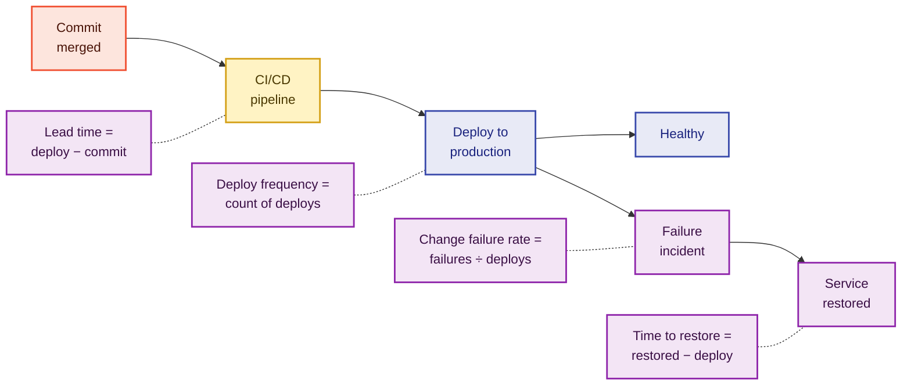
<p align="center"><sub><i>Figure: Where the four DORA metrics are measured</i></sub></p>


<b>Reading the diagram:</b> the top row is the life of one change: commit, pipeline, production deploy, and then either healthy or a failure that must be restored. Each dotted note shows which timestamp or count feeds a DORA metric. Lead time and deploy frequency come from the delivery path (speed); change failure rate and time to restore come from the failure path (stability).

New term: the <b>median</b> is the middle value after sorting. It is better than the average because one very slow deploy does not distort it.

> [!NOTE]
> <b>Real-world scenario:</b> Recent DORA reports call the fourth metric <b>"failed deployment recovery time"</b> and also discuss <b>rework rate</b> and reliability. US clients still mostly say "MTTR" or "time to restore". Learn all the names so none of them catches you out in an interview.


<b>Worked example – step by step.</b> The PeoplePulse team's deployment log for one working week (Monday to Friday):
```text
deploy_id,commit_time,deploy_time,failed,restored_time
d1,2026-11-02 09:00,2026-11-02 15:00,no,
d2,2026-11-03 10:00,2026-11-04 10:00,yes,2026-11-04 11:30
d3,2026-11-04 13:00,2026-11-04 16:00,no,
d4,2026-11-05 08:00,2026-11-05 12:00,no,
d5,2026-11-05 14:00,2026-11-06 10:00,yes,2026-11-06 10:45
d6,2026-11-06 09:00,2026-11-06 13:00,no,
```
1. <b>Deployment frequency</b> = 6 deployments ÷ 5 working days = <b>1.2 per day</b>.
2. <b>Lead time</b> for each row = deploy − commit: d1 6h, d2 24h, d3 3h, d4 4h, d5 20h, d6 4h. Sorted: 3, 4, 4, 6, 20, 24. Six values, so the median is the average of the two middle ones: (4 + 6) ÷ 2 = <b>5 hours</b>. (The average would be 10.2 hours, pulled up by the two slow deploys.)
3. <b>Change failure rate</b> = 2 failed ÷ 6 total = <b>33.3%</b>.
4. <b>Time to restore</b> for failed rows = restored − deploy: d2 1h 30m (90 min), d5 45 min. Median of 90 and 45 = <b>67.5 minutes</b>.

<b>Verdict:</b> speed is good (daily deploys, lead time under a day), but stability is weak (33% failure rate is in the "low" range). The team should improve automated tests before shipping even faster.

<b>Example:</b> the same calculation in Python, so it can run in a pipeline every week.
```python
# dora.py – calculate the four DORA metrics from deployments.csv
import csv
from datetime import datetime
from statistics import median

FMT = "%Y-%m-%d %H:%M"
WORKING_DAYS = 5  # the log covers one working week (Mon-Fri)


def hours_between(start: str, end: str) -> float:
    """Return the number of hours between two timestamps."""
    return (datetime.strptime(end, FMT) - datetime.strptime(start, FMT)).total_seconds() / 3600


with open("deployments.csv", newline="") as f:
    rows = list(csv.DictReader(f))

total = len(rows)
lead_times = [hours_between(r["commit_time"], r["deploy_time"]) for r in rows]
failed = [r for r in rows if r["failed"] == "yes"]
restore_times = [hours_between(r["deploy_time"], r["restored_time"]) for r in failed]

print(f"Deployments:           {total} in {WORKING_DAYS} working days")
print(f"Deployment frequency:  {total / WORKING_DAYS:.1f} per day")
print(f"Lead times (hours):    {sorted(lead_times)}")
print(f"Lead time (median):    {median(lead_times):.1f} hours")
print(f"Change failure rate:   {len(failed)}/{total} = {len(failed) / total:.1%}")
print(f"Time to restore (med): {median(restore_times) * 60:.1f} minutes")
```

<b>Command breakdown:</b>

| Part | What it means |
|---|---|
| `csv.DictReader(f)` | read each CSV row as a dictionary, e.g. `r["deploy_time"]` |
| `datetime.strptime(..., FMT)` | turn text like `2026-11-02 09:00` into a real date-time |
| `.total_seconds() / 3600` | convert the time difference to hours |
| `median(...)` | the middle value after sorting – not distorted by one slow deploy |
| `:.1%` | format a fraction like 0.333 as `33.3%` |

Save the log as `deployments.csv` next to the script and run `python3 dora.py`. Expected output:
```text
Deployments:           6 in 5 working days
Deployment frequency:  1.2 per day
Lead times (hours):    [3.0, 4.0, 4.0, 6.0, 20.0, 24.0]
Lead time (median):    5.0 hours
Change failure rate:   2/6 = 33.3%
Time to restore (med): 67.5 minutes
```

> [!WARNING]
> <b>Common mistake:</b> Common mistake: using DORA metrics to rank or punish individual engineers. People will game the numbers (for example, many tiny meaningless deploys). DORA measures the <i>system</i>: team + pipeline + process.


> [!TIP]
> <b>Pro tip:</b> If a client has no data, you can get a first baseline from Git tags and the CI tool's deployment history in one afternoon. Showing a "before" number in week 1 makes your "after" number much stronger.


---


<h2>9:45 – 10:00 AM · Break</h2>


| Minutes | Activity | Method |
|---|---|---|
| 9:45 – 10:00 | Break. Windows users: start downloading Docker Desktop and enable WSL now to save time in the lab. | Break |

---


<h2>10:00 – 11:15 AM · Concept Session 2 + Live Demo</h2>


| Minutes | Activity | Method |
|---|---|---|
| 10:00 – 10:10 | What cloud computing is; IaaS vs PaaS vs SaaS | Lecture / Whiteboard |
| 10:10 – 10:16 | Regions and Availability Zones | Whiteboard / Live demo |
| 10:16 – 10:23 | Shared responsibility model | Lecture / Discussion |
| 10:23 – 10:31 | Pay-as-you-go pricing and why budgets matter (cost maths) | Lecture / Whiteboard |
| 10:31 – 10:37 | AWS vs Azure at a glance | Lecture |
| 10:37 – 10:45 | US role families and how to read a job description | Discussion |
| 10:45 – 10:50 | A day in the life of a DevOps Engineer | Lecture |
| 10:50 – 11:12 | Live demo: verify toolchain, AWS identity, AWS budget from the CLI, Azure login | Live demo |
| 11:12 – 11:15 | Open questions | Discussion |

<h3>8. Cloud Computing and the Service Models (IaaS, PaaS, SaaS)</h3>

<b>In simple words:</b> cloud computing means renting computers, storage, networks and services over the internet from a provider like AWS or Azure, instead of buying your own hardware. You create resources in minutes and pay only for what you use.

The three main <b>service models</b> describe how much the provider manages for you:
- <b>IaaS (Infrastructure as a Service):</b> you rent virtual machines, disks and networks. You manage the operating system and everything above it. Examples: Amazon EC2, Azure Virtual Machines.
- <b>PaaS (Platform as a Service):</b> you give your code or container; the provider runs the servers and OS. Examples: AWS Elastic Beanstalk, AWS Fargate, Azure App Service.
- <b>SaaS (Software as a Service):</b> you just use finished software in the browser. Examples: GitHub, Microsoft 365, Jira Cloud.

> [!NOTE]
> <b>Simple analogy:</b> Pizza as a service. <b>On-premises</b> = make pizza at home (you buy everything). <b>IaaS</b> = rent a kitchen (you still cook). <b>PaaS</b> = order take-away and eat at home (they cook, you serve). <b>SaaS</b> = eat at the restaurant (they do everything).


<b>Why a DevOps Engineer cares:</b>
- Choosing IaaS vs PaaS changes how much patching, scaling and on-call work your team has.
- Cost and security responsibility change with the model (see the shared responsibility concept next).
- Interviewers often ask "Would you run this on EC2, ECS Fargate or Lambda, and why?"

<b>How it works:</b>
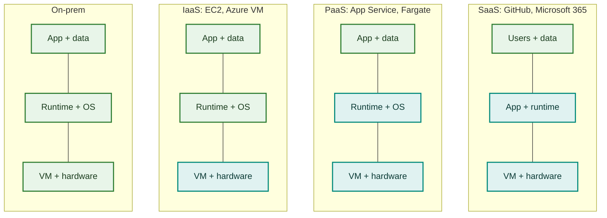
<p align="center"><sub><i>Figure: Who manages what – On-prem, IaaS, PaaS and SaaS</i></sub></p>


<b>Reading the diagram:</b> each column is a service model, with the stack from your app (top) down to the hardware (bottom). Boxes in the "person" colour are what <b>you</b> manage; boxes in the "storage" colour are what the <b>provider</b> manages. As you move left to right, the provider takes over more layers, but your data and your users always stay your responsibility.

| Model | AWS example | Azure example | You manage | Good for |
|---|---|---|---|---|
| IaaS | EC2 | Virtual Machines | OS, patches, runtime, app | Lift-and-shift, full control |
| PaaS / containers | Elastic Beanstalk, ECS Fargate | App Service, Container Apps | Your code or container | Fast delivery, less ops work |
| Serverless functions | Lambda | Azure Functions | Just the function code | Event-driven, spiky traffic |
| SaaS | Amazon WorkMail | Microsoft 365 | Users and data | Standard business tools |

<b>Example:</b> look at an IaaS building block: the size of a small VM on each cloud (read-only commands, free to run).
```bash
# AWS: details of the t3.micro instance type
aws ec2 describe-instance-types --instance-types t3.micro \
  --query "InstanceTypes[].{Type:InstanceType,vCPU:VCpuInfo.DefaultVCpus,MemoryMiB:MemoryInfo.SizeInMiB}" \
  --output table

# Azure: details of the Standard_B1s VM size in East US
az vm list-sizes --location eastus --query "[?name=='Standard_B1s']" --output table
```

<b>Command breakdown:</b>

| Part | What it means |
|---|---|
| `aws ec2 describe-instance-types` | ask EC2 for the details of instance (VM) types; read-only and free |
| `--instance-types t3.micro` | only the `t3.micro` type |
| `--query "InstanceTypes[].{...}"` | JMESPath filter: pick only the fields we want and rename them (Type, vCPU, MemoryMiB) |
| `--output table` | print a readable table instead of JSON |
| `az vm list-sizes --location eastus` | list the VM sizes available in the East US region |
| `--query "[?name=='Standard_B1s']"` | keep only the row whose name is `Standard_B1s` |

Expected output:
```text
---------------------------------
|     DescribeInstanceTypes     |
+------------+-----------+------+
| MemoryMiB  |   Type    | vCPU |
+------------+-----------+------+
|  1024      |  t3.micro |  2   |
+------------+-----------+------+
MaxDataDiskCount    MemoryInMb    Name          NumberOfCores    OsDiskSizeInMb    ResourceDiskSizeInMb
------------------  ------------  ------------  ---------------  ----------------  ----------------------
2                   1024          Standard_B1s  1                1047552           4096
```

> [!TIP]
> <b>Pro tip:</b> Default answer for a new client app: start with the most managed option that meets the requirements (PaaS or containers), and drop to IaaS only when you need control the platform does not give you.


<h3>9. Regions and Availability Zones</h3>

<b>In simple words:</b> a <b>region</b> is a geographic area where a cloud provider has data centers, e.g. `us-east-1` (N. Virginia) on AWS or `eastus` on Azure. An <b>Availability Zone (AZ)</b> is one or more separate data centers inside a region, with its own power, cooling and network. A region usually has several AZs.

> [!NOTE]
> <b>Simple analogy:</b> A region is a city. Availability Zones are separate hospitals in that city, each with its own power generator. If one hospital loses power, the others keep working. If you put all your patients in one hospital, you have no backup.


<b>Why a DevOps Engineer cares:</b>
- High availability: run at least two copies of an app in <b>two or more AZs</b> so one data center failure does not take you down.
- Many "my resources disappeared" problems are just the CLI pointing at the wrong region.
- US clients often require data to stay in US regions (data residency and compliance).
- Data transfer between regions (and sometimes between AZs) costs money.

<b>How it works:</b>
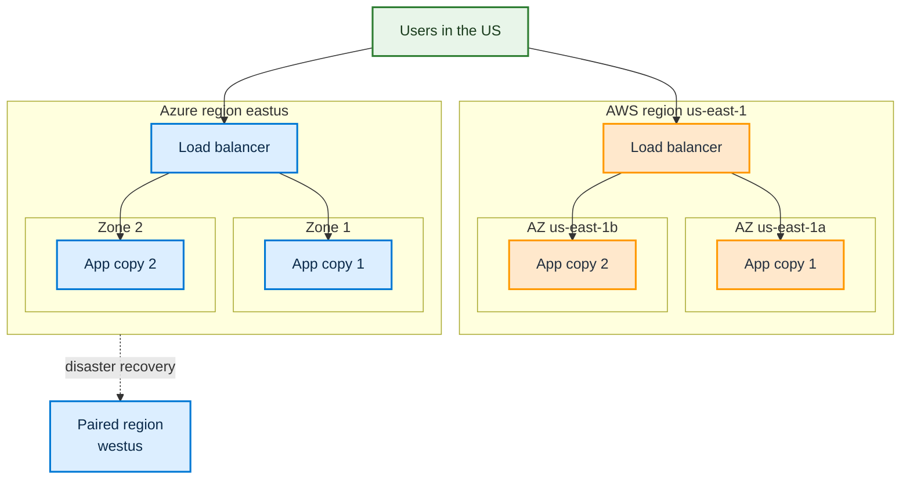
<p align="center"><sub><i>Figure: Regions and Availability Zones on AWS and Azure</i></sub></p>


<b>Reading the diagram:</b> a region is a large box containing several Availability Zones (separate data centers). In each cloud a load balancer spreads users across two copies of the app in two different zones, so losing one data center does not cause an outage. Azure also pairs each region with another one (eastus with westus) for disaster recovery.

<b>Example:</b> list AZs on AWS and see region details on Azure.
```bash
aws ec2 describe-availability-zones --region us-east-1 \
  --query "AvailabilityZones[].ZoneName" --output text

az account list-locations \
  --query "[?name=='eastus'].{Name:name, Display:displayName, Paired:metadata.pairedRegion[0].name}" \
  --output table
```

<b>Command breakdown:</b>

| Part | What it means |
|---|---|
| `aws ec2 describe-availability-zones` | list the Availability Zones you can use |
| `--region us-east-1` | ask about N. Virginia, whatever your default region is |
| `--query "AvailabilityZones[].ZoneName"` | return only the zone names |
| `--output text` | print plain text separated by tabs – easy to use in scripts |
| `az account list-locations` | list all Azure regions |
| `metadata.pairedRegion[0].name` | the first paired region, used for disaster recovery |

Expected output:
```text
us-east-1a	us-east-1b	us-east-1c	us-east-1d	us-east-1e	us-east-1f
Name    Display    Paired
------  ---------  --------
eastus  East US    westus
```

> [!WARNING]
> <b>Common mistake:</b> Common mistake: "I created an EC2 instance but it is gone!" It is not gone. Your console or CLI is pointing at a different region. Always check the region selector (top-right in the AWS console) and `aws configure get region`. In this course we use `us-east-1` on AWS and `eastus` on Azure.


<h3>10. The Shared Responsibility Model</h3>

<b>In simple words:</b> security in the cloud is shared. The provider secures the <b>cloud itself</b> (buildings, hardware, the physical network, the hypervisor). You secure <b>what you put in the cloud</b> (users, passwords, MFA, data, network rules, patches on your VMs).

> [!NOTE]
> <b>Simple analogy:</b> Think of renting an apartment. The landlord is responsible for the building's walls, roof and main door lock. You are responsible for locking your own apartment door and not giving the key to strangers. If you leave your door open, the landlord is not to blame.


<b>Why a DevOps Engineer cares:</b>
- Most cloud breaches are customer mistakes: public storage buckets, leaked access keys, no MFA, open security groups.
- As the DevOps engineer, <i>you</i> configure most of the customer side: IAM, networks, encryption and patching.
- Security interviews often start with "Explain the shared responsibility model."

<b>How it works:</b> the split moves with the service model. The more managed the service, the more the provider does.

| Responsibility | IaaS (EC2 / Azure VM) | PaaS (App Service / Fargate) | SaaS (Microsoft 365) |
|---|---|---|---|
| Physical data center, hardware | Provider | Provider | Provider |
| OS patching | <b>You</b> | Provider | Provider |
| Network rules (security groups / NSGs) | <b>You</b> | <b>You</b> (mostly) | Provider |
| Identity, MFA, access keys | <b>You</b> | <b>You</b> | <b>You</b> |
| Your data and its encryption settings | <b>You</b> | <b>You</b> | <b>You</b> |

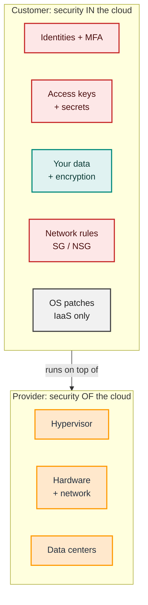
<p align="center"><sub><i>Figure: Shared responsibility – security IN the cloud vs OF the cloud</i></sub></p>


<b>Reading the diagram:</b> the bottom box is what AWS or Azure protect for you: buildings, hardware and the hypervisor. Everything in the top box is your job, and it runs on top of the provider's layer. Most real breaches happen in the top box: a missing MFA, a leaked key, an open network rule or a public storage bucket.

<b>Example:</b> check one item on the customer side: is MFA turned on for the AWS root user?
```bash
# 1 = root user has MFA, 0 = root user has NO MFA (fix this today)
aws iam get-account-summary --query "SummaryMap.AccountMFAEnabled"
```

<b>Command breakdown:</b>

| Part | What it means |
|---|---|
| `aws iam get-account-summary` | return counts and flags for the whole account (users, roles, MFA…) |
| `--query "SummaryMap.AccountMFAEnabled"` | pick only the root-MFA flag |
| `1` / `0` | 1 = root MFA on; 0 = root MFA off – a security finding to fix today |

Expected output (after today's lab):
```text
1
```

> [!CAUTION]
> <b>Cost / security alert:</b> Never paste access keys into code, chat, screenshots or Git. Bots scan public GitHub repos and can start using a leaked AWS key within minutes, often to run expensive crypto-mining servers on <i>your</i> bill.


<h3>11. Pay-As-You-Go Pricing and Why Budgets Matter</h3>

<b>In simple words:</b> in the cloud you pay for what you use, usually per second, per hour or per GB. There is no big upfront cost, but there is also <b>no automatic stop</b>. A resource you forget keeps billing every hour until you delete it.

> [!NOTE]
> <b>Simple analogy:</b> It is like a taxi meter. The meter runs while the taxi waits for you, even if you are not inside. Forgetting a cloud resource is like leaving a taxi waiting outside all month.


<b>Why a DevOps Engineer cares:</b>
- Cost is a real part of the job (FinOps, Day 35). Clients notice when the AWS bill doubles.
- In training, one forgotten resource can cost more than your whole month's budget.
- Budget alerts are your early-warning system; teardown at the end of each lab is your real protection.

<b>How it works:</b> small hourly prices add up because a month has about 730 hours.

| Forgotten resource (approx. us-east-1 on-demand price) | Per hour | Per month (730 h) |
|---|---|---|
| EC2 t3.micro VM | $0.0104 | about $7.59 |
| NAT Gateway (before data charges) | $0.045 | about $32.85 |
| EKS cluster control plane | $0.10 | about $73.00 |
| Azure AKS / VM nodes left running (2 x small VMs) | about $0.04 | about $30.00 |

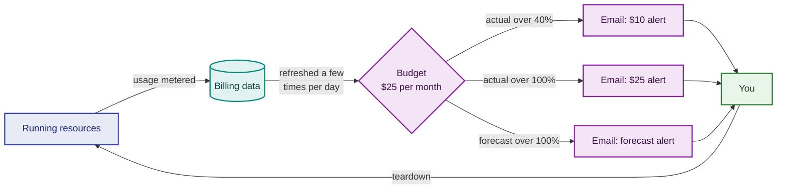
<p align="center"><sub><i>Figure: How a budget alert reaches you</i></sub></p>


<b>Reading the diagram:</b> every running resource produces usage that the cloud adds to your billing data, which is refreshed a few times per day (not in real time). The budget compares that data with your $25 limit and emails you when a threshold is crossed. The loop only closes when <b>you</b> act and delete resources. The budget itself never stops anything.

Prices change and differ by region, so always check the official AWS and Azure pricing pages. These numbers show the <i>pattern</i>, not exact quotes.

<b>Free offers (check the current terms when you sign up):</b> new AWS accounts get a Free Tier with credits for a limited time; new Azure accounts get a credit for the first 30 days plus some services free for 12 months. Credits run out, and after that your budget alerts are the only early warning you get.

<b>Example:</b> quick cost maths in Python, then check month-to-date AWS cost.
```python
# monthly_cost.py – what does a forgotten resource cost?
HOURS_PER_MONTH = 730
for name, hourly in [("t3.micro", 0.0104), ("NAT Gateway", 0.045), ("EKS control plane", 0.10)]:
    print(f"{name:<18} ${hourly * HOURS_PER_MONTH:6.2f} per month")
```
Expected output:
```text
t3.micro           $  7.59 per month
NAT Gateway        $ 32.85 per month
EKS control plane  $ 73.00 per month
```
```bash
# Month-to-date cost from AWS Cost Explorer (enable Cost Explorer once in the console first)
aws ce get-cost-and-usage \
  --time-period Start=2026-11-01,End=2026-11-09 \
  --granularity MONTHLY --metrics UnblendedCost \
  --query "ResultsByTime[].Total.UnblendedCost" --output table
```

<b>Command breakdown:</b>

| Part | What it means |
|---|---|
| `aws ce get-cost-and-usage` | query AWS Cost Explorer for cost data (each call costs about $0.01) |
| `--time-period Start=...,End=...` | date range; `End` is exclusive (not included) |
| `--granularity MONTHLY` | one total per month (other options: `DAILY`, `HOURLY`) |
| `--metrics UnblendedCost` | the actual cost you are charged, before discounts are spread |
| `--query "ResultsByTime[].Total.UnblendedCost"` | keep only the amount and currency |

Expected output (a new account):
```text
-------------------------
|    GetCostAndUsage    |
+---------------+-------+
|    Amount     | Unit  |
+---------------+-------+
|  0.0000000001 |  USD  |
+---------------+-------+
```

> [!WARNING]
> <b>Common mistake:</b> Common mistake: believing a budget <i>stops</i> spending. Budgets only <b>send alerts</b>. You still must delete resources at the end of each lab. Every cloud lab in this course ends with a teardown step.


> [!CAUTION]
> <b>Cost / security alert:</b> Each Cost Explorer API call costs about $0.01. Do not put `aws ce get-cost-and-usage` in a loop or a script that runs every minute.


<h3>12. AWS vs Azure at a Glance</h3>

<b>In simple words:</b> AWS and Azure offer very similar building blocks with different names. Learn the concept once, then map the names. AWS is our primary cloud in this course; Azure is the secondary cloud (Week 6).

> [!NOTE]
> <b>Simple analogy:</b> Think of two supermarket chains. Both sell milk, bread and eggs, but the aisles and brand names are different. Once you know what you need, you can shop in either store.


<b>Why a DevOps Engineer cares:</b>
- Many US clients are "AWS shops" or "Azure shops"; large enterprises often use both.
- Being able to say "Azure's equivalent of an AWS VPC is a VNet" shows multi-cloud experience in interviews.
- Microsoft-heavy enterprises (Active Directory, Office 365, .NET) often choose Azure.

<b>How it works:</b> the biggest structural difference is how resources are organized.
```text
  AWS                                        Azure
  Organization                               Entra ID tenant
   └─ Account (billing + security boundary)   └─ Management group
       └─ Region                                  └─ Subscription (billing boundary)
           └─ Resources (tagged)                      └─ Resource group (lifecycle folder)
                                                          └─ Resources (tagged, in a region)
```

| Concept | AWS | Azure |
|---|---|---|
| Identity and access | IAM, IAM Identity Center | Microsoft Entra ID, Azure RBAC |
| Billing boundary | Account | Subscription |
| Group resources together | Tags (and accounts) | Resource groups + tags |
| Virtual machine | EC2 | Virtual Machines |
| Private network | VPC | Virtual Network (VNet) |
| Firewall rules on a VM/NIC | Security Group | Network Security Group (NSG) |
| Object storage | S3 | Blob Storage |
| Managed SQL database | RDS | Azure SQL / Azure Database for PostgreSQL |
| Container registry | ECR | ACR |
| Managed Kubernetes | EKS | AKS |
| Serverless functions | Lambda | Azure Functions |
| Monitoring | CloudWatch | Azure Monitor |
| Native IaC | CloudFormation | Bicep / ARM templates |
| CI/CD service | CodePipeline (most clients use GitHub Actions or Jenkins) | Azure DevOps Pipelines |
| Budgets | AWS Budgets | Cost Management budgets |
| CLI | `aws` (AWS CLI v2) | `az` (Azure CLI) |

<b>Example:</b> "who am I and where am I?" on each cloud. Run this first on any new project.
```bash
aws sts get-caller-identity      # AWS: which account and identity am I using?
az account show --query "{subscription:name, user:user.name, state:state}" --output table
```
Expected output:
```text
{
    "UserId": "AIDAEXAMPLE123456789",
    "Account": "<ACCOUNT_ID>",
    "Arn": "arn:aws:iam::<ACCOUNT_ID>:user/<your-name>-admin"
}
Subscription          User             State
--------------------  ---------------  -------
Azure subscription 1  you@example.com  Enabled
```


<b>Command breakdown:</b>

| Part | What it means |
|---|---|
| `aws sts get-caller-identity` | ask AWS STS (Security Token Service) which identity your credentials belong to; works even with zero permissions |
| `az account show` | show the Azure subscription the CLI is currently using |
| `--query "{subscription:name, user:user.name, state:state}"` | build a small object with three renamed fields |
| `--output table` | print it as a table |

> [!TIP]
> <b>Pro tip:</b> Run the "who am I" command before every change on a client project. Deploying to the wrong account or subscription is one of the most common (and most embarrassing) incidents.


<h3>13. US Role Families – Where You Fit</h3>

<b>In simple words:</b> US companies use many job titles for similar work. They fall into five families: DevOps, Cloud/Infrastructure, Platform, SRE/AIOps and AI Infrastructure. Knowing the family behind a title helps you tailor your resume and prepare for the interview.

> [!NOTE]
> <b>Simple analogy:</b> Think of doctors: a general physician, a surgeon and an emergency doctor all studied medicine, but their daily work is different. All these roles share the same DevOps foundation, but focus on different parts of it.


<b>Why a DevOps Engineer cares:</b>
- As a consultant (C2C or W2) you will be submitted to roles with different titles, so you need to know what each one really expects.
- Your resume should highlight the skills each family asks for.
- Only list tools you can demo. Interviewers pick any line on your resume and keep asking follow-up questions about it.

<b>How it works:</b>

| Role family | Common US titles | Day-to-day work | Core skills from this course |
|---|---|---|---|
| DevOps | DevOps Engineer, Build & Release Engineer, CI/CD Engineer | Pipelines, Docker, deployments, scripting | Weeks 1–3, Jenkins, GitHub Actions, Azure DevOps |
| Cloud / Infra | Cloud Engineer, AWS/Azure Engineer, Infrastructure Engineer, Cloud Architect | Networks, IAM, compute, Terraform, landing zones | Weeks 4–6, Terraform, AWS, Azure |
| Platform | Platform Engineer, Kubernetes Engineer, Developer Experience Engineer | Kubernetes clusters, Helm, GitOps, golden paths, IDP | Week 3, EKS/AKS, Argo CD, Day 38 |
| SRE / AIOps | Site Reliability Engineer, Production Engineer, Observability Engineer | SLOs, on-call, incident response, monitoring, automation | Prometheus/Grafana, CloudWatch, Azure Monitor, Days 33 and 36 |
| AI Infra | MLOps Engineer, AI Platform Engineer, LLMOps Engineer | GPU clusters, model serving, vector databases, AI pipelines | Days 36–37 on top of Kubernetes + cloud |

<b>C2C vs W2 (quick context):</b> on <b>W2</b> you are an employee of the consulting firm (taxes withheld, benefits). On <b>C2C</b> (corp-to-corp) your own company invoices the vendor. Either way, the client expects you to be productive in the first weeks. That is why this program is so hands-on.

<b>Example:</b> decode a real-style job description into a role family and a study list.
```text
Job title:  Senior Cloud Engineer (Remote, US)
Must have:  AWS (VPC, EC2, EKS, IAM), Terraform modules, GitHub Actions,
            Python or Bash scripting, Linux troubleshooting
Nice:       Azure, Argo CD, Prometheus/Grafana, on-call experience
```
Expected analysis (what you write in your notes):
```text
Role family:   Cloud / Infra (with Platform flavour: EKS, Argo CD)
Course days:   2-3 (Linux, Bash), 9 (GitHub Actions), 16-23 (AWS), 18-19 (Terraform), 22 (EKS)
Resume story:  "Built EKS + RDS with Terraform isolated stacks, deployed via Argo CD" (Mini Project 3)
```

> [!WARNING]
> <b>Common mistake:</b> Common mistake: putting every tool you have heard of on your resume. One "Kubernetes" line you cannot explain costs more than ten lines you can. This program gives you real projects to talk about, so use them.


<h3>14. A Day in the Life of a DevOps Engineer</h3>

<b>In simple words:</b> a DevOps Engineer on a US client project spends the day keeping pipelines and environments healthy, delivering infrastructure and automation tickets, helping developers, and sometimes responding to incidents.

> [!NOTE]
> <b>Simple analogy:</b> Think of an airport ground crew: they check planes before departure (health checks), keep the runways clear (pipelines), help pilots with problems (developer support) and react fast when something goes wrong (incidents).


<b>Why a DevOps Engineer cares:</b>
- Knowing the daily rhythm helps you answer "Walk me through a typical day in your last role", which comes up in a lot of interviews.
- Our daily schedule (stand-up, build, review, commit, report) is designed to copy this rhythm.

<b>How it works – a typical day (US Eastern time, remote consultant):</b>

| Time | What happens |
|---|---|
| 8:30 AM | Check alerts, dashboards and overnight pipeline failures |
| 9:30 AM | Daily stand-up (15 min): yesterday, today, blockers |
| 10:00 AM | Sprint ticket: e.g. "Add a Terraform module for an S3 bucket with encryption" |
| 12:00 PM | Review teammates' pull requests (Terraform plans, pipeline changes) |
| 1:00 PM | Lunch |
| 2:00 PM | Help a developer whose build fails ("works on my laptop") |
| 3:00 PM | Change window: deploy a release through the pipeline, watch metrics |
| 4:30 PM | Update the runbook or wiki, update the Jira ticket |
| 5:00 PM | Hand over to the next on-call engineer (if on a rotation) |

<b>Example:</b> the "morning health check" commands you will be able to run from Week 3 onward.
```bash
kubectl get pods -n peoplepulse                      # are all app pods running?
aws cloudwatch describe-alarms --state-value ALARM \
  --query "MetricAlarms[].AlarmName" --output text   # any alarms firing right now?
```
Expected output (a healthy morning):
```text
NAME                           READY   STATUS    RESTARTS   AGE
peoplepulse-7c9d8f6b5d-4xk2p   1/1     Running   0          2d
peoplepulse-7c9d8f6b5d-9hq7m   1/1     Running   0          2d
```

<b>Command breakdown:</b>

| Part | What it means |
|---|---|
| `kubectl get pods` | list pods (running containers) in Kubernetes |
| `-n peoplepulse` | in the `peoplepulse` namespace |
| `READY 1/1` | 1 of 1 containers in the pod is ready |
| `aws cloudwatch describe-alarms` | list CloudWatch alarms |
| `--state-value ALARM` | only alarms that are firing right now (not `OK` or `INSUFFICIENT_DATA`) |

(The CloudWatch command prints nothing, which means no alarms are firing.)

> [!NOTE]
> <b>Real-world scenario:</b> Real-world scenario: many US clients have an on-call rotation (one week every 4–6 weeks). You carry a pager app (PagerDuty or Opsgenie), and if production breaks at night, you follow the runbook. Ask about on-call expectations before accepting a role.


<h3>Live Demo: Verify the Toolchain, Check Identities and Create an AWS Budget from the CLI</h3>

The trainer runs these steps on a laptop that already has the tools installed. Watch now; you repeat every step yourself in the lab.

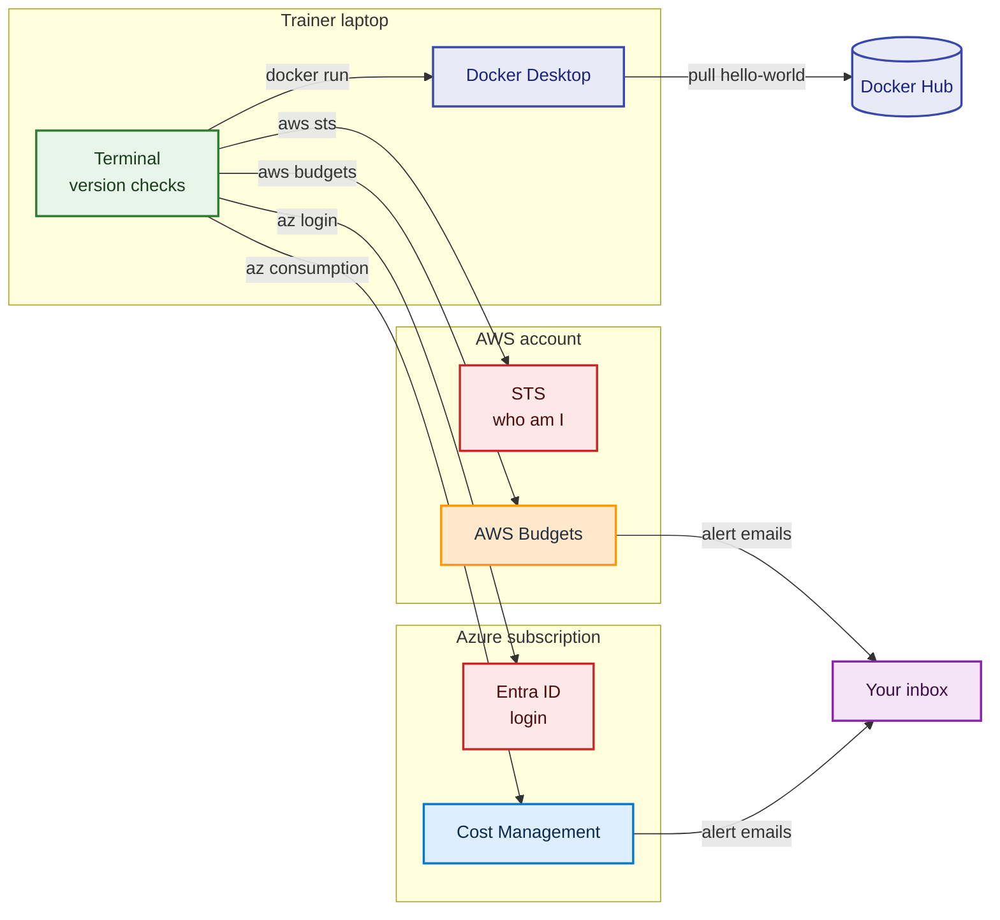
<p align="center"><sub><i>Figure: Live demo – what the trainer runs and where it goes</i></sub></p>


<b>Reading the diagram:</b> everything starts in the trainer's terminal. Docker Desktop pulls a tiny test image from Docker Hub to prove containers run. The AWS CLI asks STS "who am I?" and creates a budget; the Azure CLI logs in through Entra ID and reads budgets from Cost Management. Both budgets send alert emails to your inbox.

1. Check every tool's version in one go:
```bash
git --version
python3 --version              # macOS with Homebrew: python3.12 --version
docker --version
docker compose version
kubectl version --client
terraform version
aws --version
az version --output table
code --version
```
Expected output (your versions should be equal to or newer than these):
```text
git version 2.47.1
Python 3.12.7
Docker version 28.5.1, build e180ab8
Docker Compose version v2.40.0
Client Version: v1.34.1
Kustomize Version: v5.7.1
Terraform v1.13.4
on linux_amd64
aws-cli/2.31.20 Python/3.13.7 Linux/6.8.0 exe/x86_64.ubuntu.24
Azure-cli    Azure-cli-core    Azure-cli-telemetry
-----------  ----------------  ---------------------
2.78.0       2.78.0            1.1.0
1.105.1
e0e9ec3a2d0bf3e8f1d8c2f0b4a9a6c5d3e7f812
x64
```


<b>Command breakdown:</b>

| Part | What it means |
|---|---|
| `--version` | most tools print their version with this flag |
| `docker compose version` | Compose v2 is a Docker plugin, so it is two words with a space, not `docker-compose` |
| `kubectl version --client` | show only the local kubectl version; without `--client` it also tries to reach a cluster and prints an error |
| `az version --output table` | Azure CLI versions as a table |
| `code --version` | VS Code version, commit ID and CPU architecture (3 lines) |

2. Prove Docker can actually run containers (not just that the CLI is installed):
```bash
docker run --rm hello-world
```
Expected output (first lines):
```text
Hello from Docker!
This message shows that your installation appears to be working correctly.
```


<b>Command breakdown:</b>

| Part | What it means |
|---|---|
| `docker run` | create and start a container from an image |
| `--rm` | delete the container automatically when it exits, so stopped containers do not pile up |
| `hello-world` | a tiny official test image; Docker downloads it from Docker Hub the first time |

3. Log in to AWS with a non-root admin identity and confirm who you are:
```bash
aws configure sso          # if your account uses IAM Identity Center (recommended)
# or: aws configure        # access key of an IAM user (lab only, never root keys)
aws sts get-caller-identity
```
Expected output:
```json
{
    "UserId": "AIDAEXAMPLE123456789",
    "Account": "<ACCOUNT_ID>",
    "Arn": "arn:aws:iam::<ACCOUNT_ID>:user/<your-name>-admin"
}
```


<b>Command breakdown:</b>

| Part | What it means |
|---|---|
| `aws configure sso` | interactive setup for IAM Identity Center: asks for your start URL and region, opens a browser to log in, and saves a named profile |
| `aws configure` | saves an access key ID, secret key, region and output format in `~/.aws/credentials` and `~/.aws/config` |
| `aws sts get-caller-identity` | prints the account and identity in use; if the ARN ends in `:root`, stop and switch identity |

4. Create a $25 monthly budget with alerts at $10 (40%), $25 (100%) and a forecast alert:
```bash
ACCOUNT_ID=$(aws sts get-caller-identity --query Account --output text)

cat > budget.json <<'EOF'
{
  "BudgetName": "devops-8wk-monthly",
  "BudgetLimit": { "Amount": "25", "Unit": "USD" },
  "TimeUnit": "MONTHLY",
  "BudgetType": "COST"
}
EOF

cat > notifications.json <<'EOF'
[
  {
    "Notification": { "NotificationType": "ACTUAL", "ComparisonOperator": "GREATER_THAN",
                      "Threshold": 40, "ThresholdType": "PERCENTAGE" },
    "Subscribers": [ { "SubscriptionType": "EMAIL", "Address": "you@example.com" } ]
  },
  {
    "Notification": { "NotificationType": "ACTUAL", "ComparisonOperator": "GREATER_THAN",
                      "Threshold": 100, "ThresholdType": "PERCENTAGE" },
    "Subscribers": [ { "SubscriptionType": "EMAIL", "Address": "you@example.com" } ]
  },
  {
    "Notification": { "NotificationType": "FORECASTED", "ComparisonOperator": "GREATER_THAN",
                      "Threshold": 100, "ThresholdType": "PERCENTAGE" },
    "Subscribers": [ { "SubscriptionType": "EMAIL", "Address": "you@example.com" } ]
  }
]
EOF

aws budgets create-budget \
  --account-id "$ACCOUNT_ID" \
  --budget file://budget.json \
  --notifications-with-subscribers file://notifications.json
```
Replace `you@example.com` with your real email. No output means success.

<b>Command breakdown:</b>

| Part | What it means |
|---|---|
| `ACCOUNT_ID=$(...)` | run the command and save the 12-digit account ID in a shell variable |
| `--query Account --output text` | return only the account number as plain text, without quotes |
| `cat > budget.json <<'EOF'` | write the following lines into `budget.json` until the line `EOF`; the quotes stop the shell from changing `$` signs |
| `"TimeUnit": "MONTHLY"` | the budget resets every month |
| `"BudgetType": "COST"` | track money spent (other types track usage or savings plans) |

<b>Command breakdown:</b>

| Part | What it means |
|---|---|
| `"NotificationType": "ACTUAL"` | alert on money already spent |
| `"NotificationType": "FORECASTED"` | alert when AWS predicts you <i>will</i> go over by month end |
| `"Threshold": 40` + `PERCENTAGE` | 40% of $25 = $10 |
| `"SubscriptionType": "EMAIL"` | send the alert by email (SNS is the other option) |

<b>Command breakdown:</b>

| Part | What it means |
|---|---|
| `aws budgets create-budget` | create the budget and its alerts in one call |
| `--account-id "$ACCOUNT_ID"` | which account the budget belongs to (required) |
| `--budget file://budget.json` | read the budget settings from the local file; forgetting `file://` gives a JSON parse error |
| `--notifications-with-subscribers file://notifications.json` | attach the three alerts and their email subscribers |


5. Verify the budget exists:
```bash
aws budgets describe-budgets --account-id "$ACCOUNT_ID" \
  --query "Budgets[].{Name:BudgetName,Limit:BudgetLimit.Amount,Unit:BudgetLimit.Unit}" \
  --output table
```
Expected output:
```text
-------------------------------------------
|             DescribeBudgets             |
+--------+----------------------+---------+
|  Limit |        Name          |  Unit   |
+--------+----------------------+---------+
|  25.0  |  devops-8wk-monthly  |  USD    |
+--------+----------------------+---------+
```


<b>Command breakdown:</b>

| Part | What it means |
|---|---|
| `aws budgets describe-budgets` | list all budgets in the account |
| `--query "Budgets[].{Name:...,Limit:...,Unit:...}"` | for every budget, show only its name, limit amount and currency |
| `BudgetLimit.Amount` | a nested field: the `Amount` inside `BudgetLimit` |

6. Azure: log in, confirm the subscription, and list budgets (the Azure budget with alert rules is created in the portal during the lab):
```bash
az login                        # opens a browser; on WSL use: az login --use-device-code
az account show --query "{name:name, state:state}" --output table
az consumption budget list --query "[].{name:name, amount:amount, grain:timeGrain}" --output table
```
Expected output (after the lab):
```text
Name                  State
--------------------  -------
Azure subscription 1  Enabled
Name                Amount    Grain
------------------  --------  -------
devops-8wk-monthly  25.0      Monthly
```


<b>Command breakdown:</b>

| Part | What it means |
|---|---|
| `az login` | sign in to Azure; opens your browser and stores a token locally |
| `--use-device-code` | prints a code to type at microsoft.com/devicelogin – use it on WSL or servers without a browser |
| `az consumption budget list` | list budgets on the current subscription |
| `timeGrain` | how often the budget resets: `Monthly`, `Quarterly` or `Annually` |

> [!TIP]
> <b>Pro tip:</b> AWS sends a confirmation email for budget alerts only when a threshold is crossed. To be sure alerts reach you, check your spam folder and add `no-reply@` AWS and Microsoft senders to your safe list.


---


<h2>11:15 AM – 12:15 PM · Q&A, Live Quiz & Lab Briefing</h2>


| Minutes | Activity | Method |
|---|---|---|
| 11:15 – 11:35 | Interview-style Q&A: trainer asks, 2–3 trainees answer, trainer gives the model answer | Discussion |
| 11:35 – 11:50 | Live quiz (10 questions) | Quiz |
| 11:50 – 11:55 | Go through the quiz answers that most people missed | Discussion |
| 11:55 – 12:10 | Lab briefing: tasks, acceptance criteria, time-boxes, how to ask for help | Lecture |
| 12:10 – 12:15 | Final questions before lunch | Discussion |

<h3>Interview-style Q&A</h3>


<h4>Q1. "What is DevOps, in your own words?"</h4>

DevOps is a culture and set of practices that lets one team deliver software quickly <i>and</i> safely. We work in small batches, automate build, test, infrastructure and deployment, and measure results with metrics like DORA. On my last project that meant a CI/CD pipeline with automated tests and Terraform-managed environments, so we could deploy daily instead of monthly.

<h4>Q2. "What is the difference between Continuous Delivery and Continuous Deployment?"</h4>

Both build and test every change automatically. With Continuous Delivery every passing change is releasable, but a person approves the production release. With Continuous Deployment it goes to production automatically. Regulated clients usually choose Delivery for the audit trail.

<h4>Q3. "Which metrics would you use to show your DevOps work is improving things?"</h4>

The four DORA metrics: deployment frequency and lead time for changes for speed; change failure rate and time to restore for stability. I baseline them first, then report the trend every sprint.

<h4>Q4. "How is SRE different from DevOps?"</h4>

DevOps is the broad culture. SRE is a concrete way to implement it with a focus on reliability: define SLIs and SLOs, use error budgets to balance features against stability, run blameless post-mortems and keep toil low with automation.

<h4>Q5. "What is GitOps and why would you use it?"</h4>

Git is the single source of truth for the desired state, and an agent like Argo CD pulls and reconciles the cluster to match. Benefits: every change is a reviewed PR, rollback is a `git revert`, drift is corrected automatically, and the CI system does not need production credentials.

<h4>Q6. "Explain the shared responsibility model."</h4>

The cloud provider secures the cloud itself: data centers, hardware and the hypervisor. The customer secures what they put in the cloud: identities and MFA, data, network rules and, for IaaS, OS patching. The more managed the service, the more the provider handles, but identity and data are always the customer's job.

<h4>Q7. "You get access to a new AWS account. What do you do first?"</h4>

Enable MFA on root and lock the root user away, create a non-root admin through IAM Identity Center, set up budgets and billing alerts, confirm CloudTrail is on, and check I am in the right account and region with `aws sts get-caller-identity` and `aws configure get region`.

<h4>Q8. "Why would you put an application in more than one Availability Zone?"</h4>

Each AZ is a separate data center with its own power and network. Running copies in two or three AZs behind a load balancer means one data center failure does not cause an outage. It costs a little more, so we match it to the SLO.

<h3>Live Quiz (10 questions)</h3>


<b>Q1.</b> Which DORA metric measures stability?
- A) Deployment frequency
- B) Lead time for changes
- C) Change failure rate
- D) Number of commits

<b>Q2.</b> True or false: an AWS budget automatically stops your resources when the limit is reached.
- A) True
- B) False

<b>Q3.</b> A team deploys 20 times in a month and 3 deployments caused incidents. What is the change failure rate?
- A) 3%
- B) 6.7%
- C) 15%
- D) 20%

<b>Q4.</b> In GitOps, what applies changes to the cluster?
- A) The developer's laptop
- B) The CI pipeline with admin credentials
- C) An in-cluster agent like Argo CD that pulls from Git
- D) The cloud provider

<b>Q5.</b> What does the "A" in CALMS stand for?
- A) Agile
- B) Automation
- C) Availability
- D) Architecture

<b>Q6.</b> An SLO is 99.9% over 30 days. Roughly how many minutes of downtime does the error budget allow?
- A) 4.3
- B) 43.2
- C) 432
- D) 0.43

<b>Q7.</b> In the shared responsibility model, who patches the operating system of an EC2 instance?
- A) AWS
- B) The customer
- C) Nobody – EC2 patches itself
- D) The Availability Zone

<b>Q8.</b> What does this command output when it works: `aws sts get-caller-identity`?
- A) A list of S3 buckets
- B) Your account ID, user ID and ARN
- C) Your monthly bill
- D) The CLI version

<b>Q9.</b> Which Azure concept is closest to an AWS account as a billing boundary?
- A) Resource group
- B) Subscription
- C) Availability Zone
- D) VNet

<b>Q10.</b> Changing a Terraform-managed resource by hand in the console creates:
- A) A pull request
- B) Drift
- C) A tag
- D) An error budget

<h3>Lab Briefing</h3>

<b>What you build this afternoon:</b> a laptop where every course tool works, plus AWS and Azure accounts protected by MFA and budget alerts.

<b>Acceptance criteria:</b>
- All 9 version commands from the demo run without "command not found".
- `docker run --rm hello-world` prints "Hello from Docker!".
- AWS and Azure accounts exist, with MFA enabled on the top-level identity.
- AWS: you work as a non-root admin; `aws sts get-caller-identity` does <b>not</b> show `:root`.
- Budgets exist on AWS and Azure: $25/month with alerts at $10 (40%) and $25 (100%).
- `tool-checklist.md` + 2 budget screenshots are pushed to your GitHub training repo.

<b>Time-boxes:</b>

| Time | Task |
|---|---|
| 1:15 – 1:30 | Task 1: prepare your OS (WSL2 / Homebrew / apt) |
| 1:30 – 2:05 | Task 2: install and verify the toolchain |
| 2:05 – 2:25 | Task 3: AWS account, MFA, admin identity, budget |
| 2:25 – 2:40 | Task 4: Azure account, MFA, budget |
| 2:40 – 2:45 | Task 5: tool-install checklist |
| 2:45 – 4:00 | Lab part 2 challenges |

If one install is stuck for more than 15 minutes, raise your hand and move on to the next task. Card verification can take a while, so start the cloud sign-ups early if your installs are slow.

---


<h2>12:15 – 1:15 PM · Lunch</h2>


| Minutes | Activity | Method |
|---|---|---|
| 12:15 – 1:15 | Lunch break. Optional: start the large downloads (Docker Desktop, VS Code). | Break |

---


<h2>1:15 – 2:45 PM · Lab Part 1 – Task Assignment & Guided Build</h2>


> [!NOTE]
> <b>Lab start (1:15 PM):</b> the trainer posts today's lab tasks in the batch channel. Work through them in order, ask for help in the channel if you are stuck for more than 15 minutes, and report your results (screenshots, command output, Git link) to the trainer at the <b>4:00 PM review</b>.

| Minutes | Task | Checkpoint | Mentor check |
|---|---|---|---|
| 1:15 – 1:30 | Task 1: prepare the OS | `wsl -l -v` shows VERSION 2, or `brew --version` works | Windows trainees have virtualization enabled |
| 1:30 – 2:05 | Task 2: install the toolchain | 9 version commands + hello-world pass | Walk the room; fix PATH and WSL integration issues |
| 2:05 – 2:25 | Task 3: AWS account, MFA, admin, budget | ARN is not `:root`; budget listed | Root MFA shown on screen; no root access keys |
| 2:25 – 2:40 | Task 4: Azure account, MFA, budget | Subscription `Enabled`; budget 25 listed | Alerts at 40% and 100% configured |
| 2:40 – 2:45 | Task 5: tool-install checklist | All rows filled | Spot-check two trainees |

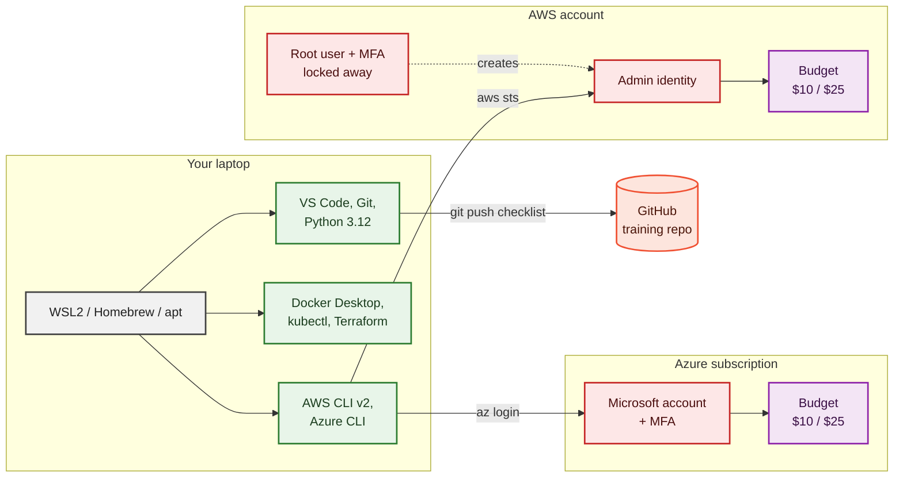
<p align="center"><sub><i>Figure: Lab – what you will build today</i></sub></p>


<b>Reading the diagram:</b> on the laptop you first prepare the OS layer (WSL2, Homebrew or apt), then install the three groups of tools. In AWS you protect the root user with MFA, use it once to create a daily admin identity, and add a budget; in Azure you protect your Microsoft account and add a budget. Finally you push your checklist and screenshots to your GitHub training repo.

<h3>Task 1 – Prepare Your Operating System</h3>

<b>Windows:</b> install WSL2 with Ubuntu. WSL2 (Windows Subsystem for Linux) runs a real Linux system inside Windows. Most course commands are Linux commands, so you will work inside Ubuntu.
```powershell
# Run PowerShell as Administrator
wsl --install -d Ubuntu-24.04
# Reboot, open "Ubuntu" from the Start menu, create a Linux username and password
wsl --list --verbose     # the VERSION column must show 2
```
Expected output:
```text
  NAME            STATE           VERSION
* Ubuntu-24.04    Running         2
```


<b>Command breakdown:</b>

| Part | What it means |
|---|---|
| `wsl --install` | turn on WSL and the Virtual Machine Platform, and install a Linux distribution |
| `-d Ubuntu-24.04` | which distribution to install (`wsl --list --online` shows all names) |
| `wsl --list --verbose` | list installed distributions with their state and WSL version; VERSION 1 is old and Docker will not work with it |

<b>macOS:</b> install Homebrew, the package manager we use for all installs.
```bash
/bin/bash -c "$(curl -fsSL https://raw.githubusercontent.com/Homebrew/install/HEAD/install.sh)"
brew --version
```

<b>Ubuntu (native or inside WSL):</b>
```bash
sudo apt-get update && sudo apt-get upgrade -y
sudo apt-get install -y curl wget unzip gnupg ca-certificates lsb-release
```

<b>Checkpoint:</b> Windows: `wsl -l -v` shows Ubuntu with VERSION 2. macOS: `brew --version` prints a version. Ubuntu: `apt-get` finished without errors.

<h3>Task 2 – Install the Toolchain</h3>

Install each tool for your OS. Windows users: install VS Code and Docker Desktop on <b>Windows</b>, and the CLIs <b>inside WSL Ubuntu</b> (Option C). You can also add them on Windows with winget (Option B).

<b>Option A – macOS (Homebrew):</b>
```bash
brew install git python@3.12 kubectl awscli azure-cli
brew tap hashicorp/tap && brew install hashicorp/tap/terraform
brew install --cask visual-studio-code docker
open -a Docker   # start Docker Desktop once and accept the terms
```


<b>Command breakdown:</b>

| Part | What it means |
|---|---|
| `brew install` | install a command-line package (a "formula") |
| `python@3.12` | a specific Python version; the command is then `python3.12` |
| `brew tap hashicorp/tap` | add HashiCorp's own package list, where the latest Terraform lives |
| `--cask` | install a desktop app (VS Code, Docker Desktop) instead of a CLI tool |
| `open -a Docker` | start the Docker Desktop app; the `docker` command fails until it is running |

<b>Option B – Windows (winget, PowerShell):</b>
```powershell
winget install -e --id Microsoft.VisualStudioCode
winget install -e --id Git.Git
winget install -e --id Docker.DockerDesktop
winget install -e --id Python.Python.3.12
winget install -e --id Kubernetes.kubectl
winget install -e --id Hashicorp.Terraform
winget install -e --id Amazon.AWSCLI
winget install -e --id Microsoft.AzureCLI
```

<b>Command breakdown:</b>

| Part | What it means |
|---|---|
| `winget install` | Windows Package Manager: download and install an app |
| `-e` | exact match – install only the package with this exact ID |
| `--id Hashicorp.Terraform` | the package ID; find IDs with `winget search terraform` |

In Docker Desktop: <b>Settings → Resources → WSL integration → enable Ubuntu-24.04</b>. In VS Code, install the extensions <b>WSL</b>, <b>Python</b>, <b>Docker</b>, <b>HashiCorp Terraform</b>, <b>YAML</b> and <b>Kubernetes</b>.

<b>Option C – Ubuntu 24.04 / WSL (one tool at a time):</b>
```bash
# Git + Python 3.12 (Ubuntu 24.04 ships Python 3.12)
sudo apt-get install -y git python3 python3-venv python3-pip
python3 --version

# kubectl (pinned minor version v1.34 from the official pkgs.k8s.io repo)
sudo mkdir -p /etc/apt/keyrings
curl -fsSL https://pkgs.k8s.io/core:/stable:/v1.34/deb/Release.key \
  | sudo gpg --dearmor -o /etc/apt/keyrings/kubernetes-apt-keyring.gpg
echo 'deb [signed-by=/etc/apt/keyrings/kubernetes-apt-keyring.gpg] https://pkgs.k8s.io/core:/stable:/v1.34/deb/ /' \
  | sudo tee /etc/apt/sources.list.d/kubernetes.list
sudo apt-get update && sudo apt-get install -y kubectl

# Terraform (HashiCorp apt repo)
wget -O- https://apt.releases.hashicorp.com/gpg \
  | sudo gpg --dearmor -o /usr/share/keyrings/hashicorp-archive-keyring.gpg
echo "deb [signed-by=/usr/share/keyrings/hashicorp-archive-keyring.gpg] https://apt.releases.hashicorp.com $(lsb_release -cs) main" \
  | sudo tee /etc/apt/sources.list.d/hashicorp.list
sudo apt-get update && sudo apt-get install -y terraform

# AWS CLI v2 (official installer; use the aarch64 zip on ARM machines)
curl "https://awscli.amazonaws.com/awscli-exe-linux-x86_64.zip" -o awscliv2.zip
unzip -q awscliv2.zip && sudo ./aws/install && rm -rf aws awscliv2.zip

# Azure CLI (official script for Debian/Ubuntu)
curl -sL https://aka.ms/InstallAzureCLIDeb | sudo bash
```

<b>Command breakdown:</b>

| Part | What it means |
|---|---|
| `curl -fsSL <url>` | download quietly (`-s`), fail on HTTP errors (`-f`), show errors (`-S`), follow redirects (`-L`) |
| pipe `\|` | send the output of the left command into the right command |
| `sudo gpg --dearmor -o <file>` | convert the signing key to binary format and save it where apt can find it |
| `[signed-by=...]` | apt only trusts packages from this repo if they are signed with that key |
| `sudo tee <file>` | write the line into a root-owned file (`>` alone would fail because of permissions) |
| `$(lsb_release -cs)` | your Ubuntu codename, e.g. `noble` for 24.04 |
| `unzip -q` | unzip quietly; `sudo ./aws/install` copies the AWS CLI to `/usr/local/bin` |
| `curl -sL ... \| sudo bash` | download Microsoft's install script and run it as root – only do this with official, trusted URLs |

Native Linux (not WSL) users install Docker Engine from the official repo (docs.docker.com → Install Docker Engine on Ubuntu), then:
```bash
sudo usermod -aG docker "$USER"   # run docker without sudo; log out and back in after this
```


<b>Command breakdown:</b>

| Part | What it means |
|---|---|
| `usermod` | modify a Linux user account |
| `-aG docker` | append (`-a`) the user to the group (`-G`) `docker`; without `-a` you are <i>removed</i> from all other groups |
| `"$USER"` | your own username |

Configure your Git identity (needed for every commit):
```bash
git config --global user.name  "<Your Name>"
git config --global user.email "<your-github-email>"
git config --global init.defaultBranch main
git config --global --list        # check the values
```


<b>Command breakdown:</b>

| Part | What it means |
|---|---|
| `git config` | read or write Git settings |
| `--global` | save in `~/.gitconfig` for all your repos (without it, only the current repo) |
| `user.name` / `user.email` | the author shown on every commit; use the email linked to your GitHub account |
| `init.defaultBranch main` | new repos start on `main` instead of `master` |
| `--list` | print all settings so you can check them |

> [!WARNING]
> <b>Common mistake:</b> Common mistake on Windows: `docker` works in PowerShell but says "command not found" in Ubuntu. Fix: Docker Desktop → Settings → Resources → WSL integration → turn on Ubuntu-24.04 → Apply & restart.


> [!NOTE]
> <b>Real-world scenario:</b> Docker Desktop is free for personal use, education and small businesses. Large US companies need a paid subscription, so on client laptops you may see Docker Desktop with a company license, Rancher Desktop or Podman instead. The `docker` commands you learn work the same way.


<b>Checkpoint:</b> run the 9 version commands from the live demo plus `docker run --rm hello-world`. Every command prints a version; none says "command not found".

<h3>Task 3 – AWS Account, MFA, Admin Identity and Budget</h3>

1. Sign up at the AWS sign-up page with your personal email. Choose the free plan or Free Tier option offered (read the current terms) and the <b>Basic (free) support plan</b>.
2. Sign in as root → account menu (top-right) → <b>Security credentials</b> → <b>Assign MFA device</b> → Authenticator app → scan the QR code → enter two codes.
3. Create a daily-use admin identity (choose one):
   - <b>Recommended:</b> IAM Identity Center → Enable → create user `<your-name>` → create permission set `AdministratorAccess` → assign it to your account. On your laptop run `aws configure sso`.
   - <b>Simpler for labs:</b> IAM → Users → Create user `<your-name>-admin` → attach policy `AdministratorAccess` → enable MFA on this user too. Create an access key only for the CLI and <b>never</b> commit it.
4. Allow your admin to see billing: as root, <b>Account → IAM user and role access to Billing information → Edit → Activate</b>.
5. Sign out of root. From now on, sign in only with the new identity.
6. Set your default region: `aws configure set region us-east-1`.
7. Create the budget: either repeat live demo step 4, or in the console <b>Billing and Cost Management → Budgets → Create budget → Customize → Cost budget</b>, amount <b>$25/month</b>, alerts at <b>40% ($10) actual</b>, <b>100% ($25) actual</b> and <b>100% forecasted</b>, email = yours.
8. Screenshot the Budgets page (hide your account ID).

```bash
aws sts get-caller-identity --query Arn --output text
aws budgets describe-budgets --account-id "$(aws sts get-caller-identity --query Account --output text)" \
  --query "Budgets[].BudgetName" --output text
aws iam get-account-summary --query "SummaryMap.AccountMFAEnabled"
```
Expected output:
```text
arn:aws:iam::<ACCOUNT_ID>:user/<your-name>-admin
devops-8wk-monthly
1
```


<b>Command breakdown:</b>

| Part | What it means |
|---|---|
| `aws configure set region us-east-1` | save `us-east-1` as the default region in `~/.aws/config` |
| `aws budgets describe-budgets --account-id "$(...)"` | the inner command gets your account ID and passes it straight in |
| `--query "Budgets[].BudgetName"` | only the budget names |

> [!CAUTION]
> <b>Cost / security alert:</b> Never create access keys for the root user. If one exists, delete it now (root → Security credentials → Access keys). A leaked root key gives an attacker full control of your account and your card.


<b>Checkpoint:</b> the ARN ends in `:user/<your-name>-admin` or contains `AWSReservedSSO_AdministratorAccess`. It must not end in `:root`. The budget name `devops-8wk-monthly` is printed. MFA summary is `1`.

<h3>Task 4 – Azure Account, MFA and Budget</h3>

1. Sign up for an Azure free account with a Microsoft account. Turn on MFA: Microsoft account → <b>Security → Advanced security options → Two-step verification → On</b>, using Microsoft Authenticator.
2. Log in from the CLI and confirm your subscription:
```bash
az login                     # opens the browser; on WSL use: az login --use-device-code
az account show --query "{name:name, id:id, state:state}" --output table
```
Expected output:
```text
Name                  Id                                    State
--------------------  ------------------------------------  -------
Azure subscription 1  00000000-0000-0000-0000-000000000000  Enabled
```
3. Create the budget in the portal: <b>Cost Management + Billing → Cost Management → Budgets → + Add</b>. Scope = your subscription, Name `devops-8wk-monthly`, Reset period <b>Monthly</b>, Amount <b>25</b>. On <b>Set alerts</b> add: Actual 40% (= $10), Actual 100% (= $25), Forecasted 100%. Add your email in <b>Alert recipients</b>. Click <b>Create</b>.
4. Check from the CLI:
```bash
az consumption budget list --query "[].{name:name, amount:amount, grain:timeGrain}" --output table
```
Expected output:
```text
Name                Amount    Grain
------------------  --------  -------
devops-8wk-monthly  25.0      Monthly
```
5. Screenshot the Budgets page (hide your subscription ID).

> [!TIP]
> <b>Pro tip:</b> Azure free-account credit expires after 30 days. After that, you must upgrade to pay-as-you-go to keep using paid services. The budget you created today keeps protecting you after the upgrade.


<b>Checkpoint:</b> `az account show` shows `State: Enabled`, and the budget appears in the list with amount 25.

<h3>Task 5 – Fill in the Tool-Install Checklist</h3>

Create `tool-checklist.md` in your home folder (you push it at 4:45 PM). Copy this template and fill in your versions:
```text
# Tool-install checklist – <your-name>

| Tool | Command | Version | OK |
|---|---|---|---|
| VS Code | code --version | | [ ] |
| Git | git --version | | [ ] |
| Python 3.12 | python3 --version | | [ ] |
| Docker Desktop | docker --version + hello-world | | [ ] |
| Docker Compose v2 | docker compose version | | [ ] |
| kubectl | kubectl version --client | | [ ] |
| Terraform | terraform version | | [ ] |
| AWS CLI v2 | aws --version | | [ ] |
| Azure CLI | az version | | [ ] |

## Cloud accounts
| Cloud | MFA on | Non-root identity | Budget $10/$25 | Screenshot |
|---|---|---|---|---|
| AWS | [ ] | [ ] | [ ] | screenshots/aws-budget.png |
| Azure | [ ] | [ ] | [ ] | screenshots/azure-budget.png |
```

<b>Checkpoint:</b> every row has a version filled in and every box is ticked `[x]`.

---


<h2>2:45 – 4:00 PM · Lab Part 2 – Independent Challenge</h2>


| Minutes | Task | Checkpoint | Mentor check |
|---|---|---|---|
| 2:45 – 3:06 | Challenge 1: `check-tools.sh` | PASS/FAIL lines and correct exit code | `echo $?` shown for pass and fail |
| 3:06 – 3:22 | Challenge 2: DORA calculation | Four numbers with units in `dora.md` | Median used, not average |
| 3:22 – 3:39 | Challenge 3: least-privilege user | `AccessDenied` on bucket creation | Test user's key deleted afterwards |
| 3:39 – 3:56 | Challenge 4: break/fix PATH | `which terraform` works in a new terminal | Root cause explained in one sentence |
| 3:56 – 4:00 | Stretch goal or catch-up | — | — |

There are no full solutions for these challenges. Work from the hints, the notes above and the official docs.

<h3>Challenge 1 – Automated Toolchain Check</h3>

<b>Goal:</b> write `check-tools.sh` that checks all course tools and prints a PASS/FAIL line for each, exiting with a non-zero code if anything is missing.

<b>Hints:</b>
- Loop over a list of command names: `git python3 docker kubectl terraform aws az code`.
- `command -v <name>` returns a non-zero exit code if a command is not found.
- `$?` holds the exit code of the last command. (Day 3 covers Bash properly; today, just get it working.)

<b>Acceptance criteria:</b>
- One line per tool, e.g. `PASS terraform` or `FAIL az`.
- The script exits `0` when all pass and `1` when any fail (check with `echo $?` right after running it).
- Test the fail case by adding a fake tool name such as `notatool` to the list.

<h3>Challenge 2 – Calculate DORA Metrics</h3>

<b>Goal:</b> from this deployment log (covering 6 working days), calculate all four DORA metrics and write one sentence on which metric the team should improve first and why.
```text
deploy_id,commit_time,deploy_time,failed,restored_time
d1,2026-10-26 09:00,2026-10-28 09:00,no,
d2,2026-10-27 11:00,2026-10-29 17:00,yes,2026-10-30 09:00
d3,2026-10-29 10:00,2026-10-30 10:00,no,
d4,2026-10-30 14:00,2026-11-02 14:00,yes,2026-11-02 18:00
d5,2026-11-02 09:00,2026-11-03 09:00,no,
```

<b>Hints:</b> lead time = deploy − commit; use the median, not the average; restore time = restored − deploy for failed rows only. You can adapt `dora.py` from Concept 7 (change `WORKING_DAYS`).

<b>Acceptance criteria:</b> four numbers with units, the working shown by hand, and a one-sentence recommendation, saved in `dora.md`.

<h3>Challenge 3 – Least-Privilege Warm-Up</h3>

<b>Least privilege</b> means giving each identity only the permissions it needs, and nothing more.

<b>Goal:</b> in AWS, create an IAM group `course-readonly` with the AWS-managed policy `ReadOnlyAccess`, add a test user `course-readonly-test` to it, and prove that this user cannot create an S3 bucket.

<b>Hints:</b> use a separate CLI profile (`aws configure --profile readonly`) with the test user's access key. Then try `aws s3 mb s3://<unique-name> --profile readonly`. An `AccessDenied` error is the <i>expected</i> (good) result.

<b>Acceptance criteria:</b> terminal output showing the `AccessDenied` error. Then delete the test user's access key and the user (see teardown).

<h3>Challenge 4 – Break/Fix: "command not found"</h3>

<b>Scenario:</b> the mentor gives you a shell where `terraform` was installed by unzipping a binary into `~/bin`, but typing `terraform version` says `terraform: command not found`.

<b>Goal:</b> find the cause and fix it permanently.

<b>Hints:</b>
- `echo $PATH`: is `~/bin` in the list?
- `ls -l ~/bin/terraform`: does the file exist, and is it executable (`x` in the permissions)?
- Which file does your shell read at start-up: `~/.bashrc` (bash) or `~/.zshrc` (zsh on macOS)?

<b>Acceptance criteria:</b> `which terraform` prints the path, and it still works after opening a new terminal. Explain the root cause in one sentence.

<h3>Stretch Goal</h3>

Enable <b>AWS Cost Anomaly Detection</b> with a daily email summary, and create an Azure <b>action group</b> so the Azure budget alert also emails a second address. Document both in `tool-checklist.md`.

---


<h2>4:00 – 4:45 PM · Lab Review with Trainer & Teardown</h2>


| Minutes | Task | Checkpoint | Mentor check |
|---|---|---|---|
| 4:00 – 4:25 | Mentor review, one trainee at a time (about 2 minutes each, in parallel with 2–3 mentors) | Checklist below all ticked | Trainee explains CI vs CD and two DORA metrics without notes |
| 4:25 – 4:35 | Teardown of the Challenge 3 test user and profile | Test user no longer listed | `aws iam list-users` output shown |
| 4:35 – 4:45 | Verify nothing is billing; cost check | $0.00 month-to-date on both clouds | Screenshots contain no IDs or keys |

<h3>Mentor Review Checklist</h3>

- All 9 tool versions recorded; `docker run --rm hello-world` works.
- AWS root user has MFA; trainee shows a non-root `aws sts get-caller-identity`.
- No root access keys exist (root → Security credentials shows "No access keys").
- Budgets with $10 and $25 alerts on AWS and Azure (2 screenshots).
- No access keys pasted into any file, chat or screenshot.
- `check-tools.sh` exit codes demonstrated; DORA numbers correct.
- Trainee can explain CI vs Continuous Delivery vs Continuous Deployment and the shared responsibility model.

<h3>Teardown Commands</h3>

Today we created almost nothing that costs money, but you still need to clean up the Challenge 3 test user:
```bash
aws iam list-access-keys --user-name course-readonly-test --query "AccessKeyMetadata[].AccessKeyId" --output text
aws iam delete-access-key --user-name course-readonly-test --access-key-id <ACCESS_KEY_ID>
aws iam remove-user-from-group --user-name course-readonly-test --group-name course-readonly
aws iam delete-user --user-name course-readonly-test
aws configure list-profiles      # if "readonly" is listed, delete its block from ~/.aws/credentials and ~/.aws/config
```

<b>Command breakdown:</b>

| Part | What it means |
|---|---|
| `aws iam list-access-keys --user-name ...` | show the access key IDs of that user (you need the ID to delete it) |
| `aws iam delete-access-key` | delete one key; a user cannot be deleted while it still has keys |
| `aws iam remove-user-from-group` | take the user out of the group; also required before deletion |
| `aws iam delete-user` | delete the user; fails with `DeleteConflict` if keys or groups remain |
| `aws configure list-profiles` | list the named profiles saved on your laptop |

Keep the budgets, the admin identity, the `course-readonly` group (optional) and the Azure subscription. We reuse them later in the course.

<b>Verify nothing is billing:</b>
```bash
aws ec2 describe-instances --region us-east-1 \
  --query "Reservations[].Instances[].InstanceId" --output text     # expect empty
az resource list --output table                                     # expect empty
```

<h3>Cost Check</h3>

- AWS: <b>Billing and Cost Management → Bills</b> shows $0.00 month-to-date.
- Azure: <b>Cost Management → Cost analysis</b> shows $0.00 and your remaining credit.

> [!CAUTION]
> <b>Cost / security alert:</b> Check the cost pages once a day during the whole course, not only when an alert arrives. Budget data on both clouds can be several hours behind real usage.


---


<h2>4:45 – 5:00 PM · Commit & Daily Report</h2>


| Minutes | Activity | Method |
|---|---|---|
| 4:45 – 4:55 | Create the training repo, commit and push today's work, open a PR | Hands-on |
| 4:55 – 5:00 | Send the daily activity report | Hands-on |

Create your personal training repo on GitHub named `devops-8wk-<your-name>` (private, add a README). Day 4 explains Git properly; for today, just copy these commands.
```bash
mkdir -p ~/devops-8wk && cd ~/devops-8wk
git clone https://github.com/<your-github-user>/devops-8wk-<your-name>.git
cd devops-8wk-<your-name>
git switch -c day01-devops-setup
mkdir -p day01/screenshots
cp ~/tool-checklist.md ~/check-tools.sh ~/dora.md day01/ 2>/dev/null
# copy your 2 budget screenshots into day01/screenshots/ (check they show no account IDs or keys)
git add day01
git commit -m "docs(day01): tool checklist, budget alerts and DORA exercise"
git push -u origin day01-devops-setup
```

<b>Command breakdown:</b>

| Part | What it means |
|---|---|
| `git clone <url>` | download the repo from GitHub to your laptop |
| `git switch -c day01-devops-setup` | create (`-c`) a new branch and move to it, following the `dayNN-<topic>` convention |
| `git add day01` | stage the `day01` folder for the next commit |
| `git commit -m "..."` | save a snapshot with a message (`docs(day01): ...` follows the Conventional Commits style) |
| `git push -u origin day01-devops-setup` | upload the branch; `-u` remembers the link so later you can just type `git push` |
| `2>/dev/null` | hide error messages, e.g. if one of the files does not exist yet |

Then open a pull request on GitHub and merge it into `main` (you learn the full PR workflow on Day 4).

<b>Daily activity report – Day 01:</b>
```text
Done
- Installed VS Code, Git, Docker Desktop, Python 3.12, kubectl, Terraform, AWS CLI v2, Azure CLI
- Created AWS and Azure accounts with MFA; non-root AWS admin identity
- Budget alerts at $10 / $25 on AWS and Azure (screenshots in day01/screenshots)
- check-tools.sh and DORA calculation exercise

Blocked
- <e.g. Azure card verification pending / none>

Next
- Day 2: Linux administration – users, permissions, systemd, cron

Learned
- Continuous Delivery has a manual approval; Continuous Deployment does not
- The 4 DORA metrics and how to calculate them with the median
- Shared responsibility: identity and data are always my job
- Budgets alert but do not stop spending – teardown is my job
```

---


<h2>Cheat Sheet</h2>

| Purpose | Command |
|---|---|
| Check versions | `git --version`, `python3 --version`, `docker --version`, `kubectl version --client`, `terraform version`, `aws --version`, `az version`, `code --version` |
| Test Docker | `docker run --rm hello-world` |
| Who am I on AWS? | `aws sts get-caller-identity` |
| AWS SSO login | `aws configure sso`, then `aws sso login --profile <profile>` |
| Set AWS default region | `aws configure set region us-east-1` |
| Root MFA check | `aws iam get-account-summary --query "SummaryMap.AccountMFAEnabled"` |
| List AWS budgets | `aws budgets describe-budgets --account-id <ACCOUNT_ID>` |
| List AWS AZs | `aws ec2 describe-availability-zones --region us-east-1` |
| Azure login | `az login` (`--use-device-code` on WSL) |
| Current Azure subscription | `az account show -o table` |
| List Azure budgets | `az consumption budget list -o table` |
| List Azure resources | `az resource list -o table` |
| Git identity | `git config --global user.name "<Your Name>"` |

```text
DORA:   Deployment frequency | Lead time for changes | Change failure rate | Time to restore
CALMS:  Culture | Automation | Lean | Measurement | Sharing
Error budget (minutes per 30 days) = 43200 x (1 - SLO)     e.g. 99.9% -> 43.2 min
Monthly cost of a resource ~ hourly price x 730
IaaS: you manage OS and up | PaaS: you manage code | SaaS: you manage users and data
```


<h2>Further Reading</h2>

- [DORA – Software delivery performance metrics](https://dora.dev/guides/dora-metrics-four-keys/)
- [AWS Budgets – Managing your costs](https://docs.aws.amazon.com/cost-management/latest/userguide/budgets-managing-costs.html)
- [AWS – Root user best practices](https://docs.aws.amazon.com/IAM/latest/UserGuide/root-user-best-practices.html)
- [AWS – Regions and Availability Zones](https://docs.aws.amazon.com/AWSEC2/latest/UserGuide/using-regions-availability-zones.html)
- [Azure – Tutorial: Create and manage budgets](https://learn.microsoft.com/en-us/azure/cost-management-billing/costs/tutorial-acm-create-budgets)
- [Azure – Shared responsibility in the cloud](https://learn.microsoft.com/en-us/azure/security/fundamentals/shared-responsibility)
- [Install Docker Desktop](https://docs.docker.com/desktop/)

<b>Next:</b> [Day 02 – Linux Administration](../Day02_Linux_Administration/Day02_Linux_Administration.md)


<h2>Answer Key</h2>


1. C – Change failure rate (and time to restore) measure stability; the other two measure speed.
2. B (False) – Budgets only send alerts; you must delete resources yourself.
3. C – 3 ÷ 20 = 0.15 = 15%.
4. C – GitOps is pull-based; the in-cluster agent reconciles the cluster with Git.
5. B – Culture, Automation, Lean, Measurement, Sharing.
6. B – 30 × 24 × 60 × 0.001 = 43.2 minutes.
7. B – EC2 is IaaS, so the customer patches the operating system.
8. B – It returns the UserId, Account and Arn of the identity you are using.
9. B – An Azure subscription is the billing boundary, like an AWS account.
10. B – The real resource no longer matches the code: that is drift.
