<h1 align="left">Day 02 – Linux Administration</h1>

<p>


</p>

<p><b>Notes</b> · <a href="Day02_Commands_and_Setup.md">Commands & Setup</a> · <a href="Day02_Questions_and_Answers.md">Questions & Answers</a> · <a href="../README.md">Week overview</a> · <a href="../../README.md">Course index</a><br><sub><b>Deliverable:</b> Linux lab worksheet</sub></p>


<h2>Learning Objectives</h2>

By the end of today you can:
- Explain why DevOps work happens on Linux, and tell the difference between the kernel, the shell and a distribution (Ubuntu, Amazon Linux, RHEL).
- Move around the Linux file system and say what lives in `/etc`, `/var`, `/opt`, `/home`, `/tmp` and `/proc`.
- Use the everyday file commands (`ls`, `cd`, `cp`, `mv`, `rm`, `find`, `cat`, `less`, `head`, `tail`, `grep`) without looking them up.
- Create users and groups, give limited `sudo` rights, and set correct ownership and permissions with `chown`, `chmod` (numeric and symbolic), special bits and `umask`.
- Inspect and stop processes safely (`ps`, `top`/`htop`, `kill`, signals) and check disk and memory (`df`, `du`, `free`, `lsof`).
- Run an app as a systemd service, read its logs with `journalctl`, and fix a broken service from its logs.
- Schedule a log-cleanup job with cron, install software with `apt` or `dnf`, and connect to a cloud VM with SSH.


<h2>Prerequisites</h2>

- Completed [Day 01 – DevOps, Cloud & Lab Setup](../Day01_DevOps_Cloud_and_Lab_Setup/Day01_DevOps_Cloud_and_Lab_Setup.md): a working terminal, Git, and the AWS CLI v2 (plus the Azure `az` CLI if you want the Azure VM option).
- A Linux machine where you can run `sudo`. Pick <b>one</b>:
  - <b>Local (recommended, free):</b> Ubuntu 24.04 in WSL2 on Windows, an Ubuntu VM (Multipass/UTM) on macOS, or a native Ubuntu laptop.
  - <b>AWS (optional):</b> one `t3.micro` Ubuntu 24.04 EC2 instance (created in Lab Task 0).
  - <b>Azure (optional):</b> one `Standard_B1s` Ubuntu 24.04 VM (created in Lab Task 0).
- WSL2 users: systemd must be on. Run `ps -p 1 -o comm=`. It must print `systemd`. If it does not, add the lines below to `/etc/wsl.conf`, run `wsl --shutdown` in PowerShell, and reopen Ubuntu.

```ini
[boot]
systemd=true
```

> [!CAUTION]
> <b>Cost / security alert:</b> A cloud VM costs money every hour it runs. Use the smallest size, tag it, and delete it at 4:00 PM today. The teardown steps are in the Lab Review section.


<h2>Batch Roster – CLOUD Nov-10 Batch</h2>


Use <b>your own row</b> everywhere the notes say `<your-name>` (cloud resource names, tags, Git repo, branch owner). Resource names are lowercase with hyphens and no accents, because AWS and Azure reject special characters such as `ó`.

| Trainee | Linux username | Resource name (`<your-name>`) | Training repo |
|---|---|---|---|
| Haiman Sher | `haiman` | `haiman-sher` | `devops-8wk-haiman-sher` |
| Cindia Josephine Fouda | `cindia` | `cindia-fouda` | `devops-8wk-cindia-fouda` |
| Jobanjit Singh | `jobanjit` | `jobanjit-singh` | `devops-8wk-jobanjit-singh` |
| Carla Rivera | `carla` | `carla-rivera` | `devops-8wk-carla-rivera` |
| Raymundo Trancoso López | `raymundo` | `raymundo-trancoso` | `devops-8wk-raymundo-trancoso` |

> [!TIP]
> <b>Pro tip:</b> Example: Carla tags her Azure VM `owner=carla-rivera` and names her AWS key pair `day02-carla-rivera`. The trainer can then see at a glance whose resource is still running at the 4:00 PM review.


<h2>Today's Schedule (EST)</h2>

| Time (EST) | Block | Type | What we do today |
|---|---|---|---|
| 8:00 – 8:15 AM | Stand-up & recap | Class | Recap Day 1 (DevOps, DORA, budgets, CLI identity) |
| 8:15 – 9:45 AM | Concept session 1 | Class | Why Linux, kernel/shell/distros, file system, file commands, grep, users/groups/sudo, permissions, special bits, umask |
| 9:45 – 10:00 AM | Break | Break | — |
| 10:00 – 11:15 AM | Concept session 2 + live demo | Class | Processes & signals, systemd, journalctl, cron, apt/dnf, disk & memory, SSH; demo: PeoplePulse stub as a systemd service |
| 11:15 AM – 12:15 PM | Q&A, quiz & lab briefing | Class | Interview Q&A, 10-question quiz, lab briefing |
| 12:15 – 1:15 PM | Lunch | Break | — |
| 1:15 – 2:45 PM | Lab part 1 – task assignment & guided build | Lab | Optional cloud VM + SSH, users and permissions, scoped sudo, systemd service, log-cleanup cron job |
| 2:45 – 4:00 PM | Lab part 2 – independent challenge | Lab | Break/fix `pp-broken` service, full-disk hunt, least-privilege config file |
| 4:00 – 4:45 PM | Lab review with trainer & teardown | Lab | Mentor review, remove lab users/services, delete EC2 or Azure VM |
| 4:45 – 5:00 PM | Commit & daily report | Lab | Push worksheet, unit file and cron file to the `day02-linux` branch |

> [!IMPORTANT]
> <b>How the day runs:</b> the class from <b>8:00 AM to 12:15 PM EST</b> is recorded every day (4 hours of teaching; recording pauses during the 9:45 break). After lunch, <b>1:15 – 5:00 PM EST</b> is 3 hours 45 minutes of hands-on lab: at 1:15 PM the trainer posts the day's lab tasks, you work through them (take short breaks at your own pace), and you report your results to the trainer at the 4:00 PM review.


---


<h2>8:00 – 8:15 AM · Stand-up & Recap</h2>


| Minutes | Activity | Method |
|---|---|---|
| 8:00 – 8:03 | Attendance, check everyone has a Linux terminal open | Discussion |
| 8:03 – 8:12 | Five recap questions on Day 1 (below) | Quiz |
| 8:12 – 8:15 | Today's goal and how the day builds towards the lab | Lecture |

Recap questions on Day 1:
1. What is the difference between Continuous Delivery and Continuous Deployment?
2. Name the four DORA metrics. Which two measure stability?
3. Does an AWS budget stop your resources when you reach $25? What does it actually do?
4. What does `aws sts get-caller-identity` tell you, and why do we run it before any AWS work?
5. In one sentence: what is drift in Infrastructure as Code?

<b>Today's goal:</b> be comfortable doing everyday Linux admin work. You will manage users and permissions, run an app as a service, fix a broken service from its logs, and automate log cleanup.

---


<h2>8:15 – 9:45 AM · Concept Session 1</h2>


| Minutes | Activity | Method |
|---|---|---|
| 8:15 – 8:22 | Why Linux matters for DevOps | Lecture |
| 8:22 – 8:32 | Kernel, shell and distributions; Ubuntu vs Amazon Linux vs RHEL | Whiteboard |
| 8:32 – 8:42 | File system hierarchy – where things live | Whiteboard |
| 8:42 – 8:57 | Essential file commands: `ls`, `cd`, `cp`, `mv`, `rm`, `find` | Live demo |
| 8:57 – 9:07 | Reading and searching files: `cat`, `less`, `head`, `tail`, `grep` | Live demo |
| 9:07 – 9:19 | Users, groups and `sudo` | Lecture |
| 9:19 – 9:32 | Permissions: rwx, numeric, symbolic, ownership | Whiteboard |
| 9:32 – 9:38 | Special bits: setuid, setgid, sticky | Lecture |
| 9:38 – 9:43 | `umask` – default permissions | Live demo |
| 9:43 – 9:45 | Two quick "what does this `ls -l` line mean?" checks | Quiz |

<h3>1. Why Linux Matters for DevOps</h3>

<b>In simple words:</b> Most servers, containers and cloud workloads run on Linux. In DevOps you will be on a Linux terminal every working day.

> [!NOTE]
> <b>Simple analogy:</b> Think of Linux as the road network of the cloud. Cars (your apps), buses (containers) and trucks (Kubernetes nodes) all use it. Being a good driver is not enough; you also need to know the roads.


<b>Why a DevOps Engineer cares:</b>
- EC2 instances, Azure VMs, Docker containers, Kubernetes nodes, Jenkins agents and GitHub Actions runners (`ubuntu-24.04`) all run Linux.
- When a pipeline or pod fails at 2 AM, you read Linux logs, check Linux permissions and restart Linux services.
- Compute is usually the biggest part of a cloud bill. Linux VMs carry no OS licence fee, so clients pick them by default.
- In interviews, expect to troubleshoot a Linux box live while sharing your screen.

<b>How it works:</b> Linux is free and open source, and many companies and communities package their own version of it (a <i>distribution</i>). You control everything from the command line, which makes it easy to automate with scripts, Ansible, Terraform user-data and Dockerfiles.

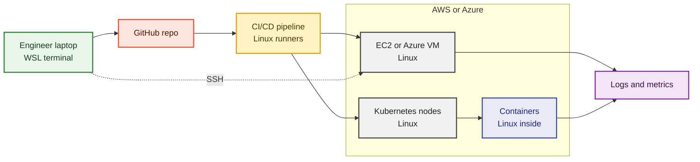
<p align="center"><sub><i>Figure: Big picture - where Linux sits in DevOps and the cloud</i></sub></p>


Reading the diagram: you write code on a laptop and push it to GitHub. A pipeline (running on Linux runners) deploys it to Linux VMs or Kubernetes nodes in AWS or Azure, where the app runs in containers that are also Linux inside. When something breaks, you SSH into the VM or read the logs. Every box in this picture is Linux.

<b>Example:</b> a sentence you will hear on a US client call:

```text
"The health check is failing on prod-api-02. I'll SSH in, check systemctl status,
and look at the last 50 lines in journalctl."
```

> [!NOTE]
> <b>Real-world scenario:</b> On a typical US client project, you might manage 200 Linux EC2 instances, an EKS cluster and Jenkins agents. Nobody logs in to a desktop; all the work goes through SSH, scripts and pipelines.


<h3>2. Kernel, Shell and Distributions</h3>

<b>In simple words:</b> The <b>kernel</b> is the core of Linux that talks to the hardware. The <b>shell</b> is the program that reads the commands you type. A <b>distribution</b> (distro) is the kernel plus tools, a package manager and default settings, packaged by a company or community.

> [!NOTE]
> <b>Simple analogy:</b> Think of a car. The kernel is the engine. The shell is the steering wheel and pedals you use to control it. A distro is the full car model (Toyota, Ford): the same kind of engine, but a different dashboard and service centre.


<b>Why a DevOps Engineer cares:</b>
- The distro decides the package manager (`apt` or `dnf`), default login user and log file names.
- Client "golden images" (approved base VMs) are usually Ubuntu, Amazon Linux or RHEL. Expect to work on all three.
- Docker base images (`ubuntu:24.04`, `amazonlinux:2023`, `alpine`) are also distros.

<b>How it works:</b>

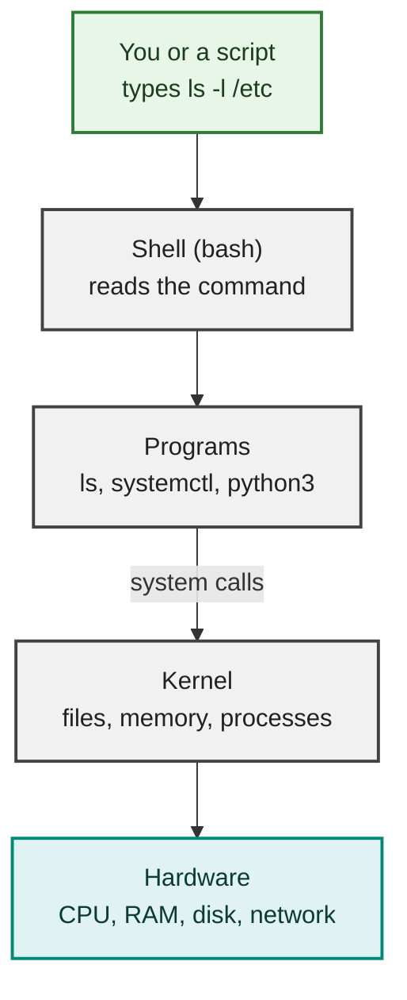
<p align="center"><sub><i>Figure: Linux layers from you down to the hardware</i></sub></p>


Reading the diagram: you type a command; the shell (bash) finds the right program, for example `/usr/bin/ls`. The program asks the kernel for what it needs (a list of files) using <i>system calls</i>. Only the kernel talks to the hardware (real hardware on a laptop, virtual hardware on an EC2 instance or Azure VM).

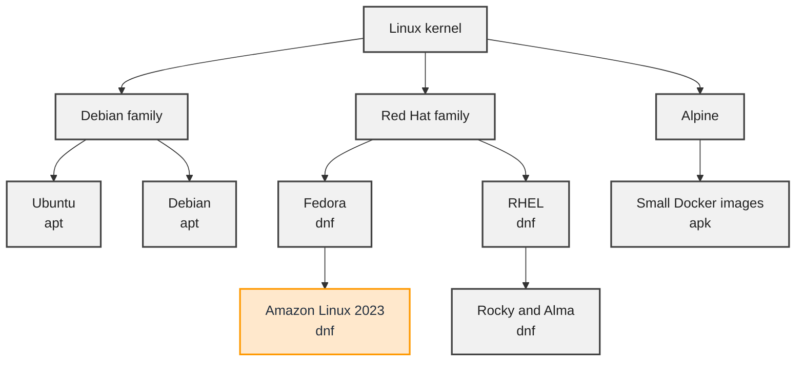
<p align="center"><sub><i>Figure: Linux distribution family tree</i></sub></p>


Reading the diagram: all distros share the Linux kernel but belong to families. Learn one command set per family: `apt` for the Debian family (Ubuntu), `dnf` for the Red Hat family (RHEL, Rocky, Alma and Amazon Linux 2023, which is based on Fedora). You will mostly meet Alpine as the base of very small container images.

| Item | Ubuntu (24.04 LTS) | Amazon Linux 2023 | RHEL 9 |
|---|---|---|---|
| Family | Debian | Fedora / Red Hat style | Red Hat |
| Package manager | `apt` (`.deb` files) | `dnf` (`.rpm` files) | `dnf` (`.rpm` files) |
| Default SSH user in the cloud | `ubuntu` (AWS), you choose on Azure (`azureuser`) | `ec2-user` | `ec2-user` (AWS), you choose on Azure |
| Cost | Free | Free (AWS only) | Paid subscription (included in the VM price in AWS/Azure) |
| Main system log | `/var/log/syslog` + journal | journal only (`journalctl`) | `/var/log/messages` + journal |
| Where you will meet it | Most VMs, GitHub runners, Azure, many Docker images | EC2, AWS managed services | Banks, insurance, healthcare, government clients |

<b>Example:</b> find out what you are running.

```bash
cat /etc/os-release | head -3   # which distro and version
uname -r                        # kernel version
echo "$SHELL"                   # your login shell
```

```text
PRETTY_NAME="Ubuntu 24.04.1 LTS"
NAME="Ubuntu"
VERSION_ID="24.04"
6.8.0-1015-aws
/bin/bash
```

> [!TIP]
> <b>Pro tip:</b> Run `cat /etc/os-release` first on any new server. It tells you whether to use `apt` or `dnf`, and whether to log in as `ubuntu` or `ec2-user`.


> [!WARNING]
> <b>Common mistake:</b> "LTS" means Long-Term Support (5 years of security updates for Ubuntu). Non-LTS releases expire after 9 months. Always pick an LTS release for servers.


<h3>3. File System Hierarchy</h3>

<b>In simple words:</b> Linux has one tree of folders starting at `/` (called "root"). There are no `C:` or `D:` drives. Extra disks are <i>mounted</i> (attached) into the tree, for example at `/data`.

> [!NOTE]
> <b>Simple analogy:</b> The file system is like an office building. `/etc` is the policy binder room, `/var/log` is the room with the security camera recordings, `/home` is everyone's personal desk, and `/tmp` is the shared table that is cleaned every night.


<b>Why a DevOps Engineer cares:</b>
- You must know where to find config (`/etc`) and logs (`/var/log`) within seconds during an incident.
- "Disk full" alerts usually trace back to `/var/log`, `/var/lib/docker` or `/tmp`.
- Dockerfiles, Ansible roles and Kubernetes volume mounts all use these standard paths.

<b>How it works:</b>

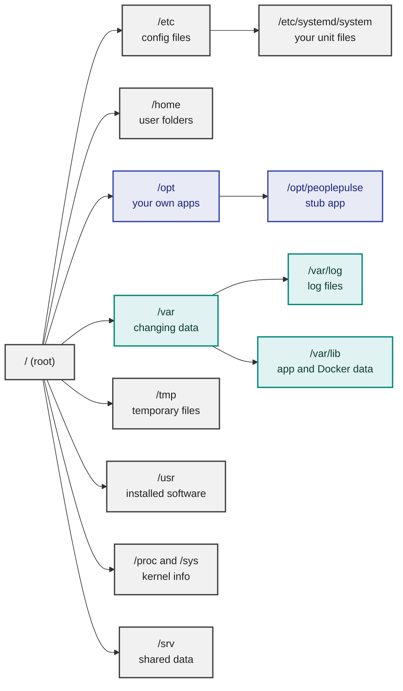
<p align="center"><sub><i>Figure: Linux file system hierarchy</i></sub></p>


Reading the diagram: everything hangs from `/`. Config lives under `/etc` (today you will add files in `/etc/systemd/system`, `/etc/cron.d` and `/etc/peoplepulse`). Data that grows lives under `/var`, so that is where disks fill up. Your own app goes in `/opt`. Other folders you will meet: `/root` (root's home), `/dev` (devices such as `/dev/null`, the "black hole") and `/mnt` (mount points for extra disks).

| You need to… | Look in |
|---|---|
| Change how a service is configured | `/etc/<service>/` |
| Read an app's log files | `/var/log/` (and `journalctl`) |
| Find why the disk is full | `/var/log`, `/var/lib/docker`, `/tmp`, `/home` |
| Install your own app | `/opt/<app>` (code), `/etc/<app>` (config), `/var/lib/<app>` (data) |
| See CPU or memory details | `/proc/cpuinfo`, `/proc/meminfo` |

<b>Example:</b>

```bash
pwd                      # where am I?
ls /                     # top-level folders
head -2 /proc/meminfo    # kernel info exposed as a "file"
```

```text
/home/ubuntu
bin  boot  dev  etc  home  lib  lib64  media  mnt  opt  proc  root  run  sbin  srv  sys  tmp  usr  var
MemTotal:         980148 kB
MemFree:          212480 kB
```

> [!TIP]
> <b>Pro tip:</b> "Everything is a file" in Linux. Config is text in `/etc`, so you can store it in Git and manage it with Ansible or a Kubernetes ConfigMap. This is why Infrastructure as Code works so well on Linux.


> [!WARNING]
> <b>Common mistake:</b> Paths that start with `/` are <b>absolute</b> (from the root). Paths without `/` are <b>relative</b> (from your current folder). `rm -rf logs` and `rm -rf /logs` are very different commands.


<h3>4. Essential File Commands</h3>

<b>In simple words:</b> A handful of commands covers moving around, copying, renaming, deleting and finding files. You will type them all day, every day.

> [!NOTE]
> <b>Simple analogy:</b> These commands are like the basic moves in driving: start, steer, reverse, park. You don't think about them after a week, but you can't drive without them.


<b>Why a DevOps Engineer cares:</b>
- Every runbook, Dockerfile and pipeline script uses them.
- `find` is the tool for "which file is huge?" and "delete logs older than 7 days" (today's cron lab).
- A careless `rm -rf` or `mv` on production is a classic cause of outages, so learn the safe habits (`-i`, checking with `ls` first).

<b>How it works:</b>

| Command | What it does | Useful options |
|---|---|---|
| `ls` | list folder contents | `-l` long, `-a` hidden files, `-h` human sizes, `-t` newest first |
| `cd` | change folder | `cd ~` home, `cd -` previous folder, `cd ..` one level up |
| `cp` | copy | `-r` folders, `-p` keep permissions/time, `-i` ask before overwrite |
| `mv` | move or rename | `-i` ask before overwrite |
| `rm` | delete (no recycle bin!) | `-r` folders, `-f` force, `-i` ask |
| `mkdir` | create folder | `-p` create parents, no error if it exists |
| `touch` | create empty file / update time | `-d "3 days ago"` set an old time |
| `find` | search by name, type, size, age | `-name`, `-type f`, `-size +100M`, `-mtime +7`, `-delete` |

<b>Example:</b>

```bash
mkdir -p ~/day02/practice && cd ~/day02/practice
touch app.log notes.txt
cp app.log app.log.bak          # copy
mv notes.txt README.txt         # rename
ls -lah                         # long list, hidden files, human sizes
find ~/day02 -type f -name '*.log'                   # find .log files
find /var/log -type f -size +10M 2>/dev/null         # files bigger than 10 MB
find ~/day02 -type f -name '*.bak' -mtime +7 -print  # .bak files older than 7 days
cd - && rm -ri ~/day02/practice                      # back to previous dir; remove with confirmation
```

```text
total 8.0K
drwxrwxr-x 2 ubuntu ubuntu 4.0K Nov 10 09:50 .
drwxrwxr-x 3 ubuntu ubuntu 4.0K Nov 10 09:50 ..
-rw-rw-r-- 1 ubuntu ubuntu    0 Nov 10 09:50 README.txt
-rw-rw-r-- 1 ubuntu ubuntu    0 Nov 10 09:50 app.log
-rw-rw-r-- 1 ubuntu ubuntu    0 Nov 10 09:50 app.log.bak
/home/ubuntu/day02/practice/app.log
```

<b>Command breakdown:</b> `find ~/day02 -type f -name '*.bak' -mtime +7 -print`

| Part | What it means |
|---|---|
| `find` | search for files, starting in a folder and going down into every sub-folder |
| `~/day02` | where to start (your home folder's `day02`) |
| `-type f` | only regular files (`d` = directories) |
| `-name '*.bak'` | name matches the pattern; quote it so the shell does not expand `*` first |
| `-mtime +7` | last modified <b>more than</b> 7 days ago (`-7` = less than 7 days) |
| `-print` | show each match; swap for `-delete` only after you have checked the list |
| `2>/dev/null` (other example) | throw away error messages such as "Permission denied" |

> [!WARNING]
> <b>Common mistake:</b> Linux has no recycle bin. `rm -rf` deletes immediately. Before you run it, list the same path with `ls` and check what will go. Before `find ... -delete`, run the same `find` with `-print` only and check the list.


> [!TIP]
> <b>Pro tip:</b> Press <b>Tab</b> to auto-complete file names and <b>Ctrl+R</b> to search your command history. `2>/dev/null` hides "Permission denied" noise from `find`.


<h3>5. Reading and Searching Files</h3>

<b>In simple words:</b> `cat`, `less`, `head` and `tail` show what is inside a file. `grep` finds lines that contain a word or pattern.

> [!NOTE]
> <b>Simple analogy:</b> `cat` is reading a whole letter aloud. `less` is scrolling through a book. `head` reads the first page, `tail` the last page. `grep` is using Ctrl+F to find one word.


<b>Why a DevOps Engineer cares:</b>
- Logs are text. `tail -f` lets you watch an app log live during a deployment.
- `grep` turns 50,000 log lines into the 5 lines that matter ("ERROR", a request ID, an IP).
- Almost every interview troubleshooting question expects you to use them.

<b>How it works:</b>

| Command | Use it when |
|---|---|
| `cat file` | small file, print all of it |
| `less file` | big file; scroll with arrows, `/word` to search, `q` to quit |
| `head -n 20 file` | first 20 lines (headers, CSV columns) |
| `tail -n 50 file` | last 50 lines (most recent log entries) |
| `tail -f file` | follow the file live; Ctrl+C to stop |
| `grep word file` | lines containing the word |
| `grep -i` / `-n` / `-v` / `-c` / `-r` | ignore case / show line numbers / lines NOT matching / count / search folders |
| `grep -E 'a\|b'` | extended regex: lines with `a` OR `b` |

The `|` (pipe) sends the output of one command into the next: `journalctl -u ssh | grep Failed | tail -5`.

<b>Example:</b>

```bash
printf 'INFO start\nERROR db timeout\nINFO request ok\nerror disk slow\n' > /tmp/app.log
head -n 2 /tmp/app.log
grep -in error /tmp/app.log          # case-insensitive, with line numbers
grep -vc INFO /tmp/app.log           # count lines that are NOT INFO
grep -E 'timeout|slow' /tmp/app.log  # either word
```

```text
INFO start
ERROR db timeout
2:ERROR db timeout
4:error disk slow
2
ERROR db timeout
error disk slow
```

<b>Command breakdown:</b> `journalctl -u ssh | grep -i failed | tail -5`

| Part | What it means |
|---|---|
| `journalctl -u ssh` | print all log lines of the SSH service |
| `\|` | pipe: send the output of the left command into the right command |
| `grep -i failed` | keep only lines containing "failed", ignoring upper/lower case |
| `\| tail -5` | keep only the last 5 of those lines (the most recent) |
| `grep -n` / `-v` / `-c` | add line numbers / show lines that do NOT match / only count matches |
| `grep -E 'timeout\|slow'` | extended regex: match "timeout" OR "slow" |

> [!TIP]
> <b>Pro tip:</b> On a busy server, use `less` instead of `cat` for large files. `cat` on a 2 GB log floods your terminal; `less` opens it instantly.


> [!NOTE]
> <b>Real-world scenario:</b> Real scenario: a client reports "some users get HTTP 500 errors". You run `grep ' 500 ' /var/log/nginx/access.log | tail -20` and see that every failing request hits the same URL path. In under a minute you know where to look.


<h3>6. Users, Groups and sudo</h3>

<b>In simple words:</b> Every program runs as a <b>user</b>. Users are placed into <b>groups</b> so you can give access to many people at once. `sudo` lets an allowed user run one command as the admin (root) user.

> [!NOTE]
> <b>Simple analogy:</b> A user is an employee ID badge. A group is a department (everyone in "DevOps" can enter the server room). `sudo` is borrowing the master key from security for one job, and security writes your name in the logbook.


<b>Why a DevOps Engineer cares:</b>
- Apps must run as their own service account, never as root (the same idea as `USER` in a Dockerfile and `runAsNonRoot` in Kubernetes).
- Security audits (SOC 2, PCI, HIPAA at US clients) check who has sudo and how it is logged.
- When an engineer joins or leaves the team, you mostly add them to or remove them from groups.

<b>How it works:</b>

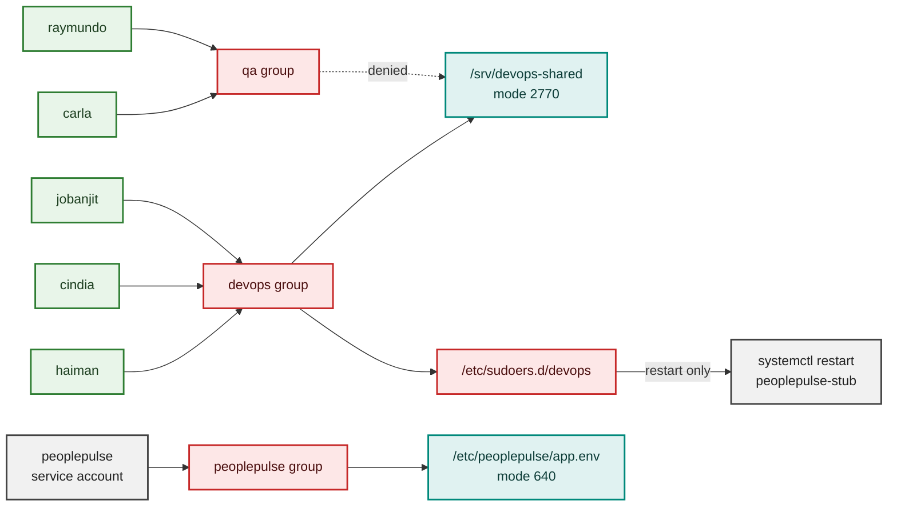
<p align="center"><sub><i>Figure: Users, groups and sudo working together</i></sub></p>


Reading the diagram: Haiman, Cindia and Jobanjit get access through the `devops` group, not one by one. The group can use the shared folder and has one narrow sudo rule. Carla and Raymundo are in the `qa` group, not `devops`, so they are denied. The app's service account has its own group, which is the only one allowed to read the app's config file. You will build exactly this in the lab.

| File | Contains | Example line |
|---|---|---|
| `/etc/passwd` | users (no passwords) | `haiman:x:1001:1001:Haiman Sher:/home/haiman:/bin/bash` |
| `/etc/shadow` | password hashes (root only) | `haiman:$y$j9T$...:20033:0:99999:7:::` |
| `/etc/group` | groups and members | `devops:x:1100:haiman,cindia,jobanjit` |
| `/etc/sudoers`, `/etc/sudoers.d/` | who may use sudo | `%devops ALL=(root) NOPASSWD: /usr/bin/systemctl restart peoplepulse-stub.service` |

Fields in `/etc/passwd`: `username:x:UID:GID:comment:home:shell`. <b>UID</b> = user ID number. UID `0` is root. UIDs below 1000 are system or service accounts. Each user has one <b>primary group</b> (owns new files) and can have many <b>supplementary groups</b> (extra access).

<b>Example:</b>

```bash
sudo groupadd devops                                  # create a group
sudo useradd -m -s /bin/bash -G devops haiman          # -m home dir, -s shell, -G extra groups
sudo passwd haiman                                     # set a password (interactive)
sudo useradd --system --no-create-home --shell /usr/sbin/nologin peoplepulse  # service account, cannot log in
sudo usermod -aG devops jobanjit                           # -a = APPEND to groups (never forget -a)
id haiman                                              # show UID, GID and groups
sudo visudo -f /etc/sudoers.d/devops                  # edit sudo rules safely (syntax checked)
sudo userdel -r haiman                                 # delete user and home folder
```

```text
uid=1001(haiman) gid=1002(haiman) groups=1002(haiman),1001(devops)
```

<b>Command breakdown:</b> `sudo useradd -m -s /bin/bash -G devops haiman`

| Part | What it means |
|---|---|
| `sudo` | run as root – only root may create users |
| `useradd` | low-level "create a user" tool (works the same on Ubuntu, Amazon Linux and RHEL) |
| `-m` | create the home folder `/home/haiman`; without it the user has no home |
| `-s /bin/bash` | login shell; without it Ubuntu may give `/bin/sh` |
| `-G devops` | extra (supplementary) group; the group must already exist |
| `haiman` | the username |
| `--system --shell /usr/sbin/nologin` (service account) | low UID, no login possible – for apps, not people |

<b>Command breakdown:</b> `sudo usermod -aG devops jobanjit`

| Part | What it means |
|---|---|
| `usermod` | change an existing user |
| `-a` | <b>append</b> – keep the groups jobanjit already has |
| `-G devops` | the group(s) to add; without `-a` this list <i>replaces</i> all his extra groups |
| `jobanjit` | the user to change; Jobanjit must log out and in again to get the new group |

> [!WARNING]
> <b>Common mistake:</b> `usermod -G docker haiman` <b>without</b> `-a` <i>replaces</i> all of Haiman's extra groups with only `docker`. Haiman may lose `sudo` access. Always use `usermod -aG`.


> [!CAUTION]
> <b>Cost / security alert:</b> Always edit sudo rules with `visudo`. A typo in `/etc/sudoers` saved with a normal editor can lock every admin out of sudo on that server.


> [!IMPORTANT]
> <b>Key point:</b> Interview line: "Apps run as a dedicated non-login service account with least privilege. Humans use their own accounts plus `sudo`, so every admin action is logged in `/var/log/auth.log` (Ubuntu) or `/var/log/secure` (RHEL)."


<h3>7. Permissions: rwx, Numeric, Symbolic and Ownership</h3>

<b>In simple words:</b> Every file has an <b>owner</b>, a <b>group</b>, and three sets of permissions: for the owner (<b>u</b>ser), the <b>g</b>roup and everyone else (<b>o</b>thers). Each set says if you can <b>r</b>ead, <b>w</b>rite or e<b>x</b>ecute.

> [!NOTE]
> <b>Simple analogy:</b> A file is like a shared document. The owner can edit it, the team (group) can view it, and the public (others) cannot open it at all.


<b>Why a DevOps Engineer cares:</b>
- "Permission denied" is one of the most common errors in pipelines, containers and services.
- Secrets and SSH keys must be `600`; SSH refuses keys with wider permissions.
- Security scanners flag world-writable files (`777`), and those findings can block a release.

<b>How it works:</b>

```text
-rwxr-x---  1 peoplepulse devops  4096 Nov 10 09:30 start.sh
│└┬┘└┬┘└┬┘    └────┬────┘ └──┬─┘
│ │  │  │         owner    group
│ │  │  └ others: ---  (no access)
│ │  └─── group:  r-x  (read + execute)
│ └────── user:   rwx  (read + write + execute)
└──────── type: - file, d directory, l symbolic link
```

| Permission | On a file | On a directory | Number |
|---|---|---|---|
| r | read the contents | list the names inside (`ls`) | 4 |
| w | change the contents | create, delete, rename files inside | 2 |
| x | run it as a program | enter it (`cd`) and reach files inside | 1 |

<b>Numeric mode:</b> add the numbers for each set. `rwx` = 4+2+1 = 7, `rw-` = 6, `r-x` = 5, `r--` = 4, `---` = 0.

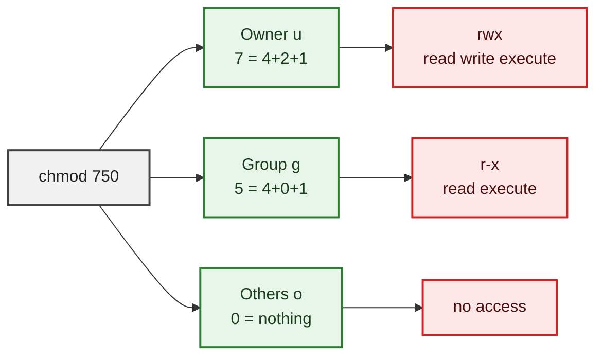
<p align="center"><sub><i>Figure: How the permission mode 750 is built</i></sub></p>


Reading the diagram: a mode has three digits, one each for owner, group and others. Each digit is the sum of read (4), write (2) and execute (1). So `750` means the owner can do everything, the group can read and run, and everyone else gets nothing.

| Mode | Meaning | Typical use |
|---|---|---|
| `755` | rwxr-xr-x | scripts, normal directories |
| `644` | rw-r--r-- | normal config and text files |
| `640` | rw-r----- | config that only the app's group may read |
| `600` | rw------- | private keys (`~/.ssh/id_ed25519`), secrets |
| `700` | rwx------ | `~/.ssh` directory |

<b>Symbolic mode:</b> `who` (`u`, `g`, `o`, `a` = all) + `action` (`+` add, `-` remove, `=` set exactly) + `what` (`r`, `w`, `x`).

| Numeric vs symbolic | Numeric (`chmod 640`) | Symbolic (`chmod g-w,o-rwx`) |
|---|---|---|
| Sets | all permissions at once | only the bits you name |
| Best for | new files, scripts, IaC (predictable) | small changes to existing files |

<b>Example:</b>

```bash
chmod 640 /etc/peoplepulse/app.env               # numeric
chmod u+x deploy.sh                              # symbolic: add execute for owner
chmod g-w,o-rwx report.csv                       # remove group write, remove all for others
chmod -R g+rX /opt/peoplepulse                   # capital X = execute only on dirs (and already-executable files)
sudo chown peoplepulse:devops /opt/peoplepulse/data    # change owner and group
sudo chown -R peoplepulse: /var/log/peoplepulse        # "user:" = user + that user's primary group
sudo chgrp devops /srv/shared                    # change group only
stat -c '%a %U:%G %n' /etc/peoplepulse/app.env   # show numeric mode, owner, group
```

```text
640 root:peoplepulse /etc/peoplepulse/app.env
```

<b>Command breakdown:</b> `chmod -R g+rX /opt/peoplepulse`

| Part | What it means |
|---|---|
| `chmod` | change mode (permissions) |
| `-R` | recursive – apply to the folder and everything inside it |
| `g` | who: the group (`u` owner, `o` others, `a` all) |
| `+` | add (`-` remove, `=` set exactly) |
| `r` | read |
| `X` (capital) | execute only for directories and files that are already executable – safe for mixed trees |
| `/opt/peoplepulse` | target; a wrong path with `-R` (for example `/`) can break the whole server |

<b>Command breakdown:</b> `sudo chown -R peoplepulse: /var/log/peoplepulse`

| Part | What it means |
|---|---|
| `chown` | change owner (and optionally group) |
| `-R` | recursive – every file and folder inside |
| `peoplepulse:` | new owner `peoplepulse`; the colon with nothing after it sets that user's primary group too |
| `peoplepulse:devops` (other example) | owner `peoplepulse`, group `devops` |
| `/var/log/peoplepulse` | target folder |

> [!WARNING]
> <b>Common mistake:</b> Never "fix" a permission error with `chmod 777`. It lets any user on the server change or replace the file, which is a real security finding. Find <i>which</i> user needs access and grant only that (owner, group or ACL).


> [!TIP]
> <b>Pro tip:</b> To debug "Permission denied", check every folder in the path, not only the file: `namei -l /opt/peoplepulse/www/health`. A missing `x` on a parent directory blocks access even if the file is `644`.


<h3>8. Special Bits: setuid, setgid and Sticky</h3>

<b>In simple words:</b> Three extra permission bits change how files and folders behave. The ones you will use most are <b>setgid</b> on shared folders and the <b>sticky bit</b> on folders like `/tmp`.

> [!NOTE]
> <b>Simple analogy:</b> setgid on a folder is like a project cupboard: anything you put in it gets the project label automatically. The sticky bit is like a shared fridge: everyone can put food in, but you may only throw away your own food.


<b>Why a DevOps Engineer cares:</b>
- Shared team folders (deploy artifacts, runbooks) need setgid so every file stays in the team group.
- You will see `t` and `s` in `ls -l` output on real servers and need to know what they mean.
- setuid programs are a security risk; audits search for unexpected ones.

<b>How it works:</b>

| Bit | Number | Effect | Shows as | Example |
|---|---|---|---|---|
| setuid (on a file) | 4000 | program runs with the file owner's rights | `s` in user x spot | `/usr/bin/passwd` `-rwsr-xr-x` |
| setgid (on a directory) | 2000 | new files inherit the directory's group | `s` in group x spot | shared team folders `drwxrws---` |
| sticky (on a directory) | 1000 | only a file's owner can delete or rename it | `t` in others x spot | `/tmp` `drwxrwxrwt` |

<b>Example:</b>

```bash
sudo mkdir -p /srv/devops-shared
sudo chown root:devops /srv/devops-shared
sudo chmod 2770 /srv/devops-shared   # 2 = setgid, 770 = rwx for owner and group, nothing for others
ls -ld /srv/devops-shared /tmp
```

```text
drwxrws--- 2 root devops 4096 Nov 10 10:33 /srv/devops-shared
drwxrwxrwt 9 root root   4096 Nov 10 10:30 /tmp
```

<b>Command breakdown:</b> `sudo chmod 2770 /srv/devops-shared`

| Part | What it means |
|---|---|
| `2` (first of four digits) | special bit: 4 = setuid, 2 = setgid, 1 = sticky; here setgid |
| `7` | owner (root): rwx |
| `7` | group (devops): rwx – members can create and edit files |
| `0` | others: no access at all |
| `/srv/devops-shared` | the shared folder; `ls -ld` shows `drwxrws---` (the `s` is setgid) |

> [!TIP]
> <b>Pro tip:</b> Find setuid files during a security review: `sudo find / -xdev -perm -4000 -type f 2>/dev/null`. Anything unexpected in that list needs an explanation.


> [!WARNING]
> <b>Common mistake:</b> A capital `S` or `T` (for example `drwxrwS---`) means the special bit is set but the execute bit is missing. Usually that is a mistake.


<h3>9. umask – Default Permissions for New Files</h3>

<b>In simple words:</b> `umask` decides the permissions of <i>new</i> files and folders. New files start at `666`, new folders at `777`, and any bit set in the umask is removed. So umask `022` turns `666` into `644`.

> [!NOTE]
> <b>Simple analogy:</b> umask is like a stencil laid over a page before you paint. Whatever the stencil covers stays blank. It only removes permissions, never adds them.


<b>Why a DevOps Engineer cares:</b>
- Hardened servers (CIS benchmarks) require `027`, so apps don't create world-readable files.
- If a monitoring agent cannot read a service's logs, the service's umask is often the cause.
- A manual `chmod` is lost as soon as the log rotates and a new file is created. Setting the right umask fixes it for good.

<b>How it works:</b>

| umask | New file | New directory | Used for |
|---|---|---|---|
| `022` | 644 (rw-r--r--) | 755 (rwxr-xr-x) | Common default |
| `002` | 664 | 775 | Ubuntu default for normal users; shared-group work |
| `027` | 640 (rw-r-----) | 750 (rwxr-x---) | Hardened servers |
| `077` | 600 | 700 | Very private (secrets) |

<b>Example:</b>

```bash
umask              # show the current value
umask 027          # change it for this shell only
touch a.txt; mkdir d
ls -ld a.txt d
```

```text
0002
-rw-r----- 1 ubuntu ubuntu    0 Nov 10 10:40 a.txt
drwxr-x--- 2 ubuntu ubuntu 4096 Nov 10 10:40 d
```

For a systemd service, set it in the unit file: `UMask=0027`.

> [!IMPORTANT]
> <b>Key point:</b> Remember for interviews: umask 027 gives files 640 and directories 750. Files never get execute from umask alone, because they start at 666.


---


<h2>9:45 – 10:00 AM · Break</h2>


Stand up, refill your coffee, and check that WSL or your VM is still running for the live demo.

---


<h2>10:00 – 11:15 AM · Concept Session 2 + Live Demo</h2>


| Minutes | Activity | Method |
|---|---|---|
| 10:00 – 10:10 | Processes, `ps`, `top`/`htop`, signals, `kill` | Live demo |
| 10:10 – 10:21 | systemd: units, `systemctl`, unit file sections | Whiteboard |
| 10:21 – 10:28 | `journalctl` – reading service logs | Live demo |
| 10:28 – 10:36 | cron – schedule syntax and gotchas | Whiteboard |
| 10:36 – 10:41 | Package managers: `apt` vs `dnf` | Lecture |
| 10:41 – 10:49 | Disk and memory: `df`, `du`, `free`, `lsof` | Live demo |
| 10:49 – 10:55 | SSH basics to a cloud VM | Lecture |
| 10:55 – 11:15 | Live Demo: PeoplePulse stub as a systemd service | Live demo |

<h3>10. Processes and Signals</h3>

<b>In simple words:</b> A process is a running program. Each process has a number (<b>PID</b>, process ID), a parent (<b>PPID</b>), an owner and a state. A <b>signal</b> is a short message you send to a process, such as "please stop".

> [!NOTE]
> <b>Simple analogy:</b> Processes are workers in a factory, each with a badge number (PID). Signals are messages from the manager: SIGTERM is "please finish your task and go home", SIGKILL is security walking the worker out immediately.


<b>Why a DevOps Engineer cares:</b>
- A runaway process stuck at 100% CPU is a common reason to get paged on call. You find it with `top` and stop it safely.
- Kubernetes stops pods by sending SIGTERM, waiting `terminationGracePeriodSeconds`, then SIGKILL. Apps must handle SIGTERM.
- Autoscaling rules, and so your cloud bill, are driven by CPU and load numbers.

<b>How it works:</b> PID 1 is `systemd`, the parent of every other process.

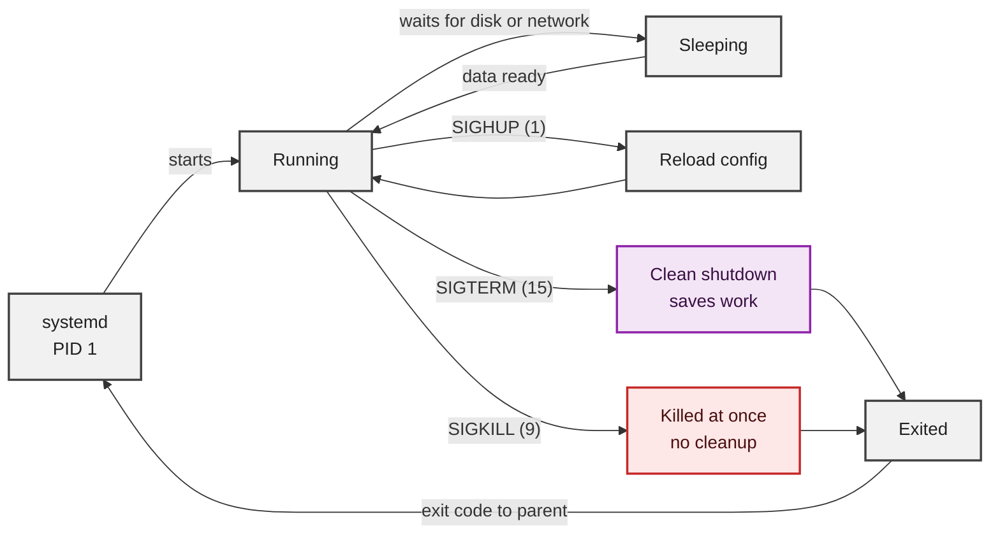
<p align="center"><sub><i>Figure: Process lifecycle and signals</i></sub></p>


Reading the diagram: systemd (PID 1) starts a process, which moves between running and sleeping while it works. A signal changes its path: SIGHUP asks it to reload, SIGTERM lets it finish cleanly, and SIGKILL stops it instantly with no cleanup. When it exits, the parent (often systemd) receives the exit code and decides what to do next. Use `ps -ef --forest` to see the real parent/child tree on your machine.

| Signal | Number | Meaning |
|---|---|---|
| SIGHUP | 1 | "reload your config" (for many daemons) |
| SIGINT | 2 | what Ctrl+C sends |
| SIGKILL | 9 | immediate kill; the app cannot catch it, no cleanup |
| SIGTERM | 15 | polite stop; the default for `kill` |

<b>Example:</b>

```bash
ps aux | head -3                     # all processes: USER PID %CPU %MEM ... COMMAND
ps -ef --forest | less               # parent/child tree
pgrep -a python3                     # find PIDs by name
top                                  # live view: P = sort by CPU, M = by memory, q = quit
sudo apt-get install -y htop && htop # friendlier top (F9 = kill, F10 = quit)
uptime                               # load average for 1, 5, 15 minutes
nproc                                # number of CPUs
kill 4821                            # SIGTERM: please stop cleanly
kill -9 4821                         # SIGKILL: last resort only
```

```text
USER         PID %CPU %MEM    VSZ   RSS TTY      STAT START   TIME COMMAND
root           1  0.0  1.3  22064 13180 ?        Ss   09:01   0:02 /sbin/init
root           2  0.0  0.0      0     0 ?        S    09:01   0:00 [kthreadd]
 10:59:12 up  1:58,  1 user,  load average: 0.52, 0.40, 0.31
2
```

<b>Command breakdown:</b> `ps aux | head -3`

| Part | What it means |
|---|---|
| `ps` | process status – a snapshot of processes |
| `a` | processes of all users |
| `u` | user-friendly columns: USER, %CPU, %MEM, START, COMMAND |
| `x` | include processes with no terminal (services/daemons) |
| `\| head -3` | keep only the header and first two lines |
| `STAT` column | `R` running, `S` sleeping, `Z` zombie, `s` session leader |

<b>Command breakdown:</b> `kill -9 4821`

| Part | What it means |
|---|---|
| `kill` | send a signal to a process (it does not always "kill") |
| `-9` | which signal: 9 = SIGKILL; default with no number is 15 = SIGTERM; `-HUP` or `-1` = reload |
| `4821` | the PID; a wrong PID stops the wrong program, so check with `ps` or `pgrep -a` first |

<b>Load average:</b> the average number of processes running or waiting for CPU. Compare it with `nproc`. A load that stays above the CPU count means work is queuing.

> [!WARNING]
> <b>Common mistake:</b> Do not use `kill -9` first. The app gets no chance to save data or close database connections. Send SIGTERM, wait 10–30 seconds, then use SIGKILL only if it is still running.


> [!NOTE]
> <b>Real-world scenario:</b> Real scenario: a Jenkins agent EC2 instance is slow. `top` shows a leftover test process using 98% CPU for three days. You `kill` it, then fix the pipeline so test processes are cleaned up after each build.


<h3>11. systemd Services</h3>

<b>In simple words:</b> systemd is the first program Linux starts (PID 1). It starts, stops, restarts and watches background programs called <b>services</b>. Each service is described by a small text file called a <b>unit file</b>.

> [!NOTE]
> <b>Simple analogy:</b> systemd is a restaurant manager. Unit files are job descriptions for each staff member: when to start, who they work as, what to do if they faint (restart them). `systemctl` is how you talk to the manager.


<b>Why a DevOps Engineer cares:</b>
- Nginx, Docker, Jenkins, the SSH server, the CloudWatch and Azure Monitor agents, and the kubelet on Kubernetes nodes are all systemd services.
- `Restart=on-failure` gives you basic self-healing for apps running on VMs.
- EC2 user-data and Azure cloud-init scripts often write a unit file and run `systemctl enable --now`.

<b>How it works:</b>

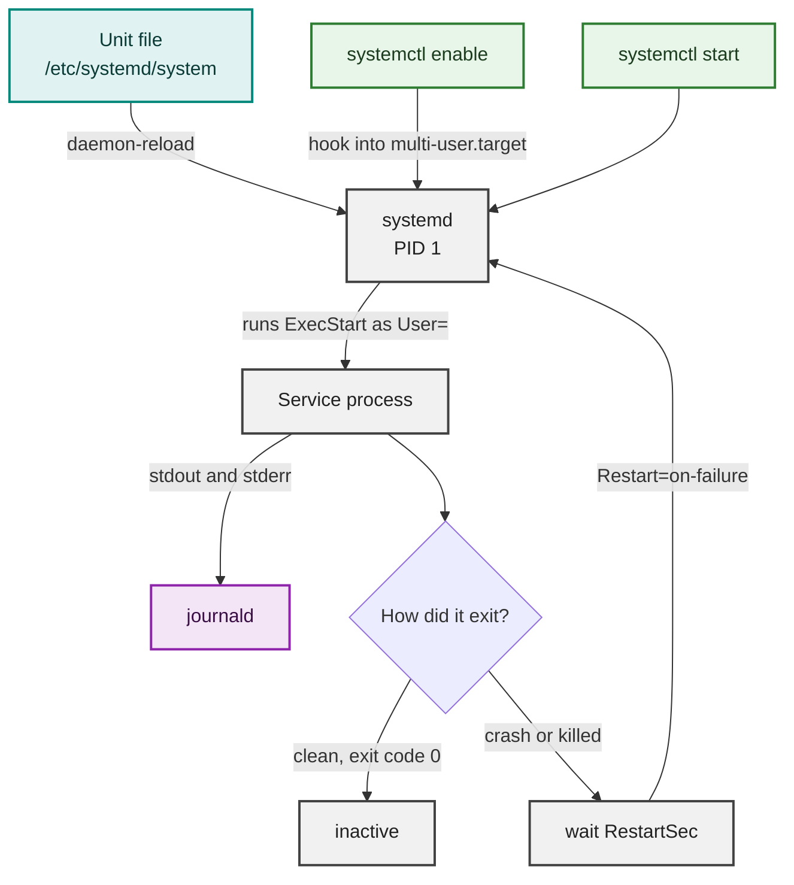
<p align="center"><sub><i>Figure: systemd unit start flow with Restart=on-failure</i></sub></p>


Reading the diagram: systemd reads unit files (after `daemon-reload`). `enable` makes the service start at boot; `start` starts it now. systemd runs the `ExecStart` command as the `User=` you set, and sends its output to journald. If the process crashes or is killed, `Restart=on-failure` makes systemd wait `RestartSec` seconds and start it again; a clean exit leaves it inactive. Units installed by packages live in `/usr/lib/systemd/system`; the ones you put in `/etc/systemd/system` take priority over them.

| Command | What it does |
|---|---|
| `systemctl status <svc>` | state, PID, last log lines |
| `systemctl start` / `stop` / `restart <svc>` | control it now |
| `systemctl enable --now <svc>` | start at boot <b>and</b> start now |
| `systemctl disable <svc>` | do not start at boot |
| `systemctl daemon-reload` | reload unit files after you edit them |
| `systemctl list-units --type=service --state=failed` | find failed services |
| `systemctl cat <svc>` | show the unit file actually in use |
| `systemctl edit <svc>` | create a drop-in override file |

| Often confused | `enable` | `start` |
|---|---|---|
| Effect | start automatically at <b>boot</b> | start <b>now</b> |
| Survives reboot? | yes | no |
| Use both | `systemctl enable --now <svc>` | |

<b>Example:</b> the main parts of a unit file.

```ini
[Unit]
Description=What this service is
After=network-online.target
Wants=network-online.target

[Service]
User=peoplepulse
ExecStart=/full/path/to/program --args
Restart=on-failure
EnvironmentFile=/etc/peoplepulse/app.env

[Install]
WantedBy=multi-user.target
```

- `[Unit]`: description and start order. `After=` means "start after the network is up".
- `[Service]`: how to run it. `User=`: never run apps as root. `ExecStart=` must be a <b>full path</b>.
- `[Install]`: what `enable` hooks into. `multi-user.target` = normal server boot.

<b>Command breakdown:</b> `sudo systemctl enable --now peoplepulse-stub.service`

| Part | What it means |
|---|---|
| `sudo` | changing services needs root (reading `status` does not) |
| `systemctl` | the command-line tool to talk to systemd |
| `enable` | create a link so the service starts at every boot |
| `--now` | also start it right now (otherwise `enable` alone waits for the next reboot) |
| `peoplepulse-stub.service` | unit name; `.service` can be left out; a typo gives "Unit ... not found" |

> [!WARNING]
> <b>Common mistake:</b> A common mistake is forgetting `sudo systemctl daemon-reload` after editing a unit file. systemd then keeps using the old version and prints "Warning: The unit file changed on disk".


> [!TIP]
> <b>Pro tip:</b> Do not edit unit files that came from a package (in `/usr/lib/systemd/system`). Use `sudo systemctl edit <svc>` to create a drop-in in `/etc/systemd/system/<svc>.service.d/`. Package upgrades will not overwrite it.


<h3>12. journalctl – Reading Service Logs</h3>

<b>In simple words:</b> systemd collects the output of every service into one log store called the <b>journal</b>. You read and filter it with `journalctl`.

> [!NOTE]
> <b>Simple analogy:</b> The journal is the building's CCTV recorder. `journalctl` is the playback screen where you choose the camera (`-u`), the time range (`--since`) and fast-forward to live (`-f`).


<b>Why a DevOps Engineer cares:</b>
- The first step for any broken service is reading its journal.
- CloudWatch Agent and Azure Monitor Agent can ship these logs to the cloud for alerting.
- The journal itself can fill a disk, so you need to know how to check its size and shrink it.

<b>How it works:</b>

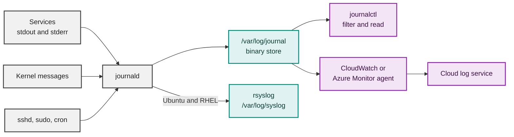
<p align="center"><sub><i>Figure: How logs flow through journald</i></sub></p>


Reading the diagram: every service, the kernel and system tools like sshd, sudo and cron write to journald. journald keeps the logs in its own store, and on Ubuntu and RHEL also forwards them to classic text files through rsyslog. You read them with `journalctl`; in production, an agent ships the same logs to CloudWatch Logs or Azure Monitor so alerts work even when the VM is gone.

| Command | What it shows |
|---|---|
| `journalctl -u <svc>` | all logs for one unit |
| `journalctl -u <svc> -f` | follow live (like `tail -f`) |
| `journalctl -u <svc> --since "10 min ago"` | a time window |
| `journalctl -u <svc> -n 50 --no-pager` | last 50 lines, printed directly |
| `journalctl -p err -b` | only errors since the last boot |
| `journalctl --disk-usage` | journal size on disk |
| `sudo journalctl --vacuum-time=7d` | delete journal entries older than 7 days |

<b>Command breakdown:</b> `journalctl -u peoplepulse-stub --since "10 min ago" -n 50 --no-pager`

| Part | What it means |
|---|---|
| `journalctl` | read the systemd journal |
| `-u peoplepulse-stub` | only this unit; without `-u` you get every log on the server |
| `--since "10 min ago"` | time filter; also accepts `"2026-11-10 09:00"`, `today`, `yesterday` |
| `-n 50` | only the last 50 lines |
| `--no-pager` | print straight to the screen instead of opening `less` (good for scripts and copy/paste) |
| `-f` (other example) | follow new lines live; Ctrl+C to stop |
| `-p err -b` (other example) | priority "error" and worse, since the last boot |

Classic log files still exist in `/var/log/`: `/var/log/syslog` (Ubuntu), `/var/log/messages` (RHEL), `/var/log/auth.log` or `/var/log/secure` (SSH and sudo logins). Amazon Linux 2023 uses the journal only.

<b>Example:</b>

```bash
journalctl -u ssh -n 3 --no-pager     # on RHEL/Amazon Linux the unit is sshd
```

```text
Nov 10 11:20:02 ip-172-31-5-10 sshd[1520]: Accepted publickey for ubuntu from 203.0.113.25 port 52144 ssh2: ED25519 SHA256:abc...
Nov 10 11:20:02 ip-172-31-5-10 sshd[1520]: pam_unix(sshd:session): session opened for user ubuntu(uid=1000) by ubuntu(uid=0)
Nov 10 11:21:40 ip-172-31-5-10 sshd[1533]: Invalid user admin from 198.51.100.7 port 41220
```

> [!TIP]
> <b>Pro tip:</b> The troubleshooting loop: `systemctl status` → `journalctl -u <svc> -n 50` → read the <b>first</b> error, not the last → fix → `daemon-reload` (if you edited the unit) → `restart` → `status` again → health check.


> [!NOTE]
> <b>Real-world scenario:</b> The "Invalid user admin" line above is a bot scanning the internet. This is why we open SSH only to our own IP address in the cloud firewall (security group or NSG).


<h3>13. cron – Scheduled Jobs</h3>

<b>In simple words:</b> cron runs commands on a schedule, such as "every night at 2 AM". You describe the schedule with five time fields.

> [!NOTE]
> <b>Simple analogy:</b> cron is the alarm clock app on your phone. Each alarm (job) has a time pattern and an action. It rings even when nobody is logged in.


<b>Why a DevOps Engineer cares:</b>
- Log cleanup, database backups, certificate checks and report jobs on VMs often use cron.
- The same five-field syntax is used in Kubernetes CronJobs, GitHub Actions `schedule:`, Jenkins triggers and AWS EventBridge.
- A broken cron job fails silently, so nobody notices until a disk fills up or a backup is missing. Knowing the gotchas saves hours.

<b>How it works:</b>

```text
 ┌───────── minute (0-59)
 │ ┌─────── hour (0-23)
 │ │ ┌───── day of month (1-31)
 │ │ │ ┌─── month (1-12)
 │ │ │ │ ┌─ day of week (0-7, 0 and 7 = Sunday)
 │ │ │ │ │
 0 2 * * *     command   -> every day at 02:00
*/15 * * * *   command   -> every 15 minutes
 30 6 * * 1-5  command   -> 06:30 Monday to Friday
```

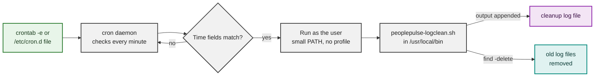
<p align="center"><sub><i>Figure: How cron runs a scheduled job</i></sub></p>


Reading the diagram: you put a schedule line in a crontab or in `/etc/cron.d`. The cron daemon wakes up every minute and checks whether the five time fields match the current time. When they match, it runs the command as the given user with a tiny environment, which is why we use full paths and append the output to a log file. In the lab, the job is the PeoplePulse log-cleanup script.

| Where | Format | Use |
|---|---|---|
| `crontab -e` | 5 time fields + command | personal jobs for your user |
| `/etc/cron.d/<file>` | 5 time fields + <b>user</b> + command | system jobs kept as files (good for IaC) |
| `/etc/cron.daily/` and similar | executable scripts | run once a day or week by the system |

| Often confused | cron | systemd timer |
|---|---|---|
| Config | one line | `.timer` + `.service` files |
| Logs | you must redirect output | automatic in `journalctl` |
| Missed runs (server was off) | skipped | can catch up with `Persistent=true` |

<b>Example:</b>

```bash
crontab -l                       # list your jobs
crontab -e                       # edit your jobs (opens an editor)
# Add this line in the editor: every day at 01:30, save disk usage to a file
# 30 1 * * * /usr/bin/df -h / >> /home/ubuntu/disk-report.log 2>&1
```

```text
no crontab for ubuntu
```

> [!WARNING]
> <b>Common mistake:</b> cron runs with a tiny `PATH` (often `/usr/bin:/bin`) and no profile. Use <b>full paths</b>, and send output to a log (`>> /var/log/job.log 2>&1`) or you will never see errors. cron also uses the server's time zone (usually UTC, not EST). Check with `timedatectl`.


> [!TIP]
> <b>Pro tip:</b> Amazon Linux 2023 does not install cron by default. Run `sudo dnf install -y cronie && sudo systemctl enable --now crond`, or use a systemd timer. For log files, `logrotate` (`/etc/logrotate.d/`) is the purpose-built tool.


<h3>14. Package Managers: apt and dnf</h3>

<b>In simple words:</b> A package manager installs, updates and removes software from trusted online stores called <b>repositories</b>. Ubuntu uses `apt`; Amazon Linux and RHEL use `dnf`.

> [!NOTE]
> <b>Simple analogy:</b> A package manager is the app store on your phone. It downloads verified apps, installs what they depend on, and updates them all with one tap.


<b>Why a DevOps Engineer cares:</b>
- Every Dockerfile, EC2 user-data and Azure cloud-init script installs packages.
- Patching (security updates) is a monthly task at most clients and an audit requirement.
- Pinning package versions means today's build and next month's build install the same thing.

<b>How it works:</b>

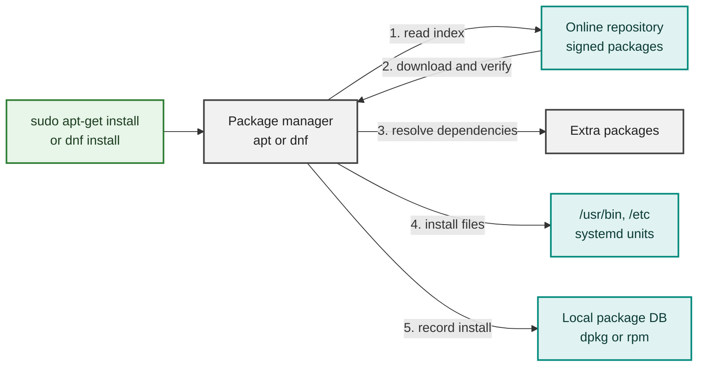
<p align="center"><sub><i>Figure: How a package manager installs software</i></sub></p>


Reading the diagram: you ask for a package by name. The package manager checks its index of the online repository, downloads the package and checks its signature (so nobody can slip in a fake one), and also installs any packages it depends on. Files land in normal places like `/usr/bin` and `/etc`, and the install is recorded in a local database so you can update or remove it later. On EC2 and Azure, the repositories are mirrors close to your region.

| Task | Ubuntu / Debian | Amazon Linux 2023 / RHEL |
|---|---|---|
| Refresh package list | `sudo apt-get update` | `sudo dnf makecache` (dnf also refreshes automatically) |
| Install | `sudo apt-get install -y nginx` | `sudo dnf install -y nginx` |
| Remove | `sudo apt-get remove -y nginx` | `sudo dnf remove -y nginx` |
| Upgrade all | `sudo apt-get upgrade -y` | `sudo dnf upgrade -y` |
| Search | `apt-cache search htop` | `dnf search htop` |
| Which package owns a file | `dpkg -S /usr/bin/curl` | `rpm -qf /usr/bin/curl` |
| List installed | `dpkg -l` | `rpm -qa` |

`yum` still works on RHEL 8/9 and Amazon Linux 2023 as an alias for `dnf`. In scripts and Dockerfiles use `apt-get`, because `apt` warns that its output may change.

<b>Example:</b>

```bash
sudo apt-get update && sudo apt-get install -y tree
tree -L 1 /etc/systemd
dpkg -S /usr/bin/tree
```

```text
/etc/systemd
├── journald.conf
├── logind.conf
├── system
├── system.conf
└── user
...
tree: /usr/bin/tree
```

<b>Command breakdown:</b> `sudo apt-get update && sudo apt-get install -y tree`

| Part | What it means |
|---|---|
| `sudo apt-get update` | download the latest package <b>list</b> (it does not upgrade anything) |
| `&&` | run the next command only if the first one succeeded |
| `apt-get install` | download and install the package and its dependencies |
| `-y` | answer "yes" automatically; without it a script or Dockerfile stops at the prompt |
| `tree` | package name |
| `sudo dnf install -y tree` (Amazon Linux/RHEL) | same job; dnf refreshes its list automatically |

> [!WARNING]
> <b>Common mistake:</b> On Ubuntu, `apt-get install` fails with "Unable to locate package" on a brand-new VM until you run `apt-get update` once. In scripts, always run the update first.


<h3>15. Disk and Memory</h3>

<b>In simple words:</b> `df` shows how full each disk is. `du` shows which folders use the space. `free` shows memory. `top`/`htop` show live CPU and memory per process. `lsof` lists open files and network ports.

> [!NOTE]
> <b>Simple analogy:</b> `df` is the fuel gauge, `du` tells you which suitcase in the car is heaviest, `free` is how much space is left on the desk, and `lsof` is the list of who has which book borrowed from the library.


<b>Why a DevOps Engineer cares:</b>
- "Disk 90% full" and "high memory" are the most common alerts on Linux VMs and Kubernetes nodes.
- When the disk fills up, databases, Docker and logging can no longer write, and that is a real outage.
- Right-sizing VMs to cut cloud cost starts with these numbers.

<b>How it works:</b>

| Command | Answers the question |
|---|---|
| `df -h` | how full is each filesystem? |
| `df -i` | are we out of <b>inodes</b> (file slots)? A disk can be "full" with free GB if millions of tiny files exist |
| `du -sh /var/log/*` | how big is each item in this folder? |
| `sudo du -xh / --max-depth=1 2>/dev/null \| sort -h \| tail` | biggest top-level folders on the root disk |
| `free -h` | how much RAM is in use? Look at <b>available</b> |
| `top` / `htop` | which process uses CPU or memory right now? |
| `sudo lsof -i :8080` | which process listens on port 8080? |
| `sudo lsof +L1` | deleted files still held open (space not freed) |

<b>Example:</b>

```bash
df -h /
free -h
```

```text
Filesystem      Size  Used Avail Use% Mounted on
/dev/root       7.6G  2.1G  5.5G  28% /
               total        used        free      shared  buff/cache   available
Mem:           957Mi       410Mi       112Mi       1.0Mi       590Mi       547Mi
Swap:             0B          0B          0B
```

Linux uses spare RAM as a disk cache (`buff/cache`), so the "free" column often looks worryingly low. <b>available</b> (547Mi) is what new programs can really use.

<b>Command breakdown:</b> `sudo du -xh / --max-depth=1 2>/dev/null | sort -h | tail`

| Part | What it means |
|---|---|
| `sudo` | read every folder, including ones only root can open |
| `du` | disk usage – add up the size of files in folders |
| `-x` | stay on this one filesystem (skip `/proc` and other mounted disks) |
| `-h` | human sizes (K, M, G) |
| `/` | start at the root |
| `--max-depth=1` | show totals only for the top-level folders, not every sub-folder |
| `2>/dev/null` | hide "Permission denied" and similar errors |
| `\| sort -h` | sort by human-readable size, smallest first |
| `\| tail` | show the last 10 lines = the 10 biggest folders |

<b>Command breakdown:</b> `sudo lsof -i :8080` and `sudo lsof +L1`

| Part | What it means |
|---|---|
| `lsof` | list open files – in Linux, network sockets are files too |
| `sudo` | without it you only see your own processes |
| `-i :8080` | only network connections on port 8080; shows COMMAND, PID and USER |
| `+L1` | files with fewer than 1 link, i.e. deleted but still held open – the hidden cause of "disk still full" |

| Often confused | `df` | `du` |
|---|---|---|
| Looks at | the whole filesystem | specific files and folders |
| Counts deleted-but-open files | yes | no |
| Use it to | detect the problem | find the cause |

> [!WARNING]
> <b>Common mistake:</b> Deleting a big log file that a running process still writes to does not free space. `df` still shows the disk full. Find it with `sudo lsof +L1` and restart the service. Better: empty the file instead of deleting it: `sudo truncate -s 0 /var/log/big.log`.


> [!NOTE]
> <b>Real-world scenario:</b> Real scenario: a client's Jenkins EC2 disk hits 100% every Monday. `du` shows `/var/lib/docker` at 40 GB of old images. The fix is a weekly `docker system prune` job plus a CloudWatch disk alarm at 80%.


<h3>16. SSH Basics: Connecting to a Cloud VM</h3>

<b>In simple words:</b> SSH (Secure Shell) gives you an encrypted terminal on a remote server. You log in with a <b>key pair</b>: a private key that stays on your laptop and a public key that is placed on the server.

> [!NOTE]
> <b>Simple analogy:</b> The public key is a padlock you give to the server. The private key is the only key that opens that padlock. You can hand out padlocks freely, but you never give away the key.


<b>Why a DevOps Engineer cares:</b>
- You SSH into VMs to debug; Ansible and Jenkins agents also connect over SSH.
- Leaked private keys and SSH open to the whole internet are top security findings.
- Interviewers ask "how do you connect to a private EC2 instance?"

<b>How it works:</b>

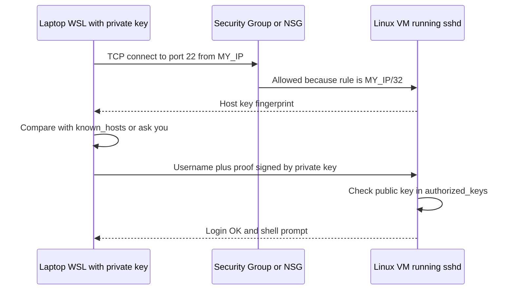
<p align="center"><sub><i>Figure: SSH key login to an EC2 instance or Azure VM</i></sub></p>


Reading the diagram: your laptop first has to get past the cloud firewall (the AWS Security Group or Azure Network Security Group), which only allows port 22 from your own IP. The VM proves who <i>it</i> is with a host key fingerprint, which your laptop stores in `~/.ssh/known_hosts`. Then your laptop proves who <i>you</i> are by signing with the private key; the VM checks it against the public key in `~/.ssh/authorized_keys`. The private key never leaves your laptop.

| Cloud | Default user (Ubuntu image) | Default user (other images) | Firewall |
|---|---|---|---|
| AWS EC2 | `ubuntu` | `ec2-user` (Amazon Linux, RHEL) | Security Group |
| Azure VM | the `--admin-username` you choose (we use `azureuser`) | same | Network Security Group (NSG) |

<b>Example:</b>

```bash
ssh-keygen -t ed25519 -f ~/.ssh/id_ed25519 -C "<your-name>@laptop"  # create a key pair (once)
chmod 600 ~/.ssh/day02-<your-name>.pem                             # private key must be private
ssh -i ~/.ssh/day02-<your-name>.pem ubuntu@<PUBLIC_IP>             # connect
scp -i ~/.ssh/day02-<your-name>.pem notes.txt ubuntu@<PUBLIC_IP>:/tmp/   # copy a file to the VM
```

```text
The authenticity of host '<PUBLIC_IP> (<PUBLIC_IP>)' can't be established.
ED25519 key fingerprint is SHA256:Xq3f...
Are you sure you want to continue connecting (yes/no/[fingerprint])? yes
Welcome to Ubuntu 24.04.1 LTS (GNU/Linux 6.8.0-1015-aws x86_64)
ubuntu@ip-172-31-5-10:~$
```

Save typing with an entry in `~/.ssh/config`, then run `ssh day02`:

```text
Host day02
  HostName <PUBLIC_IP>
  User ubuntu
  IdentityFile ~/.ssh/day02-<your-name>.pem
```

<b>Command breakdown:</b> `ssh -i ~/.ssh/day02-<your-name>.pem ubuntu@<PUBLIC_IP>`

| Part | What it means |
|---|---|
| `ssh` | open a secure remote shell |
| `-i ~/.ssh/day02-<your-name>.pem` | identity file = which private key to use; must be mode `600` |
| `ubuntu` | remote username; wrong user (for example `root` or `ec2-user` on Ubuntu) gives "Permission denied (publickey)" |
| `@<PUBLIC_IP>` | the VM's public IP or DNS name |
| `-p 2222` (optional) | use a different port than 22 |
| `-v` (optional) | verbose – shows each step, very useful when login fails |

<b>Command breakdown:</b> `scp -i key.pem notes.txt ubuntu@<PUBLIC_IP>:/tmp/`

| Part | What it means |
|---|---|
| `scp` | secure copy over SSH |
| `-i key.pem` | same private key as for `ssh` |
| `notes.txt` | local source file (use `-r` for a folder) |
| `ubuntu@<PUBLIC_IP>:/tmp/` | destination: user, host, then `:` and the remote path; swap the order to download |

> [!WARNING]
> <b>Common mistake:</b> "WARNING: UNPROTECTED PRIVATE KEY FILE! Permissions 0644 ... are too open" means SSH refuses your key. Run `chmod 600` on it. On Windows, keep keys inside WSL (`~/.ssh`), not on `/mnt/c`, where chmod does not work.


> [!CAUTION]
> <b>Cost / security alert:</b> Never open port 22 to `0.0.0.0/0` and never commit a `.pem` file to Git. At many US clients, servers have no public IP; engineers use AWS Systems Manager Session Manager or Azure Bastion instead of direct SSH.


<h3>Live Demo: Run the PeoplePulse Stub as a systemd Service</h3>

The real FastAPI app comes on Day 5. Today we run a <b>stub</b> instead: Python's built-in web server, serving one static `health` file and running as a dedicated service account.

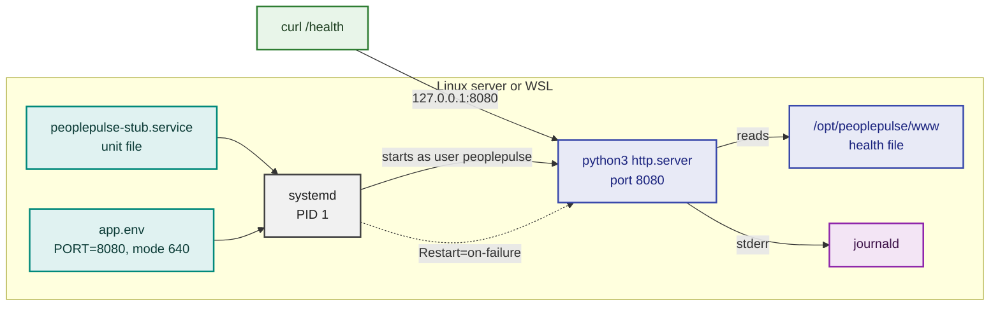
<p align="center"><sub><i>Figure: Live demo - PeoplePulse stub as a systemd service</i></sub></p>


Reading the diagram: systemd reads the unit file and the `app.env` config, then starts Python's web server as the non-root `peoplepulse` user. The server answers `curl` on `127.0.0.1:8080` by returning the `health` file, and its request log goes to journald. If the process dies, systemd restarts it; you will prove this in step 5.

1. Create the service account, folders and content:

```bash
sudo useradd --system --no-create-home --shell /usr/sbin/nologin peoplepulse
sudo mkdir -p /opt/peoplepulse/www /var/log/peoplepulse /etc/peoplepulse
echo '{"status":"ok","app":"peoplepulse-stub"}' | sudo tee /opt/peoplepulse/www/health > /dev/null
sudo chown -R root:peoplepulse /opt/peoplepulse
sudo chmod -R 750 /opt/peoplepulse
sudo chown peoplepulse:peoplepulse /var/log/peoplepulse
sudo chmod 750 /var/log/peoplepulse
echo 'PORT=8080' | sudo tee /etc/peoplepulse/app.env > /dev/null
sudo chown root:peoplepulse /etc/peoplepulse/app.env && sudo chmod 640 /etc/peoplepulse/app.env
ls -l /opt/peoplepulse /etc/peoplepulse
```

```text
/etc/peoplepulse:
total 4
-rw-r----- 1 root peoplepulse 10 Nov 10 11:56 app.env

/opt/peoplepulse:
total 4
drwxr-x--- 2 root peoplepulse 4096 Nov 10 11:56 www
```

<b>Command breakdown:</b> `echo 'PORT=8080' | sudo tee /etc/peoplepulse/app.env > /dev/null`

| Part | What it means |
|---|---|
| `echo 'PORT=8080'` | print the text we want in the file |
| `\|` | pipe the text into the next command |
| `sudo tee /etc/peoplepulse/app.env` | write it to a root-owned file; `sudo echo ... > file` fails because the `>` runs as you, not root |
| `> /dev/null` | hide the copy that `tee` also prints to the screen |
| `tee -a` (other use) | append instead of overwrite |

2. Write the unit file:

```bash
sudo tee /etc/systemd/system/peoplepulse-stub.service > /dev/null <<'EOF'
[Unit]
Description=PeoplePulse stub web service
After=network-online.target
Wants=network-online.target

[Service]
Type=simple
User=peoplepulse
Group=peoplepulse
EnvironmentFile=/etc/peoplepulse/app.env
WorkingDirectory=/opt/peoplepulse
ExecStart=/usr/bin/python3 -m http.server ${PORT} --bind 127.0.0.1 --directory /opt/peoplepulse/www
Restart=on-failure
RestartSec=5
UMask=0027
NoNewPrivileges=true

[Install]
WantedBy=multi-user.target
EOF
```

<b>Command breakdown:</b> the `ExecStart=` line and its neighbours

| Part | What it means |
|---|---|
| `<<'EOF' ... EOF` | here-document: everything between is written to the file; quotes on `'EOF'` stop the shell from expanding `${PORT}` |
| `/usr/bin/python3` | full path – systemd does not search `PATH` the way your shell does |
| `-m http.server` | run Python's built-in web server module |
| `${PORT}` | replaced by systemd with the value from `EnvironmentFile` (8080) |
| `--bind 127.0.0.1` | listen only on this machine, not on the network |
| `--directory /opt/peoplepulse/www` | folder to serve files from |
| `User=` / `Group=` | run as the service account, never root |
| `UMask=0027` | new files the app creates get 640 / 750 |
| `NoNewPrivileges=true` | the process can never gain more rights (for example through setuid programs) |

3. Load, enable and start it:

```bash
sudo systemctl daemon-reload
sudo systemctl enable --now peoplepulse-stub.service
systemctl status peoplepulse-stub --no-pager
```

```text
● peoplepulse-stub.service - PeoplePulse stub web service
     Loaded: loaded (/etc/systemd/system/peoplepulse-stub.service; enabled; preset: enabled)
     Active: active (running) since Tue 2026-11-10 12:00:04 EST; 3s ago
   Main PID: 4821 (python3)
     CGroup: /system.slice/peoplepulse-stub.service
             └─4821 /usr/bin/python3 -m http.server 8080 --bind 127.0.0.1 --directory /opt/peoplepulse/www
```

4. Test it and check who owns the process and the port:

```bash
curl -s http://127.0.0.1:8080/health
ps -o user,pid,cmd -C python3
sudo lsof -i :8080
```

```text
{"status":"ok","app":"peoplepulse-stub"}
USER         PID CMD
peoplep+    4821 /usr/bin/python3 -m http.server 8080 --bind 127.0.0.1 --directory /opt/peoplepulse/www
COMMAND  PID        USER   FD   TYPE DEVICE SIZE/OFF NODE NAME
python3 4821 peoplepulse    3u  IPv4  51234      0t0  TCP localhost:http-alt (LISTEN)
```

5. Prove that `Restart=on-failure` works: kill the process and watch systemd bring it back:

```bash
sudo kill -9 "$(systemctl show -p MainPID --value peoplepulse-stub)"
sleep 6
systemctl status peoplepulse-stub --no-pager | head -3
journalctl -u peoplepulse-stub -n 5 --no-pager
```

```text
     Active: active (running) since Tue 2026-11-10 12:02:15 EST; 1s ago
... peoplepulse-stub.service: Main process exited, code=killed, status=9/KILL
... peoplepulse-stub.service: Failed with result 'signal'.
... peoplepulse-stub.service: Scheduled restart job, restart counter is at 1.
... Started peoplepulse-stub.service - PeoplePulse stub web service.
```

<b>Command breakdown:</b> `sudo kill -9 "$(systemctl show -p MainPID --value peoplepulse-stub)"`

| Part | What it means |
|---|---|
| `$( ... )` | command substitution: run the inner command and paste its output here |
| `systemctl show -p MainPID` | ask systemd for one property of the unit: its main process ID |
| `--value` | print only the number (`4821`), not `MainPID=4821` |
| `kill -9` | send SIGKILL – simulates a crash, so `Restart=on-failure` kicks in (a normal `systemctl stop` would not restart) |
| `"..."` | quotes keep the result as one word |

6. Show the health of the box:

```bash
df -h / && free -h && uptime
```

> [!IMPORTANT]
> <b>Key point:</b> Point out to the class: the app runs as `peoplepulse` (not root), listens only on `127.0.0.1`, reads a `640` config file, and restarts itself after a crash. You will see the same design again in a Dockerfile (Day 6) and a Kubernetes Deployment (Day 11).


---


<h2>11:15 AM – 12:15 PM · Q&A, Live Quiz & Lab Briefing</h2>


| Minutes | Activity | Method |
|---|---|---|
| 11:15 – 11:35 | Interview-style Q&A (8 questions) | Discussion |
| 11:35 – 11:55 | Live quiz (10 questions) and answer review | Quiz |
| 11:55 – 12:10 | Lab briefing: tasks, acceptance criteria, time-boxes | Lecture |
| 12:10 – 12:15 | Everyone confirms `sudo` works and chooses Local, AWS or Azure for the lab | Hands-on |

<h3>Interview-style Q&A</h3>


<h4>1. "A service won't start on a Linux server. Walk me through how you troubleshoot."</h4>

<b>Model answer:</b> I run `systemctl status <svc>` for the state and exit code, then `journalctl -u <svc> -n 100 --no-pager` and read the first real error. Common causes are a wrong path in `ExecStart` (status 203/EXEC), "Permission denied" on files, a port already in use (`ss -ltnp` or `lsof -i`), or a bad config or env file. After the fix I run `daemon-reload` if I touched the unit, restart, and confirm with `status` and a health check.

<h4>2. "The disk is 100% full on a production server. What do you do?"</h4>

<b>Model answer:</b> `df -h` to find the filesystem, `df -i` to rule out inodes, then `du -xh --max-depth=1 | sort -h` to drill down. The culprit is usually `/var/log`, Docker images or `/tmp`. I truncate or compress logs rather than deleting files that are still open, check `lsof +L1`, and vacuum the journal. Then I fix the cause with logrotate or a retention policy and add a disk alarm at 80%.

<h4>3. "What does chmod 640 mean, and when would you use it?"</h4>

<b>Model answer:</b> Owner read and write, group read, others nothing. I use it for config files that the app's group must read but other users must not, for example `/etc/peoplepulse/app.env` owned by `root:peoplepulse`.

<h4>4. "Why shouldn't applications run as root?"</h4>

<b>Model answer:</b> If the app is hacked, the attacker gets full control of the host. A dedicated non-login service account with only the permissions it needs limits the damage ("blast radius"). The same rule applies in containers (`USER` in a Dockerfile) and Kubernetes (`runAsNonRoot`).

<h4>5. "What's the difference between kill and kill -9?"</h4>

<b>Model answer:</b> `kill` sends SIGTERM, which the app can catch to shut down cleanly. `kill -9` sends SIGKILL, which cannot be caught, so there is no cleanup and data can be lost. I use SIGTERM first and SIGKILL only if the process does not exit.

<h4>6. "free shows only 200 MB free. Is the server out of memory?"</h4>

<b>Model answer:</b> Not necessarily. Linux uses spare RAM for disk cache. I look at the `available` column, check swap, run `vmstat 1 5` to see if it is swapping, and search the journal for OOM-killer messages (`journalctl -k | grep -i oom`) before deciding.

<h4>7. "How do you schedule a recurring job, and what are the gotchas?"</h4>

<b>Model answer:</b> A file in `/etc/cron.d/` or a systemd timer, kept in Git. Gotchas: cron has a minimal PATH so I use full paths, the server time zone is usually UTC, I send output to a log, and I make the job safe to run twice (idempotent).

<h4>8. "How do you securely connect to an EC2 instance or Azure VM?"</h4>

<b>Model answer:</b> Key-based SSH only, private key `600`, port 22 open only to my IP in the security group or NSG. In production I prefer no public IP at all and use AWS Systems Manager Session Manager or Azure Bastion, which are audited and need no open inbound port.

<h3>Live Quiz (10 questions)</h3>


<b>Q1.</b> Which directory holds system-wide configuration files?
- A) `/var`
- B) `/etc`
- C) `/opt`
- D) `/usr`

<b>Q2.</b> What does this print? `chmod 754 run.sh && stat -c '%A' run.sh`
- A) `-rwxr-xr--`
- B) `-rwxr-x--x`
- C) `-rw-r-xr--`
- D) `-rwxrwxr--`

<b>Q3.</b> With `umask 027`, what permissions does a new <b>file</b> get?
- A) 750
- B) 640
- C) 644
- D) 600

<b>Q4.</b> True or false: `usermod -G docker haiman` adds haiman to docker and keeps Haiman's other groups.
- A) True
- B) False

<b>Q5.</b> After editing a unit file in `/etc/systemd/system/`, which command must you run before restarting?
- A) `systemctl reload-all`
- B) `systemctl daemon-reload`
- C) `journalctl --rotate`
- D) `systemctl enable`

<b>Q6.</b> What does the cron expression `*/10 9-17 * * 1-5` mean?
- A) Every 10 hours
- B) Every 10 minutes from 9:00 AM to 5:50 PM, Monday to Friday
- C) At 9:10 and 5:10 every day
- D) Every 10 minutes at weekends

<b>Q7.</b> Which command shows the process listening on port 8080?
- A) `df -h 8080`
- B) `lsof -i :8080`
- C) `free -p 8080`
- D) `du 8080`

<b>Q8.</b> A shared folder shows `drwxrws---`. What does the `s` do?
- A) Only the owner can delete files
- B) Programs inside run as root
- C) New files inherit the folder's group
- D) The folder is hidden

<b>Q9.</b> `systemctl status` shows `status=203/EXEC`. What is the most likely cause?
- A) The port is in use
- B) Out of memory
- C) The `ExecStart` program path is wrong or not executable
- D) The network is down

<b>Q10.</b> SSH says your key file permissions are "too open". Which command fixes it?
- A) `chmod 777 key.pem`
- B) `chmod 644 key.pem`
- C) `chmod 600 key.pem`
- D) `chown root key.pem`

<h3>Lab Briefing</h3>

<b>What you build this afternoon:</b> a small "server" with team users and correct permissions, the PeoplePulse stub running under systemd, a cron job that cleans old logs, and a broken service that you fix from its logs. You record the evidence in the Linux lab worksheet (template in the Commit section).

<b>Acceptance criteria:</b>
- Users `haiman`, `cindia`, `jobanjit` (group `devops`), `carla`, `raymundo` (group `qa`) and service account `peoplepulse` exist; `id` output recorded.
- `/srv/devops-shared` is `2770 root:devops`; a file created by haiman is group-owned by `devops`; carla cannot read it.
- `/etc/sudoers.d/devops` lets the `devops` group restart only the PeoplePulse service and passes `visudo -c`.
- `peoplepulse-stub.service` is <b>enabled</b> and <b>active</b>; `curl 127.0.0.1:8080/health` returns JSON.
- `/etc/cron.d/peoplepulse-logclean` deletes `*.log` files older than 7 days in `/var/log/peoplepulse`; tested by hand and by cron.
- `pp-broken.service` fixed, with both root causes and the proving log lines in the worksheet.
- Worksheet, unit file and cron file pushed to the `day02-linux` branch.

<b>Time-boxes:</b> Task 0 by 1:30 PM, Tasks 1–2 by 2:00 PM, Tasks 3–4 by 2:40 PM, Lab Part 2 challenges 2:45–4:00 PM.

---


<h2>12:15 – 1:15 PM · Lunch</h2>


Take a proper break away from the screen. If you plan to use a cloud VM, make sure your AWS or Azure CLI login still works before 1:15 PM.

---


<h2>1:15 – 2:45 PM · Lab Part 1 – Task Assignment & Guided Build</h2>


> [!NOTE]
> <b>Lab start (1:15 PM):</b> the trainer posts today's lab tasks in the batch channel. Work through them in order, ask for help in the channel if you are stuck for more than 15 minutes, and report your results (screenshots, command output, Git link) to the trainer at the <b>4:00 PM review</b>.

| Minutes | Activity | Method |
|---|---|---|
| 1:15 – 1:30 | Task 0: prepare your Linux machine (WSL check, or launch EC2 / Azure VM and SSH in) | Task |
| 1:30 – 1:50 | Task 1: users, groups and a setgid shared folder | Task |
| 1:50 – 2:00 | Task 2: limited sudo for the `devops` group | Task |
| 2:00 – 2:20 | Task 3: PeoplePulse stub under systemd with an access log | Task |
| 2:20 – 2:40 | Task 4: log-cleanup cron job, tested by hand and by cron | Task |
| 2:40 – 2:45 | Mentor walks the room and checks Tasks 1–4 checkpoints | Mentor check |

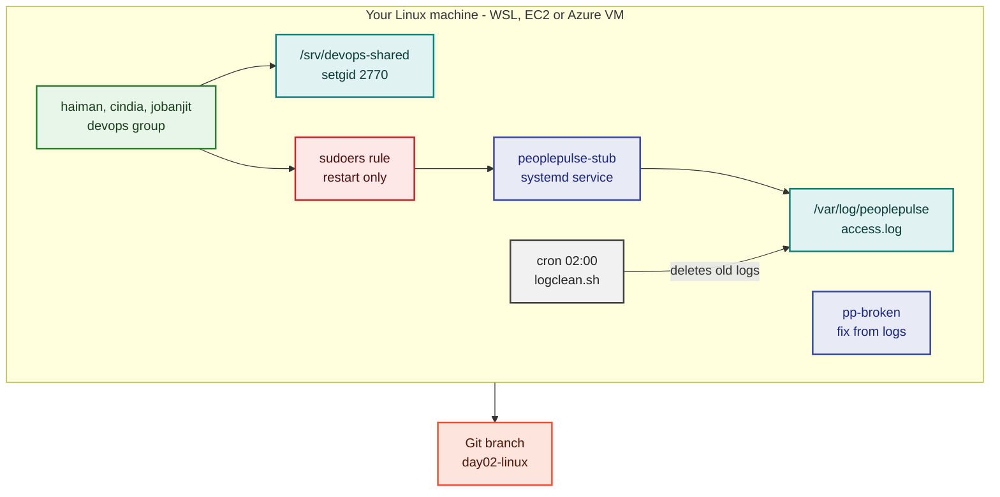
<p align="center"><sub><i>Figure: Lab - what you will build this afternoon</i></sub></p>


Reading the diagram: Task 1 creates the team users and the setgid shared folder, Task 2 gives the team one narrow sudo rule, Task 3 runs the PeoplePulse stub with an access log, and Task 4 adds a nightly cron job that removes old logs. In Lab Part 2 you fix `pp-broken` from its logs. At the end of the day, the worksheet and config files go to the `day02-linux` Git branch.

<h3>Task 0 – Prepare Your Linux Machine</h3>

<b>Option A – Local (WSL / Ubuntu):</b> confirm systemd and sudo, then go to Task 1.

```bash
ps -p 1 -o comm=      # must print: systemd
sudo -v && echo "sudo OK"
```

<b>Option B – AWS EC2 `t3.micro` (optional).</b> Run on your laptop. Cost: free-tier eligible on many accounts; otherwise about $0.01 per hour. Terminate it today.

```bash
export AWS_REGION=us-east-1
MY_IP=$(curl -s https://checkip.amazonaws.com)
AMI_ID=$(aws ssm get-parameter \
  --name /aws/service/canonical/ubuntu/server/24.04/stable/current/amd64/hvm/ebs-gp3/ami-id \
  --query Parameter.Value --output text)

aws ec2 create-key-pair --key-name day02-<your-name> --key-type ed25519 \
  --query KeyMaterial --output text > ~/.ssh/day02-<your-name>.pem
chmod 600 ~/.ssh/day02-<your-name>.pem

VPC_ID=$(aws ec2 describe-vpcs --filters Name=is-default,Values=true --query 'Vpcs[0].VpcId' --output text)
SG_ID=$(aws ec2 create-security-group --group-name day02-ssh-<your-name> \
  --description "Day02 SSH from my IP" --vpc-id "$VPC_ID" --query GroupId --output text)
aws ec2 authorize-security-group-ingress --group-id "$SG_ID" --protocol tcp --port 22 --cidr "${MY_IP}/32"

INSTANCE_ID=$(aws ec2 run-instances --image-id "$AMI_ID" --instance-type t3.micro \
  --key-name day02-<your-name> --security-group-ids "$SG_ID" \
  --tag-specifications 'ResourceType=instance,Tags=[{Key=Name,Value=day02-linux},{Key=owner,Value=<your-name>},{Key=env,Value=dev},{Key=course,Value=devops-8wk}]' \
  --query 'Instances[0].InstanceId' --output text)
aws ec2 wait instance-running --instance-ids "$INSTANCE_ID"
PUBLIC_IP=$(aws ec2 describe-instances --instance-ids "$INSTANCE_ID" \
  --query 'Reservations[0].Instances[0].PublicIpAddress' --output text)
echo "$INSTANCE_ID $SG_ID $PUBLIC_IP" | tee ~/day02-ids.txt
ssh -i ~/.ssh/day02-<your-name>.pem ubuntu@"$PUBLIC_IP"
```

<b>Command breakdown:</b> `aws ec2 run-instances ...`

| Part | What it means |
|---|---|
| `aws ec2 run-instances` | AWS CLI v2: launch one or more EC2 instances |
| `--image-id "$AMI_ID"` | which OS image (AMI); we looked up the latest Ubuntu 24.04 from a public SSM parameter, so no hard-coded ID |
| `--instance-type t3.micro` | size: 2 vCPU, 1 GiB RAM – small and cheap; a typo like `t3.xlarge` costs about 16 times more |
| `--key-name day02-<your-name>` | which key pair's public key AWS puts in `authorized_keys` |
| `--security-group-ids "$SG_ID"` | firewall that allows port 22 only from your IP |
| `--tag-specifications '...'` | tags `owner`, `env`, `course` so you can find and clean up (and track cost) |
| `--query 'Instances[0].InstanceId'` | JMESPath filter: return only the instance ID |
| `--output text` | plain text, easy to store in a shell variable |
| `aws ec2 wait instance-running` | pause until the instance is running before asking for its IP |

<b>Option C – Azure `Standard_B1s` VM (optional).</b> Run on your laptop after `az login`. Cost: free-tier eligible for new accounts; otherwise about $0.01 per hour. Delete it today.

```bash
MY_IP=$(curl -s https://checkip.amazonaws.com)
RG=rg-day02-<your-name>
az group create --name "$RG" --location eastus \
  --tags owner=<your-name> env=dev course=devops-8wk
az vm create --resource-group "$RG" --name day02-linux \
  --image Ubuntu2404 --size Standard_B1s \
  --admin-username azureuser --generate-ssh-keys \
  --public-ip-sku Standard \
  --tags owner=<your-name> env=dev course=devops-8wk
# az vm create opens SSH to any address by default - limit it to your IP
az network nsg rule update --resource-group "$RG" --nsg-name day02-linuxNSG \
  --name default-allow-ssh --source-address-prefixes "${MY_IP}/32"
PUBLIC_IP=$(az vm show -d --resource-group "$RG" --name day02-linux --query publicIps -o tsv)
ssh azureuser@"$PUBLIC_IP"
```

<b>Command breakdown:</b> `az vm create ...`

| Part | What it means |
|---|---|
| `az vm create` | Azure CLI: create a VM plus the network pieces it needs (VNet, NIC, public IP, NSG) |
| `--resource-group "$RG"` | the folder that holds everything; deleting it deletes all of it |
| `--name day02-linux` | VM name; Azure names the firewall `day02-linuxNSG` |
| `--image Ubuntu2404` | short alias for the Ubuntu 24.04 LTS image |
| `--size Standard_B1s` | 1 vCPU, 1 GiB RAM burstable – the cheap lab size |
| `--admin-username azureuser` | the Linux user you log in as |
| `--generate-ssh-keys` | use your existing `~/.ssh/id_rsa.pub`, or create a key pair if none exists |
| `--public-ip-sku Standard` | the current public IP type (Basic is retired) |
| `--tags ...` | same `owner`, `env`, `course` tags as on AWS |
| `az network nsg rule update ... --source-address-prefixes` | tighten the default SSH rule from "any" to your IP only |

<b>Checkpoint:</b> you have a shell prompt (`ubuntu@...`, `azureuser@...` or your WSL user) and `cat /etc/os-release` shows Ubuntu 24.04. Write which option you used in the worksheet.

<h3>Task 1 – Users, Groups and a Shared Team Folder</h3>


```bash
# One Linux account per trainee in the Nov-10 batch
sudo groupadd devops                               # platform team: owns the shared runbooks
sudo groupadd qa                                   # QA team: must NOT read devops files
for u in haiman cindia jobanjit; do sudo useradd -m -s /bin/bash -G devops "$u"; done
for u in carla raymundo;         do sudo useradd -m -s /bin/bash -G qa     "$u"; done
for u in haiman cindia jobanjit carla raymundo; do
  echo "$u:Lab-Pass-123!" | sudo chpasswd          # lab-only passwords
done

sudo mkdir -p /srv/devops-shared
sudo chown root:devops /srv/devops-shared
sudo chmod 2770 /srv/devops-shared

sudo -u haiman bash -c 'umask 007; echo "runbook v1" > /srv/devops-shared/runbook.txt'
sudo ls -l /srv/devops-shared
sudo -u jobanjit   cat /srv/devops-shared/runbook.txt     # works
sudo -u carla cat /srv/devops-shared/runbook.txt     # should fail
id haiman; id carla
```

```text
total 4
-rw-rw---- 1 haiman devops 11 Nov 10 14:22 runbook.txt
runbook v1
cat: /srv/devops-shared/runbook.txt: Permission denied
uid=1001(haiman) gid=1001(haiman) groups=1001(haiman),1100(devops)
uid=1004(carla) gid=1004(carla) groups=1004(carla),1101(qa)
```

<b>Checkpoint:</b> the file's group is `devops` (inherited through setgid), jobanjit can read it, carla (qa group) gets "Permission denied". Paste the `ls -l` and both `id` outputs into the worksheet.

<h3>Task 2 – Limited sudo for the devops Group</h3>


```bash
echo '%devops ALL=(root) NOPASSWD: /usr/bin/systemctl restart peoplepulse-stub.service, /usr/bin/systemctl status peoplepulse-stub.service' \
  | sudo tee /etc/sudoers.d/devops > /dev/null
sudo chmod 440 /etc/sudoers.d/devops
sudo visudo -c                                  # syntax check
sudo -l -U haiman                                # what may haiman run?
```

```text
/etc/sudoers: parsed OK
/etc/sudoers.d/devops: parsed OK
User haiman may run the following commands on day02-linux:
    (root) NOPASSWD: /usr/bin/systemctl restart peoplepulse-stub.service, /usr/bin/systemctl status peoplepulse-stub.service
```

<b>Command breakdown:</b> the sudoers rule `%devops ALL=(root) NOPASSWD: /usr/bin/systemctl restart peoplepulse-stub.service`

| Part | What it means |
|---|---|
| `%devops` | applies to the group `devops` (`%` means group; without it, a user name) |
| `ALL` | on any host name (this file is per server anyway) |
| `(root)` | may run the command as root |
| `NOPASSWD:` | no password prompt – needed for automation; leave it out for humans if policy requires |
| `/usr/bin/systemctl restart peoplepulse-stub.service` | the <b>exact</b> allowed command with full path; anything else is refused |
| `chmod 440` | sudoers files must be read-only, or sudo ignores them |
| `visudo -c` | check the syntax of all sudoers files before you log out |

<b>Checkpoint:</b> `visudo -c` says `parsed OK` and haiman may run only the two `systemctl` commands.

<h3>Task 3 – Run the PeoplePulse Stub with systemd</h3>

Repeat live demo steps 1–5 on your machine. Then add an access log file so cron has something to clean. Python's web server writes each request to stderr; a <b>drop-in</b> file tells systemd to append stderr to a log file.

```bash
sudo mkdir -p /etc/systemd/system/peoplepulse-stub.service.d
sudo tee /etc/systemd/system/peoplepulse-stub.service.d/logging.conf > /dev/null <<'EOF'
[Service]
StandardError=append:/var/log/peoplepulse/access.log
EOF
sudo systemctl daemon-reload && sudo systemctl restart peoplepulse-stub
for i in 1 2 3; do curl -s 127.0.0.1:8080/health > /dev/null; done
sudo tail -3 /var/log/peoplepulse/access.log
systemctl cat peoplepulse-stub | grep -A1 logging.conf
sudo -u haiman sudo systemctl restart peoplepulse-stub.service   # allowed by Task 2
```

```text
127.0.0.1 - - [10/Nov/2026 14:51:02] "GET /health HTTP/1.1" 200 -
127.0.0.1 - - [10/Nov/2026 14:51:02] "GET /health HTTP/1.1" 200 -
127.0.0.1 - - [10/Nov/2026 14:51:02] "GET /health HTTP/1.1" 200 -
# /etc/systemd/system/peoplepulse-stub.service.d/logging.conf
[Service]
```

<b>Checkpoint:</b> `systemctl is-enabled peoplepulse-stub` prints `enabled`, `systemctl is-active peoplepulse-stub` prints `active`, and the access log grows with each `curl`.

<h3>Task 4 – Schedule a Log-Cleanup cron Job</h3>

1. Create fake old logs to test with (`touch -d` sets an old modification time):

```bash
for d in 3 8 15 30; do
  sudo -u peoplepulse touch -d "$d days ago" /var/log/peoplepulse/app-$d.log
done
sudo ls -l --time-style=+%F /var/log/peoplepulse/
```

2. Write the cleanup script (full paths, prints what it does):

```bash
sudo tee /usr/local/bin/peoplepulse-logclean.sh > /dev/null <<'EOF'
#!/bin/bash
# Delete PeoplePulse *.log files older than RETENTION_DAYS (default 7).
set -euo pipefail
LOG_DIR="/var/log/peoplepulse"
RETENTION_DAYS="${RETENTION_DAYS:-7}"
echo "$(date -Is) cleanup start dir=${LOG_DIR} retention=${RETENTION_DAYS}d"
/usr/bin/find "$LOG_DIR" -maxdepth 1 -type f -name '*.log' -mtime +"$RETENTION_DAYS" -print -delete
echo "$(date -Is) cleanup done"
EOF
sudo chmod 755 /usr/local/bin/peoplepulse-logclean.sh
```

<b>Command breakdown:</b> the cleanup line `/usr/bin/find "$LOG_DIR" -maxdepth 1 -type f -name '*.log' -mtime +"$RETENTION_DAYS" -print -delete`

| Part | What it means |
|---|---|
| `set -euo pipefail` (top of script) | stop on any error, on unset variables and on failures inside pipes |
| `${RETENTION_DAYS:-7}` | use the variable if set, otherwise default to 7 |
| `/usr/bin/find` | full path, because cron has a tiny `PATH` |
| `"$LOG_DIR"` | the folder; quoted so spaces cannot break it; an empty value would be dangerous, which `set -u` prevents |
| `-maxdepth 1` | only this folder, not sub-folders |
| `-type f -name '*.log'` | only regular files ending in `.log` – `access.log` is safe because it is new |
| `-mtime +"$RETENTION_DAYS"` | modified more than 7 days ago |
| `-print -delete` | print each file (for the log), then delete it |

3. Run it once by hand. Always test before you schedule:

```bash
sudo /usr/local/bin/peoplepulse-logclean.sh
sudo ls /var/log/peoplepulse/
```

```text
2026-11-10T15:10:11-05:00 cleanup start dir=/var/log/peoplepulse retention=7d
/var/log/peoplepulse/app-8.log
/var/log/peoplepulse/app-15.log
/var/log/peoplepulse/app-30.log
2026-11-10T15:10:11-05:00 cleanup done
access.log  app-3.log
```

4. Schedule it daily at 02:00 (server time) in `/etc/cron.d`. Note the <b>user</b> field:

```bash
sudo tee /etc/cron.d/peoplepulse-logclean > /dev/null <<'EOF'
SHELL=/bin/bash
PATH=/usr/local/sbin:/usr/local/bin:/usr/sbin:/usr/bin:/sbin:/bin
# m h dom mon dow user command
0 2 * * * root /usr/local/bin/peoplepulse-logclean.sh >> /var/log/peoplepulse-logclean.log 2>&1
EOF
sudo chmod 644 /etc/cron.d/peoplepulse-logclean
timedatectl | grep "Time zone"
```

<b>Command breakdown:</b> the cron line `0 2 * * * root /usr/local/bin/peoplepulse-logclean.sh >> /var/log/peoplepulse-logclean.log 2>&1`

| Part | What it means |
|---|---|
| `0` | minute 0 |
| `2` | hour 2 (02:00 in the <b>server's</b> time zone, usually UTC on cloud VMs) |
| `*` (day of month) | every day of the month |
| `*` (month) | every month |
| `*` (day of week) | every day of the week |
| `root` | user to run as – only in `/etc/cron.d` files, never in `crontab -e` |
| `/usr/local/bin/peoplepulse-logclean.sh` | the command, with full path |
| `>> /var/log/peoplepulse-logclean.log` | append normal output to a log file (`>` would overwrite it every night) |
| `2>&1` | send errors (stream 2) to the same place as normal output (stream 1) |
| `SHELL=` / `PATH=` lines | set a known shell and search path for every job in the file |

5. Prove cron runs it: switch the schedule to every minute, create an old log, wait about 70 seconds, check, then switch back.

```bash
sudo sed -i 's/^0 2 \* \* \*/* * * * */' /etc/cron.d/peoplepulse-logclean
sudo -u peoplepulse touch -d "10 days ago" /var/log/peoplepulse/app-10.log
sleep 70
sudo tail -3 /var/log/peoplepulse-logclean.log
grep CRON /var/log/syslog | tail -2          # Amazon Linux/RHEL: sudo journalctl -u crond -n 5
sudo sed -i 's/^\* \* \* \* \*/0 2 * * */' /etc/cron.d/peoplepulse-logclean
grep -v '^#' /etc/cron.d/peoplepulse-logclean | tail -1
```

```text
2026-11-10T15:14:01-05:00 cleanup start dir=/var/log/peoplepulse retention=7d
/var/log/peoplepulse/app-10.log
2026-11-10T15:14:01-05:00 cleanup done
Nov 10 15:14:01 day02-linux CRON[6120]: (root) CMD (/usr/local/bin/peoplepulse-logclean.sh >> /var/log/peoplepulse-logclean.log 2>&1)
0 2 * * * root /usr/local/bin/peoplepulse-logclean.sh >> /var/log/peoplepulse-logclean.log 2>&1
```

<b>Checkpoint:</b> the cron log shows `app-10.log` deleted, syslog (or the `crond` journal) shows a `CRON ... CMD` line, and the schedule is back to `0 2 * * *`.

> [!TIP]
> <b>Pro tip:</b> In WSL, `/var/log/syslog` may not exist. Use `journalctl -u cron -n 5 --no-pager` instead.


---


<h2>2:45 – 4:00 PM · Lab Part 2 – Independent Challenge</h2>


| Minutes | Activity | Method |
|---|---|---|
| 2:45 – 3:18 | Challenge 1: break/fix the `pp-broken` service | Task |
| 3:18 – 3:22 | Mentor checks both root causes are written down | Mentor check |
| 3:22 – 3:39 | Challenge 2: who filled the disk? | Task |
| 3:39 – 3:52 | Challenge 3: least-privilege config file | Task |
| 3:52 – 4:00 | Stretch goal (systemd timer) or catch-up; final checkpoint review | Checkpoint |

There are <b>no full solutions</b> for these challenges. Work from the hints, the concept notes and the logs.

<h3>Challenge 1 – Break/Fix: Troubleshoot a Failing Service</h3>

Create this broken service exactly as written (do not "pre-fix" it):

```bash
sudo tee /etc/systemd/system/pp-broken.service > /dev/null <<'EOF'
[Unit]
Description=PeoplePulse broken copy (troubleshooting exercise)

[Service]
User=peoplepulse
ExecStart=/usr/bin/python -m http.server 80 --directory /opt/peoplepulse/www
Restart=on-failure
RestartSec=3
StartLimitBurst=3

[Install]
WantedBy=multi-user.target
EOF
sudo systemctl daemon-reload
sudo systemctl start pp-broken
```

<b>Goal:</b> make `pp-broken` run and answer `curl http://127.0.0.1:8081/health`, <b>without</b> running it as root.

<b>Hints:</b>
- `systemctl status pp-broken`: what is the status code? Look up 203/EXEC.
- `which python python3` – which one exists on this server?
- After the first fix, read `journalctl -u pp-broken -n 30 --no-pager` again. Is there a <b>second</b> problem? Ports below 1024 need special privileges.
- `StartLimitBurst` belongs in the `[Unit]` section on current systemd, so move it there as a clean-up. If you see "Start request repeated too quickly", run `sudo systemctl reset-failed pp-broken` before starting again.
- Remember `daemon-reload` after every edit.

<b>Acceptance criteria:</b> service active as user `peoplepulse` on port 8081; the worksheet has the <b>two</b> root causes, the exact log lines that proved them, and the fix.

> [!NOTE]
> <b>Real-world scenario:</b> This is a very common real-life systemd failure: an image or OS upgrade removes `/usr/bin/python`, or someone moves an app from a root container to a non-root user and port 80 stops working. Clients expect you to find it from the logs in minutes.


<h3>Challenge 2 – Who Filled the Disk?</h3>

Simulate a disk-full incident:

```bash
sudo fallocate -l 1G /var/tmp/.cache-blob
sudo -u peoplepulse bash -c 'fallocate -l 300M /var/log/peoplepulse/debug.log'
```

<b>Goal:</b> using only `df`, `du`, `find`, `sort` and `lsof`, find the two large files you just created. Work <i>as if you did not know their names</i>.

<b>Hints:</b> hidden files start with a dot; `du -ah <dir> | sort -h | tail` shows files too; `sudo find / -xdev -type f -size +200M 2>/dev/null`.

<b>Acceptance criteria:</b> the worksheet shows the commands and their output; you remove the 1 GB blob and <b>truncate</b> (not delete) the log; `df -h /` before and after is recorded.

<h3>Challenge 3 – Least-Privilege Config File</h3>

<b>Goal:</b> create `/etc/peoplepulse/db.env` containing `DB_PASSWORD=changeme-lab-only` so that root can edit it, the `peoplepulse` service account can read it, haiman (devops) can read it, and carla cannot read it.

<b>Hints:</b> a file has one owner and one group, but haiman and `peoplepulse` are not in the same group. Options: add the `peoplepulse` user to `devops`, or use an ACL (Access Control List: extra per-user rules) with `sudo setfacl -m u:haiman:r <file>` and check with `getfacl`. You may need `sudo apt-get install -y acl`.

<b>Acceptance criteria:</b> `sudo -u carla cat` fails, `sudo -u haiman cat` and `sudo -u peoplepulse cat` succeed; the base mode is no wider than `640`; the worksheet explains your choice.

> [!CAUTION]
> <b>Cost / security alert:</b> This is a lab-only fake password. In real projects, secrets live in AWS Secrets Manager or Azure Key Vault (covered on Day 20 and Day 26–30), not in plain files on a VM.


<h3>Stretch Goal</h3>

Replace the cron job with a <b>systemd timer</b>: `peoplepulse-logclean.service` (`Type=oneshot`) plus `peoplepulse-logclean.timer` with `OnCalendar=*-*-* 02:00:00` and `Persistent=true`. Show it with `systemctl list-timers` and its runs with `journalctl -u peoplepulse-logclean`. Write two lines in the worksheet on when you would choose a timer over cron.

---


<h2>4:00 – 4:45 PM · Lab Review with Trainer & Teardown</h2>


| Minutes | Activity | Method |
|---|---|---|
| 4:00 – 4:20 | Mentor reviews each worksheet against the checklist | Mentor check |
| 4:20 – 4:25 | Copy unit file, cron file and worksheet into your Git repo folder (before teardown) | Task |
| 4:25 – 4:37 | Teardown: local clean-up and/or delete the cloud VM | Task |
| 4:37 – 4:45 | Verify nothing is billing; cost check | Checkpoint |

<h3>Mentor Review Checklist</h3>

- `id haiman`, `id jobanjit`, `id carla` correct; `/srv/devops-shared` is `drwxrws---` `root devops`.
- `/etc/sudoers.d/devops` is mode `440` and passes `visudo -c`.
- `peoplepulse-stub` is enabled and active, runs as `peoplepulse` (not root), health check passes.
- Cron file in `/etc/cron.d` uses full paths, logs its output, schedule is `0 2 * * *`; evidence that it ran.
- `pp-broken` fixed; two root causes explained with log lines.
- Disk challenge: log truncated, not deleted; no `chmod 777` anywhere.
- Trainee can explain `640` vs `750`, setgid vs sticky, and SIGTERM vs SIGKILL in their own words.

<h3>Save Your Files First</h3>

Copy the files into your repo <b>before</b> you delete anything:

```bash
mkdir -p ~/devops-8wk/devops-8wk-<your-name>/day02
cd ~/devops-8wk/devops-8wk-<your-name>/day02
cp /etc/systemd/system/peoplepulse-stub.service .
cp /etc/cron.d/peoplepulse-logclean .
cp ~/worksheet.md ./worksheet.md
```

On a cloud VM, copy them to your laptop first, for example: `scp -i ~/.ssh/day02-<your-name>.pem ubuntu@<PUBLIC_IP>:/etc/cron.d/peoplepulse-logclean .`

<h3>Teardown Commands</h3>

<b>Local VM / WSL:</b> remove lab users and services with these commands:

```bash
sudo systemctl disable --now pp-broken peoplepulse-stub
sudo rm -rf /etc/systemd/system/pp-broken.service /etc/systemd/system/peoplepulse-stub.service \
  /etc/systemd/system/peoplepulse-stub.service.d
sudo systemctl daemon-reload && sudo systemctl reset-failed
sudo rm -f /etc/cron.d/peoplepulse-logclean /usr/local/bin/peoplepulse-logclean.sh /etc/sudoers.d/devops
for u in haiman cindia jobanjit carla raymundo; do sudo userdel -r "$u"; done
sudo userdel peoplepulse; sudo groupdel devops; sudo groupdel qa
sudo rm -rf /opt/peoplepulse /etc/peoplepulse /var/log/peoplepulse /var/log/peoplepulse-logclean.log \
  /srv/devops-shared /var/tmp/.cache-blob
```

<b>AWS EC2:</b> run these on your laptop, not inside the instance:

```bash
read INSTANCE_ID SG_ID PUBLIC_IP < ~/day02-ids.txt
aws ec2 terminate-instances --instance-ids "$INSTANCE_ID"
aws ec2 wait instance-terminated --instance-ids "$INSTANCE_ID"
aws ec2 delete-security-group --group-id "$SG_ID"
aws ec2 delete-key-pair --key-name day02-<your-name>
rm -f ~/.ssh/day02-<your-name>.pem ~/day02-ids.txt
```

<b>Azure VM:</b> deleting the resource group removes the VM, disk, public IP, NIC, NSG and VNet together:

```bash
az group delete --name rg-day02-<your-name> --yes
```

<h3>Verify Nothing Is Billing</h3>


```bash
# AWS: expect empty output
aws ec2 describe-instances \
  --filters Name=tag:course,Values=devops-8wk Name=instance-state-name,Values=pending,running,stopping,stopped \
  --query 'Reservations[].Instances[].InstanceId' --output text
aws ec2 describe-volumes --filters Name=status,Values=available \
  --query 'Volumes[].VolumeId' --output text

# Azure: expect an empty list
az group list --tag course=devops-8wk -o table
```

<h3>Cost Check</h3>

- A `t3.micro` or `Standard_B1s` for one afternoon costs well under $0.10, even outside the free tier. A <i>forgotten</i> one costs about $8–10 per month plus disk, which is why we verify.
- Tomorrow morning, check <b>AWS Billing and Cost Management → Bills</b> or <b>Azure Cost Management → Cost analysis</b>. Only today's hours should appear.

> [!CAUTION]
> <b>Cost / security alert:</b> A stopped EC2 instance still bills for its EBS disk, and a stopped (not deallocated) Azure VM still bills for compute. Terminate or delete; do not just stop.


---


<h2>4:45 – 5:00 PM · Commit & Daily Report</h2>


| Minutes | Activity | Method |
|---|---|---|
| 4:45 – 4:53 | Commit files to branch `day02-linux`, push, open a PR | Task |
| 4:53 – 5:00 | Fill in and post the daily activity report | Checkpoint |

```bash
cd ~/devops-8wk/devops-8wk-<your-name>
git switch main && git pull
git switch -c day02-linux
git add day02
git commit -m "docs(day02): linux lab worksheet, systemd unit and log-cleanup cron"
git push -u origin day02-linux
```

Open a pull request `day02-linux → main` and merge it after the mentor review.

<b>Linux lab worksheet template (`day02/worksheet.md`):</b>

```text
# Day 02 – Linux lab worksheet – <your-name>
Machine used: Local WSL / AWS EC2 t3.micro / Azure B1s

## 1. Users and permissions
- id haiman / id carla output:
- ls -l /srv/devops-shared:
- Why setgid (2770) on the shared folder:
- sudo -l -U haiman output:

## 2. systemd
- systemctl status peoplepulse-stub (first 5 lines):
- curl 127.0.0.1:8080/health:

## 3. cron
- /etc/cron.d/peoplepulse-logclean contents:
- Evidence it ran (cleanup log + CRON line):

## 4. Troubleshooting pp-broken
- Root cause 1 + log line:
- Root cause 2 + log line:
- Fix:

## 5. Disk incident
- Commands used + findings:
- df -h / before and after:

## 6. Least-privilege config
- Approach + proof:
```

<b>Daily activity report – Day 02:</b>

```text
Done
- Created users haiman/cindia/jobanjit (devops) and carla/raymundo (qa), setgid shared folder, scoped sudoers rule
- Ran the PeoplePulse stub as a systemd service under a non-root service account
- Log-cleanup cron job (7-day retention), tested by hand and by cron
- Fixed pp-broken (wrong python path + privileged port)

Blocked
- <e.g. WSL systemd was not enabled at first - fixed with /etc/wsl.conf / none>

Next
- Day 3: Bash scripting (set -euo pipefail, functions) and networking (CIDR, DNS, TLS)

Learned
- umask 027 gives files 640 and directories 750
- Read the first error in journalctl, not the last
- cron needs full paths; deleted-but-open files keep the disk full
```

---


<h2>Cheat Sheet</h2>

| Area | Command | Purpose |
|---|---|---|
| System | `cat /etc/os-release`, `uname -r` | distro and kernel version |
| Files | `ls -lah`, `cd -`, `cp -r`, `mv -i`, `rm -ri`, `mkdir -p` | everyday file work |
| Files | `find /var/log -type f -name '*.log' -mtime +7 -print` | find old logs (add `-delete` after checking) |
| Read | `less f`, `head -n 20 f`, `tail -f f` | view files and follow logs |
| Search | `grep -in error f`, `grep -r word dir`, `grep -E 'a\|b' f` | find lines |
| Users | `sudo useradd -m -s /bin/bash -G devops haiman` | create user with home + group |
| Users | `sudo usermod -aG devops jobanjit` / `id jobanjit` | append to group / check |
| Users | `sudo useradd --system --shell /usr/sbin/nologin svc` | service account |
| sudo | `sudo visudo -f /etc/sudoers.d/x`, `sudo -l -U haiman` | edit rules safely / list rights |
| Perms | `chmod 640 f` / `chmod u+x f` / `chmod 2770 dir` | numeric / symbolic / setgid |
| Perms | `sudo chown user:group f` / `stat -c '%a %U:%G' f` | ownership / check |
| Perms | `umask 027`, `namei -l /path/file` | defaults / debug a path |
| Process | `ps aux`, `pgrep -a name`, `top`, `htop`, `uptime` | inspect |
| Process | `kill PID` then `kill -9 PID` | stop politely, then force |
| systemd | `systemctl daemon-reload` | reload unit files |
| systemd | `systemctl enable --now svc` / `status svc` | start now + at boot / state |
| systemd | `systemctl list-units --type=service --state=failed` | failed services |
| Logs | `journalctl -u svc -n 50 --no-pager` / `-f` | recent / follow |
| Logs | `journalctl -p err -b`, `journalctl --disk-usage` | errors since boot / journal size |
| cron | `crontab -e` / `/etc/cron.d/<file>` (with user field) | schedule jobs |
| Packages | `sudo apt-get update && sudo apt-get install -y x` / `sudo dnf install -y x` | install |
| Disk | `df -h`, `df -i`, `du -sh *`, `du -xh / --max-depth=1 \| sort -h` | space / inodes / biggest dirs |
| Memory | `free -h`, `vmstat 1 5` | RAM ("available") |
| Open files | `sudo lsof -i :8080`, `sudo lsof +L1` | port owner / deleted-open files |
| SSH | `ssh -i key.pem ubuntu@IP`, `scp -i key.pem f ubuntu@IP:/tmp/` | connect / copy |

```text
Permissions: r=4 w=2 x=1    755 rwxr-xr-x   644 rw-r--r--   640 rw-r-----   600 rw-------
Special:     4000 setuid    2000 setgid (dir: inherit group)    1000 sticky (dir: owner-only delete)
umask:       022 -> 644/755   027 -> 640/750   077 -> 600/700
cron:        m h dom mon dow   "0 2 * * *" = daily 02:00   "*/15 * * * *" = every 15 min
Signals:     15 SIGTERM (polite, default)   9 SIGKILL (force)   1 SIGHUP (reload)
```


<h2>Further Reading</h2>

- [systemd.service – unit configuration (freedesktop.org)](https://www.freedesktop.org/software/systemd/man/latest/systemd.service.html)
- [journalctl manual (freedesktop.org)](https://www.freedesktop.org/software/systemd/man/latest/journalctl.html)
- [Ubuntu Server docs – User management](https://documentation.ubuntu.com/server/how-to/security/user-management/)
- [Amazon Linux 2023 User Guide](https://docs.aws.amazon.com/linux/al2023/ug/what-is-amazon-linux.html)
- [AWS – Connect to your Linux instance using SSH](https://docs.aws.amazon.com/AWSEC2/latest/UserGuide/connect-linux-inst-ssh.html)
- [Azure – Create a Linux VM with the Azure CLI](https://learn.microsoft.com/en-us/azure/virtual-machines/linux/quick-create-cli)

<b>Next:</b> [Day 03 – Bash Scripting & Networking](../Day03_Bash_Scripting_and_Networking/Day03_Bash_Scripting_and_Networking.md)


<h2>Answer Key</h2>


1. B – `/etc` holds the text configuration files.
2. A – 7 = rwx, 5 = r-x, 4 = r--.
3. B – 666 minus 027 gives 640 (rw-r-----).
4. B (False) – without `-a`, it replaces Haiman's extra groups with only `docker`.
5. B – `daemon-reload` makes systemd re-read unit files.
6. B – every 10 minutes during hours 9 to 17 (last run 17:50), Monday to Friday.
7. B – `lsof -i :8080` (or `ss -ltnp`).
8. C – setgid on a directory makes new files inherit the directory's group.
9. C – 203/EXEC means systemd could not execute the `ExecStart` program.
10. C – private keys must be readable only by you: `chmod 600`.
