<h1 align="left">Day 03 – Bash Scripting & Networking</h1>

<p>


</p>

<p><b>Notes</b> · <a href="Day03_Commands_and_Setup.md">Commands & Setup</a> · <a href="Day03_Questions_and_Answers.md">Questions & Answers</a> · <a href="../README.md">Week overview</a> · <a href="../../README.md">Course index</a><br><sub><b>Deliverable:</b> healthcheck.sh in GitHub + subnet plan</sub></p>


<h2>Learning Objectives</h2>

By the end of today you can:
- Write a Bash script with variables, safe quoting, conditions, loops, functions and arguments, and make it return meaningful exit codes.
- Protect every script with `set -euo pipefail`, a `trap`, and a clean ShellCheck run, and explain what each part prevents.
- Explain the OSI and TCP/IP models, tell TCP from UDP, and say what "connection refused" and "connection timed out" each point to.
- Calculate CIDR ranges by hand and split a `/16` into public and private `/24` subnets for an AWS VPC or Azure VNet.
- Explain how DNS, HTTP/HTTPS and TLS certificates work, and debug them with `dig`, `curl` and `openssl s_client`.
- Create and use SSH keys safely, find listening ports with `ss`, and trace a network path with `traceroute`/`tracepath`.
- Ship `healthcheck.sh`, a script that curls a list of endpoints, retries, logs, and alerts on failure.


<h2>Prerequisites</h2>

- Completed [Day 02 – Linux Administration](../Day02_Linux_Administration/Day02_Linux_Administration.md): you can use `chmod`, `systemctl`, `journalctl` and cron.
- A Linux shell with Bash 5.x (WSL2 Ubuntu 24.04, an Ubuntu VM or native Linux). Check with `bash --version`.
- Your training repo `devops-8wk-<your-name>` cloned under `~/devops-8wk/`.
- Network tools installed (run once before class):

```bash
sudo apt-get update
sudo apt-get install -y curl dnsutils traceroute iproute2 iputils-tracepath openssl netcat-openbsd jq shellcheck
# Amazon Linux 2023 / RHEL: sudo dnf install -y curl bind-utils traceroute iproute openssl nmap-ncat jq
```


<h2>Batch Roster – CLOUD Nov-10 Batch</h2>


Use <b>your own row</b> everywhere the notes say `<your-name>` (cloud resource names, tags, Git repo, branch owner). Resource names are lowercase with hyphens and no accents, because AWS and Azure reject special characters such as `ó`.

| Trainee | Linux username | Resource name (`<your-name>`) | Training repo |
|---|---|---|---|
| Haiman Sher | `haiman` | `haiman-sher` | `devops-8wk-haiman-sher` |
| Cindia Josephine Fouda | `cindia` | `cindia-fouda` | `devops-8wk-cindia-fouda` |
| Jobanjit Singh | `jobanjit` | `jobanjit-singh` | `devops-8wk-jobanjit-singh` |
| Carla Rivera | `carla` | `carla-rivera` | `devops-8wk-carla-rivera` |
| Raymundo Trancoso López | `raymundo` | `raymundo-trancoso` | `devops-8wk-raymundo-trancoso` |

> [!TIP]
> <b>Pro tip:</b> Example: Carla tags her Azure VM `owner=carla-rivera` and names her AWS key pair `day02-carla-rivera`. The trainer can then see at a glance whose resource is still running at the 4:00 PM review.


<h2>Today's Schedule (EST)</h2>

| Time (EST) | Block | Type | What we do today |
|---|---|---|---|
| 8:00 – 8:15 AM | Stand-up & recap | Class | Recap Day 2 (permissions, systemd, journalctl, cron) |
| 8:15 – 9:45 AM | Concept session 1 | Class | Bash scripts, variables and quoting, conditions and loops, functions and arguments, exit codes and streams, `set -euo pipefail`, OSI and TCP/IP, CIDR and subnetting |
| 9:45 – 10:00 AM | Break | Break | — |
| 10:00 – 11:15 AM | Concept session 2 + live demo | Class | DNS, HTTP/HTTPS and curl, TLS certificates, SSH keys, ports and `ss`, ping/traceroute/nc; demo: "Is it DNS, network, TLS or the app?" |
| 11:15 AM – 12:15 PM | Q&A, quiz & lab briefing | Class | Interview Q&A, 10-question quiz, lab briefing |
| 12:15 – 1:15 PM | Lunch | Break | — |
| 1:15 – 2:45 PM | Lab part 1 – task assignment & guided build | Lab | Test targets, `healthcheck.sh` with retries and alerts, subnet a `/16`, debug DNS and TLS |
| 2:45 – 4:00 PM | Lab part 2 – independent challenge | Lab | Smarter checks, schedule with cron, break/fix a deploy script, second-region IP plan |
| 4:00 – 4:45 PM | Lab review with trainer & teardown | Lab | ShellCheck review, stop test servers, remove cron job and hosts override |
| 4:45 – 5:00 PM | Commit & daily report | Lab | Push `healthcheck.sh` and `subnet-plan.md` to the `day03-bash-networking` branch |

> [!IMPORTANT]
> <b>How the day runs:</b> the class from <b>8:00 AM to 12:15 PM EST</b> is recorded every day (4 hours of teaching; recording pauses during the 9:45 break). After lunch, <b>1:15 – 5:00 PM EST</b> is 3 hours 45 minutes of hands-on lab: at 1:15 PM the trainer posts the day's lab tasks, you work through them (take short breaks at your own pace), and you report your results to the trainer at the 4:00 PM review.


---


<h2>8:00 – 8:15 AM · Stand-up & Recap</h2>


| Minutes | Activity | Method |
|---|---|---|
| 8:00 – 8:03 | Attendance; everyone opens a terminal and runs `bash --version` | Discussion |
| 8:03 – 8:12 | Five recap questions on Day 2 (below) | Quiz |
| 8:12 – 8:15 | Today's goal and how the lab builds on Day 2's cron and systemd | Lecture |

Recap questions on Day 2:
1. What does `chmod 640 app.env` allow, and for whom?
2. A service shows `status=203/EXEC` in `systemctl status`. What do you check first?
3. Why must you use full paths inside a cron job?
4. What is the difference between `kill` and `kill -9`?
5. `df -h` says the disk is full, but `du` cannot find the big files. What could it be?

<b>Today's goal:</b> automate checks with safe Bash scripts, and understand networking well enough to answer the first question in every outage: "Is it DNS, the network, TLS, or the app?"

---


<h2>8:15 – 9:45 AM · Concept Session 1</h2>


| Minutes | Activity | Method |
|---|---|---|
| 8:15 – 8:23 | Why Bash and networking matter; the big picture | Lecture |
| 8:23 – 8:31 | Bash scripts: shebang, running a script | Live demo |
| 8:31 – 8:41 | Variables, quoting and parameter expansion | Live demo |
| 8:41 – 8:51 | Conditions, tests, loops and `case` | Live demo |
| 8:51 – 9:00 | Functions, arguments and `getopts` | Live demo |
| 9:00 – 9:08 | Exit codes, stdout/stderr and redirection | Whiteboard |
| 9:08 – 9:16 | Strict mode: `set -euo pipefail`, `trap`, ShellCheck | Live demo |
| 9:16 – 9:27 | OSI and TCP/IP models; TCP vs UDP; refused vs timeout | Whiteboard |
| 9:27 – 9:42 | IP addresses, CIDR and subnetting a `/16` | Whiteboard |
| 9:42 – 9:45 | Two quick "how many addresses?" checks | Quiz |

<h3>1. Why Bash and Networking Matter for DevOps</h3>

<b>In simple words:</b> Bash is the language you use to glue tools together on Linux. Networking is how every one of those tools talks to the others. You will use both every working day, often in the same task.

> [!NOTE]
> <b>Simple analogy:</b> Think of a delivery company. Bash scripts are the written route sheets for the drivers: do this, then this, and call the office if something goes wrong. Networking is the road map, the street addresses and the gate codes. A perfect route sheet does not help a driver who cannot read the roads.


<b>Why a DevOps Engineer cares:</b>
- Pipeline steps in Jenkins and GitHub Actions, EC2 user-data, Azure cloud-init, container entrypoints and cron jobs are usually written in Bash.
- Most production incidents start with a network question: the name does not resolve, a port is blocked, a certificate expired, or the app is not listening.
- On Day 17 (AWS VPC) and Day 27 (Azure VNet) you will build networks from the subnet plan you write today.
- Most interviews include "write a small script" and "what happens when you type a URL in the browser?".

<b>How it works:</b>

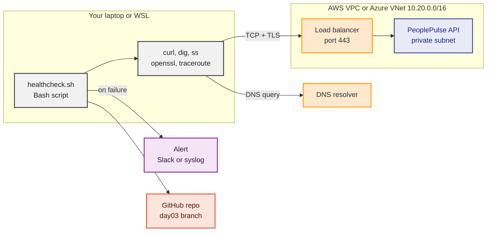
<p align="center"><sub><i>Figure: Big picture - where Bash and networking show up today</i></sub></p>


Reading the diagram: the Bash script on your laptop calls network tools. They ask DNS for the address, open a TCP connection with TLS to a load balancer, and reach the app inside a private subnet of the cloud network. When a check fails, the script sends an alert. Everything you write today gets committed to your GitHub repo.

<b>Example:</b> a sentence you will hear on a US client bridge call:

```text
"The health check is red. dig resolves fine, curl gets a timeout on 443,
so it's not DNS - I'm checking the security group and the target group now."
```

> [!NOTE]
> <b>Real-world scenario:</b> Real scenario: a client's nightly job "succeeded" for two weeks while uploading nothing, because the script had no `set -e` and ignored a failed `aws s3 cp`. The fix took one line. Finding it took two weeks of missing reports. Today you learn to write scripts that stop and complain the moment something fails.


<h3>2. Bash Scripts – Shebang and Running a Script</h3>

<b>In simple words:</b> A Bash script is a text file full of commands. The first line, the <b>shebang</b> (`#!`), tells Linux which program should run the file. You make the file executable and run it like any other command.

> [!NOTE]
> <b>Simple analogy:</b> A script is a recipe card. The shebang is the line at the top that says "this recipe is for the oven, not the microwave". `chmod +x` is putting the card in the "ready to cook" pile.


<b>Why a DevOps Engineer cares:</b>
- When a script runs on your laptop but fails in a container that only has `sh`, check the shebang first.
- CI runners execute your script exactly as written; if it is not executable, the job fails with "Permission denied" (exit 126).
- Git stores the execute bit, so commit the script after `chmod +x` and your teammates get a file they can run.

<b>How it works:</b> when you run `./hello.sh`, the kernel reads the first line. `#!/usr/bin/env bash` means "find `bash` on the `PATH` and run this file with it". It travels better than `#!/bin/bash`, because Bash is not always in `/bin` (on macOS with Homebrew, the newer Bash lives elsewhere).

<b>Example:</b>

```bash
mkdir -p ~/day03 && cd ~/day03
cat > hello.sh <<'EOF'
#!/usr/bin/env bash
# hello.sh - the smallest useful script
set -euo pipefail                  # strict mode - explained in section 7

name="${1:-world}"                 # first argument, default "world"
echo "Hello, ${name}! Today is $(date +%A)."
EOF
chmod +x hello.sh
./hello.sh
./hello.sh Cindia
bash hello.sh Raymundo             # run with bash directly (no execute bit needed)
```

```text
Hello, world! Today is Wednesday.
Hello, Cindia! Today is Wednesday.
Hello, Raymundo! Today is Wednesday.
```

<b>Command breakdown:</b> `cat > hello.sh <<'EOF' ... EOF`

| Part | What it means |
|---|---|
| `cat > hello.sh` | write what `cat` receives into `hello.sh` (overwrite if it exists) |
| `<<'EOF'` | here-document: the lines until `EOF` are the input |
| `'EOF'` (quoted) | do NOT expand `$` variables while writing – the script keeps `${1:-world}` as text |
| `EOF` (last line) | end marker; it must be alone on its line with no spaces before it |
| `chmod +x hello.sh` | add the execute bit so `./hello.sh` works; without it you get "Permission denied" |
| `./hello.sh` | run the file in the current folder; `hello.sh` alone fails because `.` is not on `PATH` |

> [!WARNING]
> <b>Common mistake:</b> Scripts written on Windows often have CRLF line endings. Linux then reports `/usr/bin/env: 'bash\r': No such file or directory`. Fix it with `sed -i 's/\r$//' script.sh` and set VS Code to "LF" for `.sh` files.


<h3>3. Variables, Quoting and Parameter Expansion</h3>

<b>In simple words:</b> A variable stores a value under a name. You read it back with `$name`. <b>Quoting</b> controls whether Bash splits or expands the text before it runs the command. Double quotes keep spaces safe; single quotes keep everything exactly as typed.

> [!NOTE]
> <b>Simple analogy:</b> A variable is a labelled jar. Double quotes are a jar with a lid: the contents stay together even if they contain spaces. No quotes is an open jar tipped over: the contents spill out as separate pieces.


<b>Why a DevOps Engineer cares:</b>
- An unquoted empty variable can turn `rm -rf "$DIR"/*` into `rm -rf /*`. This has happened on real servers.
- Pipelines pass settings as environment variables (`AWS_REGION`, `IMAGE_TAG`); your script must either fall back to a safe default or stop with a clear message.
- When you run ShellCheck, most of the warnings you see will be about quoting.

<b>How it works:</b>

| Syntax | Meaning | Example |
|---|---|---|
| `x=5` | assign – <b>no spaces</b> around `=` | `env=dev` |
| `"$x"` or `"${x}"` | use the value, safely quoted | `echo "${env}-api"` prints `dev-api` |
| `'$x'` | single quotes: literal text, no expansion | prints `$x` |
| `$(cmd)` | command substitution: run `cmd`, use its output | `today=$(date +%F)` |
| `$((a + b))` | arithmetic (integers only) | `next=$((count + 1))` |
| `${x:-default}` | use `default` if `x` is unset or empty | `port=${PORT:-8000}` |
| `${x:?message}` | stop the script with `message` if `x` is unset or empty | `: "${AWS_REGION:?set AWS_REGION}"` |
| `$1 $2 ... "$@" $#` | arguments, all arguments, how many | `for a in "$@"` |
| `$?` | exit code of the last command | `echo $?` |
| `arr=(a b c)` and `"${arr[@]}"` | arrays and all their items | `for u in "${urls[@]}"` |
| `export X=1` | make `X` visible to programs this script starts | `export AWS_PROFILE=lab` |

<b>Example:</b>

```bash
env=dev
app="PeoplePulse API"                  # quotes needed because of the space
echo "Deploying ${app} to ${env}"
echo 'Deploying ${app}'                # single quotes - printed literally
files=("q3 report.csv" "employees.csv")
for f in "${files[@]}"; do echo "file: $f"; done
for f in ${files[@]}; do echo "unquoted: $f"; done   # WRONG - splits on spaces
unset AWS_REGION
echo "region=${AWS_REGION:-us-east-1}"
: "${AWS_REGION:?AWS_REGION must be set}"
```

```text
Deploying PeoplePulse API to dev
Deploying ${app}
file: q3 report.csv
file: employees.csv
unquoted: q3
unquoted: report.csv
unquoted: employees.csv
region=us-east-1
bash: AWS_REGION: AWS_REGION must be set
```

<b>Command breakdown:</b> `: "${AWS_REGION:?AWS_REGION must be set}"`

| Part | What it means |
|---|---|
| `:` | the "do nothing" command – it exists only so Bash evaluates the argument |
| `"${AWS_REGION ... }"` | read the variable, inside double quotes |
| `:?` | if the variable is unset <b>or empty</b>, print the message and stop the script (exit 1) |
| `AWS_REGION must be set` | the error message the user sees – make it say how to fix the problem |
| `${AWS_REGION:-us-east-1}` (other example) | `:-` gives a default instead of stopping |

> [!WARNING]
> <b>Common mistake:</b> `rm -rf $DIR/*` with an empty `DIR` becomes `rm -rf /*`. Always write `rm -rf "${DIR:?}"/*`. If `DIR` is empty, `:?` stops the script before the delete runs.


<h3>4. Conditions, Tests, Loops and case</h3>

<b>In simple words:</b> `if` runs commands only when a test is true. Loops (`for`, `while`) repeat commands. `case` picks one branch based on a value, like a menu.

> [!NOTE]
> <b>Simple analogy:</b> `if` is a security guard checking your badge. A `for` loop is a teacher calling every name on the attendance list. `while read` is reading a letter line by line until the end. `case` is a receptionist sending you to the right floor based on why you came.


<b>Why a DevOps Engineer cares:</b>
- Health checks, retries and "wait until the service is ready" loops are all built from a condition inside a loop.
- You will often read a list of servers or URLs from a file, one line at a time.
- `case` is how you build small tools with sub-commands (`./deploy.sh plan|apply|destroy`).

<b>How it works:</b> `[[ ... ]]` is Bash's test command. It returns exit code 0 (true) or 1 (false), and `if` looks only at that exit code, not at any text the test prints.

| Test | True when |
|---|---|
| `[[ -f path ]]` / `[[ -d path ]]` | a regular file / a directory exists |
| `[[ -r path ]]` / `[[ -x path ]]` | readable / executable by you |
| `[[ -z "$s" ]]` / `[[ -n "$s" ]]` | string is empty / not empty |
| `[[ "$a" == "$b" ]]` / `!=` | strings equal / not equal |
| `[[ "$n" -gt 10 ]]` | number greater than (`-eq -ne -lt -le -ge`) |
| `[[ "$code" =~ ^2[0-9]{2}$ ]]` | matches a regular expression (here: any 2xx HTTP code) |
| `[[ a && b ]]` / `[[ a \|\| b ]]` | and / or |

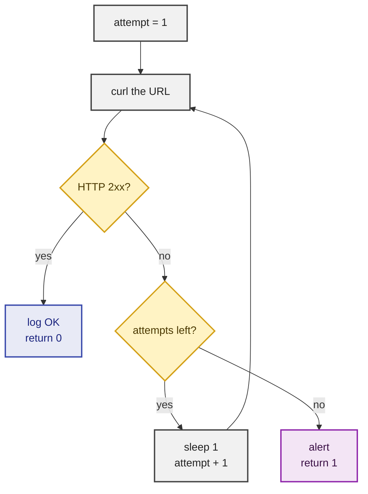
<p align="center"><sub><i>Figure: How a retry loop decides what to do</i></sub></p>


Reading the diagram: this is the same loop you will write in `healthcheck.sh` this afternoon. The script tries the URL; if the status code is 2xx it is done. If not, it checks whether it has attempts left, waits, and tries again. It raises an alert and returns a failure code only after the last attempt fails.

<b>Example:</b>

```bash
# if / elif / else
if [[ -f /etc/os-release ]]; then
  . /etc/os-release                     # "source" the file: load its variables
  echo "OS: ${PRETTY_NAME}"
elif [[ "$(uname)" == "Darwin" ]]; then
  echo "macOS"
else
  echo "unknown OS" >&2
fi

# for loop over a list
for env in dev staging prod; do
  echo "would deploy to ${env}"
done

# C-style loop
for (( i = 1; i <= 3; i++ )); do echo "attempt $i"; done

# while loop reading a file line by line (safe for spaces)
printf '# servers\nweb-01\n\napi-02\n' > servers.txt
while IFS= read -r host; do
  [[ -z "$host" || "$host" == \#* ]] && continue    # skip blanks and comments
  echo "checking $host"
done < servers.txt

# case - a small sub-command menu
action="${1:-status}"
case "$action" in
  start)  echo "starting" ;;
  stop)   echo "stopping" ;;
  status) echo "all good" ;;
  *)      echo "usage: $0 {start|stop|status}" >&2; exit 2 ;;
esac
```

```text
OS: Ubuntu 24.04.1 LTS
would deploy to dev
would deploy to staging
would deploy to prod
attempt 1
attempt 2
attempt 3
checking web-01
checking api-02
all good
```

<b>Command breakdown:</b> `while IFS= read -r host; do ... done < servers.txt`

| Part | What it means |
|---|---|
| `while ... do ... done` | repeat the body as long as the condition succeeds |
| `IFS=` | empty field separator – keeps leading and trailing spaces in the line |
| `read -r host` | read one line into `host`; `-r` keeps backslashes as normal characters |
| `< servers.txt` | feed the file into the loop; `read` fails at end of file, which ends the loop |
| `[[ ... == \#* ]]` | line starts with `#` (the backslash stops `#` being read as a comment) |
| `&& continue` | if the test is true, skip to the next line |

> [!WARNING]
> <b>Common mistake:</b> Do not write `for f in $(ls *.txt)`. File names with spaces break into pieces, and `ls` output is meant for people to read, not for scripts to parse. Use `for f in *.txt` instead, and quote `"$f"` inside the loop.


> [!TIP]
> <b>Pro tip:</b> Use `[[ ]]` (Bash) rather than `[ ]` (old POSIX `test`). `[[ ]]` handles empty variables safely and supports `&&`, `||` and `=~`.


<h3>5. Functions, Arguments and getopts</h3>

<b>In simple words:</b> A <b>function</b> is a named block of commands you can call many times. <b>Arguments</b> are the extra words you type after a script or function name. `getopts` reads options like `-f file -t 5` in a standard way.

> [!NOTE]
> <b>Simple analogy:</b> A function is a speed-dial button on a phone: press one button, and a whole number is dialled. Arguments are the extra details you give when you press it ("call the office, extension 42").


<b>Why a DevOps Engineer cares:</b>
- Functions such as `log`, `die` and `check_url` keep scripts short, so a reviewer can follow them without scrolling back and forth.
- Standard options (`-f`, `-t`, `-h`) make your script behave the way teammates and pipelines expect, so nobody has to read the code to call it.
- A `usage` message that exits with code 2 tells the caller "you called me wrong", not "the system is broken".

<b>How it works:</b> inside a function, `$1`, `$2` are the function's own arguments. `local` keeps a variable inside the function. A function "returns" an exit code with `return N` (0 = success); to hand back data, it prints it and the caller captures it with `$(...)`.

| Inside a script | Meaning |
|---|---|
| `$0` | the script's own name |
| `$1`, `$2` ... | first, second argument |
| `"$@"` | all arguments, each one kept separate (always quote it) |
| `$#` | number of arguments |
| `shift` | drop `$1` and move the others down |
| `getopts ":f:t:h" opt` | read `-f value`, `-t value`, `-h`; a `:` after a letter means "takes a value" |

<b>Example:</b>

```bash
cat > greet.sh <<'EOF'
#!/usr/bin/env bash
set -euo pipefail

log()   { printf '%s [%s] %s\n' "$(date -u +%FT%TZ)" "$1" "$2" >&2; }
die()   { log ERROR "$1"; exit "${2:-1}"; }
usage() { echo "Usage: $0 [-t team] name..." >&2; exit 2; }

greet() {
  local person="$1" team="$2"          # local: only visible inside greet()
  echo "Welcome ${person} to the ${team} team"
}

team="devops"
while getopts ":t:h" opt; do
  case "$opt" in
    t) team="$OPTARG" ;;
    h|*) usage ;;
  esac
done
shift $((OPTIND - 1))                  # remove the options; names remain in "$@"
[[ $# -gt 0 ]] || usage

for person in "$@"; do
  greet "$person" "$team"
done
log INFO "greeted $# people"
EOF
chmod +x greet.sh
./greet.sh Haiman Jobanjit
./greet.sh -t qa Carla
./greet.sh; echo "exit=$?"
```

```text
Welcome Haiman to the devops team
Welcome Jobanjit to the devops team
2026-11-11T13:20:05Z [INFO] greeted 2 people
Welcome Carla to the qa team
2026-11-11T13:20:06Z [INFO] greeted 1 people
Usage: ./greet.sh [-t team] name...
exit=2
```

<b>Command breakdown:</b> `while getopts ":t:h" opt; do ... done; shift $((OPTIND - 1))`

| Part | What it means |
|---|---|
| `getopts` | built-in Bash option reader; called once per option in a loop |
| `":t:h"` | leading `:` = silent mode (you handle errors); `t:` = `-t` needs a value; `h` = `-h` has no value |
| `opt` | variable that receives the option letter (`t`, `h`, or `?` for unknown) |
| `$OPTARG` | the value given after `-t` |
| `$OPTIND` | index of the next argument still to process |
| `shift $((OPTIND - 1))` | throw away the options so only the names remain in `"$@"` |

> [!TIP]
> <b>Pro tip:</b> Send log messages to <b>stderr</b> (`>&2`) and real data to <b>stdout</b>. Then `result=$(./script.sh)` captures only the data, while logs still show in the CI console.


<h3>6. Exit Codes, stdout/stderr and Redirection</h3>

<b>In simple words:</b> Every command finishes with an <b>exit code</b>: `0` means success, anything from `1` to `255` means failure. Every program also has two output streams: <b>stdout</b> (normal output, stream 1) and <b>stderr</b> (errors and logs, stream 2). Redirection (`>`, `>>`, `2>&1`, `|`) decides where those streams go.

> [!NOTE]
> <b>Simple analogy:</b> The exit code is the thumbs-up or thumbs-down a worker gives when the job is done. stdout is the finished product on the conveyor belt; stderr is the worker shouting problems to the supervisor. Redirection decides which bin each one lands in.


<b>Why a DevOps Engineer cares:</b>
- Jenkins and GitHub Actions mark a step <b>failed</b> only when the exit code is not 0. If your script always exits 0, a broken build still shows green.
- Kubernetes shows exit code 137 when a container was killed (often out of memory). Learn to recognise it on sight.
- Get redirection wrong and you either hide the error you need or fill the disk with noise.

<b>How it works:</b>

| Code | Convention |
|---|---|
| `0` | success |
| `1` | general failure (for example, a health check failed) |
| `2` | wrong usage or bad arguments |
| `126` / `127` | found but not executable / command not found |
| `128 + N` | killed by signal N: `130` = Ctrl+C (SIGINT), `137` = SIGKILL (often OOM-killed), `143` = SIGTERM |

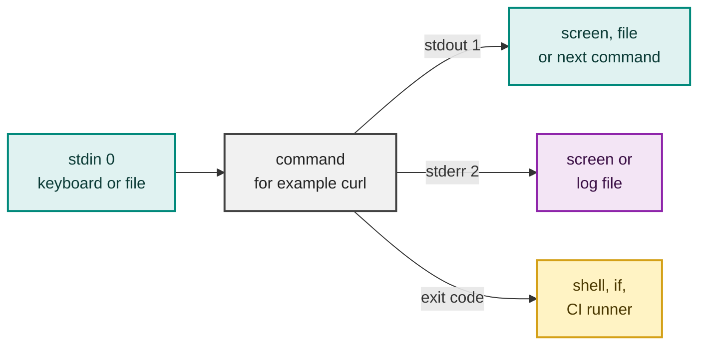
<p align="center"><sub><i>Figure: Streams and exit code of one command</i></sub></p>


Reading the diagram: a command reads from stdin, writes normal output to stdout and problems to stderr, and finishes with an exit code. Pipes and redirection decide where stdout and stderr go. The exit code goes to whoever started the command: your `if`, your script, or the CI runner that decides "green or red".

| Redirection | Meaning |
|---|---|
| `cmd > file` | stdout to file (overwrite) |
| `cmd >> file` | stdout to file (append) |
| `cmd 2> err.log` | stderr to file |
| `cmd > all.log 2>&1` | stdout to file, then stderr to the same place |
| `cmd &> all.log` | Bash shortcut for the line above |
| `cmd > /dev/null` | throw stdout away |
| `cmd1 \| cmd2` | stdout of `cmd1` becomes stdin of `cmd2` |
| `cmd \| tee -a file` | show on screen <b>and</b> append to a file |
| `cmd1 && cmd2` | run `cmd2` only if `cmd1` succeeded |
| `cmd1 \|\| cmd2` | run `cmd2` only if `cmd1` failed |

<b>Example:</b>

```bash
ls /etc/hostname /nope; echo "exit=$?"
ls /etc/hostname /nope > out.txt 2> err.txt; cat out.txt err.txt
ls /etc/hostname /nope > all.txt 2>&1; wc -l all.txt
nosuchcommand; echo "exit=$?"
grep -q root /etc/passwd && echo "root user exists"
grep -q nobody-here /etc/passwd || echo "not found - handled"
```

```text
ls: cannot access '/nope': No such file or directory
/etc/hostname
exit=2
/etc/hostname
ls: cannot access '/nope': No such file or directory
2 all.txt
nosuchcommand: command not found
exit=127
root user exists
not found - handled
```

<b>Command breakdown:</b> `ls /etc/hostname /nope > all.txt 2>&1`

| Part | What it means |
|---|---|
| `ls /etc/hostname /nope` | one file exists (stdout), one does not (stderr) |
| `> all.txt` | send stream 1 (stdout) to `all.txt` |
| `2>&1` | send stream 2 (stderr) to wherever stream 1 points <b>now</b> |
| order matters | `2>&1 > all.txt` sends errors to the screen, because stdout was still the screen when `2>&1` ran |

> [!WARNING]
> <b>Common mistake:</b> `echo $?` reports only the <b>last</b> command. `cmd; echo "done"; echo $?` prints the exit code of `echo "done"` (always 0), not of `cmd`. Save it straight away: `cmd; rc=$?`.


<h3>7. Strict Mode: set -euo pipefail, trap and ShellCheck</h3>

<b>In simple words:</b> By default Bash keeps going after a command fails. `set -euo pipefail` changes that: stop on errors, stop on unknown variables, and do not hide failures inside pipes. `trap` runs clean-up or error messages automatically. <b>ShellCheck</b> reads your script and flags likely bugs before you ever run it.

> [!NOTE]
> <b>Simple analogy:</b> Strict mode is the emergency stop button on a factory line. Without it, if one machine breaks, the line keeps moving and makes hundreds of broken products. With it, the line stops at the first problem and a light shows which machine failed.


<b>Why a DevOps Engineer cares:</b>
- Without `-e`, a script can fail `docker build` and still push the old image, then report success.
- Without `-u`, a typo like `$ENVIROMENT` silently becomes an empty string, and the script may deploy to the wrong place.
- Without `pipefail`, `curl bad-url | jq .` "succeeds" because only the exit code of `jq`, the last command, is checked.
- On Day 9 you add ShellCheck to CI, so unsafe scripts are blocked before anyone reviews them.

<b>How it works:</b>

| Option | Effect | Without it |
|---|---|---|
| `-e` | exit as soon as a command fails | script continues after a failed `docker build` and pushes an old image |
| `-u` | using an unset variable is an error | `$ENVIROMENT` (typo) silently becomes empty |
| `-o pipefail` | a pipeline fails if <b>any</b> part fails | `curl bad-url \| jq .` returns `jq`'s 0 and hides the curl failure |

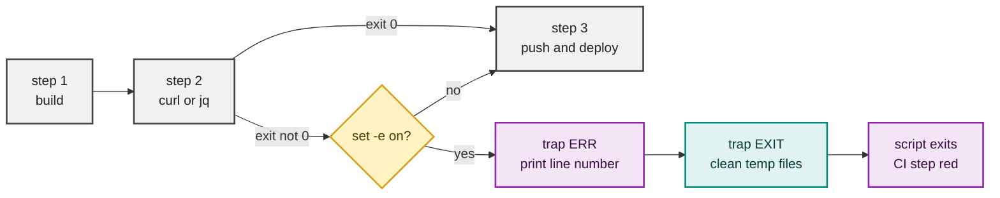
<p align="center"><sub><i>Figure: What strict mode does when a step fails</i></sub></p>


Reading the diagram: when step 2 fails without strict mode, the script carries on to step 3 and deploys something broken. With `set -e`, the failure fires the `ERR` trap (which prints where it broke), then the `EXIT` trap cleans up, and the script stops with a non-zero exit code so the CI step turns red.

<b>Example:</b>

```bash
cat > strict-demo.sh <<'EOF'
#!/usr/bin/env bash
set -euo pipefail
trap 'echo "ERROR on line $LINENO (exit $?)" >&2' ERR
tmpfile=$(mktemp)
trap 'rm -f "$tmpfile"' EXIT                    # runs on every exit, success or failure

curl -fsS -m 5 https://api.github.com/zen > "$tmpfile"
echo "GitHub says: $(cat "$tmpfile")"
curl -fsS -m 5 https://api.github.com/this-does-not-exist > "$tmpfile"
echo "never printed"
EOF
chmod +x strict-demo.sh
./strict-demo.sh; echo "exit=$?"
false | true; echo "no pipefail: $?"
set -o pipefail; false | true; echo "with pipefail: $?"; set +o pipefail
```

```text
GitHub says: Design for failure.
curl: (22) The requested URL returned error: 404
ERROR on line 9 (exit 22)
exit=22
no pipefail: 0
with pipefail: 1
```

<b>Command breakdown:</b> `trap 'echo "ERROR on line $LINENO (exit $?)" >&2' ERR`

| Part | What it means |
|---|---|
| `trap '...' ERR` | run the quoted command whenever a command fails (with `set -e`, just before exit) |
| `$LINENO` | line number where the failure happened |
| `$?` | the failing command's exit code |
| `>&2` | print to stderr so it shows in CI logs and is not captured as data |
| `trap '...' EXIT` (second trap) | runs on every exit – the right place to delete temp files |
| single quotes | the variables are expanded when the trap fires, not when it is defined |

<b>Command breakdown:</b> `curl -fsS -m 5 URL`

| Part | What it means |
|---|---|
| `-f` | fail (exit 22) on HTTP 400 or higher; without it, a 404 page counts as success |
| `-s` | silent – no progress bar |
| `-S` | but still <b>show</b> errors when `-s` is on |
| `-m 5` | give up after 5 seconds in total; without it a hung server blocks your script for minutes |

> [!WARNING]
> <b>Common mistake:</b> `((count++))` when `count=0` returns exit code 1 (the old value 0 counts as "false"), and `set -e` kills your script. Write `count=$((count + 1))`. Also, `set -e` is <b>not</b> triggered inside an `if` condition or on the left side of `||`. That is how you handle a failure you expect: put the command in an `if` or follow it with `|| ...`.


> [!TIP]
> <b>Pro tip:</b> Run `shellcheck script.sh` on every script. It catches unquoted variables, `ls` in loops, unused variables and most of the traps above. Each warning has a code such as `SC2086` that you can search to read the full explanation.


<h3>8. OSI and TCP/IP Models; TCP vs UDP</h3>

<b>In simple words:</b> Network models split "sending data" into <b>layers</b>. Each layer does one job and relies on the layer below. The <b>OSI</b> model has 7 layers (used to discuss and troubleshoot problems). The <b>TCP/IP</b> model has 4 layers (the one the internet actually runs on).

> [!NOTE]
> <b>Simple analogy:</b> Sending a parcel: you write a letter (application), put it in an envelope with a name (transport: which department), the post office adds a street address (network: IP), and a van physically carries it (link). If the parcel does not arrive, you check each of those steps in turn.


<b>Why a DevOps Engineer cares:</b>
- Asking "which layer is broken?" is the fastest way to stop guessing during an outage.
- Cloud features map to layers: security groups and NSGs work at layers 3–4, an Application Load Balancer at layer 7, a Network Load Balancer at layer 4.
- Interviewers ask "what is the difference between an L4 and an L7 load balancer?".

<b>How it works:</b>

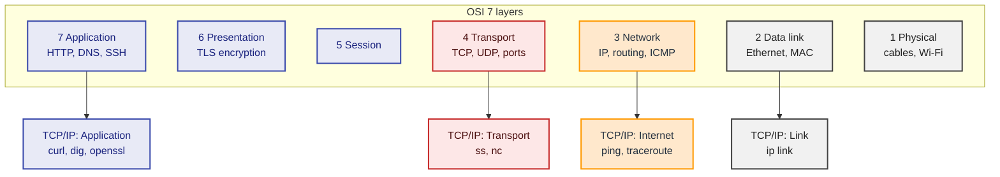
<p align="center"><sub><i>Figure: OSI and TCP/IP layers with tools and typical failures</i></sub></p>


Reading the diagram: OSI layers 5–7 fold into the single TCP/IP "Application" layer, where HTTP, DNS and TLS live and where `curl`, `dig` and `openssl` help. Layer 4 is about ports (TCP/UDP): use `ss` and `nc`. Layer 3 is IP addresses and routes: use `ping` and `traceroute`. In the cloud you almost never touch layers 1–2.

| Layer (OSI) | Typical failure message | First tool |
|---|---|---|
| 7 Application | `HTTP 500`, `NXDOMAIN` | `curl -i`, `dig` |
| 6 Presentation (TLS) | `certificate has expired` | `openssl s_client` |
| 4 Transport | `Connection refused`, `timed out` | `ss -ltn`, `nc -zv` |
| 3 Network | `No route to host`, `Network is unreachable` | `ip route`, `traceroute` |

<b>TCP vs UDP:</b>

| | TCP | UDP |
|---|---|---|
| Connection | 3-way handshake first (SYN, SYN-ACK, ACK) | none – just send |
| Reliability | ordered, lost packets resent | best effort, may lose packets |
| Speed | a little slower to start | fast, low overhead |
| Used by | HTTP/1.1, HTTP/2, SSH, PostgreSQL | DNS (mostly), NTP, HTTP/3 (QUIC), syslog |

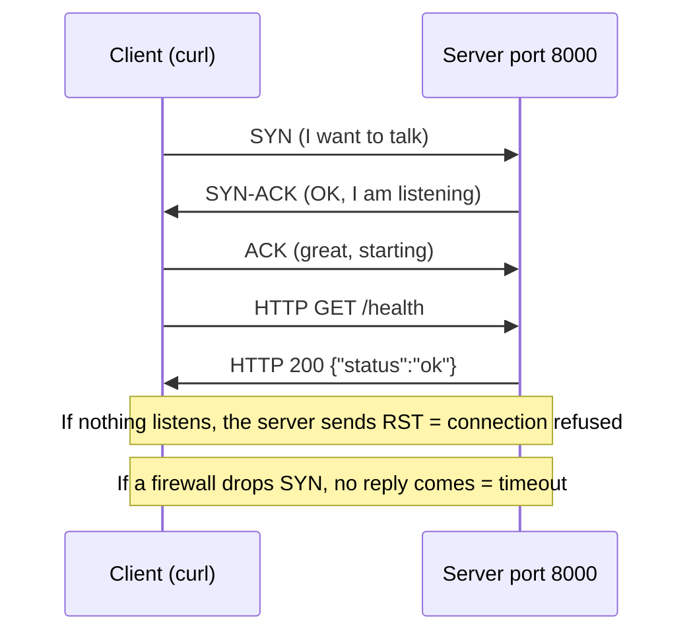
<p align="center"><sub><i>Figure: TCP three-way handshake before any HTTP data</i></sub></p>


Reading the diagram: before any HTTP data is sent, TCP sets up a connection in three steps. If the server machine is reachable but nothing listens on the port, it replies with a reset (RST) and you see "connection refused" at once. If a firewall silently drops the SYN, the client waits and then reports a timeout.

<b>"Connection refused" vs "timeout"</b> is the most useful distinction in network debugging:
- <b>Connection refused</b> (curl exit 7): the packet reached the host, but nothing is listening on that port. Check the app and the port with `ss -ltn`.
- <b>Timeout</b> (curl exit 28): no answer comes back at all. A security group, NSG or firewall is dropping packets, the route is wrong, or the host is down. Check firewall rules and routes.

<b>Example:</b>

```bash
nc -zv -w 3 github.com 443          # TCP port open?
nc -zv -w 3 127.0.0.1 9999          # nothing listening locally
```

```text
Connection to github.com (140.82.112.3) 443 port [tcp/https] succeeded!
nc: connect to 127.0.0.1 port 9999 (tcp) failed: Connection refused
```

<b>Command breakdown:</b> `nc -zv -w 3 github.com 443`

| Part | What it means |
|---|---|
| `nc` | netcat – opens raw TCP/UDP connections |
| `-z` | zero-I/O mode: only check the port opens, send no data |
| `-v` | verbose: print "succeeded" or the error |
| `-w 3` | wait at most 3 seconds; otherwise a dropped packet can hang a long time |
| `github.com 443` | host and port to test |
| `-u` (other use) | test UDP instead of TCP (results are less reliable, UDP has no handshake) |

> [!NOTE]
> <b>Real-world scenario:</b> Real scenario: Haiman is on call. The PeoplePulse load balancer health check fails. `nc -zv 10.20.10.15 8000` from the bastion times out, but works from the instance itself. That points straight at the security group (layer 4), not the app. It becomes a 2-minute fix instead of an hour of reading app logs.


<h3>9. IP Addresses, CIDR and Subnetting</h3>

<b>In simple words:</b> An IPv4 address is a 32-bit number written as four numbers from 0 to 255 (`10.20.1.15`). <b>CIDR</b> notation such as `10.20.0.0/16` describes a <b>range</b>: the `/16` says the first 16 bits are the network part, and the remaining bits are for hosts. A <b>subnet</b> is a smaller range carved out of a bigger one.

> [!NOTE]
> <b>Simple analogy:</b> A `/16` is a big apartment complex with one street address. Each `/24` subnet is one building in the complex. Each IP is one flat in a building. The smaller the prefix number, the bigger the area.


<b>Why a DevOps Engineer cares:</b>
- Every AWS VPC and Azure VNet starts with a CIDR, and every subnet needs its own non-overlapping range.
- Security group, NSG and firewall rules are written in CIDR (`203.0.113.7/32` = exactly one IP).
- Overlapping ranges make VPC peering, VPN and Transit Gateway impossible later, and fixing that means a costly rebuild.
- Interviewers ask "how many hosts in a /26?" and "how would you subnet this VPC?".

<b>How it works:</b> the number of addresses in a range is `2^(32 - prefix)`. Each `+1` on the prefix <b>halves</b> the size.

| CIDR | Netmask | Total addresses | Usable on AWS/Azure (5 reserved) |
|---|---|---|---|
| `/16` | 255.255.0.0 | 65,536 | 65,531 |
| `/20` | 255.255.240.0 | 4,096 | 4,091 |
| `/22` | 255.255.252.0 | 1,024 | 1,019 |
| `/24` | 255.255.255.0 | 256 | 251 |
| `/26` | 255.255.255.192 | 64 | 59 |
| `/28` | 255.255.255.240 | 16 | 11 (smallest AWS subnet) |
| `/32` | 255.255.255.255 | 1 | one single host (used in firewall rules) |

<b>Private ranges (RFC 1918):</b> use these inside VPCs and VNets, never public ranges: `10.0.0.0/8`, `172.16.0.0/12`, `192.168.0.0/16`. Docker's default bridge uses `172.17.0.0/16`, so avoid that range for VPCs that developers reach over VPN.

<b>Reserved addresses:</b> AWS and Azure both keep 5 addresses in every subnet: the network address (`.0`), the router (`.1`), DNS (`.2`), one reserved for future use (`.3`) and the last address (`.255` in a `/24`).

<b>Splitting a /16 into /24s:</b> in `10.20.0.0/16`, the third number (octet) picks the `/24`. `10.20.0.0/24`, `10.20.1.0/24`, ... `10.20.255.0/24`. That gives 256 possible subnets.

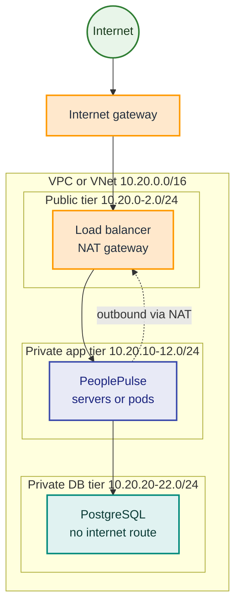
<p align="center"><sub><i>Figure: Dev VPC 10.20.0.0/16 split into public and private /24 subnets</i></sub></p>


Reading the diagram: the internet reaches the VPC only through the internet gateway, into the public subnets that hold the load balancer and NAT gateway. The app servers sit in private subnets: they receive traffic from the load balancer and go out to the internet through NAT. The database subnets have no internet route at all. A subnet is "public" only because its <b>route table</b> sends `0.0.0.0/0` to an internet gateway.

<b>Example:</b>

```bash
python3 - <<'EOF'
import ipaddress
vpc = ipaddress.ip_network("10.20.0.0/16")
print("total addresses:", vpc.num_addresses)
subs = list(vpc.subnets(new_prefix=24))
print("number of /24s:", len(subs))
print("first three:", [str(s) for s in subs[:3]])
s = ipaddress.ip_network("10.20.10.0/24")
hosts = list(s.hosts())
print("10.20.10.0/24 AWS usable range:", hosts[3], "-", hosts[-1], "=", s.num_addresses - 5, "IPs")
EOF
```

```text
total addresses: 65536
number of /24s: 256
first three: ['10.20.0.0/24', '10.20.1.0/24', '10.20.2.0/24']
10.20.10.0/24 AWS usable range: 10.20.10.4 - 10.20.10.254 = 251 IPs
```

<b>Command breakdown:</b> `python3 - <<'EOF' ... EOF` with `ipaddress`

| Part | What it means |
|---|---|
| `python3 -` | run Python code read from stdin (the `-`) |
| `<<'EOF'` | the here-document supplies that code |
| `ipaddress.ip_network("10.20.0.0/16")` | build a network object from a CIDR string |
| `.subnets(new_prefix=24)` | split it into every possible `/24` |
| `.hosts()` | all addresses except network and broadcast; AWS also reserves `.1`–`.3`, so we start at index 3 (`.4`) |
| `num_addresses - 5` | usable IPs in AWS or Azure |

> [!WARNING]
> <b>Common mistake:</b> The classic mistake is picking `10.0.0.0/16` for every VPC. The day the client wants VPC peering, a Transit Gateway or a VPN to the office, overlapping ranges make it impossible without rebuilding. Always ask for the company IP plan (IPAM) and use a unique range per environment.


> [!TIP]
> <b>Pro tip:</b> Leave gaps between tiers (`0–2` public, `10–12` app, `20–22` database). When the client adds a fourth Availability Zone, `10.20.3.0/24` and `10.20.13.0/24` are still free and the pattern stays readable.


> [!IMPORTANT]
> <b>Key point:</b> Remember for interviews: `/24` = 256 addresses, 251 usable on AWS and Azure. Each step up in the prefix halves the size; `/16` holds 256 `/24`s. The smallest AWS subnet is `/28` (16 addresses); Azure allows `/29`.


---


<h2>9:45 – 10:00 AM · Break</h2>


Stretch, refill coffee, and run `dig +short github.com` to confirm your DNS tools work before the next session starts.

---


<h2>10:00 – 11:15 AM · Concept Session 2 + Live Demo</h2>


| Minutes | Activity | Method |
|---|---|---|
| 10:00 – 10:11 | DNS: resolution path, record types, TTL, `dig` | Whiteboard |
| 10:11 – 10:21 | HTTP/HTTPS: requests, status codes, `curl` options | Live demo |
| 10:21 – 10:31 | TLS certificates: handshake, chain, SAN, expiry, `openssl s_client` | Whiteboard |
| 10:31 – 10:39 | SSH keys: key pair, `authorized_keys`, `~/.ssh/config`, tunnels | Live demo |
| 10:39 – 10:46 | Ports and `ss`/`netstat`: who is listening, on which address | Live demo |
| 10:46 – 10:52 | `ping`, `traceroute`, `tracepath`, `nc` – following the path | Live demo |
| 10:52 – 11:15 | Live Demo: "Is it DNS, network, TLS or the app?" | Live demo |

<h3>10. DNS – the Internet's Phone Book</h3>

<b>In simple words:</b> DNS (Domain Name System) turns a name like `api.peoplepulse.example.com` into an IP address. It is a worldwide system organised as a tree, and answers are <b>cached</b> (remembered) for a time called the <b>TTL</b> (time to live).

> [!NOTE]
> <b>Simple analogy:</b> DNS is like asking for a phone number. You first check your own contacts (local cache). If it is not there, you call directory enquiries (the recursive resolver), which asks the national office (root), then the regional office (`.com`), then the company's own receptionist (authoritative server), and writes the number down for next time.


<b>Why a DevOps Engineer cares:</b>
- "It's always DNS" is a running joke because it is so often true: wrong records, old cached answers and forgotten `/etc/hosts` lines cause real outages.
- You will create DNS records in Route 53 (Day 23) and Azure DNS (Day 27) for every app you deploy.
- Kubernetes service discovery (`peoplepulse.default.svc.cluster.local`) is DNS too.
- When you move an app to a new server, you plan the TTLs well before the cut-over.

<b>How it works:</b>

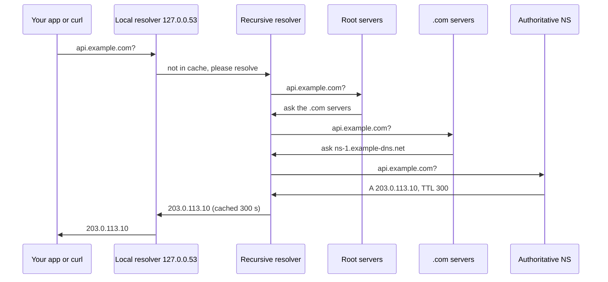
<p align="center"><sub><i>Figure: How a DNS lookup is resolved</i></sub></p>


Reading the diagram: your app asks the local resolver on the machine (on Ubuntu this is `systemd-resolved` at `127.0.0.53`). If the answer is not cached, a recursive resolver (your ISP, `1.1.1.1`, `8.8.8.8`, or the AWS VPC resolver) walks the tree: root, then the `.com` servers, then the domain's own authoritative name server. The final answer is cached for the TTL, so the next lookup is instant.

| Record | Purpose | Example |
|---|---|---|
| `A` / `AAAA` | name to IPv4 / IPv6 address | `api IN A 203.0.113.10` |
| `CNAME` | alias to another name | `www` points to `app.example.net` |
| Alias (Route 53) / alias record (Azure DNS) | CNAME-like, allowed at the zone apex (`example.com`) | `example.com` to a load balancer |
| `MX` | mail servers | `10 mail.example.com` |
| `TXT` | free text: SPF, domain verification, certificate (ACME) challenges | `"v=spf1 include:..."` |
| `NS` | which servers are authoritative for the zone | `ns-123.awsdns-15.com` |
| `SOA` | zone settings, including how long to cache "not found" | serial, negative TTL |

| `dig` status | Meaning | Typical fix |
|---|---|---|
| `NOERROR` with an answer | all good | — |
| `NOERROR` with no answer | name exists, but not that record type | ask for the right type, add the record |
| `NXDOMAIN` | the name does not exist | typo, record missing, wrong zone |
| `SERVFAIL` | resolver could not get an answer | broken delegation, DNSSEC error, resolver problem |

<b>Example:</b>

```bash
dig github.com +short                     # just the IP(s)
dig github.com A +noall +answer           # the answer line with TTL
dig @1.1.1.1 github.com +short            # ask a specific resolver
dig www.github.com CNAME +short           # alias target
dig nope.peoplepulse.invalid | grep status
getent hosts github.com                   # what the OS resolver returns (includes /etc/hosts)
resolvectl status | grep -m1 "DNS Servers"
```

```text
140.82.112.3
github.com.             60      IN      A       140.82.112.3
140.82.112.3
github.com.
;; ->>HEADER<<- opcode: QUERY, status: NXDOMAIN, id: 41872
140.82.112.3    github.com
Current DNS Server: 172.31.0.2
```

<b>Command breakdown:</b> `dig github.com A +noall +answer`

| Part | What it means |
|---|---|
| `dig` | DNS lookup tool – asks DNS servers directly, ignores `/etc/hosts` |
| `github.com` | the name to look up |
| `A` | record type (default is `A`); try `AAAA`, `CNAME`, `MX`, `TXT`, `NS` |
| `+noall +answer` | hide everything except the answer section |
| `60` in the output | TTL: seconds this answer may be cached |
| `@1.1.1.1` (other example) | ask this resolver instead of the system default |
| `+trace` (other use) | follow the delegation from the root yourself – shows where it breaks |
| `+short` | print only the values |

> [!WARNING]
> <b>Common mistake:</b> A common migration mistake is forgetting the TTL. If the record had TTL 86400 (one day), clients may keep using the old IP for a whole day. Lower the TTL to 60–300 seconds at least one TTL period <b>before</b> the cut-over, then raise it again afterwards.


> [!TIP]
> <b>Pro tip:</b> `dig` asks DNS directly; `getent hosts` asks the operating system the same way your app does, so it also reads `/etc/hosts`. When they disagree, someone has added an override in `/etc/hosts`. You will prove this in the lab.


<h3>11. HTTP, HTTPS and curl</h3>

<b>In simple words:</b> HTTP is the request-and-response language of web APIs. The client sends a <b>method</b> (GET, POST, ...), a <b>path</b> and <b>headers</b>; the server answers with a <b>status code</b>, headers and a <b>body</b>. HTTPS is the same HTTP sent inside an encrypted TLS connection, normally on port 443.

> [!NOTE]
> <b>Simple analogy:</b> HTTP is ordering at a counter. The method is what you want to do ("GET me the menu", "POST this order"), the path is which item, the headers are extra notes ("no onions"), and the status code is the cashier's reply ("200 here you go", "404 we don't have that", "500 the kitchen is on fire").


<b>Why a DevOps Engineer cares:</b>
- Health checks for load balancers, Kubernetes probes and your own scripts are HTTP requests.
- The status code tells you which team to call: 4xx usually means the client or the config, 5xx means the server side.
- You will reach for `curl` on every server, container and pipeline whenever you need to test an endpoint.

<b>How it works:</b>

```text
GET /records/2 HTTP/1.1                <- method, path, version
Host: api.peoplepulse.example.com      <- headers
Accept: application/json

HTTP/1.1 200 OK                        <- status line
Content-Type: application/json         <- response headers

{"id":2,"name":"Cindia Fouda","department":"Data"}   <- body
```

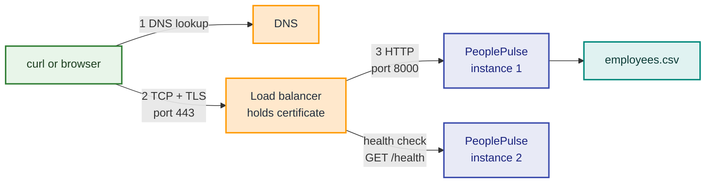
<p align="center"><sub><i>Figure: An HTTPS request through a load balancer to PeoplePulse</i></sub></p>


Reading the diagram: the client first looks up the name, then opens a TCP connection to the load balancer on port 443 and does the TLS handshake there. The load balancer forwards plain HTTP to a healthy PeoplePulse instance on port 8000, and keeps calling `/health` on each instance so it only sends traffic to healthy ones. A <b>502</b> means the load balancer could not get a good answer from the instance; a <b>503</b> usually means no healthy instance is left.

| Status | Meaning | Typical DevOps cause |
|---|---|---|
| `200` / `201` / `204` | OK / created / no content | — |
| `301` / `302` / `308` | redirect | HTTP to HTTPS redirect, moved path |
| `400` | bad request | client sent invalid data |
| `401` / `403` | not logged in / not allowed | missing token, IAM or RBAC rule |
| `404` | not found | wrong path, wrong ingress rule |
| `429` | too many requests | rate limit (API Gateway throttling) |
| `500` | internal server error | app bug, unhandled exception |
| `502` | bad gateway | load balancer cannot talk to the backend (app down, wrong port) |
| `503` | service unavailable | no healthy targets, overload, maintenance |
| `504` | gateway timeout | backend too slow |

| curl exit code | Meaning |
|---|---|
| `0` | success (with `-f`: HTTP status below 400) |
| `6` | could not resolve host – DNS problem |
| `7` | failed to connect – connection refused or no route |
| `22` | HTTP status 400 or higher (only with `-f`) |
| `28` | operation timed out |
| `35` | TLS handshake failed |
| `60` | server certificate could not be verified |

<b>Example:</b>

```bash
curl -i https://api.github.com/zen                     # -i: show response headers too
curl -sS -o /dev/null -w '%{http_code} %{time_total}s\n' https://github.com
curl -sS -X POST -H 'Content-Type: application/json' \
  -d '{"name":"test"}' https://httpbin.org/post | jq .json
curl -sSL -o /dev/null -w '%{http_code} %{url_effective}\n' http://github.com
```

```text
HTTP/2 200
content-type: text/plain;charset=utf-8
...
Keep it logically awesome.
200 0.183214s
{
  "name": "test"
}
200 https://github.com/
```

<b>Command breakdown:</b> `curl -sS -o /dev/null -w '%{http_code} %{time_total}s\n' https://github.com`

| Part | What it means |
|---|---|
| `-s` / `-S` | silent, but still show errors |
| `-o /dev/null` | throw the body away – we only want numbers |
| `-w '...'` | "write out" these values after the request finishes |
| `%{http_code}` | the HTTP status code; `000` if no HTTP answer came back at all |
| `%{time_total}` | total seconds for the request (DNS + connect + TLS + response) |
| `-X POST -H ... -d ...` (other example) | method, a header, and a request body |
| `-L` (other example) | follow redirects; `%{url_effective}` shows where you ended up |
| `--resolve host:443:IP` (useful extra) | test a new server's IP <b>before</b> changing DNS |

> [!TIP]
> <b>Pro tip:</b> `curl -v` shows every step: DNS result, TCP connect, TLS handshake and headers. When someone says "the API is down", run `curl -v` first and read where it stops.


> [!NOTE]
> <b>Real-world scenario:</b> Real scenario: after a deploy, the client's ALB returns 502. `curl -v http://10.20.10.15:8000/health` from inside the VPC shows "connection refused". The new container listens on port 8080, but the target group still sends traffic to 8000. The status code and a single curl call were enough to find it.


<h3>12. TLS Certificates</h3>

<b>In simple words:</b> TLS (Transport Layer Security) encrypts traffic so nobody in the middle can read it, and proves the server is who it claims to be. The proof is an <b>X.509 certificate</b>, signed by a trusted <b>Certificate Authority (CA)</b>. The certificate lists the names it is valid for (<b>SAN</b>, Subject Alternative Names) and its validity dates.

> [!NOTE]
> <b>Simple analogy:</b> A TLS certificate is a passport. It shows the holder's name, an expiry date and the stamp of the government that issued it. The border officer (your browser or curl) checks three things: is the stamp from a government I trust, does the name match the person, and is it still valid?


<b>Why a DevOps Engineer cares:</b>
- Expired certificates cause some of the most visible outages, even at large companies.
- You will issue certificates with AWS Certificate Manager (Day 23), Azure Key Vault/App Service, and cert-manager in Kubernetes.
- A missing intermediate certificate breaks some clients (Java, Python, mobile) but not browsers. That is confusing unless you know to check the chain.

<b>How it works:</b>

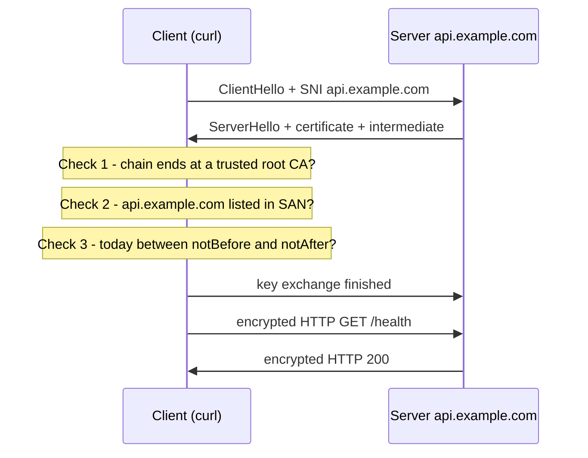
<p align="center"><sub><i>Figure: TLS handshake and the three certificate checks</i></sub></p>


Reading the diagram: the client says hello and names the site it wants (<b>SNI</b>, Server Name Indication), because one IP may host many sites. The server returns its certificate plus the intermediate certificate. The client checks the chain, the name and the dates; if all pass, both sides agree on keys and the normal HTTP traffic flows encrypted.

| Check | Error you see | Fix |
|---|---|---|
| Chain to a trusted root | `unable to get local issuer certificate` | serve the full chain (leaf + intermediate) |
| Name matches a SAN | `no alternative certificate subject name matches target host name` | issue a certificate that includes this hostname |
| Validity dates | `certificate has expired` | renew; automate with ACM, cert-manager or Let's Encrypt |
| Trusted CA | `self-signed certificate` (verify code 18) | use a public CA, or add your private CA to the trust store |

<b>Example:</b>

```bash
openssl s_client -connect github.com:443 -servername github.com </dev/null 2>/dev/null \
  | openssl x509 -noout -subject -issuer -dates -ext subjectAltName
```

```text
subject=CN = github.com
issuer=C = GB, ST = Greater Manchester, L = Salford, O = Sectigo Limited, CN = Sectigo ECC Domain Validation Secure Server CA
notBefore=Feb  5 00:00:00 2026 GMT
notAfter=Feb  5 23:59:59 2027 GMT
X509v3 Subject Alternative Name:
    DNS:github.com, DNS:www.github.com
```

<b>Command breakdown:</b> `openssl s_client -connect github.com:443 -servername github.com </dev/null 2>/dev/null | openssl x509 -noout -subject -issuer -dates -ext subjectAltName`

| Part | What it means |
|---|---|
| `openssl s_client` | act as a TLS client and print the handshake details |
| `-connect github.com:443` | host and port to connect to |
| `-servername github.com` | send SNI; without it a shared load balancer may return its <b>default</b> certificate |
| `</dev/null` | send no input, so the connection closes at once instead of waiting |
| `2>/dev/null` | hide handshake noise on stderr |
| `\| openssl x509` | read the certificate that `s_client` printed |
| `-noout` | do not print the encoded certificate itself |
| `-subject -issuer -dates` | who it is for, who signed it, valid from/to |
| `-ext subjectAltName` | the list of names (SANs) the certificate covers |

> [!WARNING]
> <b>Common mistake:</b> A common mistake is forgetting `-servername`. Load balancers host many sites on one IP. Without SNI you get the default certificate and wrongly conclude that the certificate is broken.


> [!CAUTION]
> <b>Cost / security alert:</b> Never "fix" a certificate error with `curl -k` or `verify=False` in production code. It turns off the identity check and makes man-in-the-middle attacks easy. Use it only to confirm the diagnosis, then fix the certificate.


<h3>13. SSH Keys</h3>

<b>In simple words:</b> SSH logs you into a remote machine over an encrypted connection. Instead of a password, you use a <b>key pair</b>: the <b>private key</b> stays on your laptop and is secret; the <b>public key</b> is copied to servers (`~/.ssh/authorized_keys`) or GitHub. The server checks that you hold the matching private key without the key ever leaving your laptop.

> [!NOTE]
> <b>Simple analogy:</b> The public key is a padlock you hand out to every server. The private key is the only key that opens it. Anyone can see the padlock; only you can open it.


<b>Why a DevOps Engineer cares:</b>
- You log in to EC2 instances and Azure VMs, and push to GitHub, with SSH keys.
- Jenkins agents, Ansible (Day 34) and deploy jobs use SSH keys, and leaked keys are a top security finding.
- SSH tunnels let you reach a private database through a bastion host without opening it to the internet.

<b>How it works:</b>

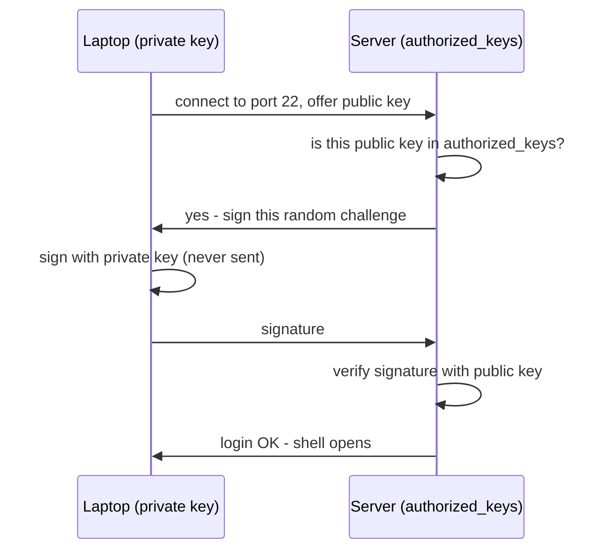
<p align="center"><sub><i>Figure: SSH key-based login</i></sub></p>


Reading the diagram: the laptop offers its public key. If the server finds it in `authorized_keys`, it sends a random challenge. The laptop signs it with the private key, and the server checks the signature with the public key. The private key never crosses the network.

<b>Example:</b>

```bash
ssh-keygen -t ed25519 -C "<your-name>@devops-8wk" -f ~/.ssh/id_ed25519   # choose a passphrase
chmod 700 ~/.ssh && chmod 600 ~/.ssh/id_ed25519
ls -l ~/.ssh/id_ed25519*
ssh-copy-id -i ~/.ssh/id_ed25519.pub ubuntu@<server-ip>    # install the public key on a server
cat >> ~/.ssh/config <<'EOF'
Host lab
  HostName <server-ip>
  User ubuntu
  IdentityFile ~/.ssh/id_ed25519
EOF
ssh lab                                                    # uses the settings above
ssh -L 5432:db.internal:5432 lab                           # tunnel to a private database
```

```text
-rw------- 1 jobanjit jobanjit 411 Nov 11 10:33 /home/jobanjit/.ssh/id_ed25519
-rw-r--r-- 1 jobanjit jobanjit 101 Nov 11 10:33 /home/jobanjit/.ssh/id_ed25519.pub
```

<b>Command breakdown:</b> `ssh-keygen -t ed25519 -C "<your-name>@devops-8wk" -f ~/.ssh/id_ed25519`

| Part | What it means |
|---|---|
| `ssh-keygen` | create a new key pair |
| `-t ed25519` | key type: modern, short and fast; use `-t rsa -b 4096` only if an old system needs RSA |
| `-C "..."` | comment saved in the public key – helps you see whose key it is on a server |
| `-f ~/.ssh/id_ed25519` | file name; the public key is the same name plus `.pub` |
| passphrase prompt | encrypts the private key on disk; use `ssh-agent` so you type it once per session |

<b>Command breakdown:</b> `ssh -L 5432:db.internal:5432 lab`

| Part | What it means |
|---|---|
| `-L` | local port forward (a tunnel) |
| `5432` (first) | port opened on <b>your laptop</b> |
| `db.internal:5432` | where the server `lab` sends the traffic – a host only it can reach |
| `lab` | the jump server from `~/.ssh/config` |
| result | `psql -h 127.0.0.1 -p 5432` on your laptop reaches the private database |

> [!WARNING]
> <b>Common mistake:</b> SSH refuses keys that other users can read: "UNPROTECTED PRIVATE KEY FILE". Keep `~/.ssh` at `700` and private keys at `600`. On Windows, keep keys inside WSL, not on `/mnt/c`.


> [!CAUTION]
> <b>Cost / security alert:</b> Never email, paste in chat or commit a private key. If it happens, treat it as compromised: remove the public key from every server and from GitHub, and create a new pair. At most US clients, production servers have no public SSH at all. Engineers use AWS Systems Manager Session Manager or Azure Bastion.


<h3>14. Ports, ss and netstat</h3>

<b>In simple words:</b> A <b>port</b> is a number (0–65535) that tells the machine which program should receive the traffic. A server program <b>listens</b> on an address and a port. `ss` (socket statistics) shows which programs are listening and which connections are open. `netstat` is the older tool that does the same.

> [!NOTE]
> <b>Simple analogy:</b> The IP address is the building's street address; the port is the apartment number. Running `ss -ltn` is like walking down the corridor and noting which apartments have someone at home.


<b>Why a DevOps Engineer cares:</b>
- "Address already in use" and "connection refused" are both answered by `ss`.
- An app that binds to `127.0.0.1` works with `curl` on the server but not from anywhere else. This is a classic bug, especially in containers.
- Security reviews ask you to prove which ports are open on a server.

<b>How it works:</b>

| Port | Service | Port | Service |
|---|---|---|---|
| 22 | SSH | 443 | HTTPS |
| 53 | DNS (UDP and TCP) | 3306 | MySQL |
| 80 | HTTP | 5432 | PostgreSQL |
| 6443 | Kubernetes API server | 8000 | PeoplePulse (FastAPI, from Day 5) |
| 8080 | Jenkins / dev apps | 9090 / 3000 | Prometheus / Grafana |

| Bind address | Who can connect |
|---|---|
| `127.0.0.1:8080` | only programs on this same machine (loopback) |
| `0.0.0.0:8080` | any network interface – other machines too, if the firewall allows |
| `[::]:8080` | the same for IPv6 (often IPv4 too) |
| `10.20.10.15:8080` | only through that one network interface |

<b>Example:</b>

```bash
python3 -m http.server 8080 --bind 127.0.0.1 > /dev/null 2>&1 &
sleep 1
ss -ltnp
ss -tn state established '( dport = :443 )' | head -3
sudo netstat -tulpn 2>/dev/null | head -3        # older tool (package net-tools)
kill %1
```

```text
State   Recv-Q  Send-Q   Local Address:Port    Peer Address:Port  Process
LISTEN  0       5            127.0.0.1:8080         0.0.0.0:*      users:(("python3",pid=6120,fd=3))
LISTEN  0       4096           0.0.0.0:22           0.0.0.0:*      users:(("sshd",pid=812,fd=3))
LISTEN  0       4096     127.0.0.53%lo:53           0.0.0.0:*
Recv-Q  Send-Q   Local Address:Port      Peer Address:Port
0       0        172.24.10.5:51122       140.82.112.3:443
```

<b>Command breakdown:</b> `ss -ltnp`

| Part | What it means |
|---|---|
| `ss` | socket statistics – modern replacement for `netstat` |
| `-l` | only <b>listening</b> sockets (servers waiting for connections) |
| `-t` | TCP only (`-u` for UDP) |
| `-n` | show numbers (`8080`), not names (`http-alt`); also faster |
| `-p` | show the process; needs `sudo` for processes owned by other users |
| `Local Address:Port` column | `127.0.0.1` = local only; `0.0.0.0` = all interfaces |
| `state established '( dport = :443 )'` (second example) | filter: open connections to remote port 443 |

> [!WARNING]
> <b>Common mistake:</b> Inside a container, an app bound to `127.0.0.1` cannot be reached through a published port, because the traffic arrives on the container's network interface, not loopback. Containers must listen on `0.0.0.0` (you will see this on Day 6 with Uvicorn `--host 0.0.0.0`).


<h3>15. Following the Path: ping, traceroute, tracepath and nc</h3>

<b>In simple words:</b> `ping` asks "are you there?" using ICMP packets. `traceroute` and `tracepath` list every router (<b>hop</b>) between you and the target, so you can see where packets stop. `nc` checks whether a single TCP port accepts a connection.

> [!NOTE]
> <b>Simple analogy:</b> `ping` is knocking on the door. `traceroute` is the parcel tracking page that lists every depot the parcel passed. If tracking stops at "Memphis hub", you know where to look.


<b>Why a DevOps Engineer cares:</b>
- When traffic between two networks fails (VPN, peering, on-prem link), `traceroute` shows the last hop that answered.
- Many cloud firewalls block ICMP, so "ping fails" does <b>not</b> mean "host down". Keep that in mind before you raise an alarm.
- `nc -zv host port` is the quickest answer to "is the security group open?".

<b>How it works:</b> `traceroute` sends packets with a small TTL (hop limit) of 1, 2, 3, ... Each router that drops a packet because the TTL reached zero sends back an error, which reveals that router's address. `* * *` means a hop did not answer (often a router or firewall set not to reply, which is not necessarily a failure).

| Tool | Protocol | Needs root | Use it for |
|---|---|---|---|
| `ping -c 3 host` | ICMP | no | basic reachability and latency (if ICMP allowed) |
| `traceroute -n host` | UDP by default | no | hop-by-hop path |
| `sudo traceroute -T -p 443 host` | TCP | yes | path through firewalls that only allow 443 |
| `tracepath -n host` | UDP | no | path plus MTU (packet size) problems |
| `nc -zv -w 3 host port` | TCP | no | is this one port reachable? |
| `ip -br addr` / `ip route` | — | no | my IPs / my routes and default gateway |

<b>Example:</b>

```bash
ip -br addr                     # my interfaces and IPs
ip route | head -2              # default gateway
ping -c 3 1.1.1.1
tracepath -n 1.1.1.1 | head -5
```

```text
lo               UNKNOWN        127.0.0.1/8 ::1/128
eth0             UP             172.24.10.5/20
default via 172.24.0.1 dev eth0 proto kernel
172.24.0.0/20 dev eth0 proto kernel scope link src 172.24.10.5
64 bytes from 1.1.1.1: icmp_seq=1 ttl=56 time=11.8 ms
64 bytes from 1.1.1.1: icmp_seq=2 ttl=56 time=12.1 ms
64 bytes from 1.1.1.1: icmp_seq=3 ttl=56 time=11.9 ms
 1?: [LOCALHOST]                      pmtu 1500
 1:  172.24.0.1                                            0.412ms
 2:  192.168.1.1                                           2.871ms
 3:  100.64.0.1                                            9.405ms
 4:  no reply
```

<b>Command breakdown:</b> `sudo traceroute -T -p 443 -n github.com`

| Part | What it means |
|---|---|
| `traceroute` | list each hop on the way to the host |
| `-T` | use TCP SYN packets instead of UDP – they pass firewalls that allow HTTPS |
| `-p 443` | destination port for the TCP probes |
| `-n` | show IPs only, do not look up names (faster, no DNS noise) |
| `sudo` | TCP mode needs raw sockets, which need root |
| `* * *` in output | no reply from that hop – keep reading; only worry if <b>all</b> later hops are `*` |

> [!TIP]
> <b>Pro tip:</b> In AWS and Azure, ICMP is blocked by default in security groups and NSGs. Test the port you care about with `nc -zv` or `curl` instead of relying on `ping`.


<h3>Live Demo: "Is It DNS, Network, TLS or the App?"</h3>

The trainer demonstrates one troubleshooting path using a local PeoplePulse-style stub on port 8080, real public sites, and the test site `badssl.com` (each of its sub-domains is broken on purpose).

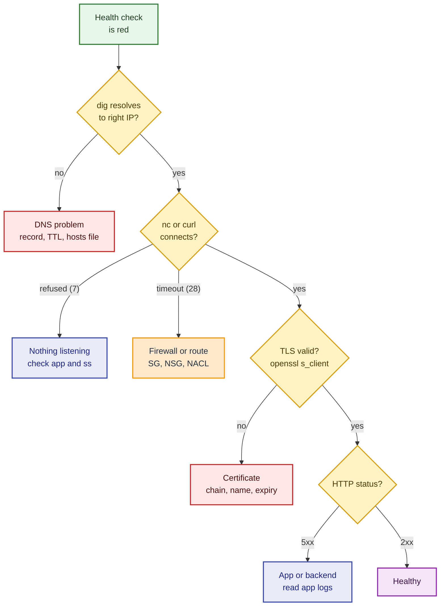
<p align="center"><sub><i>Figure: Live demo - outage triage decision path</i></sub></p>


Reading the diagram: start at the top and stop at the first "no". DNS first, because nothing else works without the right IP. Then TCP: "refused" sends you to the app and its port, "timeout" sends you to firewalls and routes. Then TLS. Only when all of those pass do you read HTTP status codes and app logs.

1. Start a local test server on port 8080 and check it listens:

```bash
mkdir -p ~/day03/www && echo '{"status":"ok"}' > ~/day03/www/health
python3 -m http.server 8080 --bind 127.0.0.1 --directory ~/day03/www > ~/day03/server.log 2>&1 &
echo $! > ~/day03/server.pid
sleep 1
ss -ltnp | grep 8080
```

```text
LISTEN 0      5          127.0.0.1:8080      0.0.0.0:*    users:(("python3",pid=6120,fd=3))
```

<b>Command breakdown:</b> `python3 -m http.server 8080 --bind 127.0.0.1 --directory ~/day03/www > ~/day03/server.log 2>&1 &`

| Part | What it means |
|---|---|
| `python3 -m http.server 8080` | Python's built-in web server on port 8080 |
| `--bind 127.0.0.1` | listen only on loopback (this machine) |
| `--directory ~/day03/www` | serve files from this folder, so `/health` returns our JSON file |
| `> ~/day03/server.log 2>&1` | send both output streams to a log file |
| `&` | run in the background and give the prompt back |
| `echo $! > server.pid` | `$!` is the PID of the last background job; we save it to stop the server later |

2. Layer 7: does the app answer, and how fast?

```bash
curl -sS -o /dev/null -w 'HTTP %{http_code} in %{time_total}s\n' http://127.0.0.1:8080/health
curl -sS -o /dev/null -w 'HTTP %{http_code}\n' http://127.0.0.1:8080/nope
```

```text
HTTP 200 in 0.002134s
HTTP 404
```

3. Layer 4: refused versus timeout (watch the exit codes):

```bash
curl -sS -m 3 http://127.0.0.1:9999/health; echo "exit=$?"
curl -sS -m 3 http://10.255.255.1/health; echo "exit=$?"
```

```text
curl: (7) Failed to connect to 127.0.0.1 port 9999 after 0 ms: Couldn't connect to server
exit=7
curl: (28) Connection timed out after 3002 milliseconds
exit=28
```

Exit 7 = refused (the host answered, but nothing listens). Exit 28 = timeout (packets dropped or no route; `10.255.255.1` is an address nobody answers on).

4. DNS: a good name and a name that does not exist:

```bash
dig +short github.com
dig doesnotexist.peoplepulse.invalid | grep status
curl -sS https://doesnotexist.peoplepulse.invalid; echo "exit=$?"
```

```text
140.82.112.3
;; ->>HEADER<<- opcode: QUERY, status: NXDOMAIN, id: 41872
curl: (6) Could not resolve host: doesnotexist.peoplepulse.invalid
exit=6
```

5. TLS: a good certificate and an expired one:

```bash
openssl s_client -connect github.com:443 -servername github.com </dev/null 2>/dev/null \
  | openssl x509 -noout -subject -enddate
curl -sS https://expired.badssl.com/ > /dev/null; echo "exit=$?"
```

```text
subject=CN = github.com
notAfter=Feb  5 23:59:59 2027 GMT
curl: (60) SSL certificate problem: certificate has expired
exit=60
```

6. A tiny loop with exit codes, the seed of this afternoon's lab script:

```bash
for url in http://127.0.0.1:8080/health http://127.0.0.1:9999/health; do
  if curl -fsS -m 3 -o /dev/null "$url"; then echo "OK   $url"; else echo "FAIL $url"; fi
done
kill "$(cat ~/day03/server.pid)"
```

```text
OK   http://127.0.0.1:8080/health
curl: (7) Failed to connect to 127.0.0.1 port 9999 after 0 ms: Couldn't connect to server
FAIL http://127.0.0.1:9999/health
```

<b>Command breakdown:</b> `if curl -fsS -m 3 -o /dev/null "$url"; then ... else ... fi`

| Part | What it means |
|---|---|
| `if <command>; then` | `if` runs the command and looks only at its exit code (0 = true) |
| `curl -f` | turn HTTP 4xx/5xx into a non-zero exit code, so a 404 counts as failure |
| `-m 3` | 3-second limit per URL |
| `"$url"` | quoted, so a URL with `&` or spaces stays one argument |
| `set -e` note | a failing command inside an `if` does <b>not</b> stop a strict-mode script – that is why this pattern is safe |

> [!IMPORTANT]
> <b>Key point:</b> Stress this to the class: each failure type has its own curl exit code: 6 (DNS), 7 (refused), 28 (timeout), 60 (certificate), 22 (HTTP error with `-f`). A health-check script that records the exit code tells the on-call engineer which layer to look at before they even log in.


---


<h2>11:15 AM – 12:15 PM · Q&A, Live Quiz & Lab Briefing</h2>


| Minutes | Activity | Method |
|---|---|---|
| 11:15 – 11:35 | Interview-style Q&A (8 questions) | Discussion |
| 11:35 – 11:55 | Live quiz (10 questions) and answer review | Quiz |
| 11:55 – 12:10 | Lab briefing: tasks, acceptance criteria, time-boxes | Lecture |
| 12:10 – 12:15 | Everyone confirms `shellcheck`, `dig`, `jq` and `openssl` are installed | Hands-on |

<h3>Interview-style Q&A</h3>


<h4>1. "What does set -euo pipefail do, and why do you use it?"</h4>

<b>Model answer:</b> `-e` stops the script at the first failing command, `-u` makes using an unset variable an error, and `-o pipefail` makes a pipeline fail if any command in it fails, not only the last one. Together they stop a script from silently continuing after an error. This matters most in CI/CD, where a hidden failure can ship a broken build. I add a `trap ... ERR` to print the failing line and run ShellCheck in the pipeline.

<h4>2. "A user says the website is down. How do you troubleshoot?"</h4>

<b>Model answer:</b> I go layer by layer and stop at the first failure. DNS: does `dig` resolve the name to the expected IP? Network: do `nc -zv host 443` or `curl -v` get refused or time out? TLS: does `openssl s_client -servername` show a valid chain, name and dates? App: `curl -i` for the status code, then the app and load balancer logs. A 502 or 503 points me at the load balancer's target health and the backends.

<h4>3. "You have a 10.0.0.0/16 VPC. How many /24 subnets can you create, and how many usable IPs does each have on AWS?"</h4>

<b>Model answer:</b> 256 subnets of `/24`. Each has 256 addresses, and AWS reserves 5 (network, VPC router, DNS, future use and the last address), so 251 usable per subnet. Azure also reserves 5.

<h4>4. "What is the difference between connection refused and connection timed out?"</h4>

<b>Model answer:</b> Refused means the host answered with a reset: the network path works, but nothing listens on that port, or a firewall actively rejects it. Timed out means no reply at all. The usual causes are a security group, NSG, NACL or firewall silently dropping packets, a wrong route, or a host that is down. Refused sends me to the app; timeout sends me to the network rules.

<h4>5. "How does TLS verify a server, and what are common certificate problems?"</h4>

<b>Model answer:</b> The client checks that the certificate chains to a trusted CA, that the hostname is in the Subject Alternative Names, and that today is within the validity dates. Common problems are an expired certificate, a missing intermediate, a wrong hostname, or missing SNI. I debug with `openssl s_client -connect host:443 -servername host -showcerts`, and I automate renewal with ACM or cert-manager.

<h4>6. "What happens when you type a URL into a browser?"</h4>

<b>Model answer:</b> The browser resolves the name through DNS (cache, resolver, root, TLD, authoritative). It opens a TCP connection to port 443, does the TLS handshake with SNI and verifies the certificate, then sends an HTTP request. Usually a load balancer receives it and forwards it to a healthy backend, which returns a response that the browser renders, opening more connections for images and scripts.

<h4>7. "How do you securely access a server in a private subnet?"</h4>

<b>Model answer:</b> My first choice is AWS Systems Manager Session Manager or Azure Bastion: no public IP and no open port 22, and every session is audited. Otherwise a bastion host with key-only SSH, restricted to my IP, using `ssh -J bastion private-host`. Never password authentication and never port 22 open to `0.0.0.0/0`.

<h4>8. "How would you check what is listening on a Linux server?"</h4>

<b>Model answer:</b> `ss -ltnp` (or `netstat -tulpn` on older systems) shows listening ports, the bind address and the process. I check whether it binds to `127.0.0.1` (local only) or `0.0.0.0` (all interfaces), and then confirm from another machine with `nc -zv` that the firewall allows it.

<h3>Live Quiz (10 questions)</h3>


<b>Q1.</b> How many total addresses are in a `/26`?
- A) 26
- B) 32
- C) 64
- D) 128

<b>Q2.</b> What does this print? `x=; echo "[${x:-default}]"`
- A) `[]`
- B) `[default]`
- C) `[x]`
- D) an error

<b>Q3.</b> True or false: without `pipefail`, `false | true` returns exit code 0.
- A) True
- B) False

<b>Q4.</b> Which DNS record type maps a name to an IPv4 address?
- A) `CNAME`
- B) `MX`
- C) `A`
- D) `TXT`

<b>Q5.</b> `curl` exits with code 7. What does it mean?
- A) Timeout
- B) Could not connect (refused or no route)
- C) TLS certificate problem
- D) HTTP 404

<b>Q6.</b> Which tool shows the certificate chain and expiry date of a remote HTTPS server?
- A) `dig`
- B) `ss`
- C) `openssl s_client`
- D) `traceroute`

<b>Q7.</b> A load balancer returns <b>502</b>. What is the most likely cause?
- A) The DNS record is wrong
- B) The client sent bad JSON
- C) The load balancer cannot get a valid response from the backend
- D) The client is being rate limited

<b>Q8.</b> Which of these is NOT an RFC 1918 private range?
- A) `10.0.0.0/8`
- B) `172.16.0.0/12`
- C) `192.168.0.0/16`
- D) `100.64.0.0/10`

<b>Q9.</b> What happens under `set -e`? `count=0; ((count++)); echo done`
- A) prints `done`
- B) nothing – the script exits
- C) prints `1`
- D) prints `0`

<b>Q10.</b> True or false: `ss -ltn` showing `127.0.0.1:8080` means other machines can reach the service on port 8080.
- A) True
- B) False

<h3>Lab Briefing</h3>

<b>What you build this afternoon:</b>
1. `healthcheck.sh`: reads a list of URLs, curls each with a timeout and retries, logs every result, alerts on failure (Slack webhook if set, otherwise syslog), and exits `0` only when all endpoints are healthy.
2. `subnet-plan.md`: `10.20.0.0/16` split into public, private-app and private-db `/24`s across 3 Availability Zones, checked by a Python script. We reuse it for the AWS VPC (Day 17) and the Azure VNet (Day 27).
3. `dns-tls-notes.md`: what you found when debugging DNS and four broken TLS sites.

<b>Acceptance criteria:</b>
- `shellcheck healthcheck.sh` reports nothing.
- `./healthcheck.sh -f endpoints.txt` prints one OK/FAIL line per URL and a summary; exit code `0` when all pass, `1` when any fail, `2` on bad usage.
- The subnet plan has no overlapping ranges, stays inside `10.20.0.0/16`, and lists usable IPs per subnet.
- You name the problem behind each badssl.com test host using `openssl s_client` and `curl`.
- All files pushed to the `day03-bash-networking` branch.

<b>Time-boxes:</b> Task 1 by 1:10 PM, Task 2 by 1:50 PM, Task 3 by 2:10 PM, Task 4 by 2:30 PM, Lab Part 2 challenges 2:30–4:00 PM.

---


<h2>12:15 – 1:15 PM · Lunch</h2>


Take a proper break away from the screen. If you are on a corporate laptop, check that a VPN does not block `dig @1.1.1.1` before 1:15 PM.

---


<h2>1:15 – 2:45 PM · Lab Part 1 – Task Assignment & Guided Build</h2>


> [!NOTE]
> <b>Lab start (1:15 PM):</b> the trainer posts today's lab tasks in the batch channel. Work through them in order, ask for help in the channel if you are stuck for more than 15 minutes, and report your results (screenshots, command output, Git link) to the trainer at the <b>4:00 PM review</b>.


| Minutes | Activity | Method |
|---|---|---|
| 1:15 – 1:25 | Task 1: set up the day03 folder, a local test server and `endpoints.txt` | Task |
| 1:25 – 2:05 | Task 2: write, lint and test `healthcheck.sh` (exit codes 0, 1, 2) | Task |
| 2:05 – 2:25 | Task 3: subnet `10.20.0.0/16` into public and private `/24`s and verify | Task |
| 2:25 – 2:40 | Task 4: debug DNS (`dig`, `/etc/hosts`) and TLS (`openssl s_client`) | Task |
| 2:40 – 2:45 | Mentor checks the Task 2 exit codes and the Task 3 `OK` line | Mentor check |

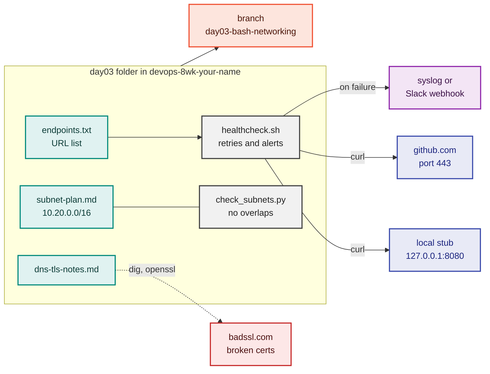
<p align="center"><sub><i>Figure: Lab - what you will build this afternoon</i></sub></p>


Reading the diagram: `healthcheck.sh` reads `endpoints.txt` and curls a local stub and a public website; failures go to syslog (or Slack). Separately, you write a subnet plan and prove it with a Python checker, and you record DNS and TLS findings from `dig` and `openssl` against `badssl.com`. Everything is committed to the `day03-bash-networking` branch.

<h3>Task 1 – Set Up Test Targets</h3>


```bash
mkdir -p ~/devops-8wk/devops-8wk-<your-name>/day03 && cd ~/devops-8wk/devops-8wk-<your-name>/day03
mkdir -p www && echo '{"status":"ok","app":"peoplepulse-stub"}' > www/health
python3 -m http.server 8080 --bind 127.0.0.1 --directory www > server.log 2>&1 &
echo $! > server.pid

cat > endpoints.txt <<'EOF'
# One URL per line. Lines starting with # are ignored.
http://127.0.0.1:8080/health
https://github.com
http://127.0.0.1:9999/health
EOF
curl -s 127.0.0.1:8080/health; echo
grep -vc '^#' endpoints.txt
```

```text
{"status":"ok","app":"peoplepulse-stub"}
3
```

<b>Checkpoint:</b> `curl` returns the JSON and the count is `3`.

<h3>Task 2 – Write healthcheck.sh</h3>


```bash
cat > healthcheck.sh <<'EOF'
#!/usr/bin/env bash
# healthcheck.sh - curl a list of HTTP(S) endpoints and alert on failure.
# Usage:      ./healthcheck.sh [-f endpoints.txt] [-t timeout_seconds] [url ...]
# Exit codes: 0 = all healthy, 1 = at least one endpoint failed, 2 = usage error.
set -euo pipefail

TIMEOUT="${TIMEOUT:-5}"                        # per-request timeout in seconds
RETRIES="${RETRIES:-2}"                        # extra attempts after the first
LOG_FILE="${LOG_FILE:-./healthcheck.log}"
SLACK_WEBHOOK_URL="${SLACK_WEBHOOK_URL:-}"     # optional - never hard-code it
ENDPOINTS_FILE=""

log() {
  printf '%s %s\n' "$(date -u +%Y-%m-%dT%H:%M:%SZ)" "$*" | tee -a "$LOG_FILE" >&2
}

usage() {
  echo "Usage: $0 [-f endpoints_file] [-t timeout_seconds] [url ...]" >&2
  exit 2
}

alert() {
  local message="$1" payload
  log "ALERT ${message}"
  if [[ -n "$SLACK_WEBHOOK_URL" ]]; then
    payload=$(jq -n --arg text "$message" '{text: $text}')   # safe JSON, even with quotes
    curl -sS -m 5 -X POST -H 'Content-Type: application/json' \
      --data "$payload" "$SLACK_WEBHOOK_URL" > /dev/null \
      || log "WARN could not send Slack alert"
  elif command -v logger > /dev/null; then
    logger -t healthcheck -p user.err "$message"            # goes to syslog / journal
  fi
}

check_url() {
  local url="$1" attempt code="000"
  for (( attempt = 1; attempt <= RETRIES + 1; attempt++ )); do
    # -w prints the status code; on connection errors curl prints 000 and exits non-zero
    code=$(curl -s -o /dev/null -w '%{http_code}' -m "$TIMEOUT" "$url" || true)
    if [[ "$code" =~ ^[23][0-9]{2}$ ]]; then
      log "OK   ${url} (HTTP ${code}, attempt ${attempt})"
      return 0
    fi
    if (( attempt <= RETRIES )); then sleep 1; fi
  done
  alert "FAIL ${url} (HTTP ${code}) after $((RETRIES + 1)) attempts on $(hostname)"
  return 1
}

main() {
  while getopts ":f:t:h" opt; do
    case "$opt" in
      f) ENDPOINTS_FILE="$OPTARG" ;;
      t) TIMEOUT="$OPTARG" ;;
      *) usage ;;
    esac
  done
  shift $((OPTIND - 1))

  local -a urls=("$@")
  local line
  if [[ -n "$ENDPOINTS_FILE" ]]; then
    [[ -r "$ENDPOINTS_FILE" ]] || { echo "Cannot read ${ENDPOINTS_FILE}" >&2; exit 2; }
    while IFS= read -r line; do
      [[ -z "$line" || "$line" == \#* ]] && continue
      urls+=("$line")
    done < "$ENDPOINTS_FILE"
  fi
  [[ ${#urls[@]} -gt 0 ]] || usage

  local failures=0 url
  for url in "${urls[@]}"; do
    check_url "$url" || failures=$((failures + 1))
  done

  log "SUMMARY total=${#urls[@]} failed=${failures}"
  if [[ "$failures" -gt 0 ]]; then
    exit 1
  fi
}

main "$@"
EOF
chmod +x healthcheck.sh
shellcheck healthcheck.sh && echo "shellcheck clean"
```

```text
shellcheck clean
```

<b>Command breakdown:</b> `code=$(curl -s -o /dev/null -w '%{http_code}' -m "$TIMEOUT" "$url" || true)`

| Part | What it means |
|---|---|
| `code=$( ... )` | store what the command prints (only the status code) in `code` |
| `curl -s -o /dev/null` | quiet, throw the body away |
| `-w '%{http_code}'` | print the status; prints `000` when there is no HTTP answer (refused, timeout, DNS) |
| `-m "$TIMEOUT"` | give up after this many seconds |
| `\|\| true` | curl exits non-zero on connection errors; `\|\| true` stops `set -e` from killing the script so we can retry |
| no `-f` here | on purpose: we want the real status code (404, 503) in the log, not just "failed" |

<b>Command breakdown:</b> `[[ "$code" =~ ^[23][0-9]{2}$ ]]`

| Part | What it means |
|---|---|
| `=~` | match against a regular expression (do not quote the pattern) |
| `^` / `$` | start and end of the text – the whole code must match |
| `[23]` | first digit 2 or 3 (success or redirect) |
| `[0-9]{2}` | exactly two more digits |
| result | `200`, `204`, `301` pass; `000`, `404`, `503` fail |

<b>Command breakdown:</b> `payload=$(jq -n --arg text "$message" '{text: $text}')`

| Part | What it means |
|---|---|
| `jq -n` | start with no input – we build JSON from scratch |
| `--arg text "$message"` | pass the shell variable into jq as a string named `text` |
| `'{text: $text}'` | build `{"text": "..."}`; jq escapes quotes and newlines correctly |
| why | building JSON with `"{\"text\": \"$message\"}"` breaks when the message contains a quote |

Run it against the file:

```bash
./healthcheck.sh -f endpoints.txt; echo "exit=$?"
```

```text
2026-11-11T18:05:01Z OK   http://127.0.0.1:8080/health (HTTP 200, attempt 1)
2026-11-11T18:05:01Z OK   https://github.com (HTTP 200, attempt 1)
2026-11-11T18:05:03Z ALERT FAIL http://127.0.0.1:9999/health (HTTP 000) after 3 attempts on lab-laptop
2026-11-11T18:05:03Z SUMMARY total=3 failed=1
exit=1
```

Test the other two exit paths and the alert:

```bash
./healthcheck.sh http://127.0.0.1:8080/health; echo "exit=$?"
./healthcheck.sh; echo "exit=$?"
journalctl -t healthcheck -n 3 --no-pager
TIMEOUT=2 RETRIES=0 ./healthcheck.sh -t 1 http://10.255.255.1/; echo "exit=$?"
```

```text
2026-11-11T18:06:10Z OK   http://127.0.0.1:8080/health (HTTP 200, attempt 1)
2026-11-11T18:06:10Z SUMMARY total=1 failed=0
exit=0
Usage: ./healthcheck.sh [-f endpoints_file] [-t timeout_seconds] [url ...]
exit=2
Nov 11 13:05:03 lab-laptop healthcheck[7012]: FAIL http://127.0.0.1:9999/health (HTTP 000) after 3 attempts on lab-laptop
2026-11-11T18:06:12Z ALERT FAIL http://10.255.255.1/ (HTTP 000) after 1 attempts on lab-laptop
2026-11-11T18:06:12Z SUMMARY total=1 failed=1
exit=1
```

<b>Checkpoint:</b> the three runs exit `1`, `0` and `2`; ShellCheck is clean; `journalctl -t healthcheck` shows the FAIL alert; `healthcheck.log` contains every line.

> [!CAUTION]
> <b>Cost / security alert:</b> A Slack webhook URL is a secret: anyone who has it can post into your channel. Pass it as an environment variable (`export SLACK_WEBHOOK_URL=...` in your shell, or a CI secret later), never in the script or in Git.


<h3>Task 3 – Subnet a /16 into Public and Private /24s</h3>

Use the dev VPC/VNet range <b>`10.20.0.0/16`</b> (the program-wide convention). Leave gaps so each tier can grow.

| Tier | AZ | CIDR | First usable | Last usable | Usable IPs |
|---|---|---|---|---|---|
| public | a | `10.20.0.0/24` | 10.20.0.4 | 10.20.0.254 | 251 |
| public | b | `10.20.1.0/24` | 10.20.1.4 | 10.20.1.254 | 251 |
| public | c | `10.20.2.0/24` | 10.20.2.4 | 10.20.2.254 | 251 |
| private-app | a | `10.20.10.0/24` | 10.20.10.4 | 10.20.10.254 | 251 |
| private-app | b | `10.20.11.0/24` | 10.20.11.4 | 10.20.11.254 | 251 |
| private-app | c | `10.20.12.0/24` | 10.20.12.4 | 10.20.12.254 | 251 |
| private-db | a | `10.20.20.0/24` | 10.20.20.4 | 10.20.20.254 | 251 |
| private-db | b | `10.20.21.0/24` | 10.20.21.4 | 10.20.21.254 | 251 |
| private-db | c | `10.20.22.0/24` | 10.20.22.4 | 10.20.22.254 | 251 |
| reserved | – | `10.20.128.0/17` | future: EKS pods, endpoints, new tiers | | |

AWS and Azure reserve the first four addresses (`.0` network, `.1` router, `.2` DNS, `.3` future) and the last one (`.255`) in every subnet.

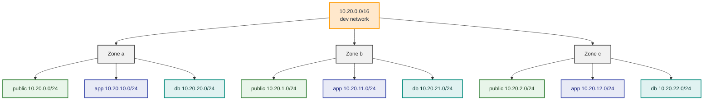
<p align="center"><sub><i>Figure: Lab - subnet plan for 10.20.0.0/16 across three zones</i></sub></p>


Reading the diagram: each Availability Zone (a separate data centre in the region) gets one subnet per tier. The third number in the address tells you the tier at a glance: 0–2 public, 10–12 app, 20–22 database. If one zone fails, the other two still have every tier.

Verify there are no overlaps with Python:

```bash
cat > check_subnets.py <<'EOF'
"""Check that every subnet is inside the VPC and no two subnets overlap."""
import ipaddress
import itertools

vpc = ipaddress.ip_network("10.20.0.0/16")
subnets = {
    "public-a": "10.20.0.0/24", "public-b": "10.20.1.0/24", "public-c": "10.20.2.0/24",
    "app-a": "10.20.10.0/24", "app-b": "10.20.11.0/24", "app-c": "10.20.12.0/24",
    "db-a": "10.20.20.0/24", "db-b": "10.20.21.0/24", "db-c": "10.20.22.0/24",
}
nets = {name: ipaddress.ip_network(cidr) for name, cidr in subnets.items()}
for name, net in nets.items():
    assert net.subnet_of(vpc), f"{name} is outside the VPC"
    print(f"{name:9} {str(net):15} usable_on_aws={net.num_addresses - 5}")
for (a, na), (b, nb) in itertools.combinations(nets.items(), 2):
    assert not na.overlaps(nb), f"{a} overlaps {b}"
print("OK: all subnets inside", vpc, "and no overlaps")
EOF
python3 check_subnets.py
```

```text
public-a  10.20.0.0/24    usable_on_aws=251
public-b  10.20.1.0/24    usable_on_aws=251
public-c  10.20.2.0/24    usable_on_aws=251
app-a     10.20.10.0/24   usable_on_aws=251
app-b     10.20.11.0/24   usable_on_aws=251
app-c     10.20.12.0/24   usable_on_aws=251
db-a      10.20.20.0/24   usable_on_aws=251
db-b      10.20.21.0/24   usable_on_aws=251
db-c      10.20.22.0/24   usable_on_aws=251
OK: all subnets inside 10.20.0.0/16 and no overlaps
```

<b>Command breakdown:</b> the two checks in `check_subnets.py`

| Part | What it means |
|---|---|
| `net.subnet_of(vpc)` | True if the subnet sits completely inside the VPC range |
| `assert ..., "message"` | stop with an error and this message if the check is False |
| `itertools.combinations(nets.items(), 2)` | every pair of subnets, once (a-b, a-c, ... no repeats) |
| `na.overlaps(nb)` | True if the two ranges share even one address |
| `{name:9}` | f-string padding: print the name in a 9-character column |

Now write `subnet-plan.md` with the table above plus two sentences on routing: public subnets have a route `0.0.0.0/0` to the internet gateway; private-app subnets route `0.0.0.0/0` to a NAT gateway; private-db subnets have no internet route.

<b>Checkpoint:</b> the script prints `OK`; `subnet-plan.md` has the table and the routing sentences. Break it on purpose (change `db-c` to `10.20.2.0/24`) and confirm the script fails with `AssertionError: public-c overlaps db-c`, then change it back.

<h3>Task 4 – Debug DNS and TLS</h3>

<b>DNS:</b>

```bash
dig github.com A +noall +answer              # answer and TTL
dig @8.8.8.8 github.com +short
dig @1.1.1.1 github.com +short               # compare two resolvers
dig +trace github.com | tail -4              # who is authoritative?
dig nope.github.invalid | grep -o 'status: [A-Z]*'
```

```text
github.com.             60      IN      A       140.82.112.3
140.82.112.3
140.82.112.3
github.com.             60      IN      A       140.82.112.3
;; Received 55 bytes from 205.251.193.165#53(ns-421.awsdns-52.com) in 12 ms

status: NXDOMAIN
```

Now simulate the classic forgotten `/etc/hosts` override:

```bash
echo "127.0.0.1 api.peoplepulse.test" | sudo tee -a /etc/hosts
getent hosts api.peoplepulse.test           # OS resolver reads /etc/hosts
dig +short api.peoplepulse.test             # dig asks DNS directly - empty
curl -s http://api.peoplepulse.test:8080/health; echo
```

```text
127.0.0.1 api.peoplepulse.test
127.0.0.1       api.peoplepulse.test

{"status":"ok","app":"peoplepulse-stub"}
```

Record in `dns-tls-notes.md` why `getent` and `dig` disagree.

<b>TLS:</b> each `badssl.com` sub-domain is broken in a different way on purpose:

```bash
for host in expired.badssl.com wrong.host.badssl.com self-signed.badssl.com untrusted-root.badssl.com; do
  echo "== $host"
  openssl s_client -connect "$host:443" -servername "$host" </dev/null 2>/dev/null \
    | grep -E 'Verify return code'
  curl -sS -o /dev/null "https://$host/" 2>&1 | head -1
done
```

```text
== expired.badssl.com
Verify return code: 10 (certificate has expired)
curl: (60) SSL certificate problem: certificate has expired
== wrong.host.badssl.com
Verify return code: 0 (ok)
curl: (60) SSL: no alternative certificate subject name matches target host name 'wrong.host.badssl.com'
== self-signed.badssl.com
Verify return code: 18 (self-signed certificate)
curl: (60) SSL certificate problem: self-signed certificate
== untrusted-root.badssl.com
Verify return code: 19 (self-signed certificate in certificate chain)
curl: (60) SSL certificate problem: self-signed certificate in certificate chain
```

Why does openssl say `0 (ok)` for `wrong.host`? Because `s_client` does not check the hostname unless you ask. Prove it:

```bash
openssl s_client -connect wrong.host.badssl.com:443 -servername wrong.host.badssl.com \
  -verify_hostname wrong.host.badssl.com </dev/null 2>/dev/null | grep 'Verify return code'
openssl s_client -connect wrong.host.badssl.com:443 -servername wrong.host.badssl.com </dev/null 2>/dev/null \
  | openssl x509 -noout -ext subjectAltName
```

```text
Verify return code: 62 (hostname mismatch)
X509v3 Subject Alternative Name:
    DNS:*.badssl.com, DNS:badssl.com
```

The wildcard `*.badssl.com` covers exactly <b>one</b> level (`wrong.badssl.com`), not two (`wrong.host.badssl.com`).

Finally, how many days does a certificate have left?

```bash
end=$(openssl s_client -connect github.com:443 -servername github.com </dev/null 2>/dev/null \
      | openssl x509 -noout -enddate | cut -d= -f2)
echo "github.com expires in $(( ( $(date -d "$end" +%s) - $(date +%s) ) / 86400 )) days"
```

```text
github.com expires in 86 days
```

<b>Command breakdown:</b> `$(( ( $(date -d "$end" +%s) - $(date +%s) ) / 86400 ))`

| Part | What it means |
|---|---|
| `openssl x509 -noout -enddate` | prints `notAfter=Feb  5 23:59:59 2027 GMT` |
| `cut -d= -f2` | split on `=` and keep field 2 – the date text |
| `date -d "$end" +%s` | convert that date to seconds since 1970 (GNU date; on macOS use `gdate`) |
| `date +%s` | now, in seconds since 1970 |
| `/ 86400` | seconds per day – the result is whole days left |

<b>Checkpoint:</b> `dns-tls-notes.md` names the problem for each of the four badssl hosts (expired, hostname mismatch, self-signed, untrusted root) and explains `getent` vs `dig`.

---


<h2>2:45 – 4:00 PM · Lab Part 2 – Independent Challenge</h2>


| Minutes | Activity | Method |
|---|---|---|
| 2:45 – 3:10 | Challenge 1: smarter health checks (body match and latency) | Task |
| 3:10 – 3:22 | Challenge 2: run the health check every 5 minutes with cron | Task |
| 3:22 – 3:43 | Challenge 3: break/fix the deploy script that "always succeeds" | Task |
| 3:43 – 3:52 | Challenge 4: second-region and Azure IP plan | Task |
| 3:52 – 4:00 | Stretch goal or catch-up; mentor spot-checks Challenge 3 | Mentor check |

These challenges have <b>no full solutions</b>. Work from the hints, the concept notes and ShellCheck.

<h3>Challenge 1 – Smarter Health Checks</h3>

<b>Goal:</b> extend `healthcheck.sh`:
- Support an optional expected text per line in `endpoints.txt`, for example `http://127.0.0.1:8080/health "status":"ok"`. The check fails if the response body does not contain it.
- Fail (and alert) if the request takes longer than `MAX_LATENCY` seconds (default 2).

<b>Hints:</b>
- `read -r url expect` splits a line into two variables at the first space.
- `curl -s -o "$tmp" -w '%{http_code} %{time_total}'` saves the body to a temp file and prints code and time together; `read -r code secs <<< "$out"` splits them.
- Bash only compares whole numbers. Compare decimals with `awk -v t="$secs" -v m="$MAX_LATENCY" 'BEGIN { exit !(t > m) }'`.
- `grep -qF -- "$expect" "$tmp"` searches for fixed text (no regex).

<b>Acceptance criteria:</b> a slow URL (`https://httpbin.org/delay/3`) fails with the word "latency"; a wrong expected string fails with "body mismatch"; the temp file is removed by a `trap`; ShellCheck is still clean.

<h3>Challenge 2 – Run It Every 5 Minutes</h3>

<b>Goal:</b> schedule `healthcheck.sh` with cron (Day 2) every 5 minutes, logging to `~/devops-8wk/devops-8wk-<your-name>/day03/cron-healthcheck.log`.

<b>Hints:</b> use `crontab -e` (no user field); use absolute paths for the script and `endpoints.txt`; cron's `PATH` is tiny, so `curl` and `jq` must be in `/usr/bin`; send both streams with `>> file 2>&1`. The schedule for "every 5 minutes" is `*/5 * * * *`.

<b>Acceptance criteria:</b> at least two runs visible in the log; you can show the crontab line; you remove it in teardown.

<h3>Challenge 3 – Break/Fix: the Deploy Script That "Always Succeeds"</h3>

Raymundo's teammate wrote this script. It reports `SUCCESS` even when everything fails. Save it as `broken-deploy.sh` exactly as written and fix it:

```bash
#!/bin/bash
# broken-deploy.sh - "deploys" by checking the target, then printing success
TARGET=$1
ENVIROMENT=${ENV}
curl -s http://$TARGET/health | grep -q ok
echo "Deploying to $ENVIRONMENT"
count=0
for f in $(ls *.txt); do
  ((count++))
done
echo "Checked $count files"
echo "SUCCESS"
```

<b>Goal:</b> the script must fail with a clear message when no argument is given, when `ENV` is not set, or when the target is down, and it must handle file names with spaces.

<b>Hints:</b> run `shellcheck broken-deploy.sh` first and read every warning. There are at least seven bugs: no strict mode, the `ENVIROMENT`/`ENVIRONMENT` typo, unquoted variables, a pipe without `pipefail` (and `curl` without `-f`), `ls` in a `for` loop, `((count++))` from zero, and no usage check.

<b>Acceptance criteria:</b>
- `ENV=dev ./broken-deploy.sh 127.0.0.1:8080` succeeds.
- `./broken-deploy.sh` exits `2` with a usage message.
- `./broken-deploy.sh 127.0.0.1:8080` (no `ENV`) fails with a message naming `ENV`.
- `ENV=dev ./broken-deploy.sh 127.0.0.1:9999` exits non-zero and never prints `SUCCESS`.
- `touch "q3 report.txt"` then a run counts it as one file.
- ShellCheck is clean, and each bug plus its fix is listed in `dns-tls-notes.md` under "Script fixes".

> [!NOTE]
> <b>Real-world scenario:</b> This exact pattern, a deploy script that prints SUCCESS after a failed health check, is behind many "the pipeline was green but production was down" incidents. Reviewers at US clients look for `set -euo pipefail` and `curl -f` in every script PR.


<h3>Challenge 4 – Second Region and Azure IP Plan</h3>

<b>Goal:</b> the client wants a <b>prod</b> VPC in `us-west-2` that will later be peered with dev (`10.20.0.0/16`) and connected to an office network `192.168.0.0/16` over VPN. Choose a non-overlapping `/16` and plan 3 public, 3 private-app and 3 private-db `/24`s. Also choose an Azure VNet range for Day 27 that overlaps with nothing.

<b>Hints:</b> stay inside `10.0.0.0/8` and avoid `172.17.0.0/16` (Docker). One clean pattern is one `/16` per environment and cloud: `10.20` dev AWS, `10.30` prod AWS, `10.40` Azure.

<b>Acceptance criteria:</b> an extended `check_subnets.py` checks all three networks and the office range, and prints `OK`.

<h3>Stretch Goal</h3>

Add a `--json` mode to `healthcheck.sh` that prints one JSON object per URL to <b>stdout</b> (`{"url":"...","code":200,"latency":0.12,"ok":true}`) while logs stay on stderr, so you can run `./healthcheck.sh --json -f endpoints.txt 2>/dev/null | jq -s 'map(select(.ok|not))'` to list failures. Hint: `getopts` only handles single letters, so check for `--json` before the `getopts` loop.

---


<h2>4:00 – 4:45 PM · Lab Review with Trainer & Teardown</h2>


| Minutes | Activity | Method |
|---|---|---|
| 4:00 – 4:25 | Mentor reviews each trainee against the checklist (live exit-code demo) | Mentor check |
| 4:25 – 4:35 | Teardown: stop test servers, remove cron job and hosts override | Task |
| 4:35 – 4:45 | Verify nothing is left running; cost check | Checkpoint |

<h3>Mentor Review Checklist</h3>

- `shellcheck healthcheck.sh` is clean; the script starts with `#!/usr/bin/env bash` and `set -euo pipefail`.
- Exit codes `0`, `1` and `2` demonstrated live; the alert appears in `journalctl -t healthcheck`.
- No webhook URL or other secret in the script or in Git.
- Subnet plan: inside `10.20.0.0/16`, no overlaps, 251 usable per `/24`, public vs private routing explained.
- Trainee explains refused vs timeout and `NXDOMAIN` vs `SERVFAIL` in their own words.
- Each badssl host diagnosed correctly; SNI (`-servername`) explained.
- Broken deploy script: all bugs listed and fixed.

<h3>Teardown Commands</h3>


```bash
cd ~/devops-8wk/devops-8wk-<your-name>/day03
kill "$(cat server.pid)" 2>/dev/null; rm -f server.pid server.log
kill "$(cat ~/day03/server.pid)" 2>/dev/null; rm -rf ~/day03
crontab -l 2>/dev/null | grep -v healthcheck.sh | crontab -     # remove the 5-minute job
sudo sed -i '/api\.peoplepulse\.test/d' /etc/hosts              # remove the hosts override
ss -ltn | grep -E ':8080|:9999' || echo "no test servers listening"
crontab -l 2>/dev/null | grep -c healthcheck || true
```

```text
no test servers listening
0
```

<b>Command breakdown:</b> `crontab -l 2>/dev/null | grep -v healthcheck.sh | crontab -`

| Part | What it means |
|---|---|
| `crontab -l` | print your current crontab |
| `2>/dev/null` | hide "no crontab for user" if it is empty |
| `grep -v healthcheck.sh` | keep every line <b>except</b> the health-check job |
| `crontab -` | install the result from stdin as your new crontab |
| warning | if `grep -v` removes every line it exits 1, but the empty crontab is still installed – that is fine here |

<h3>Cost Check</h3>

Today was fully local. You created no cloud resources, so there is nothing to bill. Quick sanity check that nothing from Day 2 is still running:

```bash
aws ec2 describe-instances \
  --filters Name=tag:course,Values=devops-8wk Name=instance-state-name,Values=pending,running,stopped \
  --query 'Reservations[].Instances[].InstanceId' --output text     # expect empty
az group list --tag course=devops-8wk -o table                      # expect empty
```

---


<h2>4:45 – 5:00 PM · Commit & Daily Report</h2>


| Minutes | Activity | Method |
|---|---|---|
| 4:45 – 4:53 | Commit files to branch `day03-bash-networking`, push, open a PR | Task |
| 4:53 – 5:00 | Fill in and post the daily activity report | Checkpoint |

```bash
cd ~/devops-8wk/devops-8wk-<your-name>
git switch main && git pull
git switch -c day03-bash-networking
cat >> .gitignore <<'EOF'
*.log
*.pid
EOF
git add .gitignore day03/healthcheck.sh day03/endpoints.txt day03/subnet-plan.md \
        day03/check_subnets.py day03/dns-tls-notes.md day03/broken-deploy.sh
git status                      # make sure no .log, .pid or secrets are staged
git commit -m "feat(day03): healthcheck.sh with retries and alerts, subnet plan, DNS/TLS notes"
git push -u origin day03-bash-networking
```

Open a pull request `day03-bash-networking → main` and merge it after the mentor review. Tomorrow you learn how a team handles this properly: branch protection, reviews and CODEOWNERS.

<b>Daily activity report – Day 03:</b>

```text
Done
- healthcheck.sh: file/args input, timeout + retries, Slack/syslog alert, exit codes 0/1/2, ShellCheck clean
- Subnet plan: 10.20.0.0/16 -> 3 public, 3 private-app, 3 private-db /24s, verified with Python ipaddress
- Debugged DNS (dig, +trace, /etc/hosts vs DNS) and TLS (expired, wrong host, self-signed, untrusted root)
- Fixed broken-deploy.sh (strict mode, quoting, pipefail, ls loop, ((count++)), usage check)

Blocked
- <none / e.g. corporate VPN blocks dig to 8.8.8.8>

Next
- Day 4: Git & GitHub - branching, PRs, branch protection, CODEOWNERS, tags, reflog

Learned
- curl exit 7 (refused) and 28 (timeout) point to different layers
- AWS and Azure reserve 5 IPs per subnet, so a /24 has 251 usable
- Always pass -servername to openssl s_client (SNI)
```

---


<h2>Cheat Sheet</h2>

| Area | Command | Purpose |
|---|---|---|
| Bash | `set -euo pipefail` | strict mode – top of every script |
| Bash | `trap 'echo "line $LINENO failed" >&2' ERR` / `trap 'rm -f "$tmp"' EXIT` | report failures / always clean up |
| Bash | `"${var:-default}"`, `: "${var:?message}"` | default value / required variable |
| Bash | `for x in "${arr[@]}"; do ...; done` | loop over an array safely |
| Bash | `while IFS= read -r line; do ...; done < file` | read a file line by line |
| Bash | `count=$((count + 1))` | safe increment under `set -e` |
| Bash | `getopts ":f:t:h" opt` + `shift $((OPTIND - 1))` | parse options |
| Bash | `cmd > out 2>&1`, `cmd \| tee -a log`, `cmd1 && cmd2 \|\| cmd3` | redirection and chaining |
| Lint | `shellcheck script.sh` | find bugs before running |
| IP | `ip -br addr`, `ip route` | my IPs and default gateway |
| Ports | `ss -ltnp`, `nc -zv -w 3 host 443` | who listens / is a port reachable |
| HTTP | `curl -sS -o /dev/null -w '%{http_code} %{time_total}\n' URL` | status and latency |
| HTTP | `curl -v URL`, `curl -fsS URL`, `curl --resolve host:443:IP URL` | debug / fail on 4xx-5xx / test new IP |
| DNS | `dig name +short`, `dig @1.1.1.1 name`, `dig +trace name`, `getent hosts name` | resolve and compare |
| TLS | `openssl s_client -connect h:443 -servername h </dev/null \| openssl x509 -noout -subject -issuer -dates` | certificate details |
| Path | `ping -c 3 host`, `tracepath -n host`, `sudo traceroute -T -p 443 -n host` | reachability and hops |
| SSH | `ssh-keygen -t ed25519 -C id`, `ssh -L 5432:db:5432 bastion` | new key / tunnel |

```text
CIDR:   /16 = 65,536   /20 = 4,096   /24 = 256 (251 usable)   /26 = 64   /28 = 16 (11 usable)   /32 = 1
        addresses = 2^(32 - prefix); private: 10/8, 172.16/12, 192.168/16
curl:   6 DNS   7 refused   22 HTTP>=400 (with -f)   28 timeout   35 TLS handshake   60 bad certificate
Exit:   0 ok   1 failure   2 usage   126 not executable   127 not found   130 Ctrl+C   137 SIGKILL/OOM
HTTP:   2xx ok   3xx redirect   401/403 auth   404 path   429 throttled   502 bad backend   503 no healthy   504 slow
DNS:    NOERROR   NXDOMAIN = no such name   SERVFAIL = resolver could not answer
```


<h2>Further Reading</h2>

- [GNU Bash Reference Manual](https://www.gnu.org/software/bash/manual/bash.html)
- [AWS – Subnet CIDR blocks and reserved addresses](https://docs.aws.amazon.com/vpc/latest/userguide/subnet-sizing.html)
- [Azure – Virtual network FAQ (reserved IP addresses)](https://learn.microsoft.com/en-us/azure/virtual-network/virtual-networks-faq)
- [curl – man page](https://curl.se/docs/manpage.html)
- [OpenSSL s_client documentation](https://docs.openssl.org/3.0/man1/openssl-s_client/)
- [GitHub – Generating a new SSH key](https://docs.github.com/en/authentication/connecting-to-github-with-ssh/generating-a-new-ssh-key-and-adding-it-to-the-ssh-agent)

<b>Next:</b> [Day 04 – Git & GitHub](../../Week02/Day04_Git_and_GitHub/Day04_Git_and_GitHub.md)


<h2>Answer Key</h2>


1. C – 2^(32 − 26) = 64 addresses.
2. B – `:-` gives the default when the variable is unset <b>or empty</b>.
3. A (True) – without `pipefail`, a pipeline's exit code is the last command's (`true` gives 0).
4. C – `A` record (`AAAA` is IPv6).
5. B – exit 7 = failed to connect; 28 is timeout, 60 is a certificate problem.
6. C – `openssl s_client -connect host:443 -servername host`.
7. C – 502 Bad Gateway: the backend failed or returned an invalid response.
8. D – `100.64.0.0/10` is carrier-grade NAT space (RFC 6598), not RFC 1918.
9. B – `((count++))` evaluates to 0 (false), so it returns exit code 1 and `set -e` exits.
10. B (False) – it listens only on loopback; it must bind to `0.0.0.0` or the host IP.
