<h1 align="left">Day 05 – Python for DevOps + Mini Project 1 Start</h1>

<p>


</p>

<p><b>Notes</b> · <a href="Day05_Commands_and_Setup.md">Commands & Setup</a> · <a href="Day05_Questions_and_Answers.md">Questions & Answers</a> · <a href="../README.md">Week overview</a> · <a href="../../README.md">Course index</a><br><sub><b>Deliverable:</b> Working API + tests pushed to GitHub</sub></p>


<h2>Learning Objectives</h2>

By the end of today you can:
- Explain when a DevOps Engineer reaches for Python instead of Bash, and read everyday Python (lists, dicts, functions, type hints, exceptions) with confidence.
- Create an isolated Python environment with `venv`, install pinned packages with `pip`, and explain the difference between `requirements.txt` and `requirements-dev.txt`.
- Read and write JSON, YAML and CSV files safely from a Python script, and structure a script with `argparse`, `logging` and exit codes.
- Build a FastAPI service with typed Pydantic models, path and query parameters and correct HTTP status codes (200, 404, 422, 503).
- Write pytest unit and API tests with fixtures, measure code coverage with an 80% gate, and lint and format the code with ruff.
- Use boto3 (AWS) and the Azure SDK for Python with the default credential chain (no keys in code) for a read-only inventory check.
- Start Mini Project 1 by delivering the PeoplePulse CSV Records API (`/health`, `/records`, `/records/{id}`) with tests, and pass the Week 1 practical assessment.


<h2>Prerequisites</h2>

- Completed [Day 04 – Git & GitHub](../Day04_Git_and_GitHub/Day04_Git_and_GitHub.md): you can branch, commit, push and open a pull request with `gh`, and the team repo `peoplepulse-team` has the seed file `data/employees.csv`.
- Your personal training repo `devops-8wk-<your-name>` cloned at `~/devops-8wk/devops-8wk-<your-name>` (created on Day 1), with the `.gitignore` you extended on Day 3.
- Python 3.12 with the venv module. Check with `python3 --version`. On Ubuntu/WSL, install the venv module once: `sudo apt-get install -y python3-venv python3-pip`.
- VS Code with the <b>Python</b> extension (select the `.venv` interpreter when VS Code asks).
- Day 2 skills (systemd, `journalctl`, service accounts) and your Day 3 `healthcheck.sh`. You need both in the afternoon assessment.
- Optional for the boto3 / Azure SDK demo: a working AWS CLI login and `az login` from Day 1. The demo only makes read-only calls, which are free.

> [!CAUTION]
> <b>Cost / security alert:</b> Today is fully local and costs $0. The optional boto3 and Azure SDK demos only <b>read</b> information (who am I, which instances are running). They never create anything. Still, finish the day with the weekly "nothing is running" check in the Lab Review section.


<h2>Batch Roster – CLOUD Nov-10 Batch</h2>


Use <b>your own row</b> everywhere the notes say `<your-name>` (cloud resource names, tags, Git repo, branch owner). Resource names are lowercase with hyphens and no accents, because AWS and Azure reject special characters such as `ó`.

| Trainee | Linux username | Resource name (`<your-name>`) | Training repo |
|---|---|---|---|
| Haiman Sher | `haiman` | `haiman-sher` | `devops-8wk-haiman-sher` |
| Cindia Josephine Fouda | `cindia` | `cindia-fouda` | `devops-8wk-cindia-fouda` |
| Jobanjit Singh | `jobanjit` | `jobanjit-singh` | `devops-8wk-jobanjit-singh` |
| Carla Rivera | `carla` | `carla-rivera` | `devops-8wk-carla-rivera` |
| Raymundo Trancoso López | `raymundo` | `raymundo-trancoso` | `devops-8wk-raymundo-trancoso` |

> [!TIP]
> <b>Pro tip:</b> Example: Carla tags her Azure VM `owner=carla-rivera` and names her AWS key pair `day02-carla-rivera`. The trainer can then see at a glance whose resource is still running at the 4:00 PM review.


<h2>Today's Schedule (EST)</h2>

| Time (EST) | Block | Type | What we do today |
|---|---|---|---|
| 8:00 – 8:15 AM | Stand-up & recap | Class | Recap Day 4 (merge vs rebase, branch protection, semver, reflog) |
| 8:15 – 9:45 AM | Concept session 1 | Class | Why Python for DevOps, Python essentials, venv, pip and requirements files, JSON, YAML, CSV, script patterns |
| 9:45 – 10:00 AM | Break | Break | — |
| 10:00 – 11:15 AM | Concept session 2 + live demo | Class | HTTP APIs and FastAPI, Pydantic and status codes, project layout, pytest, coverage, ruff, boto3 and Azure SDK; demo: from CSV to a tested API |
| 11:15 AM – 12:15 PM | Q&A, quiz & lab briefing | Class | Interview Q&A, 10-question quiz, Mini Project 1 and Week 1 assessment briefing |
| 12:15 – 1:15 PM | Lunch | Break | — |
| 1:15 – 2:45 PM | Lab part 1 – task assignment & guided build | Lab | Build the CSV Records API: venv, config, CSV repository, `/health`, `/records`, first tests, ruff, first push |
| 2:45 – 4:00 PM | Lab part 2 – independent challenge | Lab | <b>Week 1 assessment:</b> weekly quiz (Linux, networking, Git), finish `/records/{id}` with tests to 80%+, run the API as a systemd service, prove it with `healthcheck.sh` |
| 4:00 – 4:45 PM | Lab review with trainer & teardown | Lab | Break/fix drill, scoring with the rubric, reference solution, stop services |
| 4:45 – 5:00 PM | Commit & daily report | Lab | Push to `day05-python-fastapi`, open the PR, tag `v0.2.0`, weekly report |

> [!IMPORTANT]
> <b>How the day runs:</b> the class from <b>8:00 AM to 12:15 PM EST</b> is recorded every day (4 hours of teaching; recording pauses during the 9:45 break). After lunch, <b>1:15 – 5:00 PM EST</b> is 3 hours 45 minutes of hands-on lab: at 1:15 PM the trainer posts the day's lab tasks, you work through them (take short breaks at your own pace), and you report your results to the trainer at the 4:00 PM review. Today is Friday, so <b>2:30 – 4:00 PM is the Week 1 practical assessment</b>.


---


<h2>8:00 – 8:15 AM · Stand-up & Recap</h2>


| Minutes | Activity | Method |
|---|---|---|
| 8:00 – 8:03 | Attendance; everyone runs `python3 --version` and `git -C ~/devops-8wk/devops-8wk-<your-name> status` | Discussion |
| 8:03 – 8:12 | Five recap questions on Day 4 (below) | Quiz |
| 8:12 – 8:15 | Today's goal, Mini Project 1 overview and how the assessment works | Lecture |

Recap questions on Day 4:
1. When do you rebase and when do you merge? What is the golden rule of rebasing?
2. Name four settings you would turn on for `main` branch protection.
3. The current version is `0.1.0`. A PR adds a new endpoint with the commit `feat(api): add records endpoint`. What is the next version?
4. Someone ran `git reset --hard HEAD~2` and "lost" two commits. How do you get them back?
5. A developer pushed an AWS access key to GitHub. What is the very first thing you do?

<b>Today's goal:</b> write real Python for DevOps. You build and test the PeoplePulse CSV Records API, the app you will containerise, ship through CI/CD and run on Kubernetes, AWS and Azure for the next seven weeks, and you prove your Week 1 skills in the practical assessment.

---


<h2>8:15 – 9:45 AM · Concept Session 1</h2>


| Minutes | Activity | Method |
|---|---|---|
| 8:15 – 8:25 | Why Python for DevOps; Python vs Bash; the big picture | Whiteboard |
| 8:25 – 8:40 | Python essentials for DevOps: types, lists, dicts, functions, type hints, exceptions | Live demo |
| 8:40 – 8:52 | Virtual environments (`venv`) | Live demo |
| 8:52 – 9:04 | `pip`, requirements files and version pinning | Lecture |
| 9:04 – 9:14 | Reading and writing JSON | Live demo |
| 9:14 – 9:24 | Reading YAML safely | Live demo |
| 9:24 – 9:32 | Reading and writing CSV – the PeoplePulse data source | Live demo |
| 9:32 – 9:43 | Script patterns: `argparse`, `logging`, exit codes, config from env vars | Lecture |
| 9:43 – 9:45 | Two quick "what does this print?" checks | Quiz |

<h3>1. Why Python for DevOps</h3>

<b>In simple words:</b> Python is a general-purpose programming language that reads almost like plain English. DevOps Engineers switch to it when a task outgrows a Bash script: parsing data, calling cloud APIs, building small services and writing tests.

> [!NOTE]
> <b>Simple analogy:</b> Bash is a pocket knife: perfect for quick jobs like cutting a rope (running three commands in a row). Python is a full toolbox: when you need to build a shelf (parse JSON, retry API calls, test your logic), you open the toolbox.


<b>Why a DevOps Engineer cares:</b>
- Most cloud automation is written in Python: AWS Lambda functions, boto3 tag audits, Azure Functions, cost reports, custom Ansible modules.
- Many internal tools at US clients (release scripts, Slack bots, small APIs like PeoplePulse) are Python services, and you will be the one who builds, tests, containerises and deploys them.
- CI/CD pipelines run Python test suites (`pytest`) and linters (`ruff`). When a pipeline goes red, you need to read the Python error and say what broke.
- Interviews for DevOps and SRE roles often include a short Python task: "parse this log file", "call this API and count the results".

<b>How it works:</b> you write a `.py` file, and the Python interpreter (`python3`) runs it line by line. Extra features come as <b>packages</b> (libraries) that you install with `pip` from PyPI, the public Python package index.

| Use Bash when… | Use Python when… |
|---|---|
| The script is short (under about 50 lines) and mostly runs commands | You parse data: JSON, YAML, CSV, logs |
| You glue CI steps together or write a container entrypoint | You call cloud APIs (boto3, Azure SDK) with paging and retries |
| No extra packages may be installed | You want unit tests, type hints and clean error handling |
| | You build a small web service (FastAPI) or a serverless function |

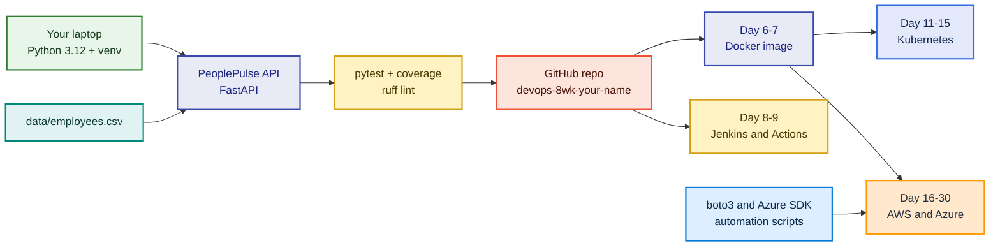
<p align="center"><sub><i>Figure: Big picture - the PeoplePulse app you start today and where it goes next</i></sub></p>


Reading the diagram: today you build the PeoplePulse API on your laptop. It reads `data/employees.csv`, is checked by pytest and ruff, and is pushed to your GitHub repo. From there the same code becomes a Docker image (Days 6–7), is built by Jenkins and GitHub Actions (Days 8–9), and runs on Kubernetes, AWS and Azure. Separately, you will write Python automation scripts with boto3 and the Azure SDK that talk to the cloud directly.

<b>Example:</b> the same check in Bash and in Python: "is the API healthy?"

```bash
# Bash: fine for one URL
curl -fsS http://127.0.0.1:8000/health > /dev/null && echo "healthy"
```

```python
# Python: easy to extend with JSON parsing, retries and tests
import json
import urllib.request

with urllib.request.urlopen("http://127.0.0.1:8000/health", timeout=3) as resp:
    body = json.load(resp)                    # parse JSON into a dict
print("healthy" if body.get("status") == "ok" else "unhealthy", body.get("version"))
```

```text
healthy
healthy 0.1.0
```

> [!NOTE]
> <b>Real-world scenario:</b> Real scenario: on her last project, Carla inherited a 400-line Bash script that parsed `aws ec2 describe-instances` JSON with `grep` and `cut`. It broke every time AWS added a field. She rewrote it in 120 lines of Python with boto3, added five unit tests, and it has not broken since.


> [!TIP]
> <b>Pro tip:</b> A useful rule of thumb: when your Bash script needs `jq` three times, a loop with retries and an `if` inside a `for`, it is time to switch to Python.


<h3>2. Python Essentials for DevOps</h3>

<b>In simple words:</b> you do not need to be a software developer, but you do need to read and write basic Python: variables, lists, dictionaries, `for` loops, functions, type hints and `try`/`except`.

> [!NOTE]
> <b>Simple analogy:</b> A <b>list</b> is a queue of people: order matters and you reach them by position. A <b>dictionary</b> is a phone book: you look things up by name (the key), not by position.


<b>Why a DevOps Engineer cares:</b>
- Every cloud API response (boto3, Azure SDK, Kubernetes) arrives as nested dictionaries and lists. You "walk" through them, level by level, to reach the value you need.
- Type hints (`def f(region: str) -> list[dict]:`) tell the reader what goes in and what comes out, and FastAPI uses them to validate requests.
- `try`/`except` decides whether your script crashes at 2 AM or logs a clear message and exits with a useful code.

<b>How it works:</b> these are the building blocks you will meet today.

| Building block | Example | Notes |
|---|---|---|
| String, int, bool, None | `"us-east-1"`, `8000`, `True`, `None` | `None` means "no value" |
| List | `ports = [22, 80, 443]` | ordered; `ports[0]` is `22` |
| Dictionary (dict) | `tags = {"owner": "haiman-sher", "env": "dev"}` | key → value; `tags["env"]` |
| f-string | `f"{name} is in {region}"` | puts variables inside text |
| List comprehension | `[p for p in ports if p > 100]` | filter or transform a list in one line |
| Function with type hints | `def is_prod(env: str) -> bool:` | hints describe inputs and output |
| Exception handling | `try: ... except KeyError: ...` | catch a specific error and react |
| Module import | `import json`, `from pathlib import Path` | reuse code from the standard library or packages |

<b>Example:</b> walk a cloud-style response and find instances missing an `owner` tag.

```python
# essentials.py - the kind of data every cloud API returns
instances = [
    {"id": "i-0a1", "type": "t3.micro", "tags": {"owner": "haiman-sher", "env": "dev"}},
    {"id": "i-0b2", "type": "t3.large", "tags": {"env": "prod"}},
]


def missing_owner(items: list[dict]) -> list[str]:
    """Return the ids of instances without an 'owner' tag."""
    return [i["id"] for i in items if "owner" not in i.get("tags", {})]


try:
    print("Missing owner:", missing_owner(instances))
    print("First type:", instances[0]["type"])
    print(instances[1]["tags"]["owner"])          # this key does not exist
except KeyError as exc:
    print(f"KeyError: no key {exc} - use .get() for optional keys")
```

```text
Missing owner: ['i-0b2']
First type: t3.micro
KeyError: no key 'owner' - use .get() for optional keys
```

> [!TIP]
> <b>Pro tip:</b> Use `d["key"]` when the key <b>must</b> exist (a missing key is a real bug and should fail loudly). Use `d.get("key", default)` when the key is optional, such as tags on a cloud resource.


> [!WARNING]
> <b>Common mistake:</b> Python uses <b>indentation</b> (4 spaces) to group code, not braces. Mixing tabs and spaces, or indenting one line by 3 spaces, gives `IndentationError`. Let VS Code and `ruff format` handle spacing for you.


<h3>3. Virtual Environments (venv)</h3>

<b>In simple words:</b> a virtual environment (venv) is a folder that holds its own copy of the Python packages for <b>one</b> project. Each project gets its own set of libraries, kept apart from every other project.

> [!NOTE]
> <b>Simple analogy:</b> A venv is a separate toolbox for each job site. The electrician's toolbox and the plumber's toolbox are kept apart, so swapping a tool in one never breaks the other job.


<b>Why a DevOps Engineer cares:</b>
- Project A may need `fastapi==0.115.6` and project B an older version. Without a venv, installing one breaks the other.
- On Ubuntu 24.04, `pip install` into the system Python is blocked with `error: externally-managed-environment` (a rule called PEP 668). A venv is the correct fix, not `--break-system-packages`.
- CI runners and Docker builds recreate the venv from the requirements files on every run. If it works in a clean venv on your laptop, it will work in the pipeline too.

<b>How it works:</b>

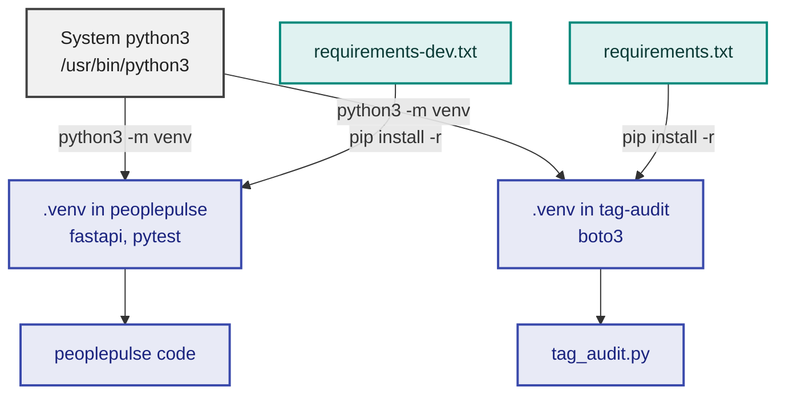
<p align="center"><sub><i>Figure: One system Python, one isolated venv per project</i></sub></p>


Reading the diagram: the operating system has one Python interpreter. `python3 -m venv` creates a small folder per project that points to that interpreter but has its <b>own</b> `site-packages` folder for libraries. Each venv is filled from that project's requirements file, so the two projects never share or break each other's packages.

<b>Example:</b>

```bash
cd ~/devops-8wk/devops-8wk-<your-name>
python3 -m venv .venv                  # create the venv once per project
source .venv/bin/activate              # activate it (Windows PowerShell: .venv\Scripts\Activate.ps1)
which python                           # now points into .venv
python -m pip install --upgrade pip    # upgrade pip inside the venv
python -m pip --version
deactivate                             # leave the venv when you are done
```

```text
/home/haiman/devops-8wk/devops-8wk-haiman-sher/.venv/bin/python
pip 24.3.1 from /home/haiman/devops-8wk/devops-8wk-haiman-sher/.venv/lib/python3.12/site-packages/pip (python 3.12)
```

<b>Command breakdown:</b> `python3 -m venv .venv && source .venv/bin/activate`

| Part | What it means |
|---|---|
| `python3` | the system Python interpreter |
| `-m venv` | run the built-in module `venv` as a program |
| `.venv` | the folder to create; the leading dot hides it, and our `.gitignore` already ignores it |
| `source` | run the activate script <b>in the current shell</b>, so it can change your `PATH` |
| `.venv/bin/activate` | puts `.venv/bin` first in `PATH`, so `python` and `pip` now mean the venv copies; your prompt shows `(.venv)` |
| `deactivate` | restore the old `PATH` |

> [!WARNING]
> <b>Common mistake:</b> Never commit `.venv/` to Git. It takes hundreds of MB and holds binaries built for <b>your</b> operating system only. Recreate it anywhere from the requirements files. If `git status` lists `.venv/`, add `.venv/` to `.gitignore` before you commit.


> [!TIP]
> <b>Pro tip:</b> Use `python -m pip ...` instead of plain `pip ...`. That way you always install into the Python you are actually running, which avoids the classic "I installed it but Python cannot find it" problem.


<h3>4. pip, Requirements Files and Version Pinning</h3>

<b>In simple words:</b> `pip` downloads and installs packages from PyPI. A <b>requirements file</b> is a text list of packages with exact versions, so every laptop, CI runner and Docker image ends up with exactly the same packages.

> [!NOTE]
> <b>Simple analogy:</b> A requirements file is a shopping list with brand and size written down ("Barilla spaghetti 500 g"), not just "pasta". Anyone who shops from that list comes home with the same bag.


<b>Why a DevOps Engineer cares:</b>
- Many "it worked yesterday" outages trace back to an unpinned package that released a new major version overnight.
- We keep two files: the Docker image gets only <b>runtime</b> packages (smaller, fewer vulnerabilities); laptops and CI also get <b>test and lint</b> tools.
- Security scanners (Trivy on Day 7, Dependabot on Day 32) read these files to report vulnerable versions.

<b>How it works:</b>

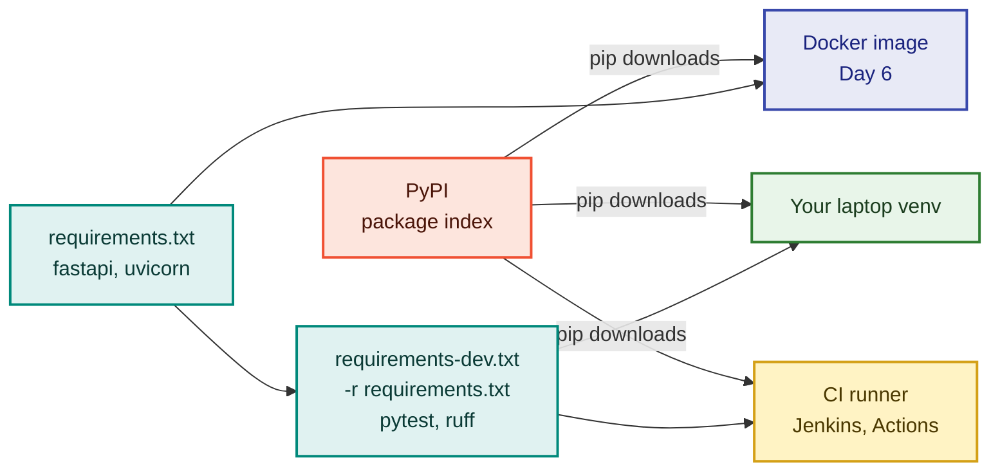
<p align="center"><sub><i>Figure: Runtime and dev requirements and where each is installed</i></sub></p>


Reading the diagram: `requirements.txt` holds only what the app needs to run, and it is the only file the Docker image installs. `requirements-dev.txt` starts with `-r requirements.txt` (include the runtime list) and adds test and lint tools, so laptops and CI get everything. All three download the same pinned versions from PyPI.

| File | Contains | Installed where |
|---|---|---|
| `requirements.txt` | runtime packages (`fastapi`, `uvicorn`) | everywhere, including the Docker image |
| `requirements-dev.txt` | `-r requirements.txt` + `pytest`, `pytest-cov`, `httpx`, `ruff` | laptops and CI only |

| Specifier | Meaning | Use it for |
|---|---|---|
| `==0.115.6` | exactly this version | apps and images (reproducible builds) |
| `~=0.115.6` | `>=0.115.6` and `<0.116` (patch updates only) | when you accept bug-fix releases automatically |
| `>=0.115,<0.116` | a range | libraries that other projects install |
| no version | whatever is newest today | never in production |

<b>Example:</b>

```text
# requirements.txt - pinned runtime dependencies
fastapi==0.115.6
uvicorn[standard]==0.34.0
```

```text
# requirements-dev.txt - everything needed to develop and test
-r requirements.txt
pytest==8.3.4
pytest-cov==6.0.0
httpx==0.28.1
ruff==0.8.4
```

```bash
python -m pip install -r requirements-dev.txt   # install everything from the list
python -m pip show fastapi | head -3             # what is installed, and which version
python -m pip list --outdated                    # what could be upgraded (review, then pin)
python -m pip freeze > /tmp/freeze.txt           # snapshot of ALL installed packages, incl. sub-dependencies
```

```text
Name: fastapi
Version: 0.115.6
Summary: FastAPI framework, high performance, easy to learn, fast to code, ready for production
```

<b>Command breakdown:</b> `python -m pip install -r requirements-dev.txt`

| Part | What it means |
|---|---|
| `python -m pip` | run pip that belongs to the active Python (the venv) |
| `install` | download from PyPI and install into the venv |
| `-r requirements-dev.txt` | read the package list from this file (`-r` = requirements); the file itself includes `requirements.txt` |
| `uvicorn[standard]` (inside the file) | the package plus its optional "standard" extras (faster event loop, auto-reload support) |
| `pip freeze` | print every installed package with its exact version – useful to compare two machines |

> [!TIP]
> <b>Pro tip:</b> Pin exact versions in apps, and let a bot (Dependabot or Renovate, Day 32) open pull requests to upgrade them. That way upgrades are tested in CI during working hours, not slipped in silently by a 2 AM rebuild.


> [!WARNING]
> <b>Common mistake:</b> Do not paste the full `pip freeze` output into `requirements.txt` by habit. It mixes your direct dependencies with dozens of sub-dependencies and test tools, and nobody can tell any more which packages the app really needs. Keep direct dependencies in the requirements files.


<h3>5. Reading and Writing JSON</h3>

<b>In simple words:</b> Almost every API and cloud CLI speaks JSON, a plain-text data format. Python's built-in `json` module turns JSON text into dicts and lists (`json.loads`) and back into text (`json.dumps`).

> [!NOTE]
> <b>Simple analogy:</b> JSON is like a standard shipping box with labelled compartments. `json.loads` unpacks the box into Python objects; `json.dumps` packs your objects back into a box anyone can open.


<b>Why a DevOps Engineer cares:</b>
- `terraform output -json`, `aws ... --output json`, `az ... -o json` and `kubectl get -o json` all produce JSON you will process in scripts.
- When you send a report or alert to Slack, Teams or a monitoring tool, you send it as JSON.
- Sorted JSON (`sort_keys=True`) always comes out in the same order, so Git diffs of generated files show only real changes.

<b>How it works:</b> `json.loads(text)` → dict/list; `json.load(file)` reads from a file; `json.dumps(obj)` → text; `json.dump(obj, file)` writes to a file. JSON `true`/`false`/`null` become Python `True`/`False`/`None`.

<b>Example:</b>

```python
# json_demo.py - read Terraform-style outputs, write a small report
import json
from pathlib import Path

text = '{"vpc_id": {"value": "vpc-0abc123"}, "public": {"value": true}}'
outputs = json.loads(text)                       # text -> dict
print(outputs["vpc_id"]["value"], outputs["public"]["value"])

report = {"service": "peoplepulse", "healthy": True, "checks": 3}
Path("report.json").write_text(json.dumps(report, indent=2, sort_keys=True), encoding="utf-8")
print(Path("report.json").read_text(encoding="utf-8"))
```

```text
vpc-0abc123 True
{
  "checks": 3,
  "healthy": true,
  "service": "peoplepulse"
}
```

<b>Command breakdown:</b> `json.dumps(report, indent=2, sort_keys=True)`

| Part | What it means |
|---|---|
| `json.dumps` | "dump to string": convert a Python object into JSON text |
| `report` | the dict to convert; only plain types (dict, list, str, int, float, bool, None) are allowed |
| `indent=2` | pretty-print with 2 spaces, readable for humans |
| `sort_keys=True` | keys in alphabetical order, so the file is identical every run (clean diffs) |
| `encoding="utf-8"` (on write) | always set it; the default differs between Windows and Linux |

> [!WARNING]
> <b>Common mistake:</b> `json.dumps` fails on types JSON does not know, such as `datetime` or `set`: `TypeError: Object of type date is not JSON serializable`. Convert them first (`d.isoformat()`, `sorted(s)`). FastAPI does this conversion for you in API responses.


<h3>6. Reading YAML Safely</h3>

<b>In simple words:</b> YAML is the human-friendly config format used by Kubernetes, Docker Compose, GitHub Actions and Ansible. Python reads it with the PyYAML package and the function `yaml.safe_load`.

> [!NOTE]
> <b>Simple analogy:</b> YAML is a neat to-do list where indentation shows which item belongs under which heading. One wrong indent and an item moves to the wrong heading, just like a misplaced bullet in a printed list.


<b>Why a DevOps Engineer cares:</b>
- You will write scripts that check Kubernetes manifests, Helm values and pipeline files before they are applied.
- `yaml.load` with an unsafe loader can run code hidden in a malicious file. On shared CI runners that is a real security issue.
- YAML has surprises (`yes`, `no`, `on` can become booleans; `010` can become a number) that break configs silently.

<b>How it works:</b> `yaml.safe_load(file)` returns dicts and lists made only of plain types. `yaml.safe_load_all(file)` reads a multi-document file where documents are separated by `---` (common in Kubernetes).

<b>Example:</b> install PyYAML into the venv (`python -m pip install PyYAML==6.0.2`), then:

```python
# yaml_demo.py
import yaml  # PyYAML

text = """
service: peoplepulse
port: 8000
version: "1.10"      # quoted - stays a string
debug: no            # unquoted - becomes False
endpoints:
  - name: health
    url: http://127.0.0.1:8000/health
  - name: records
    url: http://127.0.0.1:8000/records
"""
cfg = yaml.safe_load(text)             # ALWAYS safe_load, never yaml.load
print(cfg["service"], cfg["port"], repr(cfg["version"]), cfg["debug"])
for ep in cfg["endpoints"]:
    print(f'{ep["name"]:8} {ep["url"]}')
```

```text
peoplepulse 8000 '1.10' False
health   http://127.0.0.1:8000/health
records  http://127.0.0.1:8000/records
```

Reading a multi-document Kubernetes file:

```python
with open("k8s/all.yaml", encoding="utf-8") as f:
    for doc in yaml.safe_load_all(f):
        if doc:                                   # skip empty documents
            print(doc["kind"], doc["metadata"]["name"])
```

```text
Namespace peoplepulse
Deployment peoplepulse-api
Service peoplepulse-api
```

> [!WARNING]
> <b>Common mistake:</b> Unquoted `version: 1.10` becomes the <b>number</b> `1.1`, and your image tag silently changes. Always quote versions, and quote words like `"yes"`, `"no"`, `"on"` and `"off"` when you mean text.


> [!TIP]
> <b>Pro tip:</b> Kubernetes, GitHub Actions and Compose files are all YAML. Before committing a big change, run `python -c "import yaml,sys; yaml.safe_load(open(sys.argv[1]))" file.yaml`. No output means the YAML is at least valid.


<h3>7. Reading and Writing CSV – the PeoplePulse Data Source</h3>

<b>In simple words:</b> CSV (comma-separated values) is a plain-text table: the first line is the header, every next line is a row. Python's built-in `csv` module reads each row as a dict keyed by the header.

> [!NOTE]
> <b>Simple analogy:</b> A CSV file is a spreadsheet saved as plain text. `csv.DictReader` reads it like a person who remembers the column titles, so you can ask for "the email of this row" instead of "the third cell".


<b>Why a DevOps Engineer cares:</b>
- PeoplePulse reads `data/employees.csv`; everything in the API you build today depends on it.
- Cost and usage reports (AWS Cost and Usage Report, Azure cost exports) and many audit exports are CSV.
- CSV is easy to break (a missing column, an extra comma, a text value in a number column). Your code should validate it and stop with a message that names the problem.

<b>How it works:</b>

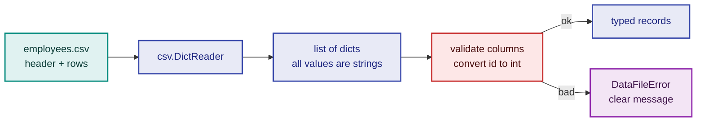
<p align="center"><sub><i>Figure: From CSV text to typed records</i></sub></p>


Reading the diagram: `csv.DictReader` turns each line into a dict, but every value is a <b>string</b>, even `id` and `hire_date`. Our code checks that all required columns exist and converts `id` to an integer. If anything is wrong, it raises our own `DataFileError` with a message that tells the on-call engineer exactly which line is bad.

<b>Example:</b> the shared file (the same five people as the team repo):

```text
id,name,email,department,title,location,hire_date
1,Haiman Sher,haiman.sher@example.com,Platform,DevOps Engineer,Austin,2023-01-09
2,Cindia Fouda,cindia.fouda@example.com,Data,Data Analyst,Chicago,2022-07-18
3,Jobanjit Singh,jobanjit.singh@example.com,Security,Cloud Security Engineer,Seattle,2021-11-01
4,Carla Rivera,carla.rivera@example.com,QA,QA Engineer,Dallas,2024-03-11
5,Raymundo Trancoso,raymundo.trancoso@example.com,Platform,SRE,Denver,2024-05-20
```

```python
# csv_demo.py
import csv

with open("data/employees.csv", newline="", encoding="utf-8") as f:
    reader = csv.DictReader(f)          # each row becomes a dict keyed by the header
    print(reader.fieldnames)
    rows = list(reader)

platform = [r for r in rows if r["department"] == "Platform"]
print(len(rows), "employees,", len(platform), "in Platform")
print(type(rows[0]["id"]).__name__)    # str, not int!

with open("platform.csv", "w", newline="", encoding="utf-8") as f:
    writer = csv.DictWriter(f, fieldnames=["id", "name", "email"], extrasaction="ignore")
    writer.writeheader()
    writer.writerows(platform)
```

```text
['id', 'name', 'email', 'department', 'title', 'location', 'hire_date']
5 employees, 2 in Platform
str
```

<b>Command breakdown:</b> `csv.DictWriter(f, fieldnames=["id", "name", "email"], extrasaction="ignore")`

| Part | What it means |
|---|---|
| `open(..., newline="")` | let the `csv` module handle line endings; without it you get blank lines on Windows |
| `csv.DictReader(f)` | read rows as dicts; keys come from the header line |
| `reader.fieldnames` | the list of header columns – use it to check required columns |
| `csv.DictWriter(f, fieldnames=[...])` | write dicts as rows, with these columns in this order |
| `extrasaction="ignore"` | silently drop keys not in `fieldnames` (default `"raise"` fails on extra keys) |
| `writeheader()` / `writerows()` | write the header line, then every row |

> [!WARNING]
> <b>Common mistake:</b> Everything the `csv` module returns is a <b>string</b>. `"10" > "9"` is `False` because strings compare letter by letter. Convert types yourself (`int(row["id"])`) or let a Pydantic model do it. That is exactly what the API does in Session 2.


<h3>8. Script Patterns for DevOps</h3>

<b>In simple words:</b> a good automation script has the same skeleton every time: arguments with `argparse`, messages with `logging`, configuration from environment variables, and a clear exit code.

> [!NOTE]
> <b>Simple analogy:</b> A script skeleton is like a standard aircraft checklist. Every pilot follows the same order, so anyone can fly any plane. In the same way, anyone on your team can pick up any script.


<b>Why a DevOps Engineer cares:</b>
- CI pipelines and cron jobs only understand <b>exit codes</b>: 0 means success, anything else turns the stage red (the same rule as Bash on Day 3).
- `argparse` gives you `--help` and input checks without extra code, so teammates can run your script without reading the code.
- Reading configuration from environment variables means the same script runs on your laptop, in Jenkins and in a container without edits (the "12-factor app" rule).

<b>How it works:</b>

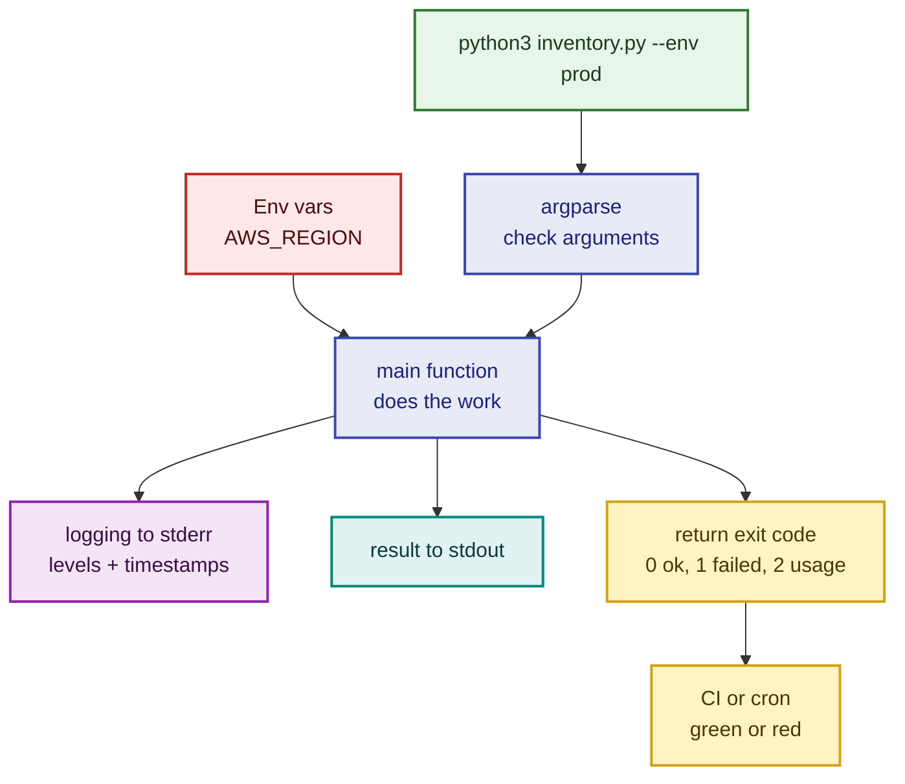
<p align="center"><sub><i>Figure: Anatomy of a CI-friendly Python script</i></sub></p>


Reading the diagram: the script starts by checking its arguments, reads configuration from environment variables, and does its work in a `main()` function. Diagnostics go through `logging` (to stderr), results go to stdout, and the function returns an exit code that CI or cron uses to decide success or failure.

<b>Example:</b>

```python
#!/usr/bin/env python3
"""inventory.py - small, testable, CI-friendly script skeleton."""

import argparse
import logging
import os
import sys

log = logging.getLogger("inventory")


def parse_args(argv: list[str] | None = None) -> argparse.Namespace:
    p = argparse.ArgumentParser(description="Print PeoplePulse inventory")
    p.add_argument("--env", choices=["dev", "prod"], default="dev", help="target environment")
    p.add_argument("--verbose", action="store_true", help="show debug messages")
    return p.parse_args(argv)


def main(argv: list[str] | None = None) -> int:
    args = parse_args(argv)
    logging.basicConfig(
        level=logging.DEBUG if args.verbose else logging.INFO,
        format="%(asctime)s %(levelname)s %(name)s %(message)s",
    )
    region = os.environ.get("AWS_REGION", "us-east-1")   # config from env, not code
    log.info("env=%s region=%s", args.env, region)
    if args.env == "prod" and region != "us-east-1":
        log.error("prod must run in us-east-1, got %s", region)
        return 1
    return 0


if __name__ == "__main__":
    sys.exit(main())
```

```bash
python3 inventory.py --env prod; echo "exit=$?"
AWS_REGION=eu-west-1 python3 inventory.py --env prod; echo "exit=$?"
python3 inventory.py --env staging; echo "exit=$?"
```

```text
2026-11-13 08:40:02,114 INFO inventory env=prod region=us-east-1
exit=0
2026-11-13 08:40:03,502 INFO inventory env=prod region=eu-west-1
2026-11-13 08:40:03,502 ERROR inventory prod must run in us-east-1, got eu-west-1
exit=1
usage: inventory.py [-h] [--env {dev,prod}] [--verbose]
inventory.py: error: argument --env: invalid choice: 'staging' (choose from 'dev', 'prod')
exit=2
```

| Pattern | Why |
|---|---|
| `main()` returns an exit code, `sys.exit(main())` | CI marks failures correctly |
| `argparse` with `choices` | `--help` for free, bad input rejected with exit code 2 |
| `logging` instead of `print` for diagnostics | levels, timestamps, goes to stderr so stdout stays clean for results |
| configuration from env vars | the same code in dev, prod and containers |
| `if __name__ == "__main__":` | the file can be imported by tests without running |
| `main(argv)` accepts a list | tests can call `main(["--env", "prod"])` directly |

> [!TIP]
> <b>Pro tip:</b> Start every automation script in <b>read-only / dry-run</b> mode and add an explicit `--apply` flag for changes. US clients like to hear "the script found 14 untagged instances; we reviewed the list before it tagged anything".


> [!NOTE]
> <b>Real-world scenario:</b> Real scenario: Jobanjit's team had a nightly cleanup script that used `print()` and always ended with exit code 0. For three weeks it failed silently on an expired credential while the cron job looked green. Adding `return 1` on errors and a proper log line made the next failure page the on-call engineer within minutes.


<b>Quick checks (9:43):</b>
1. What does `print(type(next(csv.DictReader(io.StringIO("id\n7\n")))["id"]).__name__)` print? (Answer: `str`.)
2. Which exit code does `argparse` use when an argument is invalid? (Answer: `2`.)

---


<h2>9:45 – 10:00 AM · Break</h2>


Stretch and refill your coffee. If you have not created your venv yet, run `python3 -m venv .venv` in your repo now. Session 2 needs it.

---


<h2>10:00 – 11:15 AM · Concept Session 2 + Live Demo</h2>


| Minutes | Activity | Method |
|---|---|---|
| 10:00 – 10:10 | HTTP APIs in two minutes; FastAPI and uvicorn | Lecture |
| 10:10 – 10:18 | Pydantic models, validation and HTTP status codes | Whiteboard |
| 10:18 – 10:23 | The PeoplePulse project layout and configuration from env vars | Whiteboard |
| 10:23 – 10:33 | pytest: unit tests, API tests, fixtures, parametrize | Live demo |
| 10:33 – 10:38 | Code coverage and the 80% gate | Live demo |
| 10:38 – 10:43 | Linting and formatting with ruff | Live demo |
| 10:43 – 10:53 | boto3 and the Azure SDK; default credential chains | Lecture |
| 10:53 – 11:13 | Live demo: from CSV to a tested API, plus a read-only cloud check | Live demo |
| 11:13 – 11:15 | Questions on the demo | Discussion |

<h3>9. HTTP APIs, FastAPI and uvicorn</h3>

<b>In simple words:</b> an <b>API</b> (Application Programming Interface) lets one program ask another program for data over HTTP. <b>FastAPI</b> is a Python framework for building APIs: you write normal functions with type hints, and FastAPI turns them into web endpoints. <b>uvicorn</b> is the web server that runs a FastAPI app.

> [!NOTE]
> <b>Simple analogy:</b> An API is a restaurant menu with a waiter. The menu lists what you can order (`GET /records`), the waiter (uvicorn) carries your order to the kitchen (your function) and brings back the dish (JSON). You never walk into the kitchen yourself.


<b>Why a DevOps Engineer cares:</b>
- Every health check you configure (Docker `HEALTHCHECK` on Day 6, Kubernetes probes on Day 11, AWS load balancer target groups on Day 17, Azure health probes) calls an HTTP endpoint such as `/health`.
- You will debug APIs with `curl` almost every day: the status code and response body tell you whether the problem is the app, the network or the data.
- FastAPI generates OpenAPI documentation at `/docs` automatically, which QA, API gateways (Day 23) and other teams use.

<b>How it works:</b>

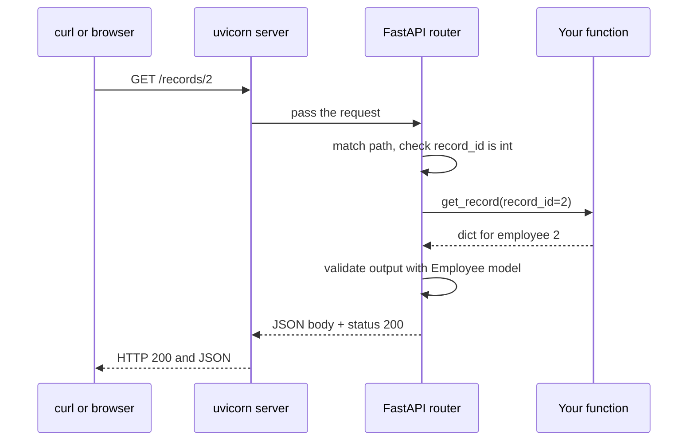
<p align="center"><sub><i>Figure: One HTTP request through uvicorn and FastAPI</i></sub></p>


Reading the diagram: `curl` sends `GET /records/2`. uvicorn receives the network request and hands it to FastAPI. FastAPI finds the matching function, converts `"2"` from the URL into the integer `2` (or answers 422 if it cannot), calls your function, checks the result against the response model, and sends JSON back with a status code.

| HTTP method | Meaning | PeoplePulse example |
|---|---|---|
| `GET` | read data, changes nothing | `GET /records`, `GET /records/2` |
| `POST` | create something new | (later) `POST /records` |
| `PUT` / `PATCH` | replace / partly update | (later) `PATCH /records/2` |
| `DELETE` | remove | (later) `DELETE /records/2` |

<b>Example:</b> a tiny inventory API (`demo.py`).

```python
from typing import Annotated

from fastapi import FastAPI, HTTPException, Query
from pydantic import BaseModel

app = FastAPI(title="Inventory demo", version="0.1.0")


class Server(BaseModel):              # Pydantic model = schema + validation
    id: int
    name: str
    env: str


SERVERS = [Server(id=1, name="web-1", env="dev"), Server(id=2, name="web-2", env="prod")]


@app.get("/servers", response_model=list[Server])
def list_servers(env: Annotated[str | None, Query(description="Filter by env")] = None):
    # query parameter: /servers?env=prod
    return [s for s in SERVERS if env is None or s.env == env]


@app.get("/servers/{server_id}", response_model=Server)
def get_server(server_id: int):       # path parameter, converted to int (or 422)
    for s in SERVERS:
        if s.id == server_id:
            return s
    raise HTTPException(status_code=404, detail="Server not found")
```

```bash
uvicorn demo:app --reload --host 127.0.0.1 --port 8000
# in a second terminal:
curl -s 'http://127.0.0.1:8000/servers?env=prod'; echo
curl -s -o /dev/null -w '%{http_code}\n' http://127.0.0.1:8000/servers/99
curl -s http://127.0.0.1:8000/servers/abc; echo
```

```text
INFO:     Uvicorn running on http://127.0.0.1:8000 (Press CTRL+C to quit)
[{"id":2,"name":"web-2","env":"prod"}]
404
{"detail":[{"type":"int_parsing","loc":["path","server_id"],"msg":"Input should be a valid integer, unable to parse string as an integer","input":"abc"}]}
```

<b>Command breakdown:</b> `uvicorn demo:app --reload --host 127.0.0.1 --port 8000`

| Part | What it means |
|---|---|
| `uvicorn` | the ASGI web server (ASGI = the standard way Python async web apps talk to servers) |
| `demo:app` | "in the file `demo.py`, use the object named `app`"; for our project it is `app.main:app` |
| `--reload` | restart automatically when you save a file – for development only, never in production |
| `--host 127.0.0.1` | listen only on loopback: reachable from this machine only |
| `--port 8000` | TCP port; PeoplePulse always uses 8000 in this course |

<b>Command breakdown:</b> `curl -s -o /dev/null -w '%{http_code}\n' URL`

| Part | What it means |
|---|---|
| `-s` | silent: no progress bar |
| `-o /dev/null` | throw the response body away |
| `-w '%{http_code}\n'` | "write out" only the HTTP status code, then a newline |

> [!WARNING]
> <b>Common mistake:</b> On your laptop, bind to `127.0.0.1`. Inside a container you <b>must</b> bind to `0.0.0.0`, because the container's loopback is not reachable from outside (Day 3 networking). This exact mistake is behind most "my container runs but curl fails" tickets. You will see it again on Day 6.


> [!TIP]
> <b>Pro tip:</b> Open `http://127.0.0.1:8000/docs` while uvicorn runs. FastAPI shows every endpoint with a "Try it out" button, so you, QA and the client get an API console at no extra effort.


<h3>10. Pydantic Models, Validation and Status Codes</h3>

<b>In simple words:</b> a <b>Pydantic model</b> is a Python class that describes what data must look like (field names and types). FastAPI uses it to check and convert data automatically. The <b>HTTP status code</b> tells the caller, in one number, what happened.

> [!NOTE]
> <b>Simple analogy:</b> A Pydantic model is the form at a bank counter. The clerk checks that every box is filled with the right kind of value (a date in the date box, a number in the amount box) before the request goes any further.


<b>Why a DevOps Engineer cares:</b>
- The CSV gives you strings; the model turns `"1"` into `1` and `"2023-01-09"` into a real date, and rejects bad data.
- Automation reacts to status codes: load balancers remove targets on 5xx, monitoring alerts on 5xx rates, retries happen on 503 but not on 404.
- Correct codes make life easier for whoever is on call: a 404 says "the caller asked for something that does not exist", a 503 says "our dependency (the data file, the database) is down".

<b>How it works:</b>

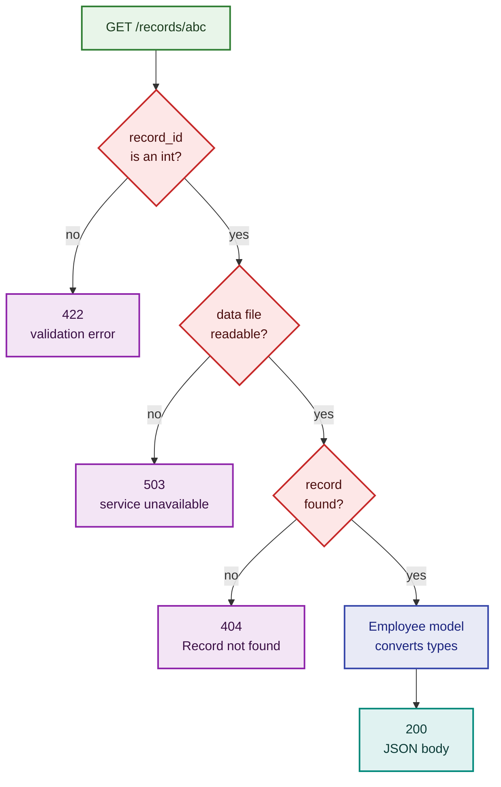
<p align="center"><sub><i>Figure: How FastAPI chooses the status code</i></sub></p>


Reading the diagram: FastAPI first checks the input types. `abc` is not an integer, so the caller gets 422 and your code never runs. Then your code loads the data; if the file is missing, it answers 503. If the id is not in the file, it answers 404. Only a found record goes through the `Employee` model and comes back as 200 with proper JSON types.

| Status | Name | When PeoplePulse returns it |
|---|---|---|
| 200 | OK | the request worked |
| 404 | Not Found | the id does not exist |
| 422 | Unprocessable Entity | input fails validation (FastAPI does this for you) |
| 500 | Internal Server Error | an unhandled bug in our code – should never be "normal" |
| 503 | Service Unavailable | a dependency is missing (the data file, later the database) |

<b>Example:</b>

```python
from datetime import date

from pydantic import BaseModel, ValidationError


class Employee(BaseModel):
    id: int
    name: str
    hire_date: date


print(Employee(id="1", name="Carla Rivera", hire_date="2024-03-11"))
try:
    Employee(id="one", name="Carla Rivera", hire_date="2024-03-11")
except ValidationError as exc:
    print(exc.errors()[0]["msg"])
```

```text
id=1 name='Carla Rivera' hire_date=datetime.date(2024, 3, 11)
Input should be a valid integer, unable to parse string as an integer
```

> [!TIP]
> <b>Pro tip:</b> Keep `/health` cheap: no file access, no database call. Kubernetes calls it every few seconds. Deeper checks ("can I read the data?") belong in a separate readiness check, which you will add on Day 11.


> [!WARNING]
> <b>Common mistake:</b> Never let a missing file become a 500 with a Python stack trace in the response. Catch the specific error and return 503 with a short message. A stack trace hands attackers your file paths and library versions.


<h3>11. The PeoplePulse Project Layout and Configuration</h3>

<b>In simple words:</b> we split the app into small files with one job each, and we read settings such as the data file path from <b>environment variables</b>, not from hard-coded values.

> [!NOTE]
> <b>Simple analogy:</b> A good project layout is a kitchen with stations: one for prep (config), one for the pantry (repository), one for plating (models), and the pass where orders go out (main). Each cook knows exactly where everything is.


<b>Why a DevOps Engineer cares:</b>
- You keep this layout for the whole course: the Dockerfile (Day 6), the Jenkinsfile (Day 8), Helm chart (Day 14) and Terraform all assume these paths.
- `DATA_FILE` from an environment variable lets Docker, Kubernetes and Azure point the app at a different file <b>without changing code</b>. This is the "12-factor" config rule.
- Small modules can be tested one at a time, and that is how we reach 80% coverage.

<b>How it works:</b>

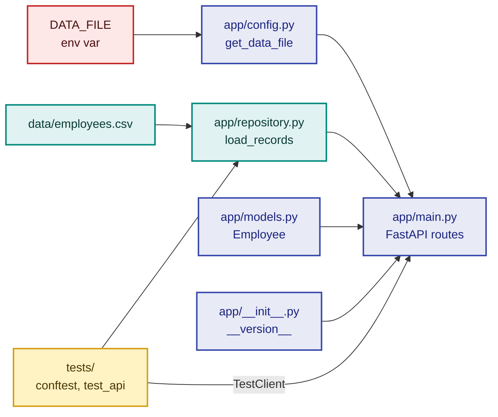
<p align="center"><sub><i>Figure: PeoplePulse modules and how they depend on each other</i></sub></p>


Reading the diagram: `main.py` is the only file that knows about HTTP. It asks `config.py` where the data is (from `DATA_FILE`, with a safe default), asks `repository.py` to load and validate the CSV, and uses the `Employee` model from `models.py` to shape the JSON. The tests call both the repository directly (unit tests) and the routes through FastAPI's `TestClient` (API tests).

```text
devops-8wk-<your-name>/
├── app/
│   ├── __init__.py        # __version__ (APP_VERSION env var, default 0.1.0)
│   ├── config.py          # get_data_file() reads DATA_FILE
│   ├── models.py          # Employee Pydantic model
│   ├── repository.py      # load_records() + DataFileError
│   └── main.py            # FastAPI app: /health, /records, /records/{id}
├── data/employees.csv
├── tests/
│   ├── conftest.py        # fixtures: data_file, client
│   ├── test_repository.py # unit tests
│   └── test_api.py        # API tests
├── pyproject.toml         # pytest, coverage and ruff settings
├── requirements.txt       # runtime packages
└── requirements-dev.txt   # + test and lint tools
```

<b>Example:</b> configuration from an environment variable with a safe default.

```python
# app/config.py
import os
from pathlib import Path

DEFAULT_DATA_FILE = Path(__file__).resolve().parent.parent / "data" / "employees.csv"


def get_data_file() -> Path:
    """Path of the employees CSV; override it with the DATA_FILE env var."""
    return Path(os.getenv("DATA_FILE", str(DEFAULT_DATA_FILE)))
```

```bash
python -c "from app.config import get_data_file; print(get_data_file())"
DATA_FILE=/tmp/other.csv python -c "from app.config import get_data_file; print(get_data_file())"
```

```text
/home/cindia/devops-8wk/devops-8wk-cindia-fouda/data/employees.csv
/tmp/other.csv
```

<b>Command breakdown:</b> `Path(__file__).resolve().parent.parent / "data" / "employees.csv"`

| Part | What it means |
|---|---|
| `__file__` | the path of the current file, `app/config.py` |
| `.resolve()` | turn it into a full absolute path |
| `.parent.parent` | go up two levels: from the file to `app/`, then to the repo root |
| `/ "data" / "employees.csv"` | `pathlib` joins paths with `/` – works on Linux, macOS and Windows |
| `os.getenv("DATA_FILE", default)` | use the env var if it is set, otherwise the default |

> [!NOTE]
> <b>Real-world scenario:</b> This one design choice saves work later: on Day 12, Kubernetes mounts a different CSV from a ConfigMap and sets `DATA_FILE`; on Day 6, Docker sets it in the image. Neither needs a code change.


> [!WARNING]
> <b>Common mistake:</b> Do not read the CSV path as a relative string like `"data/employees.csv"`. It only works when you start the app from the repo root. Started from another folder (systemd, cron, a container `WORKDIR`), it fails with "file not found". Build the default from `__file__` instead.


<h3>12. pytest – Unit Tests, API Tests and Fixtures</h3>

<b>In simple words:</b> <b>pytest</b> is the standard Python test tool. It finds files named `test_*.py` and functions named `test_*`, runs them, and prints a short report of what passed and what failed. You check results with a plain `assert`.

> [!NOTE]
> <b>Simple analogy:</b> Tests are a smoke alarm for your code. You install them once; from then on they go off the moment a change breaks something, before your users notice.


<b>Why a DevOps Engineer cares:</b>
- Tests are the first quality gate in every pipeline you will build (Jenkins Day 8, GitHub Actions Day 9). Without tests, you cannot deploy automatically and safely.
- You will write tests for your own automation too (scripts, Lambda functions), often with fake cloud clients.
- When a pipeline is red, the pytest output (`E   assert 2 == 3`) tells you exactly what broke.

<b>How it works:</b>

```mermaid
flowchart LR
  Run["pytest"] --> Find["find tests/test_*.py<br/>and test_ functions"]
  Find --> Fix["build fixtures<br/>tmp_path, monkeypatch"]
  Fix --> DF["data_file fixture<br/>writes sample CSV"]
  DF --> CL["client fixture<br/>TestClient(app)"]
  CL --> T["test_health(client)<br/>assert ..."]
  T --> Res["pass or fail report<br/>exit code 0 or 1"]
  class Run,Res cicd
  class Find,T app
  class Fix,DF,CL data
  classDef aws fill:#FFE8CC,stroke:#FF9900,stroke-width:2px,color:#232F3E
  classDef azure fill:#DCEEFF,stroke:#0078D4,stroke-width:2px,color:#0B2A4A
  classDef k8s fill:#E3E9FB,stroke:#326CE5,stroke-width:2px,color:#13284F
  classDef git fill:#FDE5DD,stroke:#F05032,stroke-width:2px,color:#4A1408
  classDef cicd fill:#FFF3C4,stroke:#D4A017,stroke-width:2px,color:#4A3800
  classDef user fill:#E8F5E9,stroke:#2E7D32,stroke-width:2px,color:#1B3D1E
  classDef sec fill:#FDE7E7,stroke:#C62828,stroke-width:2px,color:#4A0E0E
  classDef mon fill:#F3E5F5,stroke:#8E24AA,stroke-width:2px,color:#3A0F45
  classDef data fill:#E0F2F1,stroke:#00897B,stroke-width:2px,color:#0B3B36
  classDef linux fill:#F1F1F1,stroke:#424242,stroke-width:2px,color:#212121
  classDef app fill:#E8EAF6,stroke:#3949AB,stroke-width:2px,color:#1A237E
```
<p align="center"><sub><i>Figure: How pytest runs a test with fixtures</i></sub></p>


Reading the diagram: pytest collects the test functions, then builds the <b>fixtures</b> each test asks for by name. Our `data_file` fixture writes a known CSV into a temporary folder and sets `DATA_FILE`; the `client` fixture builds on it. The test receives a ready client, makes a request and asserts on the result. pytest exits with 0 only if every test passed, and that exit code is what CI checks.

| Concept | Meaning | Example |
|---|---|---|
| Unit test | tests one function in isolation | `load_records()` turns `id` into an `int` |
| API test | calls an HTTP endpoint inside the test process | `client.get("/health")` |
| Fixture | reusable setup, injected by argument name | `tmp_path`, `monkeypatch`, our `client` |
| `tmp_path` | a fresh temporary folder per test | write a test CSV there |
| `monkeypatch` | change an env var or function for one test, restored afterwards | `monkeypatch.setenv("DATA_FILE", ...)` |
| `parametrize` | run the same test with many inputs | ids 1, 3, 999 |
| `pytest.raises` | assert that code raises an exception | missing file raises `DataFileError` |

<b>Example:</b>

```python
# tests/test_demo.py
import pytest
from fastapi.testclient import TestClient

from demo import app

client = TestClient(app)


def test_list_servers_filters_by_env():
    resp = client.get("/servers", params={"env": "prod"})
    assert resp.status_code == 200
    assert [s["name"] for s in resp.json()] == ["web-2"]


@pytest.mark.parametrize(("server_id", "expected"), [(1, 200), (2, 200), (99, 404)])
def test_get_server_status(server_id, expected):
    assert client.get(f"/servers/{server_id}").status_code == expected
```

```bash
pytest -v
```

```text
tests/test_demo.py::test_list_servers_filters_by_env PASSED              [ 25%]
tests/test_demo.py::test_get_server_status[1-200] PASSED                 [ 50%]
tests/test_demo.py::test_get_server_status[2-200] PASSED                 [ 75%]
tests/test_demo.py::test_get_server_status[99-404] PASSED                [100%]
4 passed in 0.21s
```

<b>Command breakdown:</b> useful pytest options

| Part | What it means |
|---|---|
| `pytest` | find and run all tests (settings come from `pyproject.toml`) |
| `-v` | verbose: one line per test, including each parametrize case |
| `-q` | quiet: dots only – good for CI logs |
| `-k records` | run only tests whose name contains "records" |
| `-x` | stop at the first failure |
| `--lf` | re-run only the tests that failed last time |

> [!WARNING]
> <b>Common mistake:</b> Do not let tests read the real `data/employees.csv`. When someone adds a row, tests break for no good reason. Use a fixture with `tmp_path` and a small known CSV, as you will in this afternoon's lab.


> [!TIP]
> <b>Pro tip:</b> Test the unhappy paths: 404, 422, 503, a missing column, a bad id. Production incidents usually happen on the paths nobody tested.


<h3>13. Code Coverage and the 80% Gate</h3>

<b>In simple words:</b> <b>coverage</b> measures which lines (and branches of `if` statements) ran while the tests ran. The `pytest-cov` plugin adds it to pytest, and `--cov-fail-under=80` turns it into a pass/fail gate.

> [!NOTE]
> <b>Simple analogy:</b> Coverage is the security guard's patrol log: it shows which rooms were visited. It does not prove each room was checked carefully, only that someone walked through it.


<b>Why a DevOps Engineer cares:</b>
- Most US clients set a minimum coverage in CI (often 70–80%). A pull request that lowers it is blocked automatically.
- The `Missing` column lists the line numbers no test touched, so you know where to add one.
- You will publish coverage reports in Jenkins and GitHub Actions next week and in SonarQube-style quality gates later.

<b>How it works:</b>

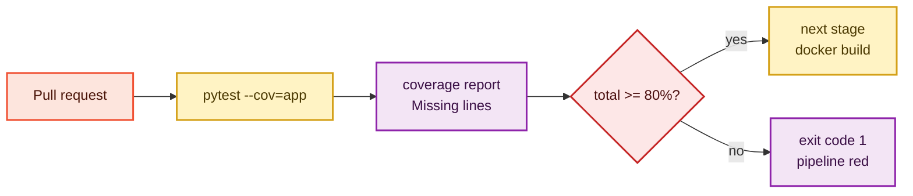
<p align="center"><sub><i>Figure: Coverage as a quality gate in the pipeline</i></sub></p>


Reading the diagram: in CI, every pull request runs the tests with coverage. If the total is at least 80%, the pipeline continues to the Docker build. If not, pytest exits with a non-zero code, the stage turns red and the pull request cannot be merged.

<b>Example:</b>

```bash
pytest --cov=app --cov-report=term-missing --cov-fail-under=80
```

```text
Name                Stmts   Miss Branch BrPart  Cover   Missing
---------------------------------------------------------------
app/__init__.py         2      0      0      0   100%
app/config.py           5      0      0      0   100%
app/main.py            21      2      2      0    91%   19-20
app/models.py          10      0      0      0   100%
app/repository.py      20      3      6      1    85%   26, 32-33
---------------------------------------------------------------
TOTAL                  58      5      8      1    91%

Required test coverage of 80% reached. Total coverage: 90.91%
5 passed in 0.42s
```

<b>Command breakdown:</b> `pytest --cov=app --cov-report=term-missing --cov-fail-under=80`

| Part | What it means |
|---|---|
| `--cov=app` | measure coverage for the `app` package only (not the tests themselves) |
| `--cov-report=term-missing` | print the table with the `Missing` line numbers in the terminal |
| `--cov-report=html` (alternative) | write a clickable report to `htmlcov/index.html` |
| `--cov-report=xml:reports/coverage.xml` | machine-readable report for Jenkins and GitHub Actions (Day 8) |
| `--cov-fail-under=80` | exit with a failure code when total coverage is below 80% |
| `Branch` / `BrPart` | number of `if` branches / branches only partly tested (needs `branch = true` in config) |

> [!WARNING]
> <b>Common mistake:</b> Coverage shows what <b>ran</b>, not what was <b>checked</b>. A test that calls every endpoint but asserts nothing gives 100% coverage and catches nothing. Always assert status codes and response bodies.


<h3>14. Linting and Formatting with ruff</h3>

<b>In simple words:</b> a <b>linter</b> reads your code without running it and points out bugs and bad style. A <b>formatter</b> rewrites the layout (spaces, quotes, line breaks) so all code looks the same. <b>ruff</b> does both, and it runs in well under a second on a project this size.

> [!NOTE]
> <b>Simple analogy:</b> ruff is the spell-checker and auto-layout in a word processor. It underlines mistakes (an unused import, a likely bug) and makes every page use the same font and margins, so reviewers read the content, not the formatting.


<b>Why a DevOps Engineer cares:</b>
- Pipelines run `ruff check .` and `ruff format --check .` as the very first, cheapest stage (you will see this in the Day 8 Jenkinsfile).
- Linters catch real bugs: unused variables, undefined names, dangerous default arguments.
- When everyone's code is formatted the same way, diffs are smaller and reviews go faster.

<b>How it works:</b> settings live in `pyproject.toml`. `ruff check` lints; `ruff check --fix` fixes safe issues; `ruff format` rewrites layout; `--check` mode changes nothing and exits non-zero if work is needed (CI mode).

<b>Example:</b>

```ini
# pyproject.toml (excerpt) - TOML format
[tool.ruff]
line-length = 100
target-version = "py312"

[tool.ruff.lint]
select = ["E", "F", "I", "B", "UP"]   # pycodestyle, pyflakes, import order, bugbear, pyupgrade
```

```bash
ruff check .            # find problems
ruff check . --fix      # auto-fix the safe ones (import order, unused imports)
ruff format .           # format the code
ruff format --check .   # CI mode: fail if any file would be reformatted
```

```text
app/main.py:3:8: F401 [*] `os` imported but unused
Found 1 error.
[*] 1 fixable with the `--fix` option.
```

| Rule set | Catches |
|---|---|
| `E` (pycodestyle) | style errors, such as very long lines |
| `F` (pyflakes) | unused imports and variables, undefined names |
| `I` (isort) | import order |
| `B` (bugbear) | likely bugs, such as mutable default arguments |
| `UP` (pyupgrade) | old syntax that has a modern replacement (`List[int]` → `list[int]`) |

> [!TIP]
> <b>Pro tip:</b> Install the <b>Ruff</b> extension in VS Code and turn on "format on save". After that, formatting failures in CI become rare.


<h3>15. boto3 – Python Automation for AWS</h3>

<b>In simple words:</b> <b>boto3</b> is the official AWS SDK (Software Development Kit) for Python. It lets your script call any AWS service (EC2, S3, IAM) the same way the AWS CLI does.

> [!NOTE]
> <b>Simple analogy:</b> The AWS CLI is a remote control with buttons. boto3 is the same remote with a programming port: you can press buttons in loops, combine results and react to errors.


<b>Why a DevOps Engineer cares:</b>
- At AWS clients, tag audits, cost reports, cleanup jobs and Lambda functions are mostly written with boto3.
- boto3 uses the same <b>default credential chain</b> as the AWS CLI, so no keys ever need to appear in code.
- Interviewers ask "how does your script authenticate in CI and on EC2?". The credential chain is the answer.

<b>How it works:</b>

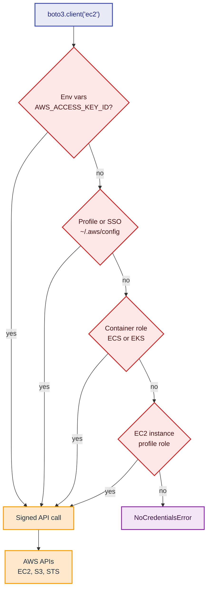
<p align="center"><sub><i>Figure: boto3 default credential chain - first match wins</i></sub></p>


Reading the diagram: when your script creates a client, boto3 looks for credentials in a fixed order and uses the first it finds: environment variables, then your CLI profile or SSO login, then a container role (ECS task role, EKS Pod Identity or IRSA), then the EC2 instance profile. On your laptop the profile wins; in the cloud a role wins. The code stays the same.

<b>Example:</b> list running EC2 instances missing the course tags.

```python
"""tag_audit_aws.py - list running EC2 instances missing owner/env/course tags (read-only)."""

import boto3

REQUIRED = {"owner", "env", "course"}


def untagged_instances(region: str = "us-east-1") -> list[dict]:
    ec2 = boto3.Session(region_name=region).client("ec2")
    paginator = ec2.get_paginator("describe_instances")      # handles many pages of results
    findings = []
    for page in paginator.paginate(
        Filters=[{"Name": "instance-state-name", "Values": ["running"]}]
    ):
        for reservation in page["Reservations"]:
            for inst in reservation["Instances"]:
                tags = {t["Key"]: t["Value"] for t in inst.get("Tags", [])}
                missing = REQUIRED - tags.keys()
                if missing:
                    findings.append({"id": inst["InstanceId"], "missing": sorted(missing)})
    return findings


if __name__ == "__main__":
    for f in untagged_instances():
        print(f"{f['id']} missing tags: {', '.join(f['missing'])}")
    print("audit complete")
```

```text
i-0d4e5f6a7b8c9d0e1 missing tags: course, owner
audit complete
```

<b>Command breakdown:</b> `ec2.get_paginator("describe_instances").paginate(Filters=[...])`

| Part | What it means |
|---|---|
| `boto3.Session(region_name=region)` | a session with a fixed region; credentials come from the default chain |
| `.client("ec2")` | low-level client for the EC2 API (same operations as `aws ec2 ...`) |
| `get_paginator("describe_instances")` | AWS returns results in pages; the paginator fetches every page for you |
| `Filters=[{"Name": "instance-state-name", "Values": ["running"]}]` | server-side filter, same as `--filters` in the CLI |
| `inst.get("Tags", [])` | instances without tags have <b>no</b> `Tags` key – `.get` avoids a `KeyError` |
| `REQUIRED - tags.keys()` | set difference: the required tags that are not present |

> [!CAUTION]
> <b>Cost / security alert:</b> Never write `aws_access_key_id="AKIA..."` in a script, notebook or config file in Git. Leaked keys are found by bots within minutes and used to start crypto-mining instances on your bill. Let the credential chain find SSO, profile or role credentials.


> [!WARNING]
> <b>Common mistake:</b> Without a paginator you only see the <b>first page</b> of results (often 50–1000 items). The script "works" in a small dev account and then silently misses resources in production.


<h3>16. The Azure SDK for Python</h3>

<b>In simple words:</b> the <b>Azure SDK for Python</b> is a set of packages (`azure-identity`, `azure-mgmt-resource`, `azure-storage-blob` …) that let a script manage Azure. `DefaultAzureCredential` finds a login automatically, like boto3's chain.

> [!NOTE]
> <b>Simple analogy:</b> `DefaultAzureCredential` is a key ring with several keys. It tries each key in turn (environment, managed identity, your `az login`) until one opens the door.


<b>Why a DevOps Engineer cares:</b>
- Many US clients run both AWS and Azure. The same automation patterns (read-only first, tags, paging) apply in both clouds.
- On Azure VMs, Functions and AKS, scripts authenticate with a <b>managed identity</b>, so there is no secret to rotate.
- Azure Functions (Day 29) in Python use these same packages.

<b>How it works:</b>

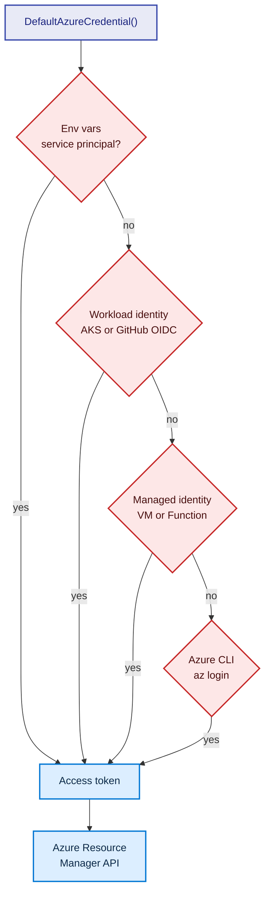
<p align="center"><sub><i>Figure: DefaultAzureCredential - first working credential wins</i></sub></p>


Reading the diagram: `DefaultAzureCredential` tries several sources in order and uses the first that works. In a pipeline that is usually workload identity (OIDC), on an Azure VM a managed identity, and on your laptop your `az login` session. The result is an access token that the management client sends to Azure Resource Manager.

<b>Example:</b> list resource groups and their `owner` tag (read-only).

```python
"""list_rgs_azure.py - pip install azure-identity==1.19.0 azure-mgmt-resource==23.2.0"""

import os

from azure.identity import DefaultAzureCredential
from azure.mgmt.resource import ResourceManagementClient

subscription_id = os.environ["AZURE_SUBSCRIPTION_ID"]      # export it before running
client = ResourceManagementClient(DefaultAzureCredential(), subscription_id)

for rg in client.resource_groups.list():                  # the SDK pages automatically
    tags = rg.tags or {}
    print(f"{rg.name:30} {rg.location:10} owner={tags.get('owner', '-')}")
```

```bash
export AZURE_SUBSCRIPTION_ID=$(az account show --query id -o tsv)
python list_rgs_azure.py
```

```text
NetworkWatcherRG               eastus     owner=-
```

<b>Command breakdown:</b> `export AZURE_SUBSCRIPTION_ID=$(az account show --query id -o tsv)`

| Part | What it means |
|---|---|
| `az account show` | show the subscription your `az login` session is using |
| `--query id` | JMESPath filter: only the subscription ID |
| `-o tsv` | plain text without quotes, safe to store in a variable |
| `$( ... )` | command substitution: run it and insert the output |
| `export` | make the variable visible to the Python process you start next |

| Item | AWS (boto3) | Azure SDK |
|---|---|---|
| Install | `boto3` | `azure-identity` + a service package such as `azure-mgmt-resource` |
| Login object | default chain inside `boto3.Session()` | `DefaultAzureCredential()` |
| Laptop login | `aws sso login` / profile | `az login` |
| In the cloud | IAM role (EC2, ECS, EKS Pod Identity / IRSA, Lambda) | managed identity / workload identity |
| Paging | `get_paginator(...)` | `.list()` returns an auto-paging iterator |

> [!NOTE]
> <b>Real-world scenario:</b> Real scenario: Raymundo's client asked for a weekly "who owns what" report across AWS and Azure. He wrote one Python tool with two small modules (boto3 and Azure SDK), ran it in a scheduled pipeline with OIDC (no stored secrets), and posted the CSV to the FinOps channel. The same idea returns on Day 35 (FinOps).


<h3>Live Demo: From CSV to a Tested API</h3>

The trainer builds a minimal version in a scratch folder; you build the full version in the lab.

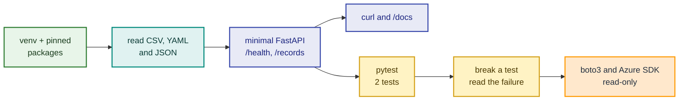
<p align="center"><sub><i>Figure: Live demo - from CSV to a tested API and a read-only cloud check</i></sub></p>


Reading the diagram: the demo goes from an empty folder to a venv, reads the three file formats, serves the CSV through a minimal API, tests it, deliberately breaks a test to practise reading failures, and ends with read-only boto3 and Azure SDK calls.

1. Project folder and venv:

```bash
mkdir -p ~/day05-demo && cd ~/day05-demo
python3 -m venv .venv && source .venv/bin/activate
python -m pip install -q fastapi==0.115.6 "uvicorn[standard]==0.34.0" pytest==8.3.4 httpx==0.28.1 PyYAML==6.0.2
python -c "import fastapi, sys; print(fastapi.__version__, sys.version.split()[0])"
```

```text
0.115.6 3.12.3
```

2. Read the three formats in one go:

```bash
mkdir -p data && cat > data/employees.csv <<'EOF'
id,name,email,department,title,location,hire_date
1,Haiman Sher,haiman.sher@example.com,Platform,DevOps Engineer,Austin,2023-01-09
2,Cindia Fouda,cindia.fouda@example.com,Data,Data Analyst,Chicago,2022-07-18
EOF
cat > settings.yaml <<'EOF'
service: peoplepulse
port: 8000
EOF
python - <<'EOF'
import csv, json, yaml
cfg = yaml.safe_load(open("settings.yaml", encoding="utf-8"))
rows = list(csv.DictReader(open("data/employees.csv", newline="", encoding="utf-8")))
print(json.dumps({"service": cfg["service"], "port": cfg["port"], "first": rows[0]["name"], "count": len(rows)}))
EOF
```

```text
{"service": "peoplepulse", "port": 8000, "first": "Haiman Sher", "count": 2}
```

<b>Command breakdown:</b> `python - <<'EOF' ... EOF`

| Part | What it means |
|---|---|
| `python -` | read the program from standard input instead of a file |
| `<<'EOF'` | here-document: everything until the line `EOF` is fed to Python |
| quotes around `'EOF'` | the shell does <b>not</b> expand `$` or backticks inside – the code arrives unchanged |

3. Minimal API, started in the background:

```bash
cat > main.py <<'EOF'
import csv

from fastapi import FastAPI

app = FastAPI(title="PeoplePulse demo")


@app.get("/health")
def health() -> dict:
    return {"status": "ok"}


@app.get("/records")
def records() -> list[dict]:
    with open("data/employees.csv", newline="", encoding="utf-8") as f:
        return list(csv.DictReader(f))
EOF
uvicorn main:app --host 127.0.0.1 --port 8000 > uvicorn.log 2>&1 &
sleep 2
curl -s http://127.0.0.1:8000/health; echo
curl -s http://127.0.0.1:8000/records | python -m json.tool | head -10
```

```text
{"status":"ok"}
[
    {
        "id": "1",
        "name": "Haiman Sher",
        "email": "haiman.sher@example.com",
        "department": "Platform",
        "title": "DevOps Engineer",
        "location": "Austin",
        "hire_date": "2023-01-09"
    },
```

<b>Command breakdown:</b> `uvicorn main:app --host 127.0.0.1 --port 8000 > uvicorn.log 2>&1 &`

| Part | What it means |
|---|---|
| `uvicorn main:app` | serve the `app` object from `main.py` |
| `> uvicorn.log` | send normal output to a log file instead of the terminal |
| `2>&1` | send errors (stderr) to the same place as stdout |
| `&` | run in the background, so the terminal is free for `curl`; stop it later with `kill %1` |
| `python -m json.tool` | pretty-print JSON (works where `jq` is not installed) |

Point out that `"id": "1"` is a <b>string</b>; the lab fixes this with the `Employee` model. Open `http://127.0.0.1:8000/docs` to show the generated Swagger UI. Also note the relative path `data/employees.csv`. It works here only because we started uvicorn from this folder.

4. First tests:

```bash
cat > test_main.py <<'EOF'
from fastapi.testclient import TestClient

from main import app

client = TestClient(app)


def test_health():
    resp = client.get("/health")
    assert resp.status_code == 200
    assert resp.json() == {"status": "ok"}


def test_records_returns_all_rows():
    assert len(client.get("/records").json()) == 2
EOF
pytest -q
```

```text
..                                                                       [100%]
2 passed in 0.31s
```

5. Break it on purpose: change `== 2` to `== 3`, re-run, and read the failure from the bottom up:

```bash
sed -i 's/== 2/== 3/' test_main.py && pytest -q
```

```text
F.
    def test_records_returns_all_rows():
>       assert len(client.get("/records").json()) == 3
E       AssertionError: assert 2 == 3
E        +  where 2 = len([{'department': 'Platform', ...}, {...}])
FAILED test_main.py::test_records_returns_all_rows - AssertionError: assert 2 == 3
1 failed, 1 passed in 0.35s
```

Read it like a pipeline log: the `FAILED` line names the test, the `E` lines show the real value (2) and the expected value (3). Fix it back with `sed -i 's/== 3/== 2/' test_main.py`.

6. Read-only cloud check with boto3 (uses your Day 1 AWS login):

```bash
python -m pip install -q boto3==1.35.90
python - <<'EOF'
import boto3
print("Account:", boto3.client("sts").get_caller_identity()["Account"])
ec2 = boto3.client("ec2", region_name="us-east-1")
resp = ec2.describe_instances(Filters=[{"Name": "instance-state-name", "Values": ["running"]}])
print("Running instances:", sum(len(r["Instances"]) for r in resp["Reservations"]))
EOF
```

```text
Account: <ACCOUNT_ID>
Running instances: 0
```

7. Read-only cloud check with the Azure SDK (uses your `az login`):

```bash
python -m pip install -q azure-identity==1.19.0 azure-mgmt-resource==23.2.0
export AZURE_SUBSCRIPTION_ID=$(az account show --query id -o tsv)
python - <<'EOF'
import os
from azure.identity import DefaultAzureCredential
from azure.mgmt.resource import ResourceManagementClient
client = ResourceManagementClient(DefaultAzureCredential(), os.environ["AZURE_SUBSCRIPTION_ID"])
print("Resource groups:", len(list(client.resource_groups.list())))
EOF
kill %1    # stop the background uvicorn
```

```text
Resource groups: 1
```

> [!TIP]
> <b>Pro tip:</b> If step 6 prints `NoCredentialsError` or `ExpiredToken`, run `aws sso login` (or check `aws sts get-caller-identity`). If step 7 fails with `DefaultAzureCredential failed to retrieve a token`, run `az login`. The demo still works without the cloud steps.


---


<h2>11:15 AM – 12:15 PM · Q&A, Live Quiz & Lab Briefing</h2>


| Minutes | Activity | Method |
|---|---|---|
| 11:15 – 11:35 | Interview-style Q&A (8 questions) | Discussion |
| 11:35 – 11:55 | Live quiz (10 questions) and answer review | Quiz |
| 11:55 – 12:10 | Lab briefing: Mini Project 1, acceptance criteria, assessment rules and rubric | Lecture |
| 12:10 – 12:15 | Everyone confirms `python3 -m venv` works and `git status` is clean | Hands-on |

<h3>Interview-style Q&A</h3>


<h4>1. "Why do you use virtual environments?"</h4>

<b>Model answer:</b> To isolate each project's dependencies, so versions do not conflict and installs are reproducible. I create one venv per project, install from pinned requirements files, and never commit the venv. In Docker the image itself gives isolation, but I still install from the same pinned requirements file so the laptop, CI and the image match.

<h4>2. "How do you manage Python dependencies for a service?"</h4>

<b>Model answer:</b> Runtime packages pinned with `==` in `requirements.txt`, because that is what goes into the image. Test and lint tools in `requirements-dev.txt`, which includes the runtime file with `-r`. Dependabot or Renovate opens pull requests for upgrades and CI tests them. For bigger projects I use a lock file with hashes, for example with pip-tools or uv.

<h4>3. "Give an example of Python automation you wrote as a DevOps Engineer."</h4>

<b>Model answer:</b> A tag-compliance script with boto3: it pages through EC2 instances, lists resources missing `owner` and `env` tags, and posts a report. It uses the default credential chain, so it runs on my laptop with SSO and in a scheduled pipeline with an OIDC role. It has a dry-run default, an `--apply` flag, exit codes for CI, and unit tests with a mocked AWS client.

<h4>4. "How do you test an API?"</h4>

<b>Model answer:</b> Unit tests for the logic, such as CSV parsing and edge cases like a missing column, and API tests with FastAPI's TestClient for status codes and bodies, including the 404, 422 and 503 paths. I use fixtures with `tmp_path` and `monkeypatch` for test data, measure coverage with pytest-cov, and fail the build below 80%.

<h4>5. "What is the difference between yaml.load and yaml.safe_load?"</h4>

<b>Model answer:</b> `safe_load` only builds plain data types: dicts, lists, strings and numbers. `load` with an unsafe loader can create arbitrary Python objects, which allows code execution from a malicious file. I always use `safe_load`, and I quote versions and yes/no values to avoid YAML type surprises.

<h4>6. "How do your scripts authenticate to AWS or Azure?"</h4>

<b>Model answer:</b> Never with keys in code or Git. Locally through SSO profiles or `az login`; in CI through OIDC federation to an IAM role or an Entra ID workload identity; in the cloud through IAM roles, EKS Pod Identity or IRSA, and Azure managed identities. The SDK's default credential chain picks the right one automatically, so the code does not change between environments.

<h4>7. "Which status codes should an API return, and why does it matter for operations?"</h4>

<b>Model answer:</b> 200 for success, 404 when the resource does not exist, 422 for invalid input, and 503 when a dependency such as the data file or database is unavailable. Unhandled 500s should be rare. It matters because load balancers, retries and alerts depend on the code class: a 503 can be retried and should page someone, while a 404 is the caller's problem.

<h4>8. "What is ruff and why put a linter in CI?"</h4>

<b>Model answer:</b> ruff is a very fast Python linter and formatter. In CI it is the first and cheapest gate: it catches unused imports, undefined names and likely bugs, and `ruff format --check` enforces one style. Reviewers then spend their time on logic instead of formatting.

<h3>Live Quiz (10 questions)</h3>


<b>Q1.</b> Which command creates a virtual environment in the folder `.venv`?
- A) `pip venv .venv`
- B) `python3 -m venv .venv`
- C) `virtualenv --global`
- D) `source .venv`

<b>Q2.</b> What does this print? `import csv, io; r = csv.DictReader(io.StringIO("id,name\n7,Carla\n")); print(type(next(r)["id"]).__name__)`
- A) `int`
- B) `str`
- C) `dict`
- D) `float`

<b>Q3.</b> True or false: `yaml.safe_load` is the recommended way to load YAML from files you do not fully trust.
- A) True
- B) False

<b>Q4.</b> In FastAPI, a request to `/records/abc` where the path parameter is typed `int` returns:
- A) 200
- B) 404
- C) 422
- D) 500

<b>Q5.</b> Which file should list `pytest` and `ruff`?
- A) `requirements.txt`
- B) `requirements-dev.txt`
- C) `.gitignore`
- D) `Dockerfile`

<b>Q6.</b> What does `pytest --cov=app --cov-fail-under=80` do when total coverage is 72%?
- A) Prints a warning but exits 0
- B) Exits with a non-zero code
- C) Deletes the failing tests
- D) Skips the coverage step

<b>Q7.</b> Which built-in pytest fixture gives each test its own temporary folder?
- A) `capsys`
- B) `monkeypatch`
- C) `tmp_path`
- D) `request`

<b>Q8.</b> True or false: boto3 needs access keys written in the script to work.
- A) True
- B) False

<b>Q9.</b> What does this print? `print(json.dumps({"b": 1, "a": 2}, sort_keys=True))`
- A) `{"b": 1, "a": 2}`
- B) `{"a": 2, "b": 1}`
- C) `{a: 2, b: 1}`
- D) An error

<b>Q10.</b> Which ruff command fails in CI when code is not formatted, without changing any file?
- A) `ruff format .`
- B) `ruff check . --fix`
- C) `ruff format --check .`
- D) `ruff clean`

<h3>Lab Briefing</h3>

<b>Mini Project 1 starts today.</b> Over Week 2 you will containerise this API (Days 6–7), build it in Jenkins (Day 8) and GitHub Actions (Day 9), and demo a full local CI/CD pipeline on Day 10. Today you build the application and its tests.

<b>Where you work:</b> your personal repo `devops-8wk-<your-name>`, branch `day05-python-fastapi`. You open a pull request to your own `main` at the end of the day. Copy the seed data from the team repo so everyone has the same five employees.

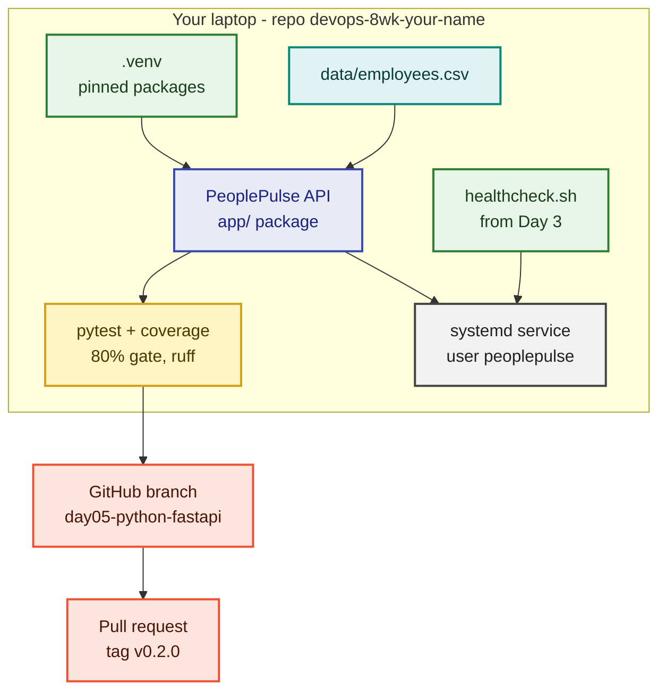
<p align="center"><sub><i>Figure: Lab - what you will build this afternoon</i></sub></p>


Reading the diagram: in Lab Part 1 you create the venv, the `app/` package and the first tests. In the assessment (Lab Part 2) you finish the API and tests to 80%+, run the API as a systemd service under a non-root service account, and prove it with your Day 3 `healthcheck.sh`. Everything goes to the `day05-python-fastapi` branch, a pull request and the `v0.2.0` tag.

<b>Acceptance criteria (Mini Project 1 – application part):</b>
- `GET /health` returns `200 {"status":"ok","version":"0.1.0"}`.
- `GET /records` returns the employees with `id` as an integer; optional `?department=` filter (case-insensitive) and `?limit=` (1–1000).
- `GET /records/{id}` returns `200` with one record, `404 {"detail":"Record not found"}` for unknown ids, and `422` for non-integer ids.
- A missing or invalid data file returns `503`, never a crash or a stack trace.
- `pytest --cov=app --cov-fail-under=80`, `ruff check .` and `ruff format --check .` all pass.
- Pushed to GitHub with conventional commits; pull request open; `v0.2.0` tag after merge.

<b>Time-boxes:</b>

| Time | Work |
|---|---|
| 1:15 – 2:45 | Lab Part 1: Tasks 1–6 (branch, venv, config, repository, `/health`, `/records`, first tests, push) |
| 2:45 – 3:02 | Assessment Part A: weekly quiz (Linux, networking, Git) – closed book |
| 3:02 – 4:00 | Assessment Part B: finish the API and tests, systemd service, health check |
| 4:00 – 4:45 | Break/fix drill, scoring with the rubric, reference solution, teardown |
| 4:45 – 5:00 | Commit, pull request, tag, weekly report |

---


<h2>12:15 – 1:15 PM · Lunch</h2>


Take a proper break away from the screen. It is a long afternoon: the guided build and then the assessment.

---


<h2>1:15 – 2:45 PM · Lab Part 1 – Task Assignment & Guided Build</h2>


> [!NOTE]
> <b>Lab start (1:15 PM):</b> the trainer posts today's lab tasks in the batch channel. Work through them in order, ask for help in the channel if you are stuck for more than 15 minutes, and report your results (screenshots, command output, Git link) to the trainer at the <b>4:00 PM review</b>.


| Minutes | Activity | Method |
|---|---|---|
| 1:15 – 1:30 | Task 1: branch, seed data, venv and requirements files | Task |
| 1:30 – 1:35 | Task 2: `pyproject.toml` for pytest, coverage and ruff | Task |
| 1:35 – 1:55 | Task 3: config, model and CSV repository | Task |
| 1:55 – 2:10 | Task 4: FastAPI app with `/health` and `/records` | Task |
| 2:10 – 2:30 | Task 5: first unit and API tests with coverage | Task |
| 2:30 – 2:40 | Task 6: lint, format, commit and push | Task |
| 2:40 – 2:45 | Mentor checks Tasks 1–6 checkpoints | Mentor check |

<h3>Task 1 – Branch, Seed Data, venv and Requirements</h3>


```bash
cd ~/devops-8wk/devops-8wk-<your-name>
git switch main && git pull
git switch -c day05-python-fastapi
mkdir -p app tests data
# same five employees as the team repo (Day 4)
cp ~/devops-8wk/peoplepulse-team/data/employees.csv data/employees.csv 2>/dev/null || cat > data/employees.csv <<'EOF'
id,name,email,department,title,location,hire_date
1,Haiman Sher,haiman.sher@example.com,Platform,DevOps Engineer,Austin,2023-01-09
2,Cindia Fouda,cindia.fouda@example.com,Data,Data Analyst,Chicago,2022-07-18
3,Jobanjit Singh,jobanjit.singh@example.com,Security,Cloud Security Engineer,Seattle,2021-11-01
4,Carla Rivera,carla.rivera@example.com,QA,QA Engineer,Dallas,2024-03-11
5,Raymundo Trancoso,raymundo.trancoso@example.com,Platform,SRE,Denver,2024-05-20
EOF

cat >> .gitignore <<'EOF'
# Python
.venv/
__pycache__/
*.pyc
.pytest_cache/
.ruff_cache/
.coverage
htmlcov/
reports/
EOF

python3 -m venv .venv && source .venv/bin/activate
python -m pip install --upgrade pip
printf 'fastapi==0.115.6\nuvicorn[standard]==0.34.0\n' > requirements.txt
printf -- '-r requirements.txt\npytest==8.3.4\npytest-cov==6.0.0\nhttpx==0.28.1\nruff==0.8.4\n' > requirements-dev.txt
python -m pip install -r requirements-dev.txt
git status --short
```

```text
 M .gitignore
?? data/
?? requirements-dev.txt
?? requirements.txt
```

<b>Command breakdown:</b> `cp ... 2>/dev/null || cat > data/employees.csv <<'EOF'`

| Part | What it means |
|---|---|
| `cp <team repo>/data/employees.csv data/` | reuse the seed file from Day 4 if you still have the team repo cloned |
| `2>/dev/null` | hide the "No such file" message if you do not |
| `\|\|` | "or": run the right side only if `cp` failed – then we write the file by hand |
| `printf -- '-r requirements.txt\n...'` | `--` tells `printf` that the text starting with `-r` is not an option |

<b>Checkpoint:</b> `which python` points into `.venv`; `python -m pip show fastapi | head -2` shows `Version: 0.115.6`; `.venv/` does <b>not</b> appear in `git status`.

<h3>Task 2 – Project Configuration (pyproject.toml)</h3>


```bash
cat > pyproject.toml <<'EOF'
[project]
name = "peoplepulse"
version = "0.1.0"
description = "PeoplePulse CSV Records API"
requires-python = ">=3.12"

[tool.pytest.ini_options]
testpaths = ["tests"]
pythonpath = ["."]

[tool.coverage.run]
source = ["app"]
branch = true

[tool.coverage.report]
show_missing = true
fail_under = 80

[tool.ruff]
line-length = 100
target-version = "py312"

[tool.ruff.lint]
select = ["E", "F", "I", "B", "UP"]
EOF
python -c "import tomllib; tomllib.load(open('pyproject.toml', 'rb')); print('valid toml')"
```

| Setting | What it does |
|---|---|
| `testpaths = ["tests"]` | pytest looks for tests only in `tests/` |
| `pythonpath = ["."]` | tests can `import app` when you run plain `pytest` from the repo root |
| `branch = true` | coverage also measures both sides of every `if` |
| `fail_under = 80` | the same gate as `--cov-fail-under=80`, stored in the repo |

<b>Checkpoint:</b> the command prints `valid toml`.

<h3>Task 3 – Config, Model and CSV Repository</h3>


```bash
cat > app/__init__.py <<'EOF'
"""PeoplePulse CSV Records API."""

import os

# Docker (Day 6) and CI set APP_VERSION; locally we fall back to the code version.
__version__ = os.getenv("APP_VERSION", "0.1.0")
EOF

cat > app/config.py <<'EOF'
"""Runtime configuration, read from environment variables (12-factor)."""

import os
from pathlib import Path

DEFAULT_DATA_FILE = Path(__file__).resolve().parent.parent / "data" / "employees.csv"


def get_data_file() -> Path:
    """Path of the employees CSV; override it with the DATA_FILE env var."""
    return Path(os.getenv("DATA_FILE", str(DEFAULT_DATA_FILE)))
EOF

cat > app/models.py <<'EOF'
"""API schemas (Pydantic models)."""

from datetime import date

from pydantic import BaseModel


class Employee(BaseModel):
    """One row of data/employees.csv, with real types."""

    id: int
    name: str
    email: str
    department: str
    title: str
    location: str
    hire_date: date
EOF

cat > app/repository.py <<'EOF'
"""Load employee records from a CSV file."""

import csv
from pathlib import Path

REQUIRED_COLUMNS = {"id", "name", "email", "department", "title", "location", "hire_date"}


class DataFileError(Exception):
    """Raised when the data file is missing or invalid."""


def load_records(path: Path) -> list[dict]:
    """Return all rows as dicts with an integer ``id``.

    Raises DataFileError if the file is missing, a column is missing,
    or an id is not a whole number.
    """
    if not path.is_file():
        raise DataFileError(f"Data file not found: {path}")

    with path.open(newline="", encoding="utf-8") as f:
        reader = csv.DictReader(f)
        missing = REQUIRED_COLUMNS - set(reader.fieldnames or [])
        if missing:
            raise DataFileError(f"Missing columns: {', '.join(sorted(missing))}")

        records = []
        for line_no, row in enumerate(reader, start=2):  # line 1 is the header
            try:
                row["id"] = int(row["id"])
            except (TypeError, ValueError) as exc:
                raise DataFileError(f"Invalid id on line {line_no}: {row['id']!r}") from exc
            records.append(row)
    return records
EOF
python -c "from app.repository import load_records; from app.config import get_data_file; r = load_records(get_data_file()); print(len(r), type(r[0]['id']).__name__)"
```

```text
5 int
```

| Code | Why it is written this way |
|---|---|
| `class DataFileError(Exception)` | our own error type, so the API can catch exactly this problem and answer 503 |
| `reader.fieldnames or []` | an empty file has no header (`None`); `or []` avoids a crash |
| `enumerate(reader, start=2)` | count lines from 2 because line 1 is the header – the message points at the real line |
| `raise ... from exc` | keep the original error attached, which helps debugging |
| `{row['id']!r}` | `!r` shows the value with quotes, so an empty value shows as `''` |

<b>Checkpoint:</b> the command prints `5 int`.

<h3>Task 4 – FastAPI App with /health and /records</h3>


```bash
cat > app/main.py <<'EOF'
"""PeoplePulse FastAPI application."""

from typing import Annotated

from fastapi import FastAPI, HTTPException, Query

from app import __version__
from app.config import get_data_file
from app.models import Employee
from app.repository import DataFileError, load_records

app = FastAPI(title="PeoplePulse", version=__version__)


def _records() -> list[dict]:
    """Load records on every request, so a new DATA_FILE is picked up (fine for a small CSV)."""
    try:
        return load_records(get_data_file())
    except DataFileError as exc:
        raise HTTPException(status_code=503, detail=str(exc)) from exc


@app.get("/health")
def health() -> dict:
    """Liveness check: cheap, no file access."""
    return {"status": "ok", "version": __version__}


@app.get("/records", response_model=list[Employee])
def list_records(
    department: Annotated[str | None, Query(description="Filter by department")] = None,
    limit: Annotated[int, Query(ge=1, le=1000)] = 100,
) -> list[dict]:
    """All employees, optionally filtered by department (case-insensitive)."""
    records = _records()
    if department:
        records = [r for r in records if r["department"].lower() == department.lower()]
    return records[:limit]


# TODO (assessment B1): GET /records/{record_id} -> 200 Employee, 404 {"detail": "Record not found"}
EOF
uvicorn app.main:app --reload --host 127.0.0.1 --port 8000 > uvicorn.log 2>&1 &
sleep 2
curl -s http://127.0.0.1:8000/health; echo
curl -s 'http://127.0.0.1:8000/records?department=platform&limit=2' | python -m json.tool
curl -s -o /dev/null -w '%{http_code}\n' 'http://127.0.0.1:8000/records?limit=0'
```

```text
{"status":"ok","version":"0.1.0"}
[
    {
        "id": 1,
        "name": "Haiman Sher",
        "email": "haiman.sher@example.com",
        "department": "Platform",
        "title": "DevOps Engineer",
        "location": "Austin",
        "hire_date": "2023-01-09"
    },
    {
        "id": 5,
        "name": "Raymundo Trancoso",
        "email": "raymundo.trancoso@example.com",
        "department": "Platform",
        "title": "SRE",
        "location": "Denver",
        "hire_date": "2024-05-20"
    }
]
422
```

<b>Command breakdown:</b> `limit: Annotated[int, Query(ge=1, le=1000)] = 100`

| Part | What it means |
|---|---|
| `limit: int` | a query parameter (`?limit=2`), converted to an integer |
| `Annotated[..., Query(...)]` | attach extra rules to the type without changing the default value |
| `ge=1, le=1000` | "greater or equal 1, less or equal 1000" – `limit=0` gives 422 automatically |
| `= 100` | default when the caller does not send `limit` |
| `response_model=list[Employee]` | FastAPI validates and converts every record through the model before sending it |

<b>Checkpoint:</b> `id` is now a number (no quotes), the department filter is case-insensitive, `limit=0` gives `422`, and `http://127.0.0.1:8000/docs` shows both endpoints.

<h3>Task 5 – First Tests with Coverage</h3>


```bash
cat > tests/conftest.py <<'EOF'
"""Shared pytest fixtures."""

import pytest
from fastapi.testclient import TestClient

from app.main import app

SAMPLE_CSV = """id,name,email,department,title,location,hire_date
1,Haiman Sher,haiman.sher@example.com,Platform,DevOps Engineer,Austin,2023-01-09
2,Cindia Fouda,cindia.fouda@example.com,Data,Data Analyst,Chicago,2022-07-18
3,Jobanjit Singh,jobanjit.singh@example.com,Security,Cloud Security Engineer,Seattle,2021-11-01
"""


@pytest.fixture
def data_file(tmp_path, monkeypatch):
    """Write a known CSV to a temp folder and point the app at it."""
    path = tmp_path / "employees.csv"
    path.write_text(SAMPLE_CSV, encoding="utf-8")
    monkeypatch.setenv("DATA_FILE", str(path))
    return path


@pytest.fixture
def client(data_file):
    """A test client for the app, already using the sample CSV."""
    return TestClient(app)
EOF

cat > tests/test_repository.py <<'EOF'
import pytest

from app.repository import DataFileError, load_records


def test_load_records_converts_id_to_int(data_file):
    records = load_records(data_file)
    assert len(records) == 3
    assert records[0]["id"] == 1


def test_missing_file_raises(tmp_path):
    with pytest.raises(DataFileError, match="not found"):
        load_records(tmp_path / "nope.csv")
EOF

cat > tests/test_api.py <<'EOF'
def test_health(client):
    resp = client.get("/health")
    assert resp.status_code == 200
    assert resp.json()["status"] == "ok"


def test_list_records_returns_all(client):
    resp = client.get("/records")
    assert resp.status_code == 200
    assert [r["id"] for r in resp.json()] == [1, 2, 3]


def test_list_records_filters_department_case_insensitive(client):
    resp = client.get("/records", params={"department": "data"})
    assert [r["name"] for r in resp.json()] == ["Cindia Fouda"]
EOF
pytest --cov=app --cov-report=term-missing
```

```text
.....                                                                    [100%]
Name                Stmts   Miss Branch BrPart  Cover   Missing
---------------------------------------------------------------
app/__init__.py         2      0      0      0   100%
app/config.py           5      0      0      0   100%
app/main.py            21      2      2      0    91%   19-20
app/models.py          10      0      0      0   100%
app/repository.py      20      3      6      1    85%   26, 32-33
---------------------------------------------------------------
TOTAL                  58      5      8      1    91%

Required test coverage of 80.0% reached. Total coverage: 90.91%
5 passed in 0.42s
```

<b>Command breakdown:</b> the `data_file(tmp_path, monkeypatch)` fixture

| Part | What it means |
|---|---|
| `@pytest.fixture` | turns the function into a fixture; any test that names `data_file` as an argument gets its return value |
| `tmp_path` | built-in fixture: a new empty folder for this test only |
| `monkeypatch.setenv("DATA_FILE", ...)` | set the env var for this test; pytest removes it afterwards |
| `client(data_file)` | a fixture can use another fixture – asking for `client` also creates the sample CSV |
| `conftest.py` | pytest loads it automatically; fixtures in it are shared by all test files |

<b>Checkpoint:</b> 5 tests pass and coverage is at least 80%. The `Missing` lines are the error paths (`19-20` is the 503 branch, `26` and `32-33` are the CSV validation errors). You cover them in the assessment.

<h3>Task 6 – Lint, Format, Commit and Push</h3>


```bash
ruff check . --fix
ruff format .
ruff check . && ruff format --check .
kill %1 2>/dev/null; rm -f uvicorn.log
git add .gitignore app tests data pyproject.toml requirements.txt requirements-dev.txt
git commit -m "feat(api): add health and records endpoints with csv repository"
git push -u origin day05-python-fastapi
```

```text
All checks passed!
8 files already formatted
[day05-python-fastapi 4c1d2e7] feat(api): add health and records endpoints with csv repository
 11 files changed, 168 insertions(+)
```

<b>Checkpoint:</b> branch `day05-python-fastapi` is visible on GitHub with one `feat(api)` commit, and `git ls-files | grep -E '\.venv|\.coverage|\.log'` prints nothing.

---


<h2>2:45 – 4:00 PM · Lab Part 2 – Independent Challenge</h2>


| Minutes | Activity | Method |
|---|---|---|
| 2:45 – 3:02 | Part A: weekly quiz – Linux, networking, Git (closed book, 15 points) | Quiz |
| 3:02 – 3:35 | Part B1: finish `/records/{id}` and the tests (35 points) | Task |
| 3:35 – 3:50 | Part B2: run PeoplePulse as a systemd service (15 points) | Task |
| 3:50 – 3:58 | Part B3: prove it is healthy with `healthcheck.sh` (10 points) | Task |
| 3:58 – 4:00 | Pens down; push your branch | Checkpoint |

Today this slot is the <b>Week 1 practical assessment</b>. Part B4 (break/fix) runs at the 4:00 PM review and Part B5 (Git delivery) is scored at 4:45 PM.

<b>Rules:</b> individual work. In Part B you may use your own notes, previous day files and official docs. Not allowed: AI assistants, chat, or copying from classmates.


<p align="center"><sub><i>Figure: Week 1 assessment - parts, timing and points</i></sub></p>


Reading the diagram: the assessment covers the whole week: the quiz checks Days 2–4, B1 checks today's Python, B2 reuses Day 2 systemd skills, B3 reuses the Day 3 script, B4 tests troubleshooting from logs, and B5 checks the Day 4 Git workflow. Total 100 points plus a 5-point stretch bonus.

<h3>Part A – Weekly Quiz: Linux, Networking, Git (15 points)</h3>

Write short answers on paper or in a text file; the mentor reads the answers at 4:00 PM.
1. Which command shows the last 50 log lines of the `nginx` unit without a pager?
2. Give the numeric mode for `rw-r-----` and say who can read the file.
3. With `umask 022`, what mode does a new directory get?
4. What is the difference between `systemctl enable` and `systemctl start`?
5. Write a cron line that runs `/usr/local/bin/backup.sh` at 01:30 every Sunday.
6. A `/22` has how many addresses in total? How many are usable in an AWS subnet?
7. Is `10.20.5.17` inside `10.20.4.0/23`? (yes or no)
8. `curl` returns exit code 6. What kind of problem does that point to?
9. Which `dig` option follows the DNS delegation from the root servers?
10. Which command shows listening TCP ports with the owning process?
11. Name the three things a TLS client checks on a server certificate.
12. What does `git push --force-with-lease` protect you from?
13. The current tag is `v1.2.3`; the next merge is `fix(api): handle empty csv`. What is the next tag?
14. Which file makes certain reviewers mandatory for changes under `/app/`?
15. Which command lists every recent position of HEAD so you can recover a lost commit?

<h3>Challenge B1 – Finish the CSV Records API (35 points)</h3>

<b>Goal:</b> complete the application part of Mini Project 1.
- Implement `GET /records/{record_id}`: return one `Employee`, `404 {"detail": "Record not found"}` for unknown ids; a non-integer id must return `422`.
- Add tests for: get by id (200), unknown id (404 and its message), non-integer id (422), the `limit` parameter, a missing data file (503), a CSV with a missing column (`DataFileError`) and a CSV with a non-numeric id (`DataFileError`).
- Coverage at least <b>80%</b> (aim for 95%+); `ruff check .` and `ruff format --check .` clean.
- Commit in small steps with conventional messages (`feat(api): ...`, `test(api): ...`).

<b>Hints:</b>
- Copy the pattern of `list_records`: loop over `_records()` and raise `HTTPException(status_code=404, ...)` when nothing matches.
- For the 503 test, call `monkeypatch.setenv("DATA_FILE", str(tmp_path / "missing.csv"))` inside the test. The app needs no change.
- `@pytest.mark.parametrize` keeps the 200/404 tests short.
- The `Missing` column of the coverage report tells you which lines still need a test.

<b>Acceptance criteria:</b> the mentor runs on your branch `pytest --cov=app --cov-fail-under=80 && ruff check . && ruff format --check .`, then `curl -s localhost:8000/records/1` (a record) and `curl -s -o /dev/null -w '%{http_code}\n' localhost:8000/records/999` (`404`).

<h3>Challenge B2 – Run PeoplePulse as a systemd Service (15 points)</h3>

<b>Goal:</b> run the API the way it would run on an EC2 instance or Azure VM: under systemd, as a non-root service account.
- Copy `app/`, `data/` and `requirements.txt` to `/opt/peoplepulse` (owned by `root:peoplepulse`, not writable by others). Create a venv there and install <b>only</b> `requirements.txt`.
- Create the `peoplepulse` system user if it does not exist from Day 2.
- Unit file `/etc/systemd/system/peoplepulse.service`: `User=peoplepulse`, `WorkingDirectory=/opt/peoplepulse`, `Environment=DATA_FILE=/opt/peoplepulse/data/employees.csv`, uvicorn on `127.0.0.1:8000` (no `--reload`), `Restart=on-failure`.
- Enabled and active; logs visible with `journalctl -u peoplepulse`.

<b>Hints:</b> stop your development uvicorn first (port 8000 must be free). `ExecStart` needs the <b>full path</b> `/opt/peoplepulse/.venv/bin/uvicorn`. Test file access with `sudo -u peoplepulse cat /opt/peoplepulse/data/employees.csv`.

<b>Acceptance criteria:</b> `systemctl is-active peoplepulse` prints `active`; `pgrep -u peoplepulse -a uvicorn` shows the process; `curl -s 127.0.0.1:8000/health` returns the version.

<h3>Challenge B3 – Prove It Is Healthy (10 points)</h3>

<b>Goal:</b> use your Day 3 `healthcheck.sh` against the systemd-hosted API.
- Create `day05/endpoints.txt` with four full URLs, one per line: `http://127.0.0.1:8000/health`, `.../records`, `.../records/1` and one deliberately wrong URL, `.../records/999`.
- Run `../day03/healthcheck.sh -f endpoints.txt` from the `day05/` folder and save the output and exit code in `day05/assessment.md`.
- Capture `ss -ltnp | grep 8000` and explain in two sentences why a teammate's laptop could not reach this service, and what you would change to run it in a container.

<b>Acceptance criteria:</b> three OK lines, one FAIL line for `/records/999` (HTTP 404), exit code `1`, and a correct explanation (loopback bind; in a container bind to `0.0.0.0` and publish the port, in the cloud also open the security group or NSG).

<h3>Stretch Goal (+5 bonus)</h3>

Write `scripts/tag_audit.py` with boto3 that prints running EC2 instances and S3 buckets missing the `owner`, `env` or `course` tags, with `--region` and `--output json|table` arguments, plus a unit test that uses `unittest.mock` to fake the boto3 client (no real AWS calls in tests).

<h3>Scoring Rubric (100 points + 5 bonus)</h3>

| Area | Criteria | Points |
|---|---|---|
| A. Weekly quiz (15) | 1 point per correct answer | 15 |
| B1. API complete (20) | `/records/{id}` correct with 200, 404 (with message), 422; 503 on a missing file | 20 |
| B1. Tests and coverage (15) | 90%+ with error paths and meaningful asserts = 15; 80–89% = 10; below 80% or failing = 0 | 15 |
| B2. systemd service (15) | non-root, enabled, active, correct ownership, restart policy; runs as root or not enabled = 7 | 15 |
| B3. Health check (10) | correct OK/FAIL lines and exit code 1 = 6; correct bind explanation = 4 | 10 |
| B4. Break/fix (10) | fixed within 10 minutes = 6; exact log line and root cause stated = 4 | 10 |
| B5. Git delivery (15) | PR with description, 3+ conventional commits, README section, `v0.2.0` tag, no junk files | 15 |
| Stretch | tag audit script with a mocked test = 5; script only = 2 | +5 |
| <b>Total</b> | <b>Pass 70 or more; distinction 85 or more</b> | <b>100</b> |

<b>Result bands:</b> 85+ distinction · 70–84 pass · 60–69 pass with an action plan (redo the weak area over the weekend) · below 60 re-assessment with the mentor on Monday after the lab review.

---


<h2>4:00 – 4:45 PM · Lab Review with Trainer & Teardown</h2>


| Minutes | Activity | Method |
|---|---|---|
| 4:00 – 4:12 | (B4) Break/fix drill: the mentor breaks your service, you fix it | Task |
| 4:12 – 4:22 | Weekly quiz answers read out; trainees mark their own sheets | Discussion |
| 4:22 – 4:32 | Reference solution walk-through; scores and one strength and one gap per trainee | Mentor check |
| 4:32 – 4:42 | Teardown: stop the service, remove `/opt/peoplepulse`, stop dev servers | Task |
| 4:42 – 4:45 | Verify nothing is running in AWS or Azure before the weekend | Checkpoint |

<h3>Challenge B4 – Break/Fix: "The Service Will Not Start" (10 points)</h3>

The mentor changes <b>one</b> thing on your machine while you look away, for example `WorkingDirectory=/opt/peoplepulse/app`, a wrong `DATA_FILE` path, or `chmod 600` on the CSV (owned by root). Restore the service within 10 minutes using only `systemctl status`, `journalctl -u peoplepulse -n 30 --no-pager`, `ls -l` and `sudo -u peoplepulse`.

| Symptom | Log line or check that reveals it | Fix |
|---|---|---|
| Service in a restart loop | `ModuleNotFoundError: No module named 'app'` | `WorkingDirectory=/opt/peoplepulse`, then `daemon-reload` and restart |
| Active, but `/records` returns 503 | `curl` body `Data file not found: /opt/peoplepulse/data/employes.csv` | correct the `DATA_FILE` path in the unit |
| Active, but `/records` returns 500 | `PermissionError: [Errno 13] Permission denied` in `journalctl` | `chmod 640` and group `peoplepulse` on the CSV |

<b>Acceptance criteria:</b> the service is healthy again and you state the exact log line that revealed the cause.

> [!TIP]
> <b>Pro tip:</b> The third case is a good lesson: our code turns "file not found" into a clean 503, but not "permission denied". A good improvement after the course is to catch `OSError` in `load_records` too. Write it down as a follow-up ticket.


<h3>Weekly Quiz Answers (Part A)</h3>

1. `journalctl -u nginx -n 50 --no-pager`
2. `640` – the owner (read and write) and the group (read); others have no access.
3. `755` (777 minus 022).
4. `enable` = start at boot (creates the symlink for the target); `start` = start now. `enable --now` does both.
5. `30 1 * * 0 /usr/local/bin/backup.sh` (in `/etc/cron.d` add the user field: `30 1 * * 0 root /usr/local/bin/backup.sh`).
6. 1,024 in total; 1,019 usable on AWS (AWS reserves 5 per subnet).
7. Yes – `10.20.4.0/23` covers `10.20.4.0` to `10.20.5.255`.
8. DNS – "Could not resolve host".
9. `dig +trace <name>`
10. `sudo ss -ltnp`
11. It chains to a trusted CA, the hostname is in the SAN list, and it is within its validity dates.
12. Overwriting commits that someone else pushed to the remote branch since your last fetch.
13. `v1.2.4` (a fix is a PATCH).
14. `.github/CODEOWNERS` (with "Require review from Code Owners" turned on).
15. `git reflog`

<h3>Reference Solution (shown after scoring)</h3>

`app/main.py` – add at the end, replacing the TODO comment:

```python
@app.get("/records/{record_id}", response_model=Employee)
def get_record(record_id: int) -> dict:
    """One employee by id; 404 when the id does not exist."""
    for record in _records():
        if record["id"] == record_id:
            return record
    raise HTTPException(status_code=404, detail="Record not found")
```

`tests/test_api.py` – add `import pytest` at the top and these tests:

```python
@pytest.mark.parametrize(("record_id", "expected"), [(1, 200), (3, 200), (999, 404)])
def test_get_record_status(client, record_id, expected):
    assert client.get(f"/records/{record_id}").status_code == expected


def test_get_record_body(client):
    body = client.get("/records/2").json()
    assert body["name"] == "Cindia Fouda"
    assert body["hire_date"] == "2022-07-18"


def test_get_record_not_found_message(client):
    assert client.get("/records/999").json() == {"detail": "Record not found"}


def test_get_record_non_integer_id_is_422(client):
    assert client.get("/records/abc").status_code == 422


def test_limit_parameter(client):
    assert len(client.get("/records", params={"limit": 2}).json()) == 2
    assert client.get("/records", params={"limit": 0}).status_code == 422


def test_missing_data_file_returns_503(client, tmp_path, monkeypatch):
    monkeypatch.setenv("DATA_FILE", str(tmp_path / "missing.csv"))
    resp = client.get("/records")
    assert resp.status_code == 503
    assert "not found" in resp.json()["detail"]
```

`tests/test_repository.py` – add:

```python
def test_missing_column_raises(tmp_path):
    path = tmp_path / "bad.csv"
    path.write_text("id,name\n1,Carla Rivera\n", encoding="utf-8")
    with pytest.raises(DataFileError, match="Missing columns"):
        load_records(path)


def test_non_numeric_id_raises(tmp_path):
    path = tmp_path / "bad.csv"
    path.write_text(
        "id,name,email,department,title,location,hire_date\n"
        "x1,Raymundo Trancoso,r@example.com,Platform,SRE,Denver,2024-05-20\n",
        encoding="utf-8",
    )
    with pytest.raises(DataFileError, match="Invalid id on line 2"):
        load_records(path)
```

```bash
pytest --cov=app --cov-fail-under=80 | tail -4
```

```text
TOTAL                  64      0     12      0   100%

Required test coverage of 80% reached. Total coverage: 100.00%
15 passed in 0.48s
```

The systemd part (B2):

```bash
sudo id peoplepulse 2>/dev/null || sudo useradd --system --no-create-home --shell /usr/sbin/nologin peoplepulse
sudo mkdir -p /opt/peoplepulse
sudo cp -r app data requirements.txt /opt/peoplepulse/
sudo python3 -m venv /opt/peoplepulse/.venv
sudo /opt/peoplepulse/.venv/bin/pip install -q -r /opt/peoplepulse/requirements.txt
sudo chown -R root:peoplepulse /opt/peoplepulse && sudo chmod -R o-rwx /opt/peoplepulse
sudo chmod -R g-w /opt/peoplepulse

sudo tee /etc/systemd/system/peoplepulse.service > /dev/null <<'EOF'
[Unit]
Description=PeoplePulse CSV Records API
After=network-online.target
Wants=network-online.target

[Service]
User=peoplepulse
Group=peoplepulse
WorkingDirectory=/opt/peoplepulse
Environment=DATA_FILE=/opt/peoplepulse/data/employees.csv
ExecStart=/opt/peoplepulse/.venv/bin/uvicorn app.main:app --host 127.0.0.1 --port 8000
Restart=on-failure
RestartSec=3

[Install]
WantedBy=multi-user.target
EOF
sudo systemctl daemon-reload
sudo systemctl enable --now peoplepulse
systemctl is-active peoplepulse && curl -s 127.0.0.1:8000/health; echo
```

```text
active
{"status":"ok","version":"0.1.0"}
```

<b>Command breakdown:</b> the key lines of `peoplepulse.service`

| Part | What it means |
|---|---|
| `User=peoplepulse` | run as the service account, never root |
| `WorkingDirectory=/opt/peoplepulse` | uvicorn imports `app.main` from here – wrong folder means `ModuleNotFoundError` |
| `Environment=DATA_FILE=...` | the same env var the code reads; no code change between laptop and server |
| `ExecStart=/opt/peoplepulse/.venv/bin/uvicorn ...` | full path to the venv's uvicorn – systemd does not use your shell's `PATH` or activated venv |
| `Restart=on-failure` + `RestartSec=3` | restart after a crash, wait 3 seconds between attempts |
| `chmod -R o-rwx` | others get no access; the group (`peoplepulse`) can read, root owns and writes |
| `enable --now` | start at boot <b>and</b> start now |

<h3>Mentor Review Checklist</h3>

- Weekly quiz scored; weak topics noted per trainee.
- On a <b>fresh clone</b> with a new venv: `pytest --cov=app --cov-fail-under=80`, `ruff check .` and `ruff format --check .` all pass.
- `/records/{id}` returns 200, 404 and 422 correctly; a missing CSV returns 503.
- Tests use `tmp_path` and `monkeypatch`, not the real `data/employees.csv`.
- No secrets, `.venv`, `.coverage`, `htmlcov/` or logs in the repo.
- The systemd service runs as `peoplepulse`; the break/fix explanation names the right log line.
- Rubric score recorded and shared with the trainee.

<h3>Teardown Commands</h3>


```bash
# Stop and remove the assessment service (the code stays in Git)
sudo systemctl disable --now peoplepulse
sudo rm -f /etc/systemd/system/peoplepulse.service
sudo systemctl daemon-reload && sudo systemctl reset-failed
sudo rm -rf /opt/peoplepulse

# Stop dev servers and clean local artifacts
pkill -f "uvicorn app.main:app" || true
pkill -f "uvicorn main:app" || true
rm -rf ~/day05-demo
cd ~/devops-8wk/devops-8wk-<your-name> && rm -rf .pytest_cache .coverage htmlcov .ruff_cache
ss -ltn | grep ':8000' || echo "port 8000 free"
```

```text
Removed "/etc/systemd/system/multi-user.target.wants/peoplepulse.service".
port 8000 free
```

Keep the `.venv` in your repo folder, because you use it again on Monday.

<h3>Verify Nothing Is Billing</h3>

Today was local only, but make this check a habit every Friday before the weekend:

```bash
aws ec2 describe-instances --region us-east-1 \
  --filters Name=instance-state-name,Values=running,pending,stopped \
  --query 'Reservations[].Instances[].InstanceId' --output text     # expect empty
az resource list --query "length(@)" -o tsv                        # expect 0 (or only NetworkWatcherRG items)
```

<b>Command breakdown:</b> `aws ec2 describe-instances --filters ... --query ... --output text`

| Part | What it means |
|---|---|
| `--filters Name=instance-state-name,Values=running,pending,stopped` | stopped instances still cost money for their disks, so include them |
| `--query 'Reservations[].Instances[].InstanceId'` | flatten the nested response into a list of instance IDs |
| `--output text` | empty output means nothing is there |
| `az resource list --query "length(@)"` | count every resource in the subscription |

<h3>Cost Check</h3>

- Local work and read-only SDK calls: <b>$0</b>.
- Open the AWS Billing and Azure Cost Management pages and confirm month-to-date spend is still about $0 and the $10 budget alert from Day 1 has not fired.

---


<h2>4:45 – 5:00 PM · Commit & Daily Report</h2>


| Minutes | Activity | Method |
|---|---|---|
| 4:45 – 4:53 | (B5) Final commits, README section, push, PR, tag after merge | Task |
| 4:53 – 5:00 | Fill in and post the weekly activity report | Checkpoint |

```bash
cd ~/devops-8wk/devops-8wk-<your-name>
cat >> README.md <<'EOF'

## Run PeoplePulse locally
    python3 -m venv .venv && source .venv/bin/activate
    python -m pip install -r requirements-dev.txt
    uvicorn app.main:app --reload --host 127.0.0.1 --port 8000   # docs: /docs
    pytest --cov=app --cov-fail-under=80 && ruff check . && ruff format --check .
EOF
git add README.md app tests day05
git status --short                    # only app/, tests/, day05/, README.md
git commit -m "test(api): cover record lookup, errors and data file validation"
git push
gh pr create --base main --title "feat(api): PeoplePulse CSV records API with tests" \
  --body "Mini Project 1 app part. /health, /records, /records/{id}; coverage <xx>%; ruff clean."
# after the mentor approves and you merge:
git switch main && git pull
git tag -a v0.2.0 -m "PeoplePulse API + tests - week 1"
git push origin v0.2.0
```

<b>Command breakdown:</b> `git tag -a v0.2.0 -m "..." && git push origin v0.2.0`

| Part | What it means |
|---|---|
| `git tag -a v0.2.0` | create an <b>annotated</b> tag (has an author, date and message) on the current commit |
| `-m "..."` | the tag message |
| `git push origin v0.2.0` | tags are not pushed by `git push`; push each one by name |
| `v0.2.0` | MINOR bump from Day 4's `v0.1.0`: a new feature, still initial development (`0.y.z`) |

<b>Daily activity report – Day 05 (weekly summary):</b>

```text
Done
- Built the PeoplePulse CSV Records API (FastAPI): /health, /records (department filter, limit), /records/{id} (404/422), 503 on a bad data file
- pytest unit + API tests with tmp_path/monkeypatch fixtures; coverage <xx>% (gate 80%); ruff clean
- Ran the API as a non-root systemd service, proved it with healthcheck.sh, fixed the break/fix scenario
- PR: <link>; tag v0.2.0
- Week 1 assessment score: <xx>/100 (quiz <xx>/15)

Blocked
- <e.g. TestClient import error until httpx was installed / none>

Next
- Day 6: Docker fundamentals - containerise PeoplePulse, multi-stage build, push a semver image to Docker Hub

Learned
- requirements.txt (runtime) vs requirements-dev.txt (test and lint)
- csv returns strings; Pydantic models validate and convert types
- Default credential chains: never hard-code cloud keys in scripts
- Weak area to review this weekend: <topic>
```

---


<h2>Cheat Sheet</h2>

| Task | Command |
|---|---|
| Create / activate venv | `python3 -m venv .venv` · `source .venv/bin/activate` |
| Install pinned packages | `python -m pip install -r requirements-dev.txt` |
| Show / outdated | `python -m pip show fastapi` · `python -m pip list --outdated` |
| Run the API (dev) | `uvicorn app.main:app --reload --host 127.0.0.1 --port 8000` |
| API docs | `http://127.0.0.1:8000/docs` |
| Status code only | `curl -s -o /dev/null -w '%{http_code}\n' URL` |
| Run tests | `pytest` · `pytest -k records -x -v` · `pytest --lf` |
| Coverage gate | `pytest --cov=app --cov-report=term-missing --cov-fail-under=80` |
| HTML coverage | `pytest --cov=app --cov-report=html` then open `htmlcov/index.html` |
| Lint / format | `ruff check . --fix` · `ruff format .` · `ruff format --check .` |
| AWS identity (boto3) | `boto3.client("sts").get_caller_identity()` |
| Azure login (SDK) | `DefaultAzureCredential()` + `ResourceManagementClient(cred, sub_id)` |
| systemd logs | `journalctl -u peoplepulse -n 30 --no-pager` |

```text
json.loads(text) / json.dumps(obj, indent=2, sort_keys=True)
yaml.safe_load(f) / yaml.safe_load_all(f)
csv.DictReader(f) / csv.DictWriter(f, fieldnames=[...])
@app.get("/items/{item_id}", response_model=Item)      # path param: 422 if wrong type
raise HTTPException(status_code=404, detail="...")
monkeypatch.setenv("DATA_FILE", str(tmp_path / "x.csv"))
@pytest.mark.parametrize(("x", "expected"), [(1, 200), (99, 404)])
```


<h2>Further Reading</h2>

- [venv – creation of virtual environments (docs.python.org)](https://docs.python.org/3/library/venv.html)
- [FastAPI tutorial – user guide (fastapi.tiangolo.com)](https://fastapi.tiangolo.com/tutorial/)
- [How to use fixtures (docs.pytest.org)](https://docs.pytest.org/en/stable/how-to/fixtures.html)
- [Ruff documentation (docs.astral.sh)](https://docs.astral.sh/ruff/)
- [Boto3 credentials guide (boto3.amazonaws.com)](https://boto3.amazonaws.com/v1/documentation/api/latest/guide/credentials.html)
- [Authenticate Python apps to Azure with the Azure SDK (learn.microsoft.com)](https://learn.microsoft.com/en-us/azure/developer/python/sdk/authentication/overview)

<b>Next:</b> [Day 06 – Docker Fundamentals](../Day06_Docker_Fundamentals/Day06_Docker_Fundamentals.md)


<h2>Answer Key</h2>


1. B – `python3 -m venv .venv` creates it; then `source .venv/bin/activate`.
2. B – the `csv` module always returns strings; convert types yourself or use a model.
3. A (True) – `safe_load` only builds plain Python data types.
4. C – type validation fails, so FastAPI answers 422 Unprocessable Entity.
5. B – test and lint tools are development-only dependencies.
6. B – coverage below the threshold makes pytest exit with a failure code, so CI turns red.
7. C – `tmp_path` is a `pathlib.Path` to a unique temporary folder per test.
8. B (False) – boto3 uses the default credential chain (env vars, profile or SSO, roles).
9. B – `sort_keys=True` sorts the keys alphabetically.
10. C – `--check` reports and exits non-zero if any file would be reformatted, without changing files.
